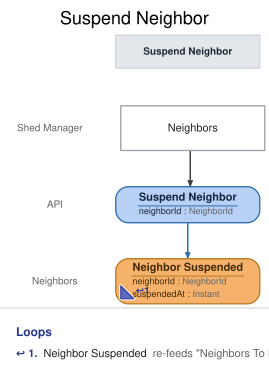

# Slice: Suspend Neighbor

<!-- GENERATED:em-slice-story:start — generated from the model by `em slice sync`; do not hand-edit -->
Step 4 of 9 in **Keep late returners in check** · after Neighbors — neighbor flagged · before Neighbors — neighbor suspended · State Change
<!-- GENERATED:em-slice-story:end -->

## Intent
Let the shed manager suspend any active neighbor, so someone who keeps returning tools late stops
borrowing until the shed manager reinstates them. Usually the neighbor has been flagged for late
returns. The system flags; the shed manager decides.

## Trigger & Actor
The shed manager issues Suspend Neighbor from the Neighbors screen, for any active neighbor,
flagged or not. The usual case is a neighbor the system has flagged for late returns, whose flags
and late returns the screen shows; it also covers a neighbor who closed their account while
suspended and signed up again with a different email.

The system never suspends anyone: reaching the late-return threshold only flags a neighbor.
(Version 1 drew this trigger from a separate Flagged Neighbors screen; v2 folds that screen into
Neighbors.)

## Command / Input
**Command:** `Suspend Neighbor`

A NeighborId is a UUID.

| Field | Type | Required | Rules / Validation |
|-------|------|----------|--------------------|
| neighborId | NeighborId | yes | The neighbor to suspend. Must be a registered account (INV-SUS-10) that isn't closed (INV-SUS-2). |

There is no reason or note field: nothing is recorded about why. The flag and its late returns
are usually the reason, and a suspension from the Neighbors screen needs none. The command carries
no "from" status: a late copy of an older request counts as a new request.

## Trigger
**Triggered by:** screen `Neighbors` @Shed Manager

## Event(s) Emitted
**Event:** `Neighbor Suspended` → context `Neighbors`
**Read by:** Neighbors (status suspended, the suspended date, the open flags cleared, Reinstate
offered), My Account (status suspended), and Neighbors To Flag (a suspended neighbor is never
flagged). Check Out Tool, Extend Loan, Place Hold, Change Email and Flag Neighbor
read it to refuse a suspended neighbor.

| Field | Type | Immutable Fact? | Source / Notes |
|-------|------|-----------------|----------------|
| neighborId | NeighborId | yes | From the command. |
| suspendedAt | Instant | yes | The UTC moment the event is recorded, set by the system. Shown as the suspended date: its calendar date in the shed's local time zone. |

The event never changes. A later Neighbor Reinstated lifts the suspension; a later suspension
records a new Neighbor Suspended.

## Read Model / View
This slice produces no view of its own. Neighbor Suspended feeds Neighbors, My Account and
Neighbors To Flag, each specified in its own doc and eventually consistent.

## Invariants / Business Rules
Suspension's effects are rules of the slices that refuse a suspended neighbor, each with its own
reason the neighbor can see: a suspended neighbor can't check out a tool, including one set aside
for them (INV-CHK-7, Check Out Tool), extend a loan (INV-EXT-7, Extend Loan), place a new hold
(INV-HOLD-9, Place Hold) or change their email (INV-CEM-3a, Change Email). They keep what they
already have: their loans stay out and they can return them (INV-RET-7, Return Tool), and their
holds keep their places and can be cancelled. A set-aside they can't collect expires at the end of
its collect-by date, as any other (Expire Hold). While suspended they are never flagged (Flag
Neighbor, INV-FLG-5). A suspension lasts until the shed manager reinstates the neighbor (Reinstate
Neighbor); it never lifts by itself and is never permanent. The neighbor isn't emailed: they see
the suspension on My Account and as the reason whenever something is refused. Neighbors and My
Account own how a suspension is shown.

- **INV-SUS-1:** Only the shed manager suspends a neighbor.
  - Sign-in, handled outside the model, supplies the shed-manager role; a caller without it is refused `not-shed-manager`.
- **INV-SUS-2:** Only an active neighbor can be suspended.
  - A neighbor whose account is closed can't be suspended, because closed is final.
  - Suspending a neighbor who is already suspended changes nothing (INV-SUS-9).
- **INV-SUS-9:** Suspending a neighbor who is already suspended succeeds and records nothing.
  - So a double submit, or a retry after a lost response, never records a second suspension.
- **INV-SUS-10:** The neighbor must be a registered account.
- **INV-SUS-11:** A request with no sign-in is refused before anything else is checked.

## Scenarios (Given / When / Then)
- **Happy path: suspending a flagged neighbor (INV-SUS-1, INV-SUS-2)**
  - **Given:** Ana (N1) is active and shown flagged on Neighbors after three late returns within
    90 days. She has the ladder on loan and a hold waiting on the cordless drill.
  - **When:** the shed manager suspends N1 from Neighbors
  - **Then:** Neighbor Suspended is recorded for N1, with the time it was recorded. Nothing else is
    recorded: her loan and her hold are untouched.
- **Suspending a neighbor who isn't flagged (INV-SUS-1, INV-SUS-2)**
  - **Given:** Ben (N2) is active and not flagged
  - **When:** the shed manager suspends N2 from the Neighbors screen
  - **Then:** Neighbor Suspended is recorded for N2.
- **Suspending again after reinstatement (INV-SUS-2)**
  - **Given:** N1 was suspended and later reinstated, so she is active
  - **When:** the shed manager suspends N1
  - **Then:** a new Neighbor Suspended is recorded for N1.
- **Already suspended (INV-SUS-9)**
  - **Given:** N1 is suspended
  - **When:** the shed manager suspends N1 again
  - **Then:** the request succeeds and nothing new is recorded.
- **A late copy after reinstatement (INV-SUS-2)**
  - **Given:** the shed manager suspended N1, and then reinstated her
  - **When:** a delayed copy of the earlier Suspend Neighbor request for N1 arrives
  - **Then:** it counts as a new request: Neighbor Suspended is recorded for N1 again.
- **Closed account (INV-SUS-2)**
  - **Given:** N3's account is closed
  - **When:** the shed manager tries to suspend N3
  - **Then:** refused with `account-closed`: "This account is closed." No event is recorded.
- **Closed while suspended (INV-SUS-2)**
  - **Given:** N4 was suspended and then closed their account
  - **When:** the shed manager tries to suspend N4
  - **Then:** refused with `account-closed`: "This account is closed." Its status is closed, not
    suspended, so this isn't treated as a repeat. No event is recorded.
- **Someone other than the shed manager (INV-SUS-1)**
  - **Given:** N1 is active
  - **When:** a caller signed in without the shed-manager role asks to suspend N1
  - **Then:** refused with `not-shed-manager`: "Only the shed manager can suspend neighbors." No
    event is recorded.
- **Unknown neighbor (INV-SUS-10)**
  - **Given:** no account has neighbor ID N9
  - **When:** the shed manager asks to suspend N9
  - **Then:** refused with `neighbor-not-found`: "There is no such neighbor." No event is
    recorded.
- **Not signed in (INV-SUS-11)**
  - **Given:** nobody is signed in
  - **When:** a request for suspending a neighbor arrives
  - **Then:** refused with `not-signed-in`: "Please sign in." No event is recorded.

## Alternate & Error Flows
Every refusal records nothing and returns one reason: the stable name, and the sentence shown to
the shed manager on the screen they acted from. The name is the contract; the sentence is the
required wording of the message.

The checks run in this order, and the first that fails is the reason returned:
1. `not-signed-in` (INV-SUS-11): a request with no sign-in is refused first.
2. `not-shed-manager` (INV-SUS-1): who is asking is settled next, before any other rule.
3. `neighbor-not-found` (INV-SUS-10).
4. If the neighbor's status is already suspended, the request succeeds and records nothing
   (INV-SUS-9). Status is tested with closed first: an account closed while suspended has status
   closed, so it gets `account-closed`, not the repeat.
5. `account-closed` (INV-SUS-2).

| Reason | Sentence | Rule |
|--------|----------|------|
| `not-signed-in` | Please sign in. | INV-SUS-11 |
| `not-shed-manager` | Only the shed manager can suspend neighbors. | INV-SUS-1 |
| `neighbor-not-found` | There is no such neighbor. | INV-SUS-10 |
| `account-closed` | This account is closed. | INV-SUS-2 |

`not-shed-manager`, `neighbor-not-found` and `account-closed` mean the same conditions as in Add
Tool, Register Neighbor and Check Out Tool. `neighbor-not-found` can only come from a faulty
caller, not from the screens, which offer Suspend only on listed neighbors. A missing or malformed
neighbor ID (not a UUID) is bad input, rejected before any rule is checked.

Idempotency: suspension is a state, and the command carries no "from" status. A request whose
effect has already happened (the neighbor is suspended) succeeds and records nothing. A late copy
of an older request that arrives after a reinstatement suspends again.

Requests at the same moment: Suspend Neighbor is decided against the neighbor's events as already
recorded, one at a time per neighbor. A reinstatement or closure landing at the same moment is
decided in the same order: whichever is recorded first stands.

There are no external calls, retries or compensations in this slice. Nothing is emailed.

## Non-Functional Requirements
- **Security / authz:** only the shed manager may suspend a neighbor (INV-SUS-1). Sign-in, handled outside the model, supplies the shed-manager role; a caller without it is refused `not-shed-manager`.
- **PII & compliance:** Neighbor Suspended links a neighbor to a suspension. It holds no name,
  email or reason.
- **Performance / SLA:** none.

## Dependencies & Read Models Affected
- **Upstream events this slice relies on**, to apply its rules, and the fields it reads from each:
  - Neighbor Registered (Register Neighbor): neighborId.
  - Neighbor Suspended (this slice): neighborId.
  - Neighbor Reinstated (Reinstate Neighbor): neighborId.
  - Neighbor Account Closed (Close Account): neighborId.
  - Neighbor Registered matches slices/register-neighbor.md. Reinstate Neighbor and Close Account
    are specified in slices not yet written in depth; each is checked against these keys when it
    is.
- **Downstream read models / slices affected:** Neighbors, My Account and Neighbors To Flag. Check Out Tool, Extend Loan, Place Hold, Change Email and Flag
  Neighbor refuse a suspended neighbor; Reinstate Neighbor lifts the suspension.

## Open Questions
None.
