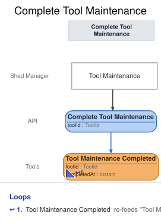

# Slice: Complete Tool Maintenance

<!-- GENERATED:em-slice-story:start — generated from the model by `em slice sync`; do not hand-edit -->
Step 4 of 5 in **Keep tools in working order** · after Tool Catalog — maintenance scheduled · before Tool Catalog — maintenance completed · State Change
<!-- GENERATED:em-slice-story:end -->

## Intent
Put a tool back in service once its maintenance is done. The shed manager looks at the Tool
Maintenance screen, finds the tool whose work (sharpening, cleaning, tuning, and so on) is
finished, and completes its maintenance. The tool leaves Tool Maintenance and returns to the Tool
Catalog, available to borrow and hold again.

Completing records that the maintenance as a whole is done. It does not tick off tasks one by
one: Tool Maintenance Scheduled carries the list of tasks, Tool Maintenance Tasks Changed carries
the replacement list when the shed manager edits it, and Tool Maintenance Completed carries none.
Completing closes every task together, whatever the list is at that moment.

What follows a completion is decided by the views that read Tool Maintenance Completed:
- The tool's row leaves Tool Maintenance.
- The tool is back on the Tool Catalog, available (Tool Catalog, as a continuation of its
  originating slice).

## Trigger & Actor
The shed manager, from the Tool Maintenance screen, which offers Complete on every tool listed in
it. Sign-in, handled outside the shed's events, supplies the shed-manager role (Amendment 6).

## Command / Input
<!-- GENERATED:em-slice-command:start — generated from the model by `em slice sync`; do not hand-edit -->
**Command:** `Complete Tool Maintenance`

| Field | Type | Required | Rules / Validation |
|-------|------|----------|--------------------|
| toolId | ToolId | yes | — |
<!-- GENERATED:em-slice-command:end -->

A missing or malformed tool ID (not a UUID) is bad input, rejected before any rule is checked
(Amendment 7). The command carries no tasks, no notes and no date: the time is set by the system.

## Trigger
**Triggered by:** screen `Tool Maintenance` @Shed Manager

## Event(s) Emitted
<!-- GENERATED:em-slice-event:start — generated from the model by `em slice sync`; do not hand-edit -->
**Event:** `Tool Maintenance Completed` → context `Tools`

| Field | Type | Immutable Fact? | Source / Notes |
|-------|------|-----------------|----------------|
| toolId | ToolId | yes | from command `Complete Tool Maintenance` |
| completedAt | Instant | yes | assigned (set by the handler) |
<!-- GENERATED:em-slice-event:end -->
**Read by:** Tool Maintenance (the tool's row is removed) and Tool Catalog (the tool is back and
available).

The event records neither who completed the maintenance nor which tasks were done. There is one
shed manager role, and the model's event carries only the tool and the time.

## Read Model / View
<!-- GENERATED:em-slice-view:start — generated from the model by `em slice sync`; do not hand-edit -->
_This slice has no read model in the model._
<!-- GENERATED:em-slice-view:end -->
This slice produces no view of its own. Tool Maintenance Completed removes the tool's row from
Tool Maintenance and puts the tool back on the Tool Catalog. Each view is specified in its own
doc (Tool Maintenance; Tool Catalog, whose "maintenance completed" position is a continuation
with no doc of its own). Both are eventually consistent.

## Invariants / Business Rules
<!-- GENERATED:em-slice-invariants:start — generated from the model by `em slice sync`; do not hand-edit -->
_No invariants declared in the model._
<!-- GENERATED:em-slice-invariants:end -->
- **INV-CTMN-1:** Only the shed manager can complete a tool's maintenance.
  - Neighbors do not. Sign-in, handled outside the shed's events, supplies the shed-manager role;
    a caller without it is refused with `not-shed-manager`.
  - A caller with no sign-in is refused with `not-signed-in`, before anything else is checked.
- **INV-CTMN-2:** Completing maintenance for a tool that is not in maintenance records nothing new.
  - The request succeeds, so a double submit or a retry never fails and never records a second
    Tool Maintenance Completed. This covers a tool whose maintenance was already completed and a
    tool that was never sent for maintenance.
  - A tool is in maintenance from its Tool Maintenance Scheduled until the next Tool
    Maintenance Completed for it (or until it is retired, INV-CTMN-4).
- **INV-CTMN-3:** The tool must exist.
- **INV-CTMN-4:** A retired tool's maintenance cannot be completed.
  - A tool is retired once Tool Retired or Tool Lost is recorded for it. Retiring a tool in
    maintenance ends the maintenance (Tool Maintenance drops the row on Tool Retired), so there is
    nothing left to complete, and a retired tool must not return to the catalog.
  - The request is refused with `tool-retired`, the same reason Schedule Tool Maintenance gives
    for a retired tool. This holds even if the tool was in maintenance when it was retired.
- **INV-CTMN-5:** Completing maintenance puts the tool back as it was before.
  - Only Tool Maintenance Completed is recorded. Nothing about the tool's loans or holds changes:
    a tool can only be scheduled while available with no holds, so none exist to be touched.
  - After completion the tool may be sent for maintenance again. The next Tool Maintenance
    Scheduled starts a new maintenance with its own tasks and time.

## Scenarios (Given / When / Then)
### Scenario: Happy path (INV-CTMN-5)
- **Given:**
  - the hedge trimmer was sent for maintenance to sharpen and clean it, and Tool Maintenance
    Scheduled is recorded for it
- **When:**
  - Complete Tool Maintenance: the shed manager completes the hedge trimmer's maintenance from Tool Maintenance
- **Then:**
  - Tool Maintenance Completed is recorded for the hedge trimmer, and nothing else.
  - Tool Maintenance no longer lists it, and Tool Catalog shows it available again.

### Scenario: Completed twice (INV-CTMN-2)
- **Given:**
  - Tool Maintenance Scheduled and then Tool Maintenance Completed are recorded for the hedge trimmer
- **When:**
  - Complete Tool Maintenance: the shed manager completes the hedge trimmer's maintenance again
- **Then:**
  - the request succeeds and nothing new is recorded.

### Scenario: Tool never sent for maintenance (INV-CTMN-2)
- **Given:**
  - the ladder is in the shed and no maintenance was ever scheduled for it
- **When:**
  - Complete Tool Maintenance: the shed manager completes the ladder's maintenance
- **Then:**
  - the request succeeds and nothing new is recorded.

### Scenario: Completed after the tasks were changed (INV-CTMN-5)
- **Given:**
  - the hedge trimmer was sent for maintenance to sharpen it, and Tool Maintenance Tasks Changed is
    recorded for it with the tasks "sharpen" and "replace the guard"
- **When:**
  - Complete Tool Maintenance: the shed manager completes the hedge trimmer's maintenance
- **Then:**
  - Tool Maintenance Completed is recorded for the hedge trimmer, and nothing else. It closes the
    tasks as last changed.

### Scenario: Sent for maintenance again after completing (INV-CTMN-5)
- **Given:**
  - the hedge trimmer's first maintenance was scheduled and completed
  - a second Tool Maintenance Scheduled is recorded for it with the task "oil the blade"
- **When:**
  - Complete Tool Maintenance: the shed manager completes the hedge trimmer's maintenance
- **Then:**
  - Tool Maintenance Completed is recorded for the hedge trimmer.

### Scenario: Tool retired while in maintenance (INV-CTMN-4)
- **Given:**
  - the hedge trimmer is in maintenance, and the shed manager then retires it (Tool Retired is recorded)
- **When:**
  - Complete Tool Maintenance: the shed manager completes the hedge trimmer's maintenance
- **Then:**
  - refused with `tool-retired`: "That tool has been retired." No event is recorded.

### Scenario: Tool recorded lost (INV-CTMN-4)
- **Given:**
  - Tool Lost is recorded for the cordless drill, which retired it
- **When:**
  - Complete Tool Maintenance: the shed manager completes the cordless drill's maintenance
- **Then:**
  - refused with `tool-retired`: "That tool has been retired." No event is recorded.

### Scenario: Unknown tool (INV-CTMN-3)
- **Given:**
  - no tool T9 has been added
- **When:**
  - Complete Tool Maintenance: the shed manager completes T9's maintenance
- **Then:**
  - refused with `tool-not-found`: "There is no such tool." No event is recorded.

### Scenario: Someone other than the shed manager (INV-CTMN-1)
- **Given:**
  - the hedge trimmer is in maintenance
- **When:**
  - Complete Tool Maintenance: a caller signed in without the shed-manager role asks to complete its maintenance
- **Then:**
  - refused with `not-shed-manager`: "Only the shed manager can complete tool maintenance." No
    event is recorded, and the tool stays in maintenance.

### Scenario: No sign-in (INV-CTMN-1)
- **Given:**
  - the hedge trimmer is in maintenance
- **When:**
  - Complete Tool Maintenance: a caller with no sign-in asks to complete its maintenance
- **Then:**
  - refused with `not-signed-in`: "Please sign in." No event is recorded.

## Alternate & Error Flows
Every refusal records nothing and returns one reason: the stable name, and the sentence shown to
the shed manager on the Tool Maintenance screen. The name is the contract; the sentence is the
required wording of the message.

The checks run in this order, and the first that fails is the reason returned:
1. `not-signed-in`, then `not-shed-manager` (INV-CTMN-1).
2. `tool-not-found` (INV-CTMN-3).
3. `tool-retired` (INV-CTMN-4).
4. If the tool is not in maintenance, the request succeeds and records nothing (INV-CTMN-2).

| Reason | Sentence | Rule |
|--------|----------|------|
| `not-signed-in` | Please sign in. | INV-CTMN-1 |
| `not-shed-manager` | Only the shed manager can complete tool maintenance. | INV-CTMN-1 |
| `tool-not-found` | There is no such tool. | INV-CTMN-3 |
| `tool-retired` | That tool has been retired. | INV-CTMN-4 |

`not-signed-in`, `not-shed-manager`, `tool-not-found` and `tool-retired` mean the same conditions
as in the other shed-manager slices (Retire Tool, Schedule Tool Maintenance). `tool-not-found`
can only come from a faulty caller, not from the screen.

Idempotency: completing maintenance for a tool that is not in maintenance succeeds and records
nothing (INV-CTMN-2).

Requests at the same moment: Complete Tool Maintenance is decided against the tool's events as
already recorded, one at a time per tool. If Schedule Tool Maintenance or Retire Tool for the same
tool is decided just before it, that stands and this command is decided against it; if just
after, that slice decides against the completion.

There are no external calls in this slice, and no email is sent.

## Non-Functional Requirements
- **Security / authz:** only the shed manager may complete a tool's maintenance (INV-CTMN-1).
  Sign-in, handled outside the shed's events, supplies the shed-manager role.
- **PII & compliance:** none. Tool Maintenance Completed holds only the tool and a time.
- **Performance / SLA:** none. Views are eventually consistent (constitution baseline).

## Dependencies & Read Models Affected
- **Upstream events this slice relies on**, to apply its rules, and the fields it reads from
  each:
  - Tool Added (Add Tool): toolId.
  - Tool Maintenance Scheduled (Schedule Tool Maintenance): toolId. It starts a maintenance.
  - Tool Maintenance Tasks Changed (Schedule Tool Maintenance): toolId. It leaves the tool in
    maintenance, so it neither starts nor ends one and changes nothing in this slice's decision.
  - Tool Maintenance Completed (this slice): toolId. It ends one.
  - Tool Retired (Retire Tool): toolId. It ends a maintenance and retires the tool.
  - Tool Lost (Record Tool Lost): toolId. A lost tool is retired by it.
- **Downstream read models / slices affected:** Tool Maintenance (removes the row) and Tool Catalog
  (the tool returns, available).
- **Rules held in other docs:** Check Out Tool and Place Hold must refuse a tool in maintenance,
  and Retire Tool must say that retiring a tool in maintenance ends it. Those are written in
  their own docs when they are revised; they are named here because they depend on this slice's
  event ending the maintenance. Tool Catalog's doc gains scenarios for the two maintenance events.

## Open Questions
None.
