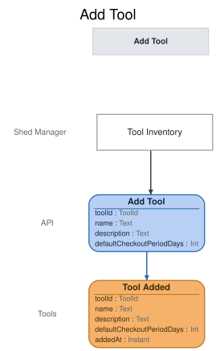

# Slice: Add Tool

## Intent
Put a tool into the shed so neighbors can borrow it. The shed manager records the tool's name,
an optional description, and its default checkout period. That period is the longest period a
checkout of the tool can start with. A tool can be borrowed as soon as it is added: the Tool
Catalog lists it as available (INV-TCAT-1), and Check Out Tool lends it.

## Trigger & Actor
The shed manager, from the Tool Inventory screen, when a new physical item joins the shed. Each
physical item is added on its own, including an item identical to one already in the shed.

## Command / Input
**Command:** `Add Tool`

| Field | Type | Required | Rules / Validation |
|-------|------|----------|--------------------|
| toolId | ToolId | yes | A UUID chosen by the caller for the new tool, so a retried request is recognised. Must not belong to a different tool already added (INV-ADD-10). |
| name | Text | yes | Leading and trailing whitespace (any Unicode whitespace) removed. Must not then be empty (INV-ADD-4), and at most 100 characters (INV-ADD-11). Need not be unique (INV-ADD-8). |
| description | Text | no | Optional. Leading and trailing whitespace removed. Empty after that means none. At most 500 characters (INV-ADD-11). |
| defaultCheckoutPeriodDays | Int | yes | Whole days, 1 to 30 inclusive (INV-ADD-3). A fractional value is refused, never rounded. |

## Trigger
**Triggered by:** screen `Tool Inventory` @Shed Manager

## Event(s) Emitted
**Event:** `Tool Added` → context `Tools`
**Read by:** Tool Inventory and Tool Catalog (their own slices, right after this one); and, for
the tool's name only, My Loans, My Holds, Overdue Loans To Notify, Undelivered Notices, Pickup
Notices To Send and Flagged Neighbors.

| Field | Type | Immutable Fact? | Source / Notes |
|-------|------|-----------------|----------------|
| toolId | ToolId | yes | From the command. Identifies the tool everywhere from here on. |
| name | Text | yes | From the command, trimmed. |
| description | Text | yes | Optional: absent when the command had none, or only whitespace. Otherwise from the command, trimmed. |
| defaultCheckoutPeriodDays | Int | yes | From the command: whole days, 1 to 30. |
| addedAt | Instant | yes | The UTC moment the event is recorded, set by the system. |

Every field is fixed for good. No command changes a tool's name, description or default period;
to correct a mistake, the shed manager retires the tool and adds it again.

## Read Model / View
This slice produces no view of its own. Tool Added starts the new tool's entry in two views,
each specified in its own doc:
- Tool Inventory (slices/tool-inventory.md) lists the new tool for the shed manager.
- Tool Catalog (slices/tool-catalog.md) lists it to neighbors as available to borrow.

Both are eventually consistent: the new tool appears once each view has caught up with Tool
Added.

## Invariants / Business Rules
- **INV-ADD-1:** Only the shed manager can add a tool.
  - Neighbors do not add tools. Sign-in, handled outside the shed's events, supplies the
    shed-manager role; a signed-in caller without it is refused with `not-shed-manager`, and a
    caller with no sign-in with `not-signed-in`.
- **INV-ADD-2:** Every tool is added with a default checkout period.
  - A checkout of this tool may start with a shorter period, never a longer one. An extension
    can later take a loan past it.
- **INV-ADD-3:** A tool's default checkout period is a whole number of days, from 1 to 30.
- **INV-ADD-4:** Every tool has a name. A description is optional.
  - A name that is empty, or only whitespace, is no name. A description that is empty, or only
    whitespace, is recorded as none.
- **INV-ADD-5:** Each physical item is added as its own tool.
  - Two identical drills are two tools, each added separately. There is no quantity on a tool.
- **INV-ADD-8:** Tool names need not be unique.
  - Two identical drills may both be named "Cordless drill". Each tool is told apart by its tool
    ID, not its name.
- **INV-ADD-9:** Each tool gets its own tool ID when it is added, and keeps it for good.
  - The tool ID is how every later event, view and command refers to the tool. Names are only
    for people to read.
- **INV-ADD-10:** Adding a tool with a tool ID that is already used adds nothing new.
  - A repeat with the same details, compared after trimming, succeeds and records nothing new,
    whatever has happened to the tool since. A repeat with different details is refused
    (`tool-id-in-use`).

- **INV-ADD-11:** A tool's name is at most 100 characters, and its description at most 500,
  counted as user-visible characters (not bytes) after trimming.
  - A longer one is refused, never cut short.

## Scenarios (Given / When / Then)
- **Happy path**
  - **Given:** the shed has no tools
  - **When:** the shed manager adds tool T1 named "Cordless drill", described as "18V, two
    batteries", with a default checkout period of 7 days, from the Tool Inventory screen
  - **Then:** Tool Added is recorded for T1 with that name, description and 7-day default
    checkout period, and the time it was added.
- **Tool added without a description (INV-ADD-4)**
  - **Given:** the shed has no tools
  - **When:** the shed manager adds a tool named "Ladder" with a default checkout period of 3
    days and no description
  - **Then:** Tool Added is recorded with that name, no description, and the 3-day period.
- **Blank description is no description (INV-ADD-4)**
  - **Given:** the shed has no tools
  - **When:** the shed manager adds a tool named "Ladder" with a 3-day period and a description
    of only whitespace
  - **Then:** Tool Added is recorded with no description.
- **Whitespace around the name is removed (INV-ADD-4)**
  - **Given:** the shed has no tools
  - **When:** the shed manager adds a tool named "  Ladder  " with a 3-day period
  - **Then:** Tool Added is recorded with the name "Ladder".
- **A second identical item (INV-ADD-5, INV-ADD-8, INV-ADD-9)**
  - **Given:** the shed holds tool T1 named "Cordless drill"
  - **When:** the shed manager adds a second, identical drill as tool T2, also named "Cordless
    drill"
  - **Then:** Tool Added is recorded for T2, a separate tool with its own tool ID. The shed now
    has two tools named "Cordless drill", T1 and T2.
- **Longest allowed name and description (INV-ADD-11)**
  - **Given:** the shed has no tools
  - **When:** the shed manager adds a tool with a name of exactly 100 characters and a
    description of exactly 500 characters, with a 7-day period
  - **Then:** Tool Added is recorded with that name and description.
- **Name too long (INV-ADD-11)**
  - **Given:** the shed has no tools
  - **When:** the shed manager tries to add a tool with a name of 101 characters
  - **Then:** refused with `name-too-long`: "A tool's name can be at most 100 characters." No event
    is recorded.
- **Description too long (INV-ADD-11)**
  - **Given:** the shed has no tools
  - **When:** the shed manager tries to add a tool with a description of 501 characters
  - **Then:** refused with `description-too-long`: "A tool's description can be at most 500
    characters." No event is recorded.
- **Shortest allowed period (INV-ADD-3)**
  - **Given:** the shed has no tools
  - **When:** the shed manager adds a tool named "Stud finder" with a default checkout period of
    1 day
  - **Then:** Tool Added is recorded with the 1-day period.
- **Longest allowed period (INV-ADD-3)**
  - **Given:** the shed has no tools
  - **When:** the shed manager adds a tool named "Tile saw" with a default checkout period of 30
    days
  - **Then:** Tool Added is recorded with the 30-day period.
- **Period over the maximum (INV-ADD-3)**
  - **Given:** the shed has no tools
  - **When:** the shed manager tries to add a tool named "Tile saw" with a default checkout period
    of 31 days
  - **Then:** refused with `period-out-of-range`: "The default checkout period must be a whole
    number of days from 1 to 30." No event is recorded.
- **Period of zero (INV-ADD-3)**
  - **Given:** the shed has no tools
  - **When:** the shed manager tries to add a tool with a default checkout period of 0 days
  - **Then:** refused with `period-out-of-range`: "The default checkout period must be a whole
    number of days from 1 to 30." No event is recorded.
- **Period that isn't a whole number of days (INV-ADD-3)**
  - **Given:** the shed has no tools
  - **When:** the shed manager tries to add a tool with a default checkout period of 2.5 days
  - **Then:** refused with `period-out-of-range`: "The default checkout period must be a whole
    number of days from 1 to 30." No event is recorded.
- **No default period (INV-ADD-2)**
  - **Given:** the shed has no tools
  - **When:** the shed manager tries to add a tool named "Ladder" with no default checkout period
  - **Then:** refused with `period-missing`: "A tool needs a default checkout period." No event
    is recorded.
- **No name (INV-ADD-4)**
  - **Given:** the shed has no tools
  - **When:** the shed manager tries to add a tool whose name is empty, or only whitespace
  - **Then:** refused with `name-missing`: "A tool needs a name." No event is recorded.
- **Someone other than the shed manager tries to add a tool (INV-ADD-1)**
  - **Given:** the caller is signed in without the shed-manager role
  - **When:** it asks to add a tool
  - **Then:** refused with `not-shed-manager`: "Only the shed manager can add tools." No event
    is recorded.
- **No sign-in (INV-ADD-1)**
  - **Given:** a caller with no sign-in
  - **When:** they ask to add a tool
  - **Then:** refused with `not-signed-in`: "Please sign in." No event is recorded.
- **The same request arrives twice (INV-ADD-10)**
  - **Given:** Tool Added was recorded for tool T1, "Cordless drill", 7 days
  - **When:** the same Add Tool request for T1, "Cordless drill", 7 days, arrives again
  - **Then:** the request succeeds and nothing new is recorded. The shed still has one tool T1.
- **The same request after the tool was retired (INV-ADD-10)**
  - **Given:** Tool Added was recorded for tool T1, "Cordless drill", 7 days, and T1 has since
    been retired
  - **When:** the same Add Tool request for T1 arrives again
  - **Then:** the request succeeds and nothing new is recorded. T1 stays retired.
- **A repeat that differs only in whitespace (INV-ADD-10)**
  - **Given:** Tool Added was recorded for tool T1, "Ladder", 3 days
  - **When:** an Add Tool request arrives for T1 named "  Ladder ", 3 days
  - **Then:** the request succeeds and nothing new is recorded.
- **A tool ID reused for different details (INV-ADD-10)**
  - **Given:** Tool Added was recorded for tool T1, "Cordless drill", 7 days
  - **When:** an Add Tool request arrives for T1 named "Ladder", 3 days
  - **Then:** refused with `tool-id-in-use`: "That tool ID is already used by another tool." No
    event is recorded.

## Alternate & Error Flows
Every refusal records nothing and returns one reason: the stable name, and the sentence shown to
the shed manager on the Tool Inventory screen. The name is the contract; the sentence is the
required wording of the message.

The checks run in this order, and the first that fails is the reason returned:
1. `not-signed-in`, then `not-shed-manager` (INV-ADD-1).
2. The tool ID is already used (INV-ADD-10): a repeat with the same details succeeds with
   nothing recorded; otherwise `tool-id-in-use`.
3. `name-missing`, then `name-too-long` (INV-ADD-4, INV-ADD-11).
4. `description-too-long` (INV-ADD-11).
5. `period-missing`, then `period-out-of-range` (INV-ADD-2, INV-ADD-3).

| Reason | Sentence | Rule |
|--------|----------|------|
| `not-signed-in` | Please sign in. | INV-ADD-1 |
| `not-shed-manager` | Only the shed manager can add tools. | INV-ADD-1 |
| `name-missing` | A tool needs a name. | INV-ADD-4 |
| `name-too-long` | A tool's name can be at most 100 characters. | INV-ADD-11 |
| `description-too-long` | A tool's description can be at most 500 characters. | INV-ADD-11 |
| `period-missing` | A tool needs a default checkout period. | INV-ADD-2 |
| `period-out-of-range` | The default checkout period must be a whole number of days from 1 to 30. | INV-ADD-3 |
| `tool-id-in-use` | That tool ID is already used by another tool. | INV-ADD-10 |

`tool-id-in-use` can only come from a faulty caller, not from the screen.

A missing or malformed tool ID (not a UUID) is bad input, rejected before any rule is checked.
It is not a refusal and has no reason name.

Idempotency: a repeated request with the same tool ID and the same details, compared after
trimming, succeeds and records nothing new, even if the tool has since been retired or lost. So
a retry after a lost response never adds a second tool. Because identical items are
legitimately added as separate tools (INV-ADD-5), a repeat is recognised by its tool ID only,
never by matching names or details.

There are no retries, compensations or external calls in this slice.

## Non-Functional Requirements
- **Security / authz:** only the shed manager may add a tool (INV-ADD-1). Sign-in, handled
  outside the shed's events, supplies the shed-manager role.
- **PII & compliance:** none. Tool Added holds only tool details, and doesn't record who added
  the tool.
- **Performance / SLA:** none.

## Dependencies & Read Models Affected
- **Upstream events this slice relies on:** none. Add Tool is the first slice on the timeline.
  Refusing a reused tool ID needs only the earlier Tool Added events.
- **Downstream read models / slices affected:** Tool Inventory and Tool Catalog (a new entry);
  My Loans, My Holds, Overdue Loans To Notify, Undelivered Notices, Pickup Notices To Send and
  Flagged Neighbors (the tool's name). Check Out Tool and Place Hold act on the tool by its tool
  ID, and Check Out Tool takes the tool's default checkout period from it.

## Open Questions
None.
