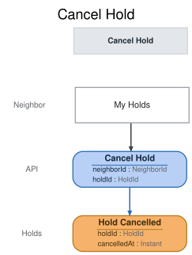

# Slice: Cancel Hold

## Intent
Let a neighbor give up a hold they no longer want, from My Holds, so the tool goes to the next
neighbor in the queue instead of waiting on them. A hold can be cancelled while it is waiting or
while the tool is set aside for the holder, and a suspended neighbor can cancel too.

What follows a cancellation is decided by the views and slices that read Hold Cancelled:
- Every hold behind the cancelled one on that tool moves up one place (My Holds, Holds To
  Fulfill).
- Cancelling a hold that is ready for pickup ends the set-aside. The tool passes to the next
  hold, or becomes available if none is waiting (Holds To Fulfill, Tool Catalog), the same as
  when a set-aside expires.
- A cancelled hold gives up its place for good. The neighbor may place a new hold on the same
  tool, which joins the back of the queue (Place Hold, INV-HOLD-7: only a live hold counts).

## Trigger & Actor
The holder, from the My Holds screen, on one of their own holds that hasn't ended. The shed
manager doesn't cancel holds. How the system recognises the holder is the open identity question
in Add Tool (slices/add-tool.md); this slice follows its answer.

## Command / Input
**Command:** `Cancel Hold`

A HoldId or NeighborId is a UUID.

| Field | Type | Required | Rules / Validation |
|-------|------|----------|--------------------|
| holdId | HoldId | yes | The hold to cancel. Must be a hold that has been placed (INV-CNH-7). |
| neighborId | NeighborId | yes | The neighbor cancelling, who must be the one making the request (`requester-mismatch`) and the hold's holder (`not-your-hold`) (INV-CNH-1). |

## Trigger
**Triggered by:** screen `My Holds` @Neighbor

## Event(s) Emitted
**Event:** `Hold Cancelled` → context `Holds`
**Read by:** My Holds and Tool Catalog (their continuations right after this slice), My Loans
(whether a hold is still waiting on a borrowed tool), Holds To Fulfill and Pickups To Expire (the
hold's queue and set-aside), Pickup Notices To Send (no pickup email for a cancelled set-aside),
and Undelivered Notices (a failed pickup email's entry drops off).

| Field | Type | Immutable Fact? | Source / Notes |
|-------|------|-----------------|----------------|
| holdId | HoldId | yes | From the command. The tool and holder are those on the hold's Hold Placed. |
| cancelledAt | Instant | yes | The UTC moment the event is recorded, set by the system. |

The event doesn't say whether the hold was waiting or set aside. Readers already know from Hold
Placed and Hold Fulfilled.

## Read Model / View
This slice produces no view of its own. Hold Cancelled ends the hold in My Holds, Tool Catalog,
My Loans and the hold to-do lists, each specified in its own doc. All are eventually consistent.

## Invariants / Business Rules
- **INV-CNH-1:** A neighbor can cancel only their own hold, and does it themselves.
  - The command names the acting neighbor in neighborId. The request must come from that
    neighbor (`requester-mismatch`), and the hold must be theirs (`not-your-hold`). The shed
    manager does not cancel holds. How the requester is recognised is the open identity
    question.
- **INV-CNH-2:** A hold can be cancelled while it is waiting or while the tool is set aside for
  the holder.
  - A suspended neighbor may cancel their own hold. Cancelling only gives up their own claim.
  - A set-aside whose collect-by date has passed, but whose Hold Expired hasn't been recorded
    yet, hasn't ended, so it can still be cancelled. Either way the tool passes on.
- **INV-CNH-3:** A hold that has ended in any way other than being cancelled can't be cancelled.
  - A hold ends when it is cancelled or expires, the holder checks the tool out, the tool is
    retired or recorded lost, or the holder closes their account.
  - A hold the holder has already cancelled is covered by INV-CNH-8.
- **INV-CNH-7:** The hold must exist.
- **INV-CNH-8:** Cancelling a hold that is already cancelled succeeds and records nothing new.
  - So a double submit, or a retry after a lost response, never fails and never records a second
    Hold Cancelled.

## Scenarios (Given / When / Then)
Unless a scenario says otherwise: Ben and Cara are active neighbors, and Ben's hold H1 on the
cordless drill was placed before Cara's hold H2.

- **Cancel a waiting hold (INV-CNH-2)**
  - **Given:** the drill is checked out by Ana, and H1 and H2 are waiting
  - **When:** Ben cancels H1 from My Holds
  - **Then:** Hold Cancelled is recorded for H1.
- **Cancel a hold that is ready for pickup (INV-CNH-2)**
  - **Given:** the drill is set aside for Ben under H1, with a collect-by date of 17 October, and
    H2 is waiting
  - **When:** Ben cancels H1 on 15 October
  - **Then:** Hold Cancelled is recorded for H1.
- **Cancel a lapsed set-aside before its expiry is recorded (INV-CNH-2)**
  - **Given:** the drill was set aside for Ben under H1, to collect by 17 October. It is 18
    October and Hold Expired hasn't been recorded for H1.
  - **When:** Ben cancels H1
  - **Then:** Hold Cancelled is recorded for H1, and no Hold Expired follows for it.
- **Suspended neighbor cancels a hold (INV-CNH-2)**
  - **Given:** Ben is suspended, and H1 is waiting
  - **When:** Ben cancels H1
  - **Then:** Hold Cancelled is recorded for H1.
- **The same request arrives twice (INV-CNH-8)**
  - **Given:** Hold Cancelled has been recorded for H1
  - **When:** the same request to cancel H1 arrives again
  - **Then:** the request succeeds and nothing new is recorded.
- **A request that doesn't come from the neighbor it names (INV-CNH-1)**
  - **Given:** H1 is Ben's waiting hold
  - **When:** a request to cancel H1, naming Ben, comes from someone other than Ben
  - **Then:** refused with `requester-mismatch`: "You can only cancel holds for yourself." No
    event is recorded.
- **Someone else's hold (INV-CNH-1)**
  - **Given:** H1 is Ben's waiting hold
  - **When:** Cara, naming herself, tries to cancel H1
  - **Then:** refused with `not-your-hold`: "You can only cancel your own holds." No event is
    recorded.
- **Unknown hold (INV-CNH-7)**
  - **Given:** no hold H9 has been placed
  - **When:** a request to cancel H9 arrives
  - **Then:** refused with `hold-not-found`: "There is no such hold." No event is recorded.
- **Hold already expired (INV-CNH-3)**
  - **Given:** Hold Expired has been recorded for H1
  - **When:** Ben tries to cancel H1
  - **Then:** refused with `hold-ended`: "This hold has already ended." No event is recorded.
- **Hold ended by the holder's checkout (INV-CNH-3)**
  - **Given:** Ben checked out the drill as H1's holder, which ended H1
  - **When:** Ben tries to cancel H1
  - **Then:** refused with `hold-ended`. No event is recorded.
- **Hold ended by retirement (INV-CNH-3)**
  - **Given:** the drill was retired while H1 was waiting
  - **When:** Ben tries to cancel H1
  - **Then:** refused with `hold-ended`. No event is recorded.
- **Hold ended because the tool was recorded lost (INV-CNH-3)**
  - **Given:** Tool Lost was recorded for Ana's loan of the drill while H1 was waiting
  - **When:** Ben tries to cancel H1
  - **Then:** refused with `hold-ended`. No event is recorded.
- **Hold ended by closing the account (INV-CNH-3)**
  - **Given:** Ben closed his account while H1 was waiting
  - **When:** a request to cancel H1 for Ben arrives
  - **Then:** refused with `hold-ended`. No event is recorded.

## Alternate & Error Flows
Every refusal records nothing and returns one reason: the stable name, and the sentence shown to
the neighbor on the My Holds screen. The name is the contract; the sentence is the required
wording of the message.

The checks run in this order, and the first that fails is the reason returned:
1. `requester-mismatch` (INV-CNH-1).
2. `hold-not-found` (INV-CNH-7).
3. `not-your-hold` (INV-CNH-1).
4. If Hold Cancelled is already recorded for the hold, the request succeeds and records nothing
   (INV-CNH-8).
5. `hold-ended` (INV-CNH-3).

| Reason | Sentence | Rule |
|--------|----------|------|
| `requester-mismatch` | You can only cancel holds for yourself. | INV-CNH-1 |
| `hold-not-found` | There is no such hold. | INV-CNH-7 |
| `not-your-hold` | You can only cancel your own holds. | INV-CNH-1 |
| `hold-ended` | This hold has already ended. | INV-CNH-3 |

`hold-not-found` can only come from a faulty caller, not from the screen. A missing or malformed
ID (not a UUID) is bad input, rejected before any rule is checked. It is not a refusal and has no
reason name. `hold-not-found` is worded the same wherever a hold is looked up.

Idempotency: cancelling is safe to repeat (INV-CNH-8). A repeat records nothing, whatever has
happened since.

Requests at the same moment: each cancellation is decided against the hold's events as already
recorded, one at a time per hold. If the holder cancels just as the hold ends another way (the
fulfiller sets the tool aside, the expirer expires it, or the tool is retired), whichever is
recorded first stands. A cancel decided after an expiry, retirement or closure is refused with
`hold-ended`. A cancel decided after Hold Fulfilled cancels the set-aside.

There are no external calls, retries or compensations in this slice. Cancelling sends no email.

## Non-Functional Requirements
- **Security / authz:** only the holder may cancel their own hold (INV-CNH-1). How the requester
  is recognised is the open identity question in Add Tool.
- **PII & compliance:** Hold Cancelled holds only the hold's ID and a time. No name or email.
- **Performance / SLA:** none beyond the one-at-a-time rule above.

## Dependencies & Read Models Affected
- **Upstream events this slice relies on**, to apply its rules, and the fields it reads from
  each:
  - Hold Placed (Place Hold): holdId, toolId, neighborId.
  - Hold Cancelled (this slice): holdId.
  - Hold Expired (Expire Hold): holdId.
  - Tool Checked Out (Check Out Tool): toolId, neighborId (the holder's own checkout ends their
    hold on that tool).
  - Tool Retired (Retire Tool): toolId.
  - Tool Lost (Record Tool Lost): loanId, matched to the tool through Tool Checked Out.loanId.
  - Neighbor Account Closed (Close Account): neighborId.
  - These keys match slices/place-hold.md, check-out-tool.md and tool-catalog.md. Hold Cancelled
    adds cancelledAt; readers that need only {holdId} are unaffected.
- **Downstream read models / slices affected:** My Holds, Tool Catalog, My Loans, Holds To
  Fulfill, Pickups To Expire, Pickup Notices To Send and Undelivered Notices. Place Hold accepts a
  new hold from the same neighbor on the same tool once this one is cancelled.

## Open Questions
- [ ] How a person is recognised (the identity question) — brief 10 A1. The requester checks here follow its answer.
