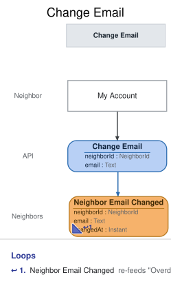

# Slice: Change Email

## Intent
Let a neighbor change the email address the shed uses for them, from My Account, so a wrong or
outdated address can be put right and overdue and pickup emails reach them. The new address
takes effect at once, and the old one is free for anyone to use.

## Trigger & Actor
A neighbor, from their own My Account screen, for their own account. My Account offers Change
Email on any account that isn't closed (INV-MYAC-9); a suspended neighbor is offered it and
refused with a reason they can see. The shed manager doesn't change neighbors' emails.

## Command / Input
**Command:** `Change Email`

A NeighborId is a UUID. Text has leading and trailing whitespace (any Unicode whitespace)
removed; text that is empty after that counts as absent.

| Field | Type | Required | Rules / Validation |
|-------|------|----------|--------------------|
| neighborId | NeighborId | yes | The account whose email changes, which must be the neighbor making the request (INV-CEM-1) and a registered account (INV-CEM-10). |
| email | Text | yes | The new email. Trimmed; must not then be empty (INV-CEM-11), at most 254 characters, and shaped like an email address (INV-CEM-12). Must not be held by another account under INV-CEM-2, compared ignoring case. Kept as typed. |

There is no name field: only the email can be changed. A neighbor's name stays as they
registered it.

## Trigger
**Triggered by:** screen `My Account` @Neighbor

## Event(s) Emitted
**Event:** `Neighbor Email Changed` → context `Neighbors`
**Read by:** My Account and Neighbors (the email shown); Overdue Loans To Notify and Pickup
Notices To Send (the address the next email goes to); Undelivered Notices, Flagged Neighbors and
Suspended Neighbors (the email shown to the shed manager).

| Field | Type | Immutable Fact? | Source / Notes |
|-------|------|-----------------|----------------|
| neighborId | NeighborId | yes | From the command. |
| email | Text | yes | From the command, trimmed. The account's current email from now on. |
| changedAt | Instant | yes | The UTC moment the event is recorded, set by the system. |

The event never changes. A later change records a new Neighbor Email Changed. An account's current
email is the email of its latest Neighbor Email Changed, or of its Neighbor Registered if it has
never changed it.

## Read Model / View
This slice produces no view of its own. Neighbor Email Changed updates the email in My Account,
Neighbors, Overdue Loans To Notify, Pickup Notices To Send, Undelivered Notices, Flagged Neighbors
and Suspended Neighbors, each specified in its own doc. All are eventually consistent: the new
email shows once each has caught up. Every overdue or pickup email the shed sends from then on,
including one for a loan or set-aside already waiting to be emailed, goes to the new address.

## Invariants / Business Rules
Changing the email resends nothing. A notice already sent, or already recorded as undelivered, is
not tried again at the new address: no further attempt is made after a failure (Record Overdue
Notice Failure, INV-ONF-6).

- **INV-CEM-1:** A neighbor changes their own email themselves, from My Account.
  - The request must come from the neighbor whose account it names. Sign-in, handled outside the model, supplies the acting neighbor's ID; a request whose neighbor ID isn't the signed-in neighbor's is refused `requester-mismatch`. The shed manager doesn't change neighbors' emails.
- **INV-CEM-2:** The new email is refused if it belongs to an account that is not closed, or to a
  closed account that was suspended when it was closed.
  - This is the same one-account-per-email rule as at sign-up (INV-REG-4, Register Neighbor). An
    account's email is always its current one.
  - Emails are compared ignoring case. The account's own current email never counts as held by
    another account.
  - Whether a closed account was suspended when it was closed is read from its Neighbor Account
    Closed (whileSuspended), never worked out from earlier suspensions and reinstatements.
- **INV-CEM-3:** A neighbor whose account is closed can't change their email.
  - After closing, My Account is read-only.
- **INV-CEM-3a:** A suspended neighbor can't change their email. The change is refused with a
  reason they can see, and they can change it once reinstated.
  - Otherwise a suspended neighbor could change to a new address, close their account, and sign
    up again with their original address.
- **INV-CEM-4:** Once changed, the account's email is the new one.
  - Every later check of INV-CEM-2 and INV-REG-4 treats the new email as held by this account.
- **INV-CEM-5:** The old email is released.
  - No account holds it any more, so it can be used to sign up or by another neighbor's change.
- **INV-CEM-7:** The new email takes effect at once, with no verification.
  - Neighbor Email Changed is recorded straight from the request; nothing is sent to the new
    address first.
- **INV-CEM-9:** Asking to change the email to the one the account already has succeeds and
  records nothing.
  - The comparison is made after trimming, exactly as typed. So a repeated request, after a lost
    response, never records a second change. A request that differs from the current email only
    in capital letters is a change, and is recorded: it is how a neighbor corrects the
    capitalisation of their address.
  - The command carries no "from" email. A late copy of an older request, arriving after a later
    change, counts as a new request and changes the email again.
- **INV-CEM-10:** The neighbor must be a registered account.
- **INV-CEM-11:** A new email is required.
  - An email that is empty, or only whitespace, is missing.
- **INV-CEM-12:** A new email is at most 254 user-visible characters, counted after trimming,
  and must be shaped like an email address: an "@" with at least one character before it and at
  least one after it.
  - A longer one is refused, never cut short. These are the same limits as at sign-up
    (INV-REG-10, INV-REG-11, Register Neighbor).
- **INV-CEM-13:** A request with no sign-in is refused before anything else is checked.

## Scenarios (Given / When / Then)
- **Happy path (INV-CEM-1, INV-CEM-4, INV-CEM-7)**
  - **Given:** Ana's account N1 is active with ana@oldmail.example, and no other account uses
    ana@example.org
  - **When:** Ana changes her email to ana@example.org from My Account
  - **Then:** Neighbor Email Changed is recorded for N1, with ana@example.org and the time it was
    recorded. Nothing is sent to the new address first.
- **Whitespace is removed (INV-CEM-11)**
  - **Given:** N1 is active with ana@oldmail.example
  - **When:** Ana changes her email to " ana@example.org "
  - **Then:** Neighbor Email Changed is recorded with ana@example.org.
- **Same email as now (INV-CEM-9)**
  - **Given:** N1's current email is ana@example.org
  - **When:** Ana asks to change her email to ana@example.org
  - **Then:** the request succeeds and nothing is recorded.
- **The same request arrives twice (INV-CEM-9)**
  - **Given:** Neighbor Email Changed was recorded for N1, to ana@example.org
  - **When:** the same Change Email request for N1, ana@example.org, arrives again
  - **Then:** the request succeeds and nothing new is recorded.
- **No email (INV-CEM-11)**
  - **Given:** N1 is active
  - **When:** Ana asks to change her email to an empty value, or only whitespace
  - **Then:** refused with `email-missing`: "Please enter your email address." No event is
    recorded.
- **Email used by an active account (INV-CEM-2)**
  - **Given:** Ben's active account N2 uses ben@example.org
  - **When:** Ana asks to change her email to ben@example.org
  - **Then:** refused with `email-in-use`: "That email address can't be used."
    No event is recorded.
- **Email used by a suspended account (INV-CEM-2)**
  - **Given:** Cleo's account N3 uses cleo@example.org and is suspended
  - **When:** Ana asks to change her email to cleo@example.org
  - **Then:** refused with `email-in-use`: "That email address can't be used."
    No event is recorded.
- **Email of an account closed while suspended (INV-CEM-2)**
  - **Given:** Dan's account N4, using dan@example.org, was closed while suspended
  - **When:** Ana asks to change her email to dan@example.org
  - **Then:** refused with `email-in-use`: "That email address can't be used."
    No event is recorded.
- **Email of an account closed while active (INV-CEM-2)**
  - **Given:** Eve's account N5, using eve@example.org, was closed while active
  - **When:** Ana changes her email to eve@example.org
  - **Then:** Neighbor Email Changed is recorded for N1, with eve@example.org.
- **Email held in different capitals (INV-CEM-2)**
  - **Given:** Ben's active account N2 uses ben@example.org
  - **When:** Ana asks to change her email to Ben@Example.ORG
  - **Then:** refused with `email-in-use`: "That email address can't be used." No event is
    recorded.
- **Correcting capital letters (INV-CEM-2, INV-CEM-9)**
  - **Given:** N1's current email is ana@example.org
  - **When:** Ana changes her email to Ana@Example.org
  - **Then:** Neighbor Email Changed is recorded for N1, with Ana@Example.org. Her own account
    doesn't count as holding the address.
- **Email not shaped like an address (INV-CEM-12)**
  - **Given:** N1 is active
  - **When:** Ana asks to change her email to ana.example.org
  - **Then:** refused with `email-invalid`: "Please enter a valid email address." No event is
    recorded.
- **Email too long (INV-CEM-12)**
  - **Given:** N1 is active
  - **When:** Ana asks to change her email to an address of 255 characters
  - **Then:** refused with `email-too-long`: "Your email address can be at most 254 characters." No
    event is recorded.
- **Old email released (INV-CEM-5)**
  - **Given:** Ana changed N1's email from ana@oldmail.example to ana@example.org
  - **When:** Ben asks to change N2's email to ana@oldmail.example
  - **Then:** Neighbor Email Changed is recorded for N2, with ana@oldmail.example.
- **The new email is held from then on (INV-CEM-4)**
  - **Given:** Ana changed N1's email to ana@example.org
  - **When:** Ben asks to change N2's email to ana@example.org
  - **Then:** refused with `email-in-use`: "That email address can't be used."
    No event is recorded.
- **Suspended neighbor (INV-CEM-3a)**
  - **Given:** N1 is suspended, with ana@oldmail.example
  - **When:** Ana asks to change her email to ana@example.org
  - **Then:** refused with `neighbor-suspended`: "You can't change your email while your account
    is suspended." No event is recorded.
- **Changing the email after reinstatement (INV-CEM-3a)**
  - **Given:** N1 was suspended and has since been reinstated, and no other account uses
    ana.ruiz@example.org
  - **When:** Ana changes her email to ana.ruiz@example.org from My Account
  - **Then:** Neighbor Email Changed is recorded for N1, with ana.ruiz@example.org.
- **Closed account (INV-CEM-3)**
  - **Given:** N1 is closed, with ana@oldmail.example
  - **When:** a change of N1's email to ana@example.org is requested
  - **Then:** refused with `account-closed`: "This account is closed." No event is recorded.
- **A request for someone else's account (INV-CEM-1)**
  - **Given:** N1 and N2 are both active
  - **When:** a request from Ben asks to change N1's email
  - **Then:** refused with `requester-mismatch`: "You can only change your own email." No event
    is recorded.
- **Unknown neighbor (INV-CEM-10)**
  - **Given:** no account has neighbor ID N9
  - **When:** a change of N9's email is requested
  - **Then:** refused with `neighbor-not-found`: "There is no such neighbor." No event is
    recorded.
- **Not signed in (INV-CEM-13)**
  - **Given:** nobody is signed in
  - **When:** a request for changing an email arrives
  - **Then:** refused with `not-signed-in`: "Please sign in." No event is recorded.

## Alternate & Error Flows
Every refusal records nothing and returns one reason: the stable name, and the sentence shown to
the neighbor on My Account. The name is the contract; the sentence is the required wording of the
message.

The checks run in this order, and the first that fails is the reason returned:
1. `not-signed-in` (INV-CEM-13): a request with no sign-in is refused first.
2. `requester-mismatch` (INV-CEM-1): who is asking is settled next, before any other rule.
3. `neighbor-not-found` (INV-CEM-10).
4. `email-missing`, then `email-too-long`, then `email-invalid` (INV-CEM-11, INV-CEM-12).
5. The new email is the account's current one (INV-CEM-9): succeeds with nothing recorded.
6. `account-closed` (INV-CEM-3).
7. `neighbor-suspended` (INV-CEM-3a).
8. `email-in-use` (INV-CEM-2).

| Reason | Sentence | Rule |
|--------|----------|------|
| `not-signed-in` | Please sign in. | INV-CEM-13 |
| `requester-mismatch` | You can only change your own email. | INV-CEM-1 |
| `neighbor-not-found` | There is no such neighbor. | INV-CEM-10 |
| `email-missing` | Please enter your email address. | INV-CEM-11 |
| `account-closed` | This account is closed. | INV-CEM-3 |
| `neighbor-suspended` | You can't change your email while your account is suspended. | INV-CEM-3a |
| `email-too-long` | Your email address can be at most 254 characters. | INV-CEM-12 |
| `email-invalid` | Please enter a valid email address. | INV-CEM-12 |
| `email-in-use` | That email address can't be used. | INV-CEM-2 |

`neighbor-not-found` can only come from a faulty caller, not from the screen. A missing or
malformed neighbor ID (not a UUID) is bad input, rejected before any rule is checked. It is not a
refusal and has no reason name. `email-missing`, `email-too-long`,
`email-invalid`, `email-in-use`, `account-closed` and `neighbor-not-found` mean the same
conditions as in Register Neighbor and Check Out Tool. `email-in-use` is one reason for every
case of INV-CEM-2, worded to be true in each, so a refusal never reveals another account's
status; its sentence fits a change rather than a sign-up.

Idempotency: there is no request ID. A request whose effect has already happened, because the
account's current email is already the one asked for, succeeds and records nothing (INV-CEM-9).

Requests at the same moment: the email check and the recording of Neighbor Email Changed happen
as one step, shared with Register Neighbor, so no two accounts are ever given the same email. Of
two requests for the same email at once, from a sign-up or a change, at most one is recorded; the
other is refused with `email-in-use`.

There are no retries, compensations or external calls in this slice. Nothing is emailed when the
email changes.

## Non-Functional Requirements
- **Security / authz:** a neighbor may change only their own email (INV-CEM-1); the shed manager
  doesn't change neighbors' emails. Sign-in, handled outside the model, supplies the acting neighbor's ID; a request whose neighbor ID isn't the signed-in neighbor's is refused `requester-mismatch`.
- **PII & compliance:** Neighbor Email Changed holds the neighbor's new email address. The old
  address stays in the earlier events as the shed's record. Names and emails are kept with the
  shed's history and never erased.
- **Performance / SLA:** none beyond the one-at-a-time email check above.

## Dependencies & Read Models Affected
- **Upstream events this slice relies on**, to apply its rules, and the fields it reads from each:
  - Neighbor Registered (Register Neighbor): neighborId, email.
  - Neighbor Email Changed (this slice): neighborId, email.
  - Neighbor Suspended (Suspend Neighbor): neighborId. Used for INV-CEM-3a (this neighbor's own
    suspension).
  - Neighbor Reinstated (Reinstate Neighbor): neighborId. Used for INV-CEM-3a.
  - Neighbor Account Closed (Close Account): neighborId, whileSuspended.
  - These match slices/register-neighbor.md, slices/suspend-neighbor.md and
    slices/reinstate-neighbor.md. Close Account is specified in a slice being written in depth;
    it is checked against these keys when it is.
- **Downstream read models / slices affected:** My Account, Neighbors, Overdue Loans To Notify,
  Pickup Notices To Send, Undelivered Notices, Flagged Neighbors and Suspended Neighbors (the
  email). Register Neighbor and later Change Email requests check the new email as held.

## Open Questions
None.
