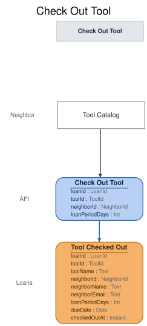

# Slice: Check Out Tool

## Intent
Let a neighbor borrow a tool, self-service, from the Tool Catalog. The checkout opens a loan with
a due date set from the tool's default checkout period, or from a shorter period the neighbor
chooses. It is also how a holder collects a tool set aside for them: there is no separate pickup.

## Trigger & Actor
The neighbor who will borrow the tool, from the Tool Catalog screen, on a tool the catalog offers
Check Out on (available, reserved or set aside). The shed manager does not record checkouts.
Sign-in, handled outside the shed's events, supplies the acting neighbor's ID.

## Command / Input
**Command:** `Check Out Tool`

A LoanId, ToolId or NeighborId is a UUID. One clock reading is taken when the command is handled.
"Today" is that moment's calendar date in the shed's local time zone, and the event's
checkedOutAt is that same moment.

| Field | Type | Required | Rules / Validation |
|-------|------|----------|--------------------|
| loanId | LoanId | yes | A UUID chosen by the caller for the new loan, so a retried request is recognised. Must not belong to a different loan already recorded (INV-CHK-12). |
| toolId | ToolId | yes | The tool to borrow. Must be a tool that has been added (INV-CHK-11). |
| neighborId | NeighborId | yes | The neighbor borrowing it, who must be the one making the request (INV-CHK-1). Must be a registered account (INV-CHK-11). |
| loanPeriodDays | Int | no | Optional. Whole days, from 1 up to the tool's default checkout period (INV-CHK-6). When absent, the default applies. A fractional value is refused, never rounded. |

## Trigger
**Triggered by:** screen `Tool Catalog` @Neighbor

## Event(s) Emitted
**Event:** `Tool Checked Out` → context `Loans`
**Read by:** Tool Inventory, Tool Catalog and My Loans; My Holds, Holds To Fulfill, Pickups To
Expire and Pickup Notices To Send (a holder's checkout ends their hold); Overdue Loans To Notify
and Neighbors To Flag (the loan's due date); Undelivered Notices (loan details shown there).

| Field | Type | Immutable Fact? | Source / Notes |
|-------|------|-----------------|----------------|
| loanId | LoanId | yes | From the command. Identifies the loan everywhere from here on. |
| toolId | ToolId | yes | From the command. |
| toolName | Text | yes | Set by the system: the tool's name as recorded by Tool Added, copied so the loan's readers never look it up. |
| neighborId | NeighborId | yes | From the command: the borrower. |
| loanPeriodDays | Int | yes | The period the loan started with: loanPeriodDays from the command, or the tool's default checkout period when it was absent. |
| dueDate | Date | yes | Set by the system: the checkout date (today) plus loanPeriodDays. A later Loan Extended sets a new dueDate; this one never changes. |
| checkedOutAt | Instant | yes | Set by the system: the UTC moment of the clock reading above. Its date in the shed's local time zone is the checkout date. |

The event doesn't name the hold it ends. A holder has at most one hold on a tool, so readers
match the ended hold by toolId and neighborId (INV-CHK-9).

## Read Model / View
This slice produces no view of its own. Tool Checked Out changes the tool's entry in Tool
Inventory and Tool Catalog, starts the loan's entry in My Loans, and ends the borrower's hold on
the tool in My Holds and the hold to-do lists. Each view is specified in its own doc. All are
eventually consistent.

## Invariants / Business Rules
- **INV-CHK-1:** A neighbor checks a tool out themselves, for themselves.
  - The command names the acting neighbor in neighborId, and the request must come from that
    neighbor (`requester-mismatch` otherwise). The shed manager does not
    record checkouts. Sign-in, handled outside the shed's events, supplies the acting
    neighbor's ID, resolving a person to their newest account.
  - A caller with no sign-in is refused with `not-signed-in`, before anything else is checked.
- **INV-CHK-2:** A tool that is already checked out can't be checked out again until it is
  returned or recorded lost.
  - A loan is open from Tool Checked Out until Tool Returned or Tool Lost for that loan.
- **INV-CHK-3:** A tool set aside for a holder can be checked out only by that holder, until the
  end of the collect-by date.
  - A tool is set aside from Hold Fulfilled for a hold until that hold ends. The collect-by date
    is Hold Fulfilled.collectByDate, recorded on the event; this slice reads it and never works
    it out.
  - The holder's pickup is an ordinary checkout. There is no separate pickup event.
- **INV-CHK-3a:** A tool that is back in the shed with holds waiting, and not set aside, can be
  checked out only by the neighbor whose hold is at the front of the queue.
  - This holds after a return before Hold Fulfilled is recorded, and after a set-aside ends
    before the next hold is fulfilled.
  - The front of the queue is the hold on the tool, still waiting, whose Hold Placed was
    recorded first. Queue order is the order the Hold Placed events were recorded, never a
    comparison of times.
- **INV-CHK-3b:** A holder's claim on a set-aside tool ends at the start of the day after the
  collect-by date, shed local time, whether or not Hold Expired has been recorded yet.
  - From that moment the set-aside is treated as ended. If a hold is waiting, only the neighbor
    at the front of the queue can check the tool out (INV-CHK-3a), and the former holder is
    refused. If none is waiting, anyone can, the former holder included.
- **INV-CHK-4:** A retired tool can't be checked out.
  - A tool recorded lost is retired by that, so it can't be checked out either.
- **INV-CHK-5:** A neighbor with an overdue loan can't check out a tool.
  - A loan is overdue from the start of the day after its due date, in the shed's local time,
    while it is still open. The due date is the latest one set by Tool Checked Out or Loan
    Extended. Nothing records it; it is worked out from the due date and today.
  - Any open loan counts, including one whose tool has since been retired. A loan that ended
    because the tool was recorded lost no longer counts.
  - This also stops a holder collecting a tool set aside for them.
- **INV-CHK-6:** The due date is set at checkout: the checkout date plus the loan period.
  - The loan period is the tool's default checkout period, unless the neighbor chooses a shorter
    one. It is never longer than the default.
  - A shorter period is chosen as a whole number of days, at least 1.
- **INV-CHK-7:** A suspended neighbor can't check out a tool, and neither can a neighbor whose
  account is closed.
  - An account is suspended from Neighbor Suspended until Neighbor Reinstated, and closed for
    good from Neighbor Account Closed.
  - This also stops a suspended holder collecting a tool set aside for them. Their hold keeps its
    place, and the set-aside still lapses at the end of its collect-by date.
- **INV-CHK-8:** There is no limit on how many tools one neighbor can have checked out at once.
- **INV-CHK-9:** When a holder checks out the tool they hold, their hold ends, whether or not
  it had been fulfilled.
  - The tool is then on loan, so it is not set aside for anyone, and the next hold waits for its
    return. When the tool comes back, the former holder is no longer in the queue.
  - The views that show holds end it by matching the checkout's toolId and neighborId; a holder
    has at most one hold on a tool.
- **INV-CHK-11:** The tool must have been added, and the borrower must be a registered account.
- **INV-CHK-12:** Checking out with a loan ID that is already used opens no new loan.
  - A repeat with the same tool, borrower and loan period succeeds and records nothing new,
    whatever has happened to the loan since. A repeat with different details is refused.
  - The loan period compared is the one the loan started with: a request that leaves the period
    out is the same as one that sends the tool's default explicitly.

Check Out is offered on a reserved or set-aside tool to every neighbor, not only to the holder
whose turn it is (Tool Catalog, INV-TCAT-11). This slice refuses anyone else with the reason
(INV-CHK-3, INV-CHK-3a).

## Scenarios (Given / When / Then)
Unless a scenario says otherwise: the cordless drill (tool D) has a 7-day default checkout
period, Ana, Ben and Cara are registered, active neighbors with no overdue loans, and today is 5
October.

- **Happy path (INV-CHK-6)**
  - **Given:** the drill is available
  - **When:** Ana checks out the drill from the Tool Catalog as loan L1, keeping the default
    period
  - **Then:** Tool Checked Out is recorded for L1: the drill, Ana, a 7-day period, due 12
    October, checked out today.
- **Shorter period chosen (INV-CHK-6)**
  - **Given:** the drill is available
  - **When:** Ana checks out the drill and chooses a 3-day period
  - **Then:** Tool Checked Out is recorded with a 3-day period, due 8 October.
- **Shortest period (INV-CHK-6)**
  - **Given:** the drill is available
  - **When:** Ana checks out the drill and chooses a 1-day period
  - **Then:** Tool Checked Out is recorded with a 1-day period, due 6 October.
- **Period equal to the default (INV-CHK-6)**
  - **Given:** the drill is available
  - **When:** Ana checks out the drill and chooses a 7-day period
  - **Then:** Tool Checked Out is recorded with a 7-day period, due 12 October.
- **Period longer than the default (INV-CHK-6)**
  - **Given:** the drill is available
  - **When:** Ana tries to check out the drill with an 8-day period
  - **Then:** refused with `period-out-of-range`: "The loan period must be a whole number of
    days from 1 up to this tool's default checkout period." No event is recorded.
- **Period of zero, or not whole (INV-CHK-6)**
  - **Given:** the drill is available
  - **When:** Ana tries to check out the drill with a 0-day period, or a 2.5-day period
  - **Then:** refused with `period-out-of-range`: "The loan period must be a whole number of
    days from 1 up to this tool's default checkout period." No event is recorded.
- **Tool already checked out (INV-CHK-2)**
  - **Given:** Ben has the drill on loan
  - **When:** Ana tries to check out the drill
  - **Then:** refused with `tool-checked-out`: "This tool is already checked out." No event is
    recorded.
- **Retired tool (INV-CHK-4)**
  - **Given:** the drill has been retired
  - **When:** Ana tries to check out the drill
  - **Then:** refused with `tool-retired`: "This tool has been retired." No event is recorded.
- **Unknown tool (INV-CHK-11)**
  - **Given:** no tool T9 has been added
  - **When:** Ana tries to check out T9
  - **Then:** refused with `tool-not-found`: "There is no such tool." No event is recorded.
- **Unknown neighbor (INV-CHK-11)**
  - **Given:** no account N9 has been registered
  - **When:** a request to check out the drill for N9 arrives
  - **Then:** refused with `neighbor-not-found`: "There is no such neighbor." No event is
    recorded.
- **Suspended neighbor (INV-CHK-7)**
  - **Given:** Ana is suspended, and the drill is available
  - **When:** Ana tries to check out the drill
  - **Then:** refused with `neighbor-suspended`: "You can't borrow tools while your account is
    suspended." No event is recorded.
- **Closed account (INV-CHK-7)**
  - **Given:** Ana's account is closed
  - **When:** a request to check out the drill for Ana arrives
  - **Then:** refused with `account-closed`: "This account is closed." No event is recorded.
- **Reinstated neighbor can borrow again (INV-CHK-7)**
  - **Given:** Ana was suspended and has been reinstated, and the drill is available
  - **When:** Ana checks out the drill
  - **Then:** Tool Checked Out is recorded for the drill and Ana.
- **Overdue loan blocks a checkout (INV-CHK-5)**
  - **Given:** Ana has the ladder on loan, due 4 October, and the drill is available
  - **When:** Ana tries to check out the drill on 5 October
  - **Then:** refused with `has-overdue-loan`: "You have an overdue loan. Return it before borrowing
    another tool." No event is recorded.
- **A loan due today is not overdue (INV-CHK-5)**
  - **Given:** Ana has the ladder on loan, due 5 October, and the drill is available
  - **When:** Ana checks out the drill on 5 October
  - **Then:** Tool Checked Out is recorded for the drill and Ana.
- **An extended loan is not overdue (INV-CHK-5)**
  - **Given:** Ana's ladder loan was due 4 October, and Loan Extended moved it to 11 October
  - **When:** Ana checks out the drill on 5 October
  - **Then:** Tool Checked Out is recorded for the drill and Ana.
- **A loan ended by loss no longer blocks (INV-CHK-5)**
  - **Given:** Ana's ladder loan was due 1 October, and Tool Lost has been recorded for it
  - **When:** Ana checks out the drill on 5 October
  - **Then:** Tool Checked Out is recorded for the drill and Ana.
- **Several loans at once (INV-CHK-8)**
  - **Given:** Ana has the ladder and the hedge trimmer on loan, neither overdue, and the drill
    is available
  - **When:** Ana checks out the drill
  - **Then:** Tool Checked Out is recorded. Ana now has three tools on loan.
- **Holder collects a set-aside tool (INV-CHK-3, INV-CHK-9)**
  - **Given:** Hold Fulfilled was recorded for Ben's hold on the drill with a collect-by date of
    6 October, so the drill is set aside for him
  - **When:** Ben checks out the drill on 5 October
  - **Then:** Tool Checked Out is recorded for the drill and Ben, due 12 October. Ben's hold
    ends with it.
- **Holder collects on the collect-by date (INV-CHK-3)**
  - **Given:** the drill is set aside for Ben, to collect by 5 October
  - **When:** Ben checks out the drill on 5 October
  - **Then:** Tool Checked Out is recorded for the drill and Ben.
- **Someone else tries to take a set-aside tool (INV-CHK-3)**
  - **Given:** the drill is set aside for Ben, to collect by 6 October
  - **When:** Ana tries to check out the drill on 5 October
  - **Then:** refused with `set-aside-for-another`: "This tool is set aside for another
    neighbor." No event is recorded.
- **Overdue holder can't collect (INV-CHK-5)**
  - **Given:** the drill is set aside for Ben, and Ben has the ladder on loan, due 2 October
  - **When:** Ben tries to check out the drill on 5 October
  - **Then:** refused with `has-overdue-loan`. The drill stays set aside for Ben until his
    collect-by date ends.
- **Suspended holder can't collect (INV-CHK-7)**
  - **Given:** the drill is set aside for Ben, and Ben is suspended
  - **When:** Ben tries to check out the drill
  - **Then:** refused with `neighbor-suspended`. His hold keeps its place.
- **Front holder collects before the set-aside is recorded (INV-CHK-3a, INV-CHK-9)**
  - **Given:** the drill has just been returned, Ben's hold is at the front of its queue and
    Cara's is behind it, and Hold Fulfilled has not yet been recorded
  - **When:** Ben checks out the drill
  - **Then:** Tool Checked Out is recorded for the drill and Ben. Ben's hold ends without ever
    being fulfilled.
- **An early collector is out of the queue when the tool returns (INV-CHK-9, INV-CHK-3a)**
  - **Given:** Ben checked out the drill as the front holder before his hold was fulfilled, with
    Cara's hold behind his. He has since returned it, and Cara's hold is still waiting.
  - **When:** Ben tries to check out the drill again
  - **Then:** refused with `reserved-for-another`: "This tool is reserved for the next neighbor
    in the hold queue." No event is recorded. Cara is now at the front.
- **Someone who isn't next tries to take a reserved tool (INV-CHK-3a)**
  - **Given:** the drill has just been returned, with Ben's hold at the front and Cara's behind
    it, and Hold Fulfilled has not yet been recorded
  - **When:** Cara tries to check out the drill, and then Ana does
  - **Then:** both are refused with `reserved-for-another`: "This tool is reserved for the next
    neighbor in the hold queue." No event is recorded.
- **Holder too late, another hold waiting (INV-CHK-3b)**
  - **Given:** the drill was set aside for Ben on 14 October, to collect by 17 October, and
    Cara's hold is waiting. Hold Expired has not yet been recorded.
  - **When:** Ben tries to check out the drill on 18 October
  - **Then:** refused with `pickup-window-ended`: "Your pickup window has ended, and this tool
    has passed to the next neighbor in the queue." No event is recorded. Cara can check the drill
    out.
- **Someone else tries a lapsed set-aside while a hold waits (INV-CHK-3a, INV-CHK-3b)**
  - **Given:** as above, on 18 October, before Hold Expired is recorded
  - **When:** Ana, who has no hold on the drill, tries to check it out
  - **Then:** refused with `reserved-for-another`. No event is recorded.
- **Next holder takes a lapsed set-aside before the expiry is recorded (INV-CHK-3a, INV-CHK-3b)**
  - **Given:** as above, on 18 October, before Hold Expired is recorded
  - **When:** Cara checks out the drill
  - **Then:** Tool Checked Out is recorded for the drill and Cara, and her hold ends. Ben's hold
    still gets its Hold Expired.
- **Lapsed set-aside, no hold waiting, taken by someone else (INV-CHK-3b)**
  - **Given:** the drill was set aside for Ben, to collect by 17 October, no other hold is
    waiting, and Hold Expired has not yet been recorded
  - **When:** Ana checks out the drill on 18 October
  - **Then:** Tool Checked Out is recorded for the drill and Ana. Ben's hold still gets its Hold
    Expired.
- **Lapsed set-aside, no hold waiting, taken by the former holder (INV-CHK-3b, INV-CHK-9)**
  - **Given:** as above
  - **When:** Ben checks out the drill on 18 October
  - **Then:** Tool Checked Out is recorded for the drill and Ben. His own checkout ends his hold,
    so no Hold Expired follows for it.
- **The same request arrives twice (INV-CHK-12)**
  - **Given:** Tool Checked Out was recorded for loan L1: the drill, Ana, default period
  - **When:** the same Check Out Tool request for L1 arrives again
  - **Then:** the request succeeds and nothing new is recorded. Ana still has one loan of the
    drill.
- **A loan ID reused for different details (INV-CHK-12)**
  - **Given:** Tool Checked Out was recorded for loan L1: the drill, Ana
  - **When:** a Check Out Tool request for L1 arrives naming the ladder
  - **Then:** refused with `loan-id-in-use`: "That loan ID is already used by another loan." No
    event is recorded.
- **Someone checks out a tool for another neighbor (INV-CHK-1)**
  - **Given:** the drill is available
  - **When:** a request to check out the drill for Ana comes from someone other than Ana
  - **Then:** refused with `requester-mismatch`: "You can only check out tools for yourself." No
    event is recorded.
- **No sign-in (INV-CHK-1)**
  - **Given:** a caller with no sign-in
  - **When:** they ask to check out the drill
  - **Then:** refused with `not-signed-in`: "Please sign in." No event is recorded.

## Alternate & Error Flows
Every refusal records nothing and returns one reason: the stable name, and the sentence shown to
the neighbor on the Tool Catalog screen. The name is the contract; the sentence is the required
wording of the message.

The checks run in this order, and the first that fails is the reason returned:
1. `not-signed-in`, then `requester-mismatch` (INV-CHK-1).
2. The loan ID is already used (INV-CHK-12): a repeat with the same details succeeds with nothing
   recorded; otherwise `loan-id-in-use`.
3. `tool-not-found`, then `neighbor-not-found` (INV-CHK-11).
4. `tool-retired` (INV-CHK-4).
5. `tool-checked-out` (INV-CHK-2).
6. `account-closed`, then `neighbor-suspended` (INV-CHK-7).
7. `has-overdue-loan` (INV-CHK-5).
8. The tool's holds (INV-CHK-3, INV-CHK-3a, INV-CHK-3b):
   - `set-aside-for-another`: the tool is set aside and its collect-by date hasn't ended, and the
     requester isn't the holder.
   - `pickup-window-ended`: the set-aside's collect-by date has ended, another hold is waiting,
     and the requester is the former holder.
   - `reserved-for-another`: the tool is back with a hold waiting (or a lapsed set-aside with one
     waiting), and the requester isn't the neighbor at the front of the queue. This includes a
     third neighbor after a set-aside lapses.
9. `period-out-of-range` (INV-CHK-6).

| Reason | Sentence | Rule |
|--------|----------|------|
| `loan-id-in-use` | That loan ID is already used by another loan. | INV-CHK-12 |
| `not-signed-in` | Please sign in. | INV-CHK-1 |
| `requester-mismatch` | You can only check out tools for yourself. | INV-CHK-1 |
| `tool-not-found` | There is no such tool. | INV-CHK-11 |
| `neighbor-not-found` | There is no such neighbor. | INV-CHK-11 |
| `tool-retired` | This tool has been retired. | INV-CHK-4 |
| `tool-checked-out` | This tool is already checked out. | INV-CHK-2 |
| `account-closed` | This account is closed. | INV-CHK-7 |
| `neighbor-suspended` | You can't borrow tools while your account is suspended. | INV-CHK-7 |
| `has-overdue-loan` | You have an overdue loan. Return it before borrowing another tool. | INV-CHK-5 |
| `set-aside-for-another` | This tool is set aside for another neighbor. | INV-CHK-3 |
| `pickup-window-ended` | Your pickup window has ended, and this tool has passed to the next neighbor in the queue. | INV-CHK-3b |
| `reserved-for-another` | This tool is reserved for the next neighbor in the hold queue. | INV-CHK-3a |
| `period-out-of-range` | The loan period must be a whole number of days from 1 up to this tool's default checkout period. | INV-CHK-6 |

`loan-id-in-use`, `tool-not-found` and `neighbor-not-found` can only come from a faulty caller,
not from the screen. A missing or malformed ID (not a UUID) is bad input, rejected before any
rule is checked. It is not a refusal and has no reason name.

Idempotency: a repeated request with the same loan ID and the same tool, borrower and requested
period succeeds and records nothing new, even if the loan has since been extended, returned or
lost. So a retry after a lost response never opens a second loan.

Two neighbors checking out the same tool at the same moment: only one Tool Checked Out is
recorded for the tool. The other request is refused with `tool-checked-out`, because each
checkout is decided against the tool's loans as already recorded, one at a time.

There are no external calls, retries or compensations in this slice.

## Non-Functional Requirements
- **Security / authz:** a neighbor may check out a tool only for themselves (INV-CHK-1); the
  shed manager doesn't check tools out. Sign-in, handled outside the shed's events,
  supplies the acting neighbor's ID; `requester-mismatch` means it isn't the neighborId in the
  request.
- **PII & compliance:** Tool Checked Out links a neighbor to a tool and a due date. It holds no
  name or email; those stay on Neighbor Registered and Neighbor Email Changed.
- **Performance / SLA:** none beyond the one-at-a-time rule above.

## Dependencies & Read Models Affected
- **Upstream events this slice relies on**, to apply its rules, and the fields it reads from
  each:
  - Tool Added (Add Tool): toolId, defaultCheckoutPeriodDays.
  - Tool Retired (Retire Tool): toolId.
  - Tool Lost (Record Tool Lost): loanId.
  - Tool Checked Out (this slice): loanId, toolId, neighborId, loanPeriodDays, dueDate.
  - Loan Extended (Extend Loan): loanId, dueDate.
  - Tool Returned (Return Tool): loanId.
  - Neighbor Registered (Register Neighbor): neighborId.
  - Neighbor Suspended (Suspend Neighbor), Neighbor Reinstated (Reinstate Neighbor), Neighbor
    Account Closed (Close Account): neighborId.
  - Hold Placed (Place Hold): holdId, toolId, neighborId. Queue order is the order these events
    were recorded.
  - Hold Fulfilled (Fulfill Hold): holdId, collectByDate.
  - Hold Cancelled (Cancel Hold), Hold Expired (Expire Hold): holdId.
  - These keys match slices/add-tool.md, tool-inventory.md, tool-catalog.md and
    register-neighbor.md. Hold Fulfilled.collectByDate is the Date the fulfiller records (set by
    the system, as dueDate is on loans). Those slices aren't yet written in depth, and each is
    checked against these keys when it is.
- **Downstream read models / slices affected:** Tool Inventory, Tool Catalog, My Loans, My Holds,
  Overdue Loans To Notify, Undelivered Notices, Holds To Fulfill, Pickup Notices To Send, Pickups
  To Expire and Neighbors To Flag. Extend Loan, Return Tool and Record Tool
  Lost act on the loan by its loan ID.

## Open Questions
- [x] Flagged Neighbors and Suspended Neighbors were folded into the Neighbors view (model reshape 2026-11-01, merged-from on slices/neighbors.md v2): reword this doc's mentions of them to Neighbors — v2: reworded; Check Out Tool no longer feeds the merged Neighbors view, Return Tool does (2026-11-01)
