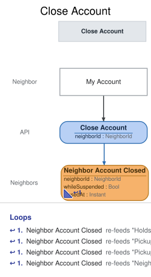

# Slice: Close Account

## Intent
Let a neighbor who is moving away or no longer wants to take part close their own account, from
My Account. Closing is the neighbor's own choice, and it is final: nothing reopens, suspends or
reinstates a closed account. A neighbor who wants to come back signs up again as a new account.

What follows a closure is decided by the views and slices that read Neighbor Account Closed:
- All of the neighbor's holds end. Holds waiting behind theirs move up, and a tool set aside for
  them passes to the next hold, or becomes available if none is waiting, as when a set-aside
  expires (My Holds, Holds To Fulfill, Tool Catalog).
- The neighbor can still view My Account, read-only, and can't borrow, extend or place holds
  (My Account, Check Out Tool, Extend Loan, Place Hold).
- A closed account is never flagged, and drops off Flagged Neighbors and Suspended Neighbors.
  The Neighbors screen shows it as closed (Neighbors To Flag, Flagged Neighbors, Suspended
  Neighbors, Neighbors).
- If the account was suspended when it was closed, its email can't be used to sign up again
  (Register Neighbor, INV-REG-4). Otherwise it can.

## Trigger & Actor
The neighbor, from the My Account screen, on their own active or suspended account. My Account
offers Close Account on any account that isn't closed. While the neighbor has a tool on loan,
the closing is refused with a reason they can see (INV-CLS-7). The shed manager doesn't close
accounts. Sign-in, handled outside the shed's events, supplies the acting neighbor's ID. It
resolves a person to their newest account, and to a closed one only when there is no newer.

## Command / Input
**Command:** `Close Account`

A NeighborId is a UUID.

| Field | Type | Required | Rules / Validation |
|-------|------|----------|--------------------|
| neighborId | NeighborId | yes | The account to close: the acting neighbor's own, who must be the one making the request (INV-CLS-1). Must be a registered account (INV-CLS-8). |

## Trigger
**Triggered by:** screen `My Account` @Neighbor

## Event(s) Emitted
**Event:** `Neighbor Account Closed` → context `Neighbors`
**Read by:** My Account, Neighbors, Flagged Neighbors, Suspended Neighbors, My Holds, Tool
Catalog, My Loans and Undelivered Notices (their continuations after this slice); and Holds To
Fulfill, Pickups To Expire, Pickup Notices To Send and Neighbors To Flag (the neighbor's holds
and late-return count end).

| Field | Type | Immutable Fact? | Source / Notes |
|-------|------|-----------------|----------------|
| neighborId | NeighborId | yes | From the command. |
| whileSuspended | Bool | yes | Set by the system: yes if the account was suspended when it was closed (Neighbor Suspended with no Neighbor Reinstated since). Register Neighbor reads it to keep that email from being used again (INV-CLS-9). |
| closedAt | Instant | yes | Set by the system: the UTC moment the event is recorded. |

## Read Model / View
This slice produces no view of its own. Neighbor Account Closed changes the account's entry in
My Account and Neighbors, removes it from Flagged Neighbors and Suspended Neighbors, and ends the
neighbor's holds in My Holds, Tool Catalog, My Loans and the hold to-do lists. Each view is
specified in its own doc. All are eventually consistent.

## Invariants / Business Rules
- **INV-CLS-1:** A neighbor closes their own account themselves.
  - The command names the account in neighborId, and the request must come from that neighbor
    (`requester-mismatch` otherwise). The shed manager doesn't close accounts.
  - A caller with no sign-in is refused with `not-signed-in`, before anything else is checked.
- **INV-CLS-2:** An active or a suspended account can be closed.
  - Closing an account that is already closed succeeds and records nothing new, so a double
    submit or a retry never fails and never records a second Neighbor Account Closed.
- **INV-CLS-7:** An account can't be closed while the neighbor has any tool on loan, overdue or
  not.
  - A loan is on loan from Tool Checked Out until Tool Returned or Tool Lost for it. A loan ended
    by the shed manager recording the tool lost no longer counts.
  - So a closed account never has a tool out.
- **INV-CLS-8:** The account must exist.
- **INV-CLS-9:** Neighbor Account Closed records whether the account was suspended when it was
  closed.
  - Suspended means Neighbor Suspended has been recorded and no Neighbor Reinstated since.

## Scenarios (Given / When / Then)
Unless a scenario says otherwise: Ana is registered as N1, is active, and has no tools on loan.

- **Happy path (INV-CLS-2, INV-CLS-9)**
  - **Given:** Ana has a hold waiting on the cordless drill, at position 1
  - **When:** Ana closes her account from My Account
  - **Then:** Neighbor Account Closed is recorded for N1, with whileSuspended no.
- **Suspended neighbor closes their account (INV-CLS-2, INV-CLS-9)**
  - **Given:** Ana is suspended
  - **When:** Ana closes her account
  - **Then:** Neighbor Account Closed is recorded for N1, with whileSuspended yes.
- **Reinstated neighbor closes their account (INV-CLS-9)**
  - **Given:** Ana was suspended and has since been reinstated
  - **When:** Ana closes her account
  - **Then:** Neighbor Account Closed is recorded for N1, with whileSuspended no.
- **Closing while a tool is set aside (INV-CLS-2)**
  - **Given:** the drill is set aside for Ana, and Cara's hold is waiting
  - **When:** Ana closes her account
  - **Then:** Neighbor Account Closed is recorded for N1. A set-aside is not a loan, so it doesn't
    stop the closing.
- **Closing with a tool still on loan (INV-CLS-7)**
  - **Given:** Ana has the ladder on loan, not overdue
  - **When:** Ana tries to close her account
  - **Then:** refused with `tools-on-loan`: "Return all your tools before closing your account."
    No event is recorded.
- **Closing with an overdue tool (INV-CLS-7)**
  - **Given:** Ana has the ladder on loan, and it is overdue
  - **When:** Ana tries to close her account
  - **Then:** refused with `tools-on-loan`. No event is recorded.
- **Closing after a tool was recorded lost (INV-CLS-7)**
  - **Given:** Ana's only loan, of the hedge trimmer, ended when the shed manager recorded it lost
  - **When:** Ana closes her account
  - **Then:** Neighbor Account Closed is recorded for N1.
- **Closing after returning everything (INV-CLS-7)**
  - **Given:** Ana had the ladder on loan and has since returned it
  - **When:** Ana closes her account
  - **Then:** Neighbor Account Closed is recorded for N1.
- **Closing twice (INV-CLS-2)**
  - **Given:** Neighbor Account Closed has been recorded for N1
  - **When:** Ana closes her account again
  - **Then:** the request succeeds and nothing new is recorded.
- **Someone else's account (INV-CLS-1)**
  - **Given:** N1 is Ana's account
  - **When:** a request to close N1 comes from someone other than Ana
  - **Then:** refused with `requester-mismatch`: "You can only close your own account." No event
    is recorded.
- **Unknown account (INV-CLS-8)**
  - **Given:** no account N9 has been registered
  - **When:** a request to close N9 arrives
  - **Then:** refused with `neighbor-not-found`: "There is no such neighbor." No event is
    recorded.
- **No sign-in (INV-CLS-1)**
  - **Given:** a caller with no sign-in
  - **When:** they ask to close an account
  - **Then:** refused with `not-signed-in`: "Please sign in." No event is recorded.

## Alternate & Error Flows
Every refusal records nothing and returns one reason: the stable name, and the sentence shown to
the neighbor on the My Account screen. The name is the contract; the sentence is the required
wording of the message.

The checks run in this order, and the first that fails is the reason returned:
1. `not-signed-in`, then `requester-mismatch` (INV-CLS-1).
2. `neighbor-not-found` (INV-CLS-8).
3. If the account is already closed, the request succeeds and records nothing (INV-CLS-2).
4. `tools-on-loan` (INV-CLS-7).

| Reason | Sentence | Rule |
|--------|----------|------|
| `not-signed-in` | Please sign in. | INV-CLS-1 |
| `requester-mismatch` | You can only close your own account. | INV-CLS-1 |
| `neighbor-not-found` | There is no such neighbor. | INV-CLS-8 |
| `tools-on-loan` | Return all your tools before closing your account. | INV-CLS-7 |

`requester-mismatch` and `neighbor-not-found` mean the same conditions as in the other neighbor
commands. `neighbor-not-found` can only come from a faulty caller, not from the screen. A
missing or malformed ID (not a UUID) is bad input, rejected before any rule is checked.

Idempotency: closing an account that is already closed succeeds and records nothing (INV-CLS-2).

Requests at the same moment: Close Account is decided against the neighbor's loans and status as
already recorded, one at a time per neighbor. If a checkout for the neighbor is decided just
before the closing, the closing is refused with `tools-on-loan`. If a suspension or
reinstatement is decided just before, whileSuspended reflects it.

There are no external calls in this slice, and no email is sent.

## Non-Functional Requirements
- **Security / authz:** only the neighbor may close their own account (INV-CLS-1). Sign-in,
  handled outside the shed's events, supplies the acting neighbor's ID.
- **PII & compliance:** Neighbor Account Closed holds only the account ID, whether it was
  suspended, and a time. Closing doesn't erase the neighbor's name or email: they are kept
  with the shed's loan and hold history and never erased.
- **Performance / SLA:** none.

## Dependencies & Read Models Affected
- **Upstream events this slice relies on**, to apply its rules, and the fields it reads from
  each:
  - Neighbor Registered (Register Neighbor): neighborId.
  - Neighbor Suspended (Suspend Neighbor), Neighbor Reinstated (Reinstate Neighbor): neighborId.
  - Neighbor Account Closed (this slice): neighborId.
  - Tool Checked Out (Check Out Tool): loanId, neighborId.
  - Tool Returned (Return Tool), Tool Lost (Record Tool Lost): loanId.
  - These keys match the deep-passed docs. whileSuspended is new on Neighbor Account Closed;
    readers that need only {neighborId} are unaffected, and Register Neighbor can read it
    instead of working out the status itself.
- **Downstream read models / slices affected:** My Account, Neighbors, Flagged Neighbors,
  Suspended Neighbors, My Holds, Tool Catalog, My Loans, Undelivered Notices, Holds To Fulfill,
  Pickups To Expire, Pickup Notices To Send and Neighbors To Flag. Register Neighbor reads
  whileSuspended for INV-REG-4. Check Out Tool, Extend Loan, Place Hold, Suspend Neighbor,
  Reinstate Neighbor and Change Email refuse a closed account.

## Open Questions
None.
- [x] Flagged Neighbors and Suspended Neighbors were folded into the Neighbors view (model reshape 2026-11-01, merged-from on slices/neighbors.md v2): reword this doc's mentions of them to Neighbors — v1: v1 keeps the old view names in prose; the views named no longer exist in the model; deferred to v2 (2026-11-01, Mike Key)
