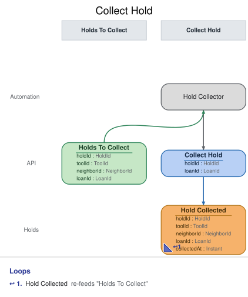

# Slice: Collect Hold

## Intent
When a holder checks out the tool they hold, record that their hold was collected, so the hold
ends as a Holds fact and the views about holds hear it from their own context. Checking out
records only Tool Checked Out; Hold Collected is recorded separately, by this slice. The system
does this itself; no person collects a hold.

What follows a collection is decided by the slices that read Hold Collected: the hold leaves My
Holds, Holds To Fulfill's queue, Pickup Notices To Send and Pickups To Expire, and a failed pickup
email for it leaves Undelivered Notices.

## Trigger & Actor
- **Pattern:** automation. The Hold Collector, a system processor, watches the Holds To Collect
  list (slices/holds-to-collect.md). Only the Hold Collector issues Collect Hold; it is not
  exposed to neighbors or the shed manager.
- **Triggering condition:** a hold is on the list: its holder has an open loan on its tool.
- **When it acts:** the list changes only when a checkout lands, so the collector acts whenever
  the list changes, on each item that appears.
- **What it does:** it issues `Collect Hold` for the item's hold and loan. If the command is
  refused or is a repeat, nothing is recorded and the processor moves on.

## Command / Input
**Command:** `Collect Hold`

HoldId and LoanId are UUIDs.

| Field | Type | Required | Rules / Validation |
|-------|------|----------|--------------------|
| holdId | HoldId | yes | The hold collected. Must be a hold that has been placed (INV-COL-5) and is still live (INV-COL-2). |
| loanId | LoanId | yes | The loan that collected it, from the list item: the holder's open loan on the hold's tool (INV-COL-3). |

## Trigger
**Triggered by:** processor `Hold Collector`, also in this slice, reading `Holds To Collect`.

## Event(s) Emitted
**Event:** `Hold Collected` → context `Holds`
**Read by:** Holds To Collect (the hold leaves the list), My Holds (the hold drops off), Holds To
Fulfill (the hold leaves the queue), Pickup Notices To Send and Pickups To Expire (the set-aside
ends), Undelivered Notices (a pickup-notice entry drops off).

| Field | Type | Immutable Fact? | Source / Notes |
|-------|------|-----------------|----------------|
| holdId | HoldId | yes | From the command. |
| toolId | ToolId | yes | Set by the system: the tool on the hold's Hold Placed. |
| neighborId | NeighborId | yes | Set by the system: the holder on the hold's Hold Placed. |
| loanId | LoanId | yes | From the command: the loan that collected the hold. |
| collectedAt | Instant | yes | Set by the system: the UTC moment the event is recorded. |

## Read Model / View
This slice produces no view of its own. Hold Collected takes the hold off Holds To Collect, My
Holds, Holds To Fulfill, Pickup Notices To Send, Pickups To Expire and Undelivered Notices, each
specified in its own doc and eventually consistent.

## Invariants / Business Rules
- **INV-COL-1:** Only the Hold Collector collects holds, and only from Holds To Collect.
- **INV-COL-2:** A hold is collected only while it is live: placed, and not cancelled, expired or
  already collected.
  - A hold cancelled in the moment between the checkout and the collector acting is refused
    `hold-ended`, and stays ended.
- **INV-COL-3:** The loan named must be the holder's open loan on the hold's tool.
  - The collector takes it from the list item; a different loan is a faulty caller.
- **INV-COL-4:** Collecting a hold already collected succeeds and records nothing.
- **INV-COL-5:** The hold must exist.
- **INV-COL-6:** Collect Hold records only Hold Collected.

## Scenarios (Given / When / Then)
Unless a scenario says otherwise: Ben's hold H1 is live on the cordless drill (T1), and Tool
Checked Out was recorded for T1 and Ben as loan L5.

- **Happy path (INV-COL-1, INV-COL-3, INV-COL-6)**
  - **Given:** H1 is on Holds To Collect with loan L5
  - **When:** the Hold Collector issues Collect Hold for H1 and L5
  - **Then:** Hold Collected is recorded for H1: tool T1, holder Ben, loan L5, and the moment.
    Nothing else is recorded.
- **Front hold collected before the set-aside (INV-COL-2)**
  - **Given:** H1 was never fulfilled; Ben took T1 from the front of the queue
  - **When:** the Hold Collector issues Collect Hold for H1 and L5
  - **Then:** Hold Collected is recorded for H1.
- **Collected twice (INV-COL-4)**
  - **Given:** Hold Collected has been recorded for H1
  - **When:** the Hold Collector issues Collect Hold for H1 and L5 again
  - **Then:** the request succeeds and nothing new is recorded.
- **Cancelled before the collector acts (INV-COL-2)**
  - **Given:** Hold Cancelled was recorded for H1 after the checkout
  - **When:** the Hold Collector issues Collect Hold for H1 and L5
  - **Then:** refused with `hold-ended`. No event is recorded.
- **Wrong loan (INV-COL-3)**
  - **Given:** H1 is on the list with loan L5
  - **When:** Collect Hold arrives for H1 and L9
  - **Then:** refused with `loan-mismatch`. No event is recorded.
- **Unknown hold (INV-COL-5)**
  - **Given:** no hold has ID H9
  - **When:** Collect Hold arrives for H9
  - **Then:** refused with `hold-not-found`. No event is recorded.

## Alternate & Error Flows
A refusal records nothing. No person sees these reasons; they are logged with the hold ID. The name
is the contract; the sentence is the log text.

The checks run in this order, and the first that fails is the reason returned:
1. `hold-not-found` (INV-COL-5).
2. If Hold Collected is already recorded for the hold, the command succeeds and records nothing
   (INV-COL-4).
3. `hold-ended` (INV-COL-2).
4. `loan-mismatch` (INV-COL-3).

| Reason | Sentence | Rule |
|--------|----------|------|
| `hold-not-found` | There is no such hold. | INV-COL-5 |
| `hold-ended` | This hold has already ended. | INV-COL-2 |
| `loan-mismatch` | This loan did not collect this hold. | INV-COL-3 |

`hold-not-found` and `hold-ended` mean the same conditions as in Cancel Hold. A missing or
malformed hold ID or loan ID (not a UUID) is bad input, rejected before any rule is checked.

Idempotency: a collection is identified by its hold. A repeat after Hold Collected succeeds and
records nothing. The collector may read the same item twice before Hold Collected lands; the
second attempt is the repeat above.

Requests at the same moment: Collect Hold is decided against the hold's events as already
recorded, one at a time per hold, so at most one Hold Collected is recorded for a hold.

## Non-Functional Requirements
- **Security / authz:** internal; only the Hold Collector issues it (INV-COL-1).
- **PII & compliance:** ids and a time only.
- **Performance / SLA:** a hold is collected shortly after its checkout lands (seconds, not
  minutes); until then the hold views still show it, as the doc of each says.

## Dependencies & Read Models Affected
- **Upstream events this slice relies on**, to apply its rules, and the fields it reads from each:
  - Hold Placed (Place Hold): holdId, toolId, neighborId.
  - Hold Cancelled (Cancel Hold and the slices that repeat it), Hold Expired (Expire Hold): holdId.
  - Hold Collected (this slice): holdId.
  - Tool Checked Out (Check Out Tool): loanId, toolId, neighborId.
  - These keys match slices/place-hold.md, slices/cancel-hold.md and slices/check-out-tool.md.
- **Read model this slice's processor reads:** Holds To Collect (slices/holds-to-collect.md).
- **Downstream read models / slices affected:** Holds To Collect, My Holds, Holds To Fulfill,
  Pickup Notices To Send, Pickups To Expire and Undelivered Notices.

## Open Questions
None.
