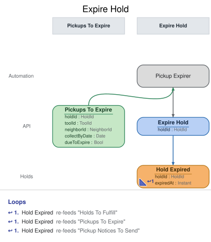

# Slice: Expire Hold

## Intent
When a holder doesn't collect a set-aside tool by the end of its collect-by date, end their hold
so the tool passes to the next neighbor in the queue, or becomes available to borrow. The system
does this itself; no person decides it.

## Trigger & Actor
Internally triggered. The Pickup Expirer, a system processor in this slice, reads Pickups To
Expire every 5 minutes, at any hour, and issues Expire Hold for each set-aside whose collect-by
date has passed. A lapsed set-aside is therefore expired within about 5 minutes of midnight,
shed time. No person
expires a hold; the shed manager doesn't cancel set-asides by hand. There is no screen.

## Command / Input
**Command:** `Expire Hold`

A HoldId is a UUID. One clock reading is taken when the command is handled. "Today" is that
moment's calendar date in the shed's local time zone, and the event's expiredAt is that same
moment.

| Field | Type | Required | Rules / Validation |
|-------|------|----------|--------------------|
| holdId | HoldId | yes | The set-aside hold to expire. Must be a hold that has been placed (INV-EXP-10), fulfilled (INV-EXP-10), not ended (INV-EXP-3), and past its collect-by date (INV-EXP-2). |

## Trigger
**Triggered by:** processor `Pickup Expirer`, also in this slice, reading Pickups To Expire.

## Event(s) Emitted
**Event:** `Hold Expired` → context `Holds`
**Read by:** My Holds (the hold drops off), Tool Catalog (the set-aside ends), My Loans (the hold
no longer waits), Holds To Fulfill (the tool can pass to the next hold), Pickups To Expire (the
set-aside leaves its list), Pickup Notices To Send (an unsent pickup email is dropped), and
Undelivered Notices (a failed pickup email's entry drops off).

| Field | Type | Immutable Fact? | Source / Notes |
|-------|------|-----------------|----------------|
| holdId | HoldId | yes | From the command. |
| expiredAt | Instant | yes | The UTC moment the event is recorded, set by the system. |

The event never changes. Readers find the hold's tool and holder from its Hold Placed or Hold
Fulfilled.

## Read Model / View
This slice produces no view of its own. It reads Pickups To Expire (slices/pickups-to-expire.md),
specified in its own doc. Hold Expired ends the hold in My Holds, Tool Catalog, My Loans, Holds To
Fulfill, Pickups To Expire, Pickup Notices To Send and Undelivered Notices, each eventually
consistent.

## Invariants / Business Rules
Expiry ends the hold, and the tool then passes to the next waiting hold (Fulfill Hold sets it
aside, recorded as Hold Fulfilled) or becomes available. Afterwards the neighbor may place a new
hold on the tool, at the back of the queue (Place Hold, INV-HOLD-7). The neighbor gets no message
when their hold expires: the pickup email already gave the collect-by date. An expired hold
doesn't count against the neighbor; only late returns count toward a flag (Neighbors To Flag).
Those rules are owned by those slices; this slice records only Hold Expired.

- **INV-EXP-2:** A set-aside expires only once its collect-by date has passed: from the start of
  the day after the collect-by date, in the shed's local time.
  - The collect-by date is the one Hold Fulfilled carries (the set-aside date plus 3 days), read
    as recorded and never worked out here. On the collect-by date itself, the hold can't be
    expired.
- **INV-EXP-3:** Only a set-aside still in force can expire.
  - A set-aside ends without expiring when the holder checks the tool out, the hold is cancelled,
    the tool is retired, or the holder closes their account. Then nothing expires.
  - Someone else checking the tool out doesn't end the holder's set-aside. Once the collect-by
    date has passed, another neighbor may check the tool out before Hold Expired is recorded
    (INV-CHK-3b, Check Out Tool); the lapsed hold still expires.
- **INV-EXP-4:** The window runs regardless of whether the holder can collect.
  - A holder who is suspended or has an overdue loan can't collect, and their set-aside expires
    on the same terms as anyone's.
- **INV-EXP-10:** Only a hold that has been placed and fulfilled can expire.
  - A hold still waiting has no collect-by date and never expires.
- **INV-EXP-11:** Expiring a hold that has already expired succeeds and records nothing.
  - Hold Expired ends the hold for good: the holder loses their place in the queue, and nothing
    reopens it. Other commands on an expired hold are refused `hold-ended`.

## Scenarios (Given / When / Then)
- **Happy path: set-aside lapses (INV-EXP-2)**
  - **Given:** Hold Fulfilled was recorded for Ben's hold H1 on the cordless drill (T1), collect by
    17 October. Ben hasn't collected T1, and Cleo's hold H2 is waiting.
  - **When:** at 00:10 on 18 October, shed time, the Pickup Expirer issues Expire Hold for H1
  - **Then:** Hold Expired is recorded for H1, with the time it was recorded.
- **On the collect-by date (INV-EXP-2)**
  - **Given:** H1 is set aside, collect by 17 October
  - **When:** Expire Hold for H1 is handled at 23:59 on 17 October, shed time
  - **Then:** refused with `pickup-window-open`: "This hold's pickup window hasn't ended." No event
    is recorded.
- **Holder already collected (INV-EXP-3)**
  - **Given:** H1 was set aside, and Tool Checked Out was recorded for T1 and Ben
  - **When:** Expire Hold for H1 is handled on 18 October
  - **Then:** refused with `hold-ended`: "This hold has already ended." No event is recorded.
- **Hold cancelled (INV-EXP-3)**
  - **Given:** H1 was set aside, and Hold Cancelled was recorded for H1
  - **When:** Expire Hold for H1 is handled on 18 October
  - **Then:** refused with `hold-ended`: "This hold has already ended." No event is recorded.
- **Tool retired (INV-EXP-3)**
  - **Given:** H1 was set aside, and Tool Retired was recorded for T1
  - **When:** Expire Hold for H1 is handled on 18 October
  - **Then:** refused with `hold-ended`: "This hold has already ended." No event is recorded.
- **Holder closed their account (INV-EXP-3)**
  - **Given:** H1 was set aside, and Neighbor Account Closed was recorded for Ben
  - **When:** Expire Hold for H1 is handled on 18 October
  - **Then:** refused with `hold-ended`: "This hold has already ended." No event is recorded.
- **Someone else checked the tool out after the cut-off (INV-EXP-3)**
  - **Given:** H1 was set aside, collect by 17 October. On 18 October, before Hold Expired was
    recorded, Cleo checked T1 out (ending her own hold H2).
  - **When:** the Pickup Expirer issues Expire Hold for H1
  - **Then:** Hold Expired is recorded for H1. Cleo's checkout didn't end Ben's hold; only Ben's
    own checkout would have.
- **Former holder takes a lapsed set-aside nobody waits for (INV-EXP-3)**
  - **Given:** H1 was set aside for Ben, collect by 17 October, and no other hold is waiting. On
    18 October, before Hold Expired was recorded, Ben checked T1 out.
  - **When:** the Pickup Expirer issues Expire Hold for H1
  - **Then:** refused with `hold-ended`: "This hold has already ended." No Hold Expired is
    recorded; Ben's checkout ended his hold.
- **Suspended holder (INV-EXP-4)**
  - **Given:** H1 was set aside, collect by 17 October, and Ben is suspended
  - **When:** Expire Hold for H1 is handled on 18 October
  - **Then:** Hold Expired is recorded for H1, the same as for any holder.
- **Hold still waiting (INV-EXP-10)**
  - **Given:** Cleo's hold H2 on T1 is waiting and has never been fulfilled
  - **When:** Expire Hold for H2 is handled
  - **Then:** refused with `hold-not-set-aside`: "This hold hasn't been set aside." No event is
    recorded.
- **Unknown hold (INV-EXP-10)**
  - **Given:** no hold has ID H9
  - **When:** Expire Hold for H9 is handled
  - **Then:** refused with `hold-not-found`: "There is no such hold." No event is recorded.
- **Expired twice (INV-EXP-11)**
  - **Given:** Hold Expired was recorded for H1
  - **When:** Expire Hold for H1 is handled again
  - **Then:** it succeeds and nothing new is recorded.

## Alternate & Error Flows
A refusal records nothing; the Pickup Expirer logs it with the hold ID and moves on. No person sees
these reasons. The name is the contract; the sentence is the log text.

The checks run in this order, and the first that fails is the reason returned:
1. `hold-not-found` (INV-EXP-10).
2. If Hold Expired is already recorded for the hold, the command succeeds and records nothing
   (INV-EXP-11).
3. `hold-ended` (INV-EXP-3).
4. `hold-not-set-aside` (INV-EXP-10).
5. `pickup-window-open` (INV-EXP-2).

| Reason | Sentence | Rule |
|--------|----------|------|
| `hold-not-found` | There is no such hold. | INV-EXP-10 |
| `hold-ended` | This hold has already ended. | INV-EXP-3 |
| `hold-not-set-aside` | This hold hasn't been set aside. | INV-EXP-10 |
| `pickup-window-open` | This hold's pickup window hasn't ended. | INV-EXP-2 |

`hold-not-found` and `hold-ended` mean the same conditions as in Fulfill Hold and Cancel Hold. A
missing or malformed hold ID (not a UUID) is bad input, rejected before any rule is checked.

Idempotency: a repeated Expire Hold for a hold already expired succeeds and records nothing
(INV-EXP-11). The Pickup Expirer may read the same lapsed set-aside twice before Hold Expired
lands; the second command is then a repeat.

Requests at the same moment: Expire Hold is decided against the hold's events as already
recorded, one at a time per tool. A cancellation or the holder's checkout landing at the same
moment is decided in the same order: whichever is recorded first stands. After the cut-off, the
former holder may still check the tool out if nobody else is waiting (INV-CHK-3b, Check Out
Tool); that checkout ends their hold, and a later Expire Hold for it is refused `hold-ended`.

There are no external calls, retries or compensations in this slice. No email is sent on expiry.

## Non-Functional Requirements
- **Security / authz:** only the Pickup Expirer issues Expire Hold. No person or screen does. It
  is an internal automation command, not on the REST API, so it has no sign-in guard.
- **PII & compliance:** Hold Expired holds no name or email: only the hold and the time.
- **Performance / SLA:** the Pickup Expirer reads its list every 5 minutes, so a lapsed set-aside
  is expired within about 5 minutes of the cut-off. In that gap the next neighbor in the queue can
  already check the tool out (INV-CHK-3b).

## Dependencies & Read Models Affected
- **Upstream events this slice relies on**, to apply its rules, and the fields it reads from each:
  - Hold Placed (Place Hold): holdId, toolId, neighborId.
  - Hold Fulfilled (Fulfill Hold): holdId, collectByDate.
  - Hold Cancelled (Cancel Hold): holdId.
  - Hold Expired (this slice): holdId.
  - Tool Checked Out (Check Out Tool): toolId, neighborId.
  - Tool Retired (Retire Tool): toolId.
  - Neighbor Account Closed (Close Account): neighborId.
  - These match slices/place-hold.md, slices/check-out-tool.md, slices/pickups-to-expire.md and
    the conventions for Hold Fulfilled. The others are specified in slices not yet written in depth; each is checked
    against these keys when it is.
- **Read model this slice's processor reads:** Pickups To Expire (slices/pickups-to-expire.md):
  the set-asides whose collect-by date has passed, each with its holdId.
- **Downstream read models / slices affected:** My Holds, Tool Catalog, My Loans, Holds To
  Fulfill, Pickups To Expire, Pickup Notices To Send and Undelivered Notices. Fulfill Hold then sets the tool aside for
  the next waiting hold.

## Open Questions
None.
