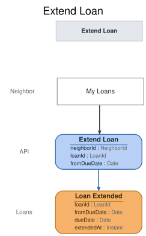

# Slice: Extend Loan

## Intent
Let a borrower keep a tool longer by extending their loan from My Loans. An extension moves the
due date later by one of the tool's default checkout periods. It is refused while someone is
waiting for the tool, once the loan is overdue, while the borrower is suspended, and once the
tool has been retired.

## Trigger & Actor
The borrower, from the My Loans screen, on one of their own loans that My Loans offers Extend
on. Sign-in, handled outside the shed's events, supplies the acting neighbor's ID.

## Command / Input
**Command:** `Extend Loan`

A LoanId is a UUID. A Date is a calendar date in the shed's local time zone. "Today" is that
date at the moment the command is handled.

| Field | Type | Required | Rules / Validation |
|-------|------|----------|--------------------|
| neighborId | NeighborId | yes | The neighbor extending, who must be the one making the request and the loan's borrower (INV-EXT-1). |
| loanId | LoanId | yes | The loan to extend. Must be a loan that has been checked out (INV-EXT-9). |
| fromDueDate | Date | yes | The due date the borrower is extending from, as My Loans showed it. Must be the loan's current due date, unless this exact extension has already been recorded (INV-EXT-10). |

## Trigger
**Triggered by:** screen `My Loans` @Neighbor

## Event(s) Emitted
**Event:** `Loan Extended` → context `Loans`
**Read by:** My Loans, Tool Inventory and Tool Catalog (the new due date shown); Overdue Loans To
Notify and Neighbors To Flag (when the loan becomes overdue, and whether a return is late);
Undelivered Notices and Flagged Neighbors (loan details shown there).

| Field | Type | Immutable Fact? | Source / Notes |
|-------|------|-----------------|----------------|
| loanId | LoanId | yes | From the command. |
| fromDueDate | Date | yes | From the command: the loan's due date before this extension. |
| dueDate | Date | yes | Set by the system: the new due date, fromDueDate plus the tool's default checkout period (INV-EXT-3). |
| extendedAt | Instant | yes | The UTC moment the event is recorded, set by the system. |

A later extension records a new Loan Extended; this one never changes. A loan's current due date
is the dueDate of its latest Loan Extended, or of its Tool Checked Out if it has never been
extended.

## Read Model / View
This slice produces no view of its own. Loan Extended moves the loan's due date in My Loans,
Tool Inventory and Tool Catalog, and in the lists that work out overdue loans and late returns.
Each view is specified in its own doc. All are eventually consistent.

## Invariants / Business Rules
- **INV-EXT-1:** Only the borrower can extend a loan, and they do it themselves.
  - The command names the acting neighbor in neighborId. The request must come from that
    neighbor (`requester-mismatch`), and the loan must be theirs: the neighbor who checked the
    tool out (`not-your-loan`). Sign-in, handled outside the shed's events, supplies the acting
    neighbor's ID.
  - A caller with no sign-in is refused with `not-signed-in`, before anything else is checked.
- **INV-EXT-2:** Only an open loan can be extended.
  - A loan is open from Tool Checked Out until Tool Returned or Tool Lost for that loan.
- **INV-EXT-3:** An extension adds one of the tool's default checkout periods to the loan's
  current due date.
  - It adds the tool's default period even if the borrower chose a shorter period at checkout.
  - The default period is the one on Tool Added. It never changes.
- **INV-EXT-4:** An extension is refused while any hold is waiting on the tool.
  - A hold is waiting from Hold Placed until it is fulfilled or ends. A hold ends when it is
    cancelled or expires, the holder checks the tool out, the tool is retired or recorded lost,
    or the holder closes their account. This is the meaning the Tool Catalog and Place Hold use.
  - My Loans shows the same (INV-MYL-9), except for a moment it can't see: when a lapsed
    set-aside has gone to the next holder and its Hold Expired isn't recorded yet. My Loans then
    holds back Extend for a few seconds; this slice already allows it.
  - Holds that were already waiting when the loan began count too.
- **INV-EXT-5:** An extension is refused once the loan is overdue.
  - A loan is overdue from the start of the day after its current due date, in the shed's local
    time. On the due date itself, the loan can still be extended.
  - Only the overdue loan itself is refused. The same borrower can still extend their other
    loans that are not overdue.
- **INV-EXT-6:** There is no limit on how many times a loan can be extended, as long as each
  extension meets the other rules here.
- **INV-EXT-7:** A suspended neighbor can't extend a loan.
  - A neighbor is suspended from Neighbor Suspended until Neighbor Reinstated. Once reinstated,
    they can extend again.
  - A closed account has no open loans, because an account can't be closed while tools are on
    loan, so it needs no rule here.
- **INV-EXT-8:** A loan whose tool has been retired can't be extended.
  - The loan carries on until the tool is returned or recorded lost.
- **INV-EXT-9:** The loan must exist.
- **INV-EXT-10:** Extending from a due date that has already been extended from adds nothing.
  - A repeated request succeeds and records nothing new, whatever has happened to the loan
    since. A request whose fromDueDate is neither the loan's current due date nor one it has
    already been extended from is refused.

## Scenarios (Given / When / Then)
Unless a scenario says otherwise: Ana has the cordless drill on loan L1. The drill has a 7-day
default checkout period. L1 is due 12 October, has never been extended, and no hold is waiting
on the drill. Ana is active, and today is 10 October.

- **Happy path (INV-EXT-3)**
  - **Given:** L1 as above
  - **When:** Ana extends L1 from My Loans, from 12 October
  - **Then:** Loan Extended is recorded for L1, from 12 October to 19 October.
- **Extending on the due date (INV-EXT-5)**
  - **Given:** today is 12 October
  - **When:** Ana extends L1 from 12 October
  - **Then:** Loan Extended is recorded, to 19 October.
- **Extending the day after the due date (INV-EXT-5)**
  - **Given:** today is 13 October, and L1 is still due 12 October
  - **When:** Ana tries to extend L1 from 12 October
  - **Then:** refused with `loan-overdue`: "This loan is overdue and can't be extended. Please
    return the tool." No event is recorded.
- **Extending again (INV-EXT-6)**
  - **Given:** L1 has already been extended once and is due 19 October; today is 18 October
  - **When:** Ana extends L1 from 19 October
  - **Then:** Loan Extended is recorded, from 19 October to 26 October.
- **Extending a loan checked out for a shorter period (INV-EXT-3)**
  - **Given:** Ana checked out the drill for 3 days, so L1 is due 8 October; today is 7 October
  - **When:** Ana extends L1 from 8 October
  - **Then:** Loan Extended is recorded, to 15 October: the drill's 7-day default, not 3 days.
- **A hold is waiting (INV-EXT-4)**
  - **Given:** Ben has placed a hold on the drill, and it is still waiting
  - **When:** Ana tries to extend L1
  - **Then:** refused with `hold-waiting`: "Someone is waiting for this tool, so this loan can't
    be extended." No event is recorded.
- **A hold was waiting when the loan began (INV-EXT-4)**
  - **Given:** Ana checked out the drill as the front holder, and Cara's hold was behind hers and
    is still waiting
  - **When:** Ana tries to extend L1
  - **Then:** refused with `hold-waiting`.
- **The waiting hold has ended (INV-EXT-4)**
  - **Given:** Ben placed a hold on the drill, and then cancelled it
  - **When:** Ana extends L1 from 12 October
  - **Then:** Loan Extended is recorded, to 19 October.
- **Another of the borrower's loans is overdue (INV-EXT-5)**
  - **Given:** Ana also has the ladder on loan, due 4 October, so it is overdue
  - **When:** Ana extends L1 from 12 October
  - **Then:** Loan Extended is recorded for L1, to 19 October. The ladder loan is still overdue.
- **Suspended borrower (INV-EXT-7)**
  - **Given:** Ana is suspended
  - **When:** Ana tries to extend L1
  - **Then:** refused with `neighbor-suspended`: "You can't extend loans while your account is
    suspended." No event is recorded.
- **Reinstated borrower (INV-EXT-7)**
  - **Given:** Ana was suspended and has been reinstated
  - **When:** Ana extends L1 from 12 October
  - **Then:** Loan Extended is recorded, to 19 October.
- **Tool retired while on loan (INV-EXT-8)**
  - **Given:** the drill was retired while Ana has it on loan
  - **When:** Ana tries to extend L1
  - **Then:** refused with `tool-retired`: "This tool has been retired, so this loan can't be
    extended. Please return it by the due date." No event is recorded.
- **Loan already returned (INV-EXT-2)**
  - **Given:** Ana has returned the drill, ending L1
  - **When:** a request to extend L1 from 12 October arrives
  - **Then:** refused with `loan-ended`: "This loan has ended." No event is recorded.
- **Loan ended by loss (INV-EXT-2)**
  - **Given:** Tool Lost has been recorded for L1
  - **When:** a request to extend L1 arrives
  - **Then:** refused with `loan-ended`.
- **Unknown loan (INV-EXT-9)**
  - **Given:** no loan L9 has been checked out
  - **When:** a request to extend L9 arrives
  - **Then:** refused with `loan-not-found`: "There is no such loan." No event is recorded.
- **Someone else's loan (INV-EXT-1)**
  - **Given:** L1 is Ana's loan
  - **When:** Ben, naming himself, tries to extend L1
  - **Then:** refused with `not-your-loan`: "You can only extend your own loans." No event is
    recorded.
- **A request that doesn't come from the neighbor it names (INV-EXT-1)**
  - **Given:** L1 is Ana's loan
  - **When:** a request to extend L1, naming Ana, comes from someone other than Ana
  - **Then:** refused with `requester-mismatch`: "You can only extend loans for yourself." No
    event is recorded.
- **The same request arrives twice (INV-EXT-10)**
  - **Given:** Loan Extended was recorded for L1, from 12 October to 19 October
  - **When:** the same request to extend L1 from 12 October arrives again
  - **Then:** the request succeeds and nothing new is recorded. L1 is still due 19 October.
- **The same request after a hold was placed (INV-EXT-10)**
  - **Given:** Loan Extended was recorded for L1, from 12 October to 19 October, and Ben has
    since placed a hold on the drill
  - **When:** the same request to extend L1 from 12 October arrives again
  - **Then:** the request succeeds and nothing new is recorded.
- **Extending from a due date that isn't current (INV-EXT-10)**
  - **Given:** L1 is due 12 October and has never been extended
  - **When:** a request to extend L1 from 5 October arrives
  - **Then:** refused with `due-date-changed`: "This loan's due date has changed. Check it and
    try again." No event is recorded.
- **No sign-in (INV-EXT-1)**
  - **Given:** a caller with no sign-in
  - **When:** they ask to extend L1
  - **Then:** refused with `not-signed-in`: "Please sign in." No event is recorded.

## Alternate & Error Flows
Every refusal records nothing and returns one reason: the stable name, and the sentence shown to
the borrower on the My Loans screen. The name is the contract; the sentence is the required
wording of the message.

The checks run in this order, and the first that fails is the reason returned:
1. `not-signed-in`, then `requester-mismatch` (INV-EXT-1).
2. `loan-not-found` (INV-EXT-9).
3. `not-your-loan` (INV-EXT-1).
4. If a Loan Extended for this loan already has the same fromDueDate, the request is a repeat:
   it succeeds and records nothing (INV-EXT-10).
5. `loan-ended` (INV-EXT-2).
6. `due-date-changed`, if fromDueDate isn't the loan's current due date (INV-EXT-10).
7. `neighbor-suspended` (INV-EXT-7).
8. `tool-retired` (INV-EXT-8).
9. `loan-overdue` (INV-EXT-5).
10. `hold-waiting` (INV-EXT-4).

| Reason | Sentence | Rule |
|--------|----------|------|
| `not-signed-in` | Please sign in. | INV-EXT-1 |
| `requester-mismatch` | You can only extend loans for yourself. | INV-EXT-1 |
| `loan-not-found` | There is no such loan. | INV-EXT-9 |
| `not-your-loan` | You can only extend your own loans. | INV-EXT-1 |
| `loan-ended` | This loan has ended. | INV-EXT-2 |
| `due-date-changed` | This loan's due date has changed. Check it and try again. | INV-EXT-10 |
| `neighbor-suspended` | You can't extend loans while your account is suspended. | INV-EXT-7 |
| `tool-retired` | This tool has been retired, so this loan can't be extended. Please return it by the due date. | INV-EXT-8 |
| `loan-overdue` | This loan is overdue and can't be extended. Please return the tool. | INV-EXT-5 |
| `hold-waiting` | Someone is waiting for this tool, so this loan can't be extended. | INV-EXT-4 |

`loan-not-found` and `requester-mismatch` can only come from a faulty or impersonating caller,
not from the screen. A missing or malformed
loan ID (not a UUID), or a fromDueDate that isn't a date, is bad input, rejected before any rule
is checked. It is not a refusal and has no reason name.

Idempotency: each extension is identified by the loan and the due date it extends from. A double
submit, or a retry after a lost response, carries the same fromDueDate, so it succeeds with
nothing recorded, even if the loan has since changed. It never extends the loan twice.

Two requests for the same loan at the same moment: each is decided against the loan's events as
already recorded, one at a time, so only one Loan Extended is recorded from a given due date.

There are no external calls, retries or compensations in this slice.

## Non-Functional Requirements
- **Security / authz:** only the borrower may extend their own loan (INV-EXT-1). The shed
  manager doesn't extend loans. Sign-in, handled outside the shed's events, supplies the acting
  neighbor's ID.
- **PII & compliance:** Loan Extended holds only the loan and its dates. No name or email.
- **Performance / SLA:** none beyond the one-at-a-time rule above.

## Dependencies & Read Models Affected
- **Upstream events this slice relies on**, to apply its rules, and the fields it reads from
  each:
  - Tool Added (Add Tool): toolId, defaultCheckoutPeriodDays.
  - Tool Checked Out (Check Out Tool): loanId, toolId, neighborId, dueDate, checkedOutAt.
  - Loan Extended (this slice): loanId, fromDueDate, dueDate.
  - Tool Returned (Return Tool), Tool Lost (Record Tool Lost): loanId.
  - Tool Retired (Retire Tool): toolId.
  - Neighbor Suspended (Suspend Neighbor), Neighbor Reinstated (Reinstate Neighbor): neighborId.
  - Hold Placed (Place Hold): holdId, toolId, neighborId.
  - Hold Fulfilled (Fulfill Hold), Hold Cancelled (Cancel Hold), Hold Expired (Expire Hold):
    holdId.
  - Neighbor Account Closed (Close Account): neighborId.
  - These keys match slices/add-tool.md, check-out-tool.md, tool-inventory.md and
    tool-catalog.md. This slice adds fromDueDate and extendedAt to Loan Extended; readers
    that only need the new due date keep reading {loanId, dueDate}.
- **Downstream read models / slices affected:** My Loans, Tool Inventory, Tool Catalog, Overdue
  Loans To Notify, Neighbors To Flag, Undelivered Notices and Flagged Neighbors (the new due
  date).

## Open Questions
None.
