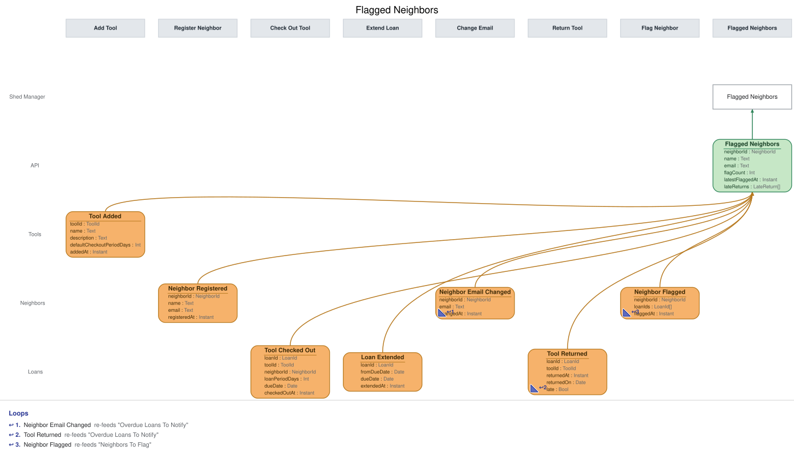

# Slice: Flagged Neighbors

## Intent
Shows the shed manager every neighbor the system has flagged for repeated late returns, on the
Flagged Neighbors screen they suspend neighbors from. The system flags; the shed manager decides.
Each entry shows who the neighbor is, how often and when they were last flagged, and the late
returns behind the flags.

## Trigger & Actor
- **Actor:** the shed manager, opening the Flagged Neighbors screen.
- **What it shows:** one entry per neighbor currently flagged, built from the events listed under
  Read Model / View. Nothing on this screen records anything by itself; its one action issues a
  command owned by another slice:
  - **Suspend** (Suspend Neighbor slice), offered on every entry (INV-FLN-5). There is no dismiss
    action.
- Flagging is done by the system (Flag Neighbor). A neighbor is not told they were flagged, and a
  suspended neighbor is never flagged (Neighbors To Flag, INV-NTF-7).

## Read Model / View
- **View:** `Flagged Neighbors` built from events: "Neighbor Flagged", "Neighbor Registered",
  "Neighbor Email Changed", "Tool Added", "Tool Checked Out", "Loan Extended", "Tool Returned",
  "Neighbor Suspended", "Neighbor Account Closed"
- **Consumed by:** the Flagged Neighbors screen (Shed Manager)
- **Freshness / consistency expectation:** eventual. An entry appears, changes or drops off
  shortly after its event is recorded (seconds, not minutes). Suspend checks its own rules when
  it runs.

One row per flagged neighbor. NeighborId, LoanId and ToolId are UUIDs. A Date is a calendar date
in the shed's local time zone; an Instant is a UTC instant set when the event was recorded.

| Field | Type | Source / Notes |
|-------|------|-----------------|
| neighborId | NeighborId | Neighbor Flagged.neighborId. |
| name | Text | Neighbor Registered.name for neighborId. Never changes. |
| email | Text | Neighbor Registered.email for neighborId, replaced by each Neighbor Email Changed.email. Always the current one. |
| flagCount | Int | `Derived:` the number of Neighbor Flagged recorded for the neighbor since their entry appeared (INV-FLN-3). |
| latestFlaggedAt | Instant | `Derived:` flaggedAt of the neighbor's latest Neighbor Flagged. Shown as a date in the shed's local time zone. |
| lateReturns | LateReturn[] | `Derived:` one item for each loan named by the entry's Neighbor Flagged events, as below. |

Each LateReturn item:

| Field | Type | Source / Notes |
|-------|------|-----------------|
| loanId | LoanId | One of Neighbor Flagged.loanIds. |
| toolName | Text | Tool Added.name for the loan's tool (Tool Checked Out.toolId). |
| dueDate | Date | The loan's due date in force when it was returned: Tool Checked Out.dueDate, replaced by each Loan Extended.dueDate for the loan. |
| returnedOn | Date | Tool Returned.returnedOn for the loan. |
| flaggedAt | Instant | flaggedAt of the Neighbor Flagged that named this loan. |

To fill an entry when its flag lands, the view also keeps, beyond its rows: every neighbor's
name and current email; every tool's name; and, for every loan, its tool, borrower, current due
date and return date. These are bookkeeping, not rows, and are never returned.

**When an entry appears and drops off.**
- Neighbor Flagged creates the neighbor's entry, or adds to it if they are already listed.
- Neighbor Suspended removes the entry, whichever screen the suspension came from.
- Neighbor Account Closed removes the entry.

**Queries**
- **List flagged neighbors.** Takes nothing. Returns every entry with all the fields above,
  including its late returns. There is no paging. Entries are listed by name, then by when the
  entry was created: the flaggedAt of its first flag (INV-FLN-10).

## Invariants / Business Rules
- **INV-FLN-1:** A neighbor appears on Flagged Neighbors when Neighbor Flagged is recorded for
  them.
  - Being on this list never suspends anyone by itself.
- **INV-FLN-2:** Each entry shows the neighbor's name and current email, the date of their latest
  flag, and the late returns behind every flag on the entry, each with the tool's name, its due
  date, the date it was returned, and the date of the flag that named it.
  - The name comes from Neighbor Registered. The email is the current one: Neighbor Registered
    sets it, Neighbor Email Changed replaces it.
  - Neighbor Flagged names the late returns it uses up, as the loans they belong to. It carries
    no copies of names or dates. The view looks those loans up in the loan events it hears: the
    tool from Tool Checked Out and its name from Tool Added, the due date from Tool Checked Out
    as moved by any Loan Extended, and the return date from Tool Returned.
- **INV-FLN-3:** A neighbor has at most one entry. If they are flagged again while still listed,
  the entry shows how many times they have been flagged, and the latest flag date.
  - An entry starts fresh. A neighbor who leaves the list (suspended), is reinstated and is later
    flagged again gets a new entry, flagged once, with only the new flag's late returns.
- **INV-FLN-4:** A flagged neighbor stays on the list until they are suspended or close their
  account.
  - There is no dismiss action. A flag the shed manager decides not to act on stays on the list.
- **INV-FLN-5:** Every entry offers Suspend, and a suspended neighbor leaves the list.
  - A flagged neighbor suspended from the Neighbors screen leaves this list too.
- **INV-FLN-6:** When a flagged neighbor closes their account, they leave the list.
  - Closed is final, so the shed manager is never offered Suspend on a closed account.
- **INV-FLN-10:** Entries are listed by name, ignoring case, then by when the entry was created.
  - The same order as every list in the shed.
- **INV-FLN-9:** Applying the same event twice leaves the list as if it had been applied once.
- **INV-FLN-11:** Only the shed manager can read Flagged Neighbors.
  - A signed-in caller without the shed-manager role is refused with `not-shed-manager`, and a
    caller with no sign-in with `not-signed-in`. Nothing is returned to either.

## Scenarios (Given / When / Then)
Unless a scenario says otherwise: Ana Ruiz registered with ana@example.org. She returned the
ladder (L1, due 31 August) on 1 September, the drill (L2, due 15 September) on 20 September and
the hedge trimmer (L3, due 1 October) on 5 October, all late.

- **Neighbor flagged (INV-FLN-1, INV-FLN-2, INV-FLN-5)**
  - **Given:** Flagged Neighbors is empty
  - **When:** Neighbor Flagged is recorded for Ana on 5 October, naming L1, L2 and L3
  - **Then:** Flagged Neighbors lists Ana Ruiz, ana@example.org, flagged once, latest on 5
    October, with three late returns: the ladder (due 31 August, returned 1 September), the
    drill (due 15 September, returned 20 September) and the hedge trimmer (due 1 October,
    returned 5 October). Suspend is offered.
- **Due date after an extension (INV-FLN-2)**
  - **Given:** L2 was extended from 15 September to 18 September before it was returned on 20
    September
  - **When:** Neighbor Flagged is recorded for Ana, naming L1, L2 and L3
  - **Then:** the drill's late return shows due 18 September, returned 20 September.
- **Flagged again while still listed (INV-FLN-3)**
  - **Given:** Flagged Neighbors lists Ana, flagged once on 5 October, and she has since
    returned three more tools late (L4, L5, L6)
  - **When:** Neighbor Flagged is recorded for Ana on 15 November, naming L4, L5 and L6
  - **Then:** Flagged Neighbors still lists Ana once: flagged twice, latest on 15 November, with
    all six late returns: L1, L2 and L3 flagged 5 October, and L4, L5 and L6 flagged 15
    November.
- **Flagged again after reinstatement (INV-FLN-3)**
  - **Given:** Ana was flagged, then suspended, which removed her entry, and later reinstated
  - **When:** Neighbor Flagged is recorded for Ana on 20 January, naming L7, L8 and L9
  - **Then:** Flagged Neighbors lists Ana in a new entry: flagged once, latest on 20 January, with
    only L7, L8 and L9.
- **Flagged neighbor suspended (INV-FLN-5)**
  - **Given:** Flagged Neighbors lists Ana and Ben
  - **When:** Neighbor Suspended is recorded for Ana
  - **Then:** Ana leaves Flagged Neighbors. Ben is still listed.
- **Flagged neighbor closes their account (INV-FLN-6)**
  - **Given:** Flagged Neighbors lists Ana
  - **When:** Neighbor Account Closed is recorded for Ana
  - **Then:** Ana leaves Flagged Neighbors.
- **Flag left alone (INV-FLN-4)**
  - **Given:** Flagged Neighbors has listed Ana since 5 October, and the shed manager has not
    suspended her
  - **When:** a month passes with no Neighbor Suspended recorded for Ana
  - **Then:** Ana is still listed.
- **Flagged neighbor changes their email (INV-FLN-2)**
  - **Given:** Flagged Neighbors lists Ana Ruiz, ana@example.org
  - **When:** Neighbor Email Changed is recorded for Ana, to ana.ruiz@example.net
  - **Then:** Flagged Neighbors lists Ana Ruiz, ana.ruiz@example.net. Her flags are unchanged.
- **Same event applied twice (INV-FLN-9)**
  - **Given:** Flagged Neighbors lists Ana, flagged once
  - **When:** the same Neighbor Flagged for Ana is applied again
  - **Then:** Ana is still listed once, flagged once.
- **Listing order (INV-FLN-10)**
  - **Given:** Flagged Neighbors lists Ben Ito (first flagged 1 October) and Ana Ruiz (first
    flagged 5 October)
  - **When:** the shed manager lists flagged neighbors
  - **Then:** Ana Ruiz comes first, then Ben Ito.
- **Listing flagged neighbors**
  - **Given:** Flagged Neighbors lists Ana and Ben
  - **When:** the shed manager's screen lists flagged neighbors
  - **Then:** both entries are returned with all their fields and late returns, with no paging.
- **A neighbor tries to read the list (INV-FLN-11)**
  - **Given:** Flagged Neighbors has entries
  - **When:** a neighbor, signed in without the shed-manager role, asks for the flagged neighbors
  - **Then:** refused with `not-shed-manager`: "Only the shed manager can see this screen."
    Nothing is returned.
- **No sign-in (INV-FLN-11)**
  - **Given:** Flagged Neighbors has entries
  - **When:** a caller with no sign-in asks for the flagged neighbors
  - **Then:** refused with `not-signed-in`: "Please sign in." Nothing is returned.

## Alternate & Error Flows
- **Read refusals:** the list query refuses a caller without the shed-manager role with
  `not-shed-manager` ("Only the shed manager can see this screen."), and a caller with no
  sign-in with `not-signed-in` ("Please sign in."). Nothing is returned on a refusal. These
  mean the same conditions as in the shed manager's commands.
- **Repeated events:** every event is applied idempotently (INV-FLN-9).
- **Events after an entry is gone:** once an entry has been removed, a later Neighbor Suspended
  or Neighbor Account Closed for that neighbor changes nothing. A later Neighbor Flagged starts a
  new entry.
- **Stale actions:** Suspend offered on the screen can be out of date by the time it is used
  (for example, on a neighbor who has just closed their account). Suspend Neighbor checks its own
  rules and refuses with its own reason; this view raises no errors of its own.

## Non-Functional Requirements
- **Security / authz:** the Flagged Neighbors screen is the shed manager's alone. Sign-in, handled outside the shed's events, supplies the
  shed-manager role; only a caller with it may read this view.
- **PII & compliance:** shows flagged neighbors' names, current emails and their late-return
  history to the shed manager only. An entry is removed when the neighbor is suspended or closes
  their account. To fill entries, the view keeps every neighbor's name and current email, every
  tool's name, and every loan's tool, borrower and dates, whether or not they are flagged. Names
  and emails are kept with the shed's loan and hold history and never erased.
- **Performance / SLA:** none beyond the freshness above.

## Dependencies & Read Models Affected
- **Upstream events this slice relies on**, and the fields it reads from each:
  - Neighbor Flagged (Flag Neighbor): neighborId, loanIds (LoanId[]), flaggedAt.
  - Neighbor Registered (Register Neighbor): neighborId, name, email.
  - Neighbor Email Changed (Change Email): neighborId, email.
  - Tool Added (Add Tool): toolId, name.
  - Tool Checked Out (Check Out Tool): loanId, toolId, neighborId, dueDate.
  - Loan Extended (Extend Loan): loanId, dueDate.
  - Tool Returned (Return Tool): loanId, returnedOn.
  - Neighbor Suspended (Suspend Neighbor), Neighbor Account Closed (Close Account): neighborId.
  - These keys match the deep-passed docs. Neighbor Flagged's shape is agreed with
    slices/flag-neighbor.md.
- **Downstream read models / slices affected:** none. The screen it feeds issues Suspend
  Neighbor.

## Open Questions
None.
