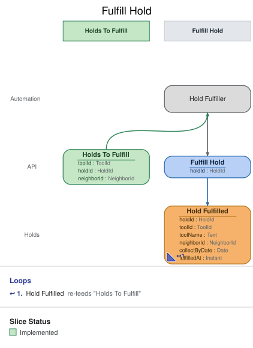

# Slice: Fulfill Hold

## Intent
When a tool is back in the shed with holds waiting, set it aside for the neighbor at the front of
the queue, so the tool goes to holders in the order they asked. The system does this itself; no
person decides it. Returning a tool records only Tool Returned; Hold Fulfilled is recorded
separately, by this slice.

What follows a fulfilment is decided by the slices that read Hold Fulfilled: the holder is
emailed that the tool is ready (Send Pickup Notice, which doesn't hold up the fulfilment), My
Holds shows it ready for pickup with its collect-by date, the Tool Catalog shows it set aside,
and the set-aside lapses at the end of its collect-by date (Expire Hold).

## Trigger & Actor
- **Pattern:** automation. The Hold Fulfiller, a system processor, watches the Holds To Fulfill
  list (slices/holds-to-fulfill.md). No person fulfils holds; only the Hold Fulfiller issues
  Fulfill Hold, and it is not exposed to neighbors or the shed manager.
- **Triggering condition:** a tool is on the list: it is in the shed, not set aside for anyone,
  and at least one hold on it is waiting. Each item names the tool, the hold at the front of its
  queue, and that hold's holder.
- **When it acts:** the list changes only when an event lands (a return, an expiry, a
  cancellation, a closure), so the Hold Fulfiller acts whenever the list changes, on each item
  that appears.
- **What it does:** it issues `Fulfill Hold` for the item's hold. If the command is refused or is
  a repeat, nothing is recorded and the processor moves on; the list will show the tool again
  with its new front hold, if there is one.

## Command / Input
**Command:** `Fulfill Hold`

A HoldId is a UUID. One clock reading is taken when the command is handled. "Today" (for
collectByDate) is that moment's calendar date in the shed's local time zone, and the event's
fulfilledAt is that same moment.

| Field | Type | Required | Rules / Validation |
|-------|------|----------|--------------------|
| holdId | HoldId | yes | The hold to fulfil: the front waiting hold of its tool (INV-FUL-2). Must be a hold that has been placed (INV-FUL-9). |

## Trigger
**Triggered by:** processor `Hold Fulfiller`, also in this slice, reading `Holds To Fulfill`.

## Event(s) Emitted
**Event:** `Hold Fulfilled` → context `Holds`
**Read by:** Holds To Fulfill (the tool leaves the list), Tool Catalog (set aside), My Holds
(ready for pickup), Pickup Notices To Send (the holder's email), Pickups To Expire (the
collect-by date to watch), and Undelivered Notices (a later pickup-email failure's details).

| Field | Type | Immutable Fact? | Source / Notes |
|-------|------|-----------------|----------------|
| holdId | HoldId | yes | From the command. |
| toolId | ToolId | yes | Set by the system: the tool on the hold's Hold Placed. |
| neighborId | NeighborId | yes | Set by the system: the holder on the hold's Hold Placed. |
| collectByDate | Date | yes | Set by the system: today plus 3 days. The set-aside lapses at the start of the day after it, shed local time. |
| fulfilledAt | Instant | yes | Set by the system: the UTC moment the event is recorded. |

collectByDate is recorded here once, so every reader uses the same date and none works it out.

## Read Model / View
This slice produces no view of its own. The Hold Fulfiller reads Holds To Fulfill, specified in
slices/holds-to-fulfill.md. Hold Fulfilled takes the tool off that list and sets it aside in the
Tool Catalog, My Holds and the pickup lists. All are eventually consistent: the list may still
show a tool for a moment after it was fulfilled, which is why the command itself refuses a second
fulfilment.

## Invariants / Business Rules
- **INV-FUL-2:** A tool is set aside for the hold at the front of its queue: the hold, still
  waiting, whose Hold Placed was recorded first.
  - Queue order is the order the Hold Placed events were recorded, never a comparison of times.
- **INV-FUL-3:** A hold is fulfilled only while the tool is in the shed and not set aside for
  anyone, and the hold is still waiting.
  - In the shed: no loan of the tool is open (Tool Checked Out without Tool Returned or Tool
    Lost for that loan), and it hasn't been retired.
  - Not set aside: no other hold on the tool has been fulfilled and not yet ended.
  - Still waiting: the hold hasn't been fulfilled and hasn't ended. A hold ends when it is
    cancelled or expires, the holder checks the tool out, the tool is retired or recorded lost,
    or the holder closes their account.
- **INV-FUL-4:** A tool is set aside for one holder at a time.
  - A lapsed set-aside still counts until its Hold Expired is recorded. Only then is the next
    hold fulfilled.
- **INV-FUL-5:** A fulfilled hold's collect-by date is the fulfilment date plus 3 days.
  - Until the end of that date, only the holder may check the tool out (Check Out Tool,
    INV-CHK-3). The holder collects it with an ordinary checkout.
- **INV-FUL-6:** When a set-aside ends without the holder collecting it and another hold is
  waiting, the next hold is fulfilled in the same way.
  - A set-aside ends this way when the hold expires or is cancelled, or the holder closes their
    account. With no hold waiting, nothing is fulfilled and the tool becomes available.
- **INV-FUL-8:** The front hold is fulfilled even if its holder can't collect right now, because
  they are suspended or have an overdue loan.
  - They keep their place. If they can't collect by the end of the collect-by date, the hold
    expires and the next hold is fulfilled.
- **INV-FUL-9:** The hold must exist.
- **INV-FUL-10:** Fulfilling a hold that is already fulfilled records nothing new.
  - A repeated request for that hold succeeds, so a list read twice never sets a tool aside
    twice or moves its collect-by date.

## Scenarios (Given / When / Then)
Unless a scenario says otherwise: Ben's hold H1 on the cordless drill was placed before Cara's
hold H2. Today is 10 October in the shed's local time.

- **Happy path: tool returned with holds waiting (INV-FUL-2, INV-FUL-5)**
  - **Given:** Ana returned the drill on 10 October. H1 and H2 are waiting, so the drill is on
    Holds To Fulfill with H1 at the front.
  - **When:** the Hold Fulfiller issues Fulfill Hold for H1
  - **Then:** Hold Fulfilled is recorded for H1: the drill, Ben, collect by 13 October.
- **Next hold after an expired set-aside (INV-FUL-6)**
  - **Given:** the drill was set aside for Ben under H1, Hold Expired has been recorded for H1,
    and H2 is waiting
  - **When:** the Hold Fulfiller issues Fulfill Hold for H2
  - **Then:** Hold Fulfilled is recorded for H2: the drill, Cara, collect by 13 October.
- **Next hold after a cancelled set-aside (INV-FUL-6)**
  - **Given:** the drill was set aside for Ben under H1, Ben cancelled H1, and H2 is waiting
  - **When:** the Hold Fulfiller issues Fulfill Hold for H2
  - **Then:** Hold Fulfilled is recorded for H2.
- **Next hold after the holder closes their account (INV-FUL-6)**
  - **Given:** the drill was set aside for Ben under H1, Ben closed his account, and H2 is
    waiting
  - **When:** the Hold Fulfiller issues Fulfill Hold for H2
  - **Then:** Hold Fulfilled is recorded for H2.
- **Front holder is suspended (INV-FUL-8)**
  - **Given:** the drill is back in the shed with H1 at the front, and Ben is suspended
  - **When:** the Hold Fulfiller issues Fulfill Hold for H1
  - **Then:** Hold Fulfilled is recorded for H1: the drill, Ben, collect by 13 October.
- **Front holder has an overdue loan (INV-FUL-8)**
  - **Given:** the drill is back in the shed with H1 at the front, and Ben has an overdue loan
  - **When:** the Hold Fulfiller issues Fulfill Hold for H1
  - **Then:** Hold Fulfilled is recorded for H1.
- **The list is read twice (INV-FUL-10)**
  - **Given:** Hold Fulfilled has been recorded for H1, and the list showed the drill once more
    before it caught up
  - **When:** the Hold Fulfiller issues Fulfill Hold for H1 again
  - **Then:** the command succeeds and records nothing new. The collect-by date stays 13
    October.
- **The holder collected first (INV-FUL-3)**
  - **Given:** the drill came back with H1 at the front, and Ben checked it out before the Hold
    Fulfiller acted, which ended H1
  - **When:** the Hold Fulfiller issues Fulfill Hold for H1
  - **Then:** refused with `hold-ended`: "This hold has already ended." No event is recorded.
- **Not the front of the queue (INV-FUL-2)**
  - **Given:** the drill is back in the shed with H1 and H2 waiting
  - **When:** a Fulfill Hold for H2 arrives
  - **Then:** refused with `not-front-of-queue`: "This hold isn't at the front of its tool's
    queue." No event is recorded.
- **Tool still set aside for someone else (INV-FUL-4)**
  - **Given:** the drill is set aside for Ben under H1, his collect-by date has passed, and Hold
    Expired hasn't been recorded for H1 yet. H2 is waiting.
  - **When:** a Fulfill Hold for H2 arrives
  - **Then:** refused with `tool-set-aside`: "This tool is already set aside for a holder." No
    event is recorded. Once Hold Expired is recorded for H1, H2 can be fulfilled.
- **Tool on loan (INV-FUL-3)**
  - **Given:** the drill is on loan to Ana, and H1 is waiting
  - **When:** a Fulfill Hold for H1 arrives
  - **Then:** refused with `tool-checked-out`: "This tool is already checked out." No event is
    recorded.
- **Hold cancelled before the fulfiller acted (INV-FUL-3)**
  - **Given:** the drill came back with H1 at the front, and Ben cancelled H1 before the Hold
    Fulfiller acted
  - **When:** a Fulfill Hold for H1 arrives
  - **Then:** refused with `hold-ended`. No event is recorded. The list shows the drill with H2
    at the front.
- **Unknown hold (INV-FUL-9)**
  - **Given:** no hold H9 has been placed
  - **When:** a Fulfill Hold for H9 arrives
  - **Then:** refused with `hold-not-found`: "There is no such hold." No event is recorded.

## Alternate & Error Flows
A refusal records nothing; the Hold Fulfiller logs it with the hold ID and moves on. No person
sees these reasons. The name is the contract; the sentence is the log text.

The checks run in this order, and the first that fails is the reason returned:
1. `hold-not-found` (INV-FUL-9).
2. If Hold Fulfilled is already recorded for the hold, the command succeeds and records nothing
   (INV-FUL-10).
3. `hold-ended` (INV-FUL-3).
4. `tool-checked-out` (INV-FUL-3).
5. `tool-set-aside` (INV-FUL-4).
6. `not-front-of-queue` (INV-FUL-2).

| Reason | Sentence | Rule |
|--------|----------|------|
| `hold-not-found` | There is no such hold. | INV-FUL-9 |
| `hold-ended` | This hold has already ended. | INV-FUL-3 |
| `tool-checked-out` | This tool is already checked out. | INV-FUL-3 |
| `tool-set-aside` | This tool is already set aside for a holder. | INV-FUL-4 |
| `not-front-of-queue` | This hold isn't at the front of its tool's queue. | INV-FUL-2 |

`hold-not-found`, `hold-ended` and `tool-checked-out` mean the same conditions as in Cancel Hold
and Check Out Tool. A retired tool's holds have all ended, so a retired tool shows as
`hold-ended`. A missing or malformed hold ID (not a UUID) is bad input, rejected before any rule
is checked.

Idempotency: a repeated Fulfill Hold for a hold already fulfilled succeeds and records nothing
(INV-FUL-10).

Requests at the same moment: Fulfill Hold is decided against the tool's holds and loans as
already recorded, one at a time per tool, so at most one hold on a tool is set aside at once. A
holder's checkout, a cancellation or an expiry landing at the same moment is decided in the same
order: whichever is recorded first stands.

There are no external calls in this slice. The pickup email is sent by Send Pickup Notice.

## Non-Functional Requirements
- **Security / authz:** Fulfill Hold is internal. Only the Hold Fulfiller issues it.
- **PII & compliance:** Hold Fulfilled links a neighbor to a tool and a date. No name or email.
- **Performance / SLA:** a tool is set aside within moments of the event that put it on the list.
  Nothing on record sets a tighter limit.

## Dependencies & Read Models Affected
- **Upstream events this slice relies on**, to apply its rules, and the fields it reads from
  each:
  - Hold Placed (Place Hold): holdId, toolId, neighborId. Queue order is the order these were
    recorded.
  - Hold Fulfilled (this slice): holdId, toolId.
  - Hold Cancelled (Cancel Hold), Hold Expired (Expire Hold): holdId.
  - Tool Checked Out (Check Out Tool): loanId, toolId, neighborId.
  - Tool Returned (Return Tool), Tool Lost (Record Tool Lost): loanId, toolId.
  - Tool Retired (Retire Tool): toolId.
  - Neighbor Account Closed (Close Account): neighborId.
  - The Hold Fulfiller reads Holds To Fulfill's items: toolId, holdId, neighborId
    (slices/holds-to-fulfill.md).
  - These keys match the deep-passed docs, and the Hold Fulfilled shape matches what
    undelivered-notices.md, check-out-tool.md and holds-to-fulfill.md read.
- **Downstream read models / slices affected:** Holds To Fulfill, Tool Catalog, My Holds, Pickup
  Notices To Send, Pickups To Expire and Undelivered Notices. Check Out Tool reads
  collectByDate to enforce the holder's claim, and Expire Hold to find lapsed set-asides.

## Open Questions
None.
