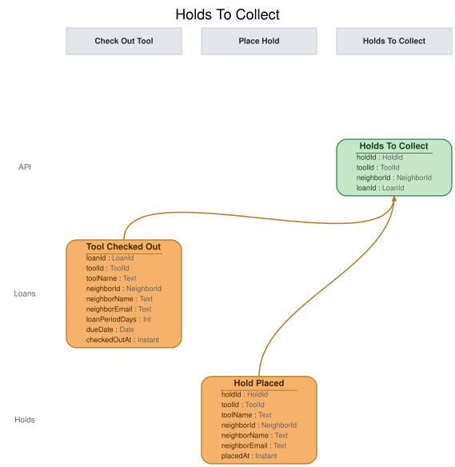

# Slice: Holds To Collect

## Intent
The hold collector's to-do list: every hold whose holder has checked the tool out and whose hold
hasn't yet been recorded collected. The collector works through it, so a holder's own checkout
ends their hold as a Holds fact (Hold Collected) and the views about holds never infer it from
the loan.

## Trigger & Actor
- **Consumed by:** the Hold Collector (Collect Hold). Internal: no ui.
- **What it lists:** one row per hold that is live (placed, not cancelled, expired or collected)
  on a tool that its holder now has on loan. A row names the hold, its tool and holder, and the
  loan that collected it.

## Read Model / View
- **View:** `Holds To Collect` built from events: "Hold Placed", "Tool Checked Out", "Hold
  Collected", "Hold Cancelled"
- **Consumed by:** the Hold Collector (Collect Hold). Internal: no ui.
- **Freshness / consistency expectation:** eventual. A row appears shortly after the checkout is
  recorded and leaves shortly after Hold Collected is (seconds, not minutes).

HoldId, ToolId, NeighborId and LoanId are UUIDs.

| Field | Type | Source / Notes |
|-------|------|----------------|
| holdId | HoldId | Hold Placed.holdId. |
| toolId | ToolId | Hold Placed.toolId. |
| neighborId | NeighborId | Hold Placed.neighborId: the holder. |
| loanId | LoanId | `Derived:` Tool Checked Out.loanId of the holder's open loan on the tool. |

**When a row appears.** Tool Checked Out for a tool and neighbor who has a live hold on that tool
creates the row for that hold (INV-HTC-1). A holder has at most one hold on a tool (INV-HOLD-2,
Place Hold), so the checkout names at most one hold.

**When a row leaves.** Hold Collected for the hold (INV-HTC-2), or Hold Cancelled for it
(INV-HTC-3): a hold cancelled in the moment between the checkout and the collector acting is
never collected. Nothing puts a row back.

To know which holds are live, the view keeps, beyond its rows, every hold from Hold Placed until
Hold Cancelled or Hold Collected for it. A hold that expired, or ended with its tool retired or
lost, cannot be checked out by its holder (INV-CHK-3b, INV-CHK-4), so those endings need no
rule here.

**Queries**
- **List holds to collect.** Takes nothing. Returns every row with all four fields. There is no
  paging. The order doesn't matter to the collector.

## Invariants / Business Rules
- **INV-HTC-1:** A hold joins the list when its holder's checkout of the tool is recorded.
  - Whether the hold was set aside (INV-CHK-3) or taken from the front of the queue before the
    set-aside was recorded (INV-CHK-3a) makes no difference: both are collections.
  - A checkout by a neighbor with no live hold on the tool adds nothing.
- **INV-HTC-2:** Once Hold Collected is recorded for a hold, it leaves the list and never
  returns.
- **INV-HTC-3:** A hold cancelled before it is collected leaves the list.
- **INV-HTC-4:** Applying the same event twice leaves the list as if it had been applied once.

The list has no screen; only the Hold Collector reads it.

## Scenarios (Given / When / Then)
Unless a scenario says otherwise: Ben's hold H1 is live on the cordless drill (T1).

- **Holder collects a set-aside (INV-HTC-1)**
  - **Given:** T1 is set aside for H1, and the list is empty
  - **When:** Tool Checked Out is recorded for T1 and Ben, loan L5
  - **Then:** the list has H1: T1, Ben, L5.
- **Front holder collects before the set-aside is recorded (INV-HTC-1)**
  - **Given:** H1 is at the front of T1's queue, T1 has just been returned, and no Hold Fulfilled
    has been recorded
  - **When:** Tool Checked Out is recorded for T1 and Ben, loan L6
  - **Then:** the list has H1: T1, Ben, L6.
- **Checkout with no hold (INV-HTC-1)**
  - **Given:** Ana has no hold on the hammer (T5)
  - **When:** Tool Checked Out is recorded for T5 and Ana
  - **Then:** the list is unchanged.
- **Someone else's checkout (INV-HTC-1)**
  - **Given:** H1 is live on T1 and Cara, who has no hold on it, is allowed to take it (no set-aside
    and Ben not at the front: INV-CHK-3a does not apply)
  - **When:** Tool Checked Out is recorded for T1 and Cara
  - **Then:** the list is unchanged.
- **Hold collected (INV-HTC-2)**
  - **Given:** the list has H1
  - **When:** Hold Collected is recorded for H1
  - **Then:** the list is empty.
- **Cancelled before collection (INV-HTC-3)**
  - **Given:** the list has H1
  - **When:** Hold Cancelled is recorded for H1
  - **Then:** the list is empty.
- **Same event applied twice (INV-HTC-4)**
  - **Given:** the list has H1 once
  - **When:** the same Tool Checked Out is applied again
  - **Then:** the list still has H1 once.

## Alternate & Error Flows
- **Repeated events:** every event is applied idempotently (INV-HTC-4).
- **Events for a hold no longer listed:** once a row has left, a later Hold Collected or Hold
  Cancelled for it changes nothing.
- **The collector reads a row twice before Hold Collected lands:** the list may return the same
  hold on two reads in a row. Collecting a hold once is Collect Hold's rule, enforced when it
  runs; the list need not prevent the second read.

## Non-Functional Requirements
- **Security / authz:** internal; no caller outside the Hold Collector reads it.
- **PII & compliance:** ids only.
- **Performance / SLA:** none beyond the freshness above.

## Dependencies & Read Models Affected
- **Upstream events this slice relies on**, and the fields it reads from each:
  - Hold Placed (Place Hold): holdId, toolId, neighborId.
  - Tool Checked Out (Check Out Tool): loanId, toolId, neighborId.
  - Hold Collected (Collect Hold): holdId.
  - Hold Cancelled (Cancel Hold, and the Hold Cancelled recorded by Retire Tool, Record Tool
    Lost and Close Account): holdId.
  - These keys match slices/place-hold.md, slices/check-out-tool.md and slices/cancel-hold.md.
- **Downstream read models / slices affected:** none. The Hold Collector reads it and issues
  Collect Hold.

## Open Questions
None.
