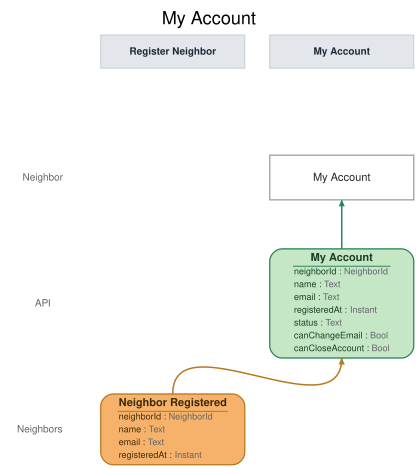

# Slice: My Account

## Intent
Shows a neighbor their own account on the My Account screen: their name, their current email,
and whether the account is active, suspended or closed. It is where a neighbor learns they are
suspended, and the screen they change their email and close their account from.

## Trigger & Actor
- **Actor:** a neighbor, opening their own My Account screen. A neighbor whose account is closed
  can still open it, read-only.
- **Whose account it shows:** the account of the neighbor asking. Sign-in, handled outside the model, supplies the neighbor's ID, resolving a person to their newest account, or to their closed one only when they have no newer.
- **Actions offered:** nothing on this screen records anything by itself. Its actions issue
  commands owned by other slices:
  - **Change Email** (Change Email slice) — offered while the account isn't closed (INV-MYAC-9).
  - **Close Account** (Close Account slice) — offered while the account isn't closed
    (INV-MYAC-11).

## Read Model / View
- **View:** `My Account` built from events: "Neighbor Registered", "Neighbor Email Changed",
  "Neighbor Suspended", "Neighbor Reinstated", "Neighbor Account Closed"
- **Consumed by:** the My Account screen (Neighbor)
- **Freshness / consistency expectation:** eventual. A change shows shortly after its event is
  recorded (seconds, not minutes). No action on this screen depends on it being instant, because
  Change Email and Close Account each check their own rules when they run.

One row per account. A NeighborId is a UUID. An Instant is a UTC instant set when the event was
recorded.

| Field | Type | Source / Notes |
|-------|------|-----------------|
| neighborId | NeighborId | Neighbor Registered.neighborId. |
| name | Text | Neighbor Registered.name. Never changes. |
| email | Text | Neighbor Registered.email, replaced by each Neighbor Email Changed.email for this account. Always the current one. |
| status | Text | One of `active`, `suspended`, `closed`. `Derived:` see the status rules below. |
| canChangeEmail | Bool | `Derived:` yes unless status is `closed` (INV-MYAC-9). |
| canCloseAccount | Bool | `Derived:` yes unless status is `closed` (INV-MYAC-11). |

My Account doesn't show the neighbor's sign-up date; that is the shed manager's to see, on
Neighbors.

**Status rules.** An account's status is a test of its current facts, taken in this order. The
first that holds wins:
1. **closed** — Neighbor Account Closed has been recorded for the account. Closed is final.
2. **suspended** — otherwise, Neighbor Suspended has been recorded and no Neighbor Reinstated
   since.
3. **active** — otherwise.

**Queries**
- **Get my account.** Takes the asking neighbor's neighborId. Returns that one account with every field above, or not found if no account has that neighbor ID. It never returns another
  account (INV-MYAC-1).

## Invariants / Business Rules
- **INV-MYAC-1:** A neighbor's My Account shows only their own account.
  - The query returns the one account whose neighbor ID it is given, and nothing about any other
    account.
- **INV-MYAC-2:** My Account shows the neighbor's name and their current email.
  - Neighbor Registered sets the email. Neighbor Email Changed replaces it. The name never
    changes after sign-up.
- **INV-MYAC-3:** A newly registered neighbor's account shows as active.
  - One account per Neighbor Registered.
- **INV-MYAC-4:** A suspended neighbor's account shows as suspended until they are reinstated,
  and then shows as active again.
  - This is how a neighbor learns they are suspended; they aren't emailed about it.
- **INV-MYAC-5:** Once a neighbor closes their account, it shows as closed, permanently.
  - Closed is final. A suspended neighbor who closes their account sees it as closed, not
    suspended.
- **INV-MYAC-6:** After closing their account, the neighbor can still view My Account,
  read-only.
  - Close Account and Change Email are no longer offered on a closed account.
- **INV-MYAC-7:** Only Neighbor Registered, Neighbor Email Changed, Neighbor Suspended, Neighbor
  Reinstated and Neighbor Account Closed change My Account.
  - Loans, holds and flags never change it.
- **INV-MYAC-8:** A person who signs up again after closing an account has a new account, and My
  Account shows them only that new account.
  - Each account has its own neighbor ID, and the query returns the one account it is asked
    for. The old, closed account is no longer shown to them. It stays on the shed manager's
    Neighbors screen.
- **INV-MYAC-9:** My Account offers Change Email on any account that isn't closed.
  - It is offered to a suspended neighbor too. Change Email refuses them with its own reason
    (INV-CEM-3a, Change Email), and they can change it once reinstated. A refusal with a reason
    they see means the action was offered.
- **INV-MYAC-10:** Applying the same event twice leaves My Account as if it had been applied
  once.
- **INV-MYAC-11:** My Account offers Close Account on any account that isn't closed.
  - It is offered whether or not the neighbor has tools on loan. Close Account refuses a
    neighbor with tools on loan with its own reason (INV-CLS-7, Close Account): a refusal with a
    reason the neighbor sees means the action was offered.
- **INV-MYAC-13:** A request with no sign-in is refused before anything else is checked.
- **INV-MYAC-14:** My Account is answered only for the signed-in neighbor: a request for any other neighbor ID is refused.

## Scenarios (Given / When / Then)
- **Neighbor registered (INV-MYAC-2, INV-MYAC-3, INV-MYAC-9, INV-MYAC-11)**
  - **Given:** no account has neighbor ID N1
  - **When:** Neighbor Registered is recorded for N1, with the name "Ana Ruiz" and the email
    ana@example.org
  - **Then:** My Account for N1 shows "Ana Ruiz", ana@example.org, `active`, with Change Email
    and Close Account offered.
- **Email changed (INV-MYAC-2)**
  - **Given:** My Account for N1 shows "Ana Ruiz", ana@example.org, `active`
  - **When:** Neighbor Email Changed is recorded for N1, to ana.ruiz@example.net
  - **Then:** My Account for N1 shows "Ana Ruiz", ana.ruiz@example.net, `active`.
- **Neighbor suspended (INV-MYAC-4, INV-MYAC-9, INV-MYAC-11)**
  - **Given:** My Account for N1 shows `active`
  - **When:** Neighbor Suspended is recorded for N1
  - **Then:** My Account for N1 shows `suspended`. Change Email and Close Account are still
    offered.
- **Neighbor reinstated (INV-MYAC-4)**
  - **Given:** My Account for N1 shows `suspended`
  - **When:** Neighbor Reinstated is recorded for N1
  - **Then:** My Account for N1 shows `active`.
- **Email changed after reinstatement (INV-MYAC-2, INV-MYAC-4)**
  - **Given:** N1 was suspended and then reinstated, and My Account for N1 shows ana@example.org
  - **When:** Neighbor Email Changed is recorded for N1, to ana.ruiz@example.net
  - **Then:** My Account for N1 shows ana.ruiz@example.net, `active`.
- **Account closed (INV-MYAC-5, INV-MYAC-6)**
  - **Given:** My Account for N1 shows `active`
  - **When:** Neighbor Account Closed is recorded for N1
  - **Then:** My Account for N1 shows `closed`, with neither Change Email nor Close Account
    offered. It can still be read.
- **Suspended neighbor closes their account (INV-MYAC-5)**
  - **Given:** My Account for N1 shows `suspended`
  - **When:** Neighbor Account Closed is recorded for N1
  - **Then:** My Account for N1 shows `closed`, not `suspended`.
- **Signed up again after closing (INV-MYAC-8)**
  - **Given:** account N1, "Ana Ruiz", ana@example.org, is `closed`, and was not suspended when it
    was closed
  - **When:** Neighbor Registered is recorded for a new account N4, "Ana Ruiz", ana@example.org
  - **Then:** My Account for N4 shows "Ana Ruiz", ana@example.org, `active`. My Account for N1
    still shows `closed`; asking for N4 never returns N1.
- **Only their own account (INV-MYAC-1)**
  - **Given:** accounts N1 (Ana) and N2 (Ben) are both registered
  - **When:** My Account is asked for N1
  - **Then:** it returns Ana's account only. Nothing about Ben's account is returned.
- **Another neighbor's change (INV-MYAC-1, INV-MYAC-7)**
  - **Given:** My Account for N1 shows `active`
  - **When:** Neighbor Suspended is recorded for N2
  - **Then:** My Account for N1 is unchanged.
- **Loans and holds don't change it (INV-MYAC-7)**
  - **Given:** My Account for N1 shows `active`
  - **When:** Tool Checked Out is recorded for N1, and later Hold Placed for N1
  - **Then:** My Account for N1 is unchanged.
- **Same event applied twice (INV-MYAC-10)**
  - **Given:** My Account for N1 shows `active`
  - **When:** the same Neighbor Registered for N1 is applied again
  - **Then:** My Account for N1 is unchanged, and there is still one account N1.
- **Asking for an account that doesn't exist (INV-MYAC-1)**
  - **Given:** no account has neighbor ID N9
  - **When:** My Account is asked for N9
  - **Then:** not found.
- **Not signed in (INV-MYAC-13)**
  - **Given:** nobody is signed in
  - **When:** My Account is asked for
  - **Then:** refused with `not-signed-in`: "Please sign in." Nothing is returned.
- **Asked by the wrong person (INV-MYAC-14)**
  - **Given:** Ben (N2) is signed in
  - **When:** My Account is asked for N1, Ana's account
  - **Then:** refused with `requester-mismatch`: "You can only see your own account." Nothing is returned.

## Alternate & Error Flows
Reading this view is guarded like a command. A refused read returns nothing and one reason: the
stable name, and the sentence shown on the screen. The checks run in this order:
1. `not-signed-in` (INV-MYAC-13).
2. `requester-mismatch` (INV-MYAC-14).

| Reason | Sentence | Rule |
|--------|----------|------|
| `not-signed-in` | Please sign in. | INV-MYAC-13 |
| `requester-mismatch` | You can only see your own account. | INV-MYAC-14 |

- **Repeated events:** every event is applied idempotently (INV-MYAC-10). An event applied a
  second time leaves the account as it was after the first.
- **Events for a closed account:** closed is final, so no Neighbor Suspended, Neighbor Reinstated
  or Neighbor Email Changed is recorded for a closed account (Close Account: nothing reopens,
  suspends or reinstates a closed account; Change Email, INV-CEM-3). If one reaches this view, it can only be a replay, and it changes nothing.
- **Unknown neighbor ID:** the query returns not found. The screen shows that no account was
  found rather than an error.
- **Stale actions:** an action offered on the screen can be out of date by the time it is used
  (for example, Change Email just after the neighbor was suspended). The command it issues checks
  its own rules and refuses with its own reason; this view raises no errors of its own.

## Non-Functional Requirements
- **Security / authz:** a neighbor may read only their own account (INV-MYAC-1). The query is always asked for the signed-in neighbor's own ID, which sign-in, handled outside the model, supplies; a request for any other neighbor ID is refused `requester-mismatch` (INV-MYAC-14), and one with no sign-in `not-signed-in` (INV-MYAC-13).
- **PII & compliance:** holds and shows the neighbor's name and email, to that neighbor only.
  Names and emails are kept with the shed's history and never erased, including a closed account's.
- **Performance / SLA:** none beyond the freshness above.

## Dependencies & Read Models Affected
- **Upstream events this slice relies on**, and the fields it reads from each:
  - Neighbor Registered (Register Neighbor): neighborId, name, email.
  - Neighbor Email Changed (Change Email): neighborId, email.
  - Neighbor Suspended (Suspend Neighbor): neighborId.
  - Neighbor Reinstated (Reinstate Neighbor): neighborId.
  - Neighbor Account Closed (Close Account): neighborId.
  - Change Email, Suspend Neighbor, Reinstate Neighbor and Close Account aren't yet written in
    depth. These names are this view's assumptions; each of those slices is checked against them
    when it is.
- **Downstream read models / slices affected:** none. The screen it feeds issues Change Email and
  Close Account.

## Open Questions
None.
