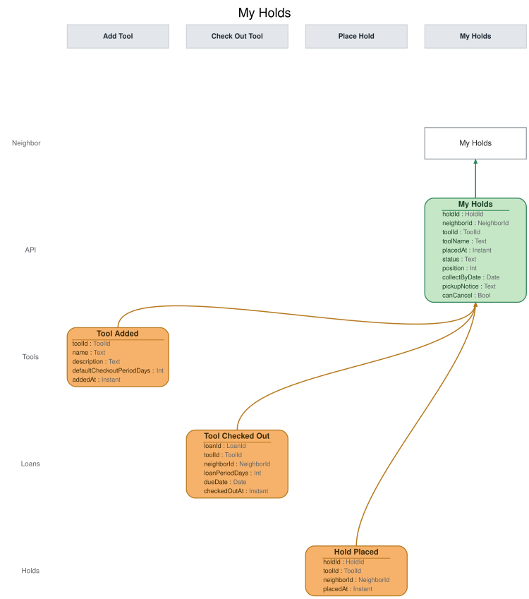

# Slice: My Holds

## Intent
Shows a neighbor the holds they have, on the My Holds screen: where they stand in each tool's
queue, and when a tool has been set aside for them, the date to collect it by and whether the
pickup email reached them. It is the only screen that tells a neighbor a tool is waiting for
them, and the screen they cancel holds from.

## Trigger & Actor
- **Actor:** a neighbor, opening their own My Holds screen.
- **Whose holds it shows:** the holds of the neighbor asking. Sign-in, handled outside the model, supplies the neighbor's ID, resolving a person to their newest account, or to their closed one only when they have no newer.
- **Actions offered:** nothing on this screen records anything by itself. Its one action issues
  a command owned by another slice:
  - **Cancel** (Cancel Hold slice) — offered on every listed hold (INV-MYHD-16).
  - A neighbor collects a set-aside tool with an ordinary checkout from the Tool Catalog, not
    from here.

## Read Model / View
- **View:** `My Holds` built from events: "Hold Placed", "Tool Checked Out", "Tool Added", "Hold
  Cancelled", "Hold Fulfilled", "Pickup Notice Sent", "Pickup Notice Failed", "Hold Expired",
  "Tool Retired", "Tool Lost", "Neighbor Account Closed"
- **Consumed by:** the My Holds screen (Neighbor)
- **Freshness / consistency expectation:** eventual for everything that comes from events: a
  change shows shortly after its event is recorded (seconds, not minutes). Whether a set-aside's
  pickup window has ended is worked out when the view is read, from collectByDate and today's
  date in the shed's local time zone, so it is always current. No action on this screen depends
  on the view being instant, because Cancel Hold and Check Out Tool each check their own rules
  when they run.

One row per hold that hasn't ended. HoldId, ToolId, LoanId and NeighborId are UUIDs. A Date is a
calendar date in the shed's local time zone; an Instant is a UTC instant set when the event was
recorded. A field marked optional can be absent.

| Field | Type | Source / Notes |
|-------|------|-----------------|
| holdId | HoldId | Hold Placed.holdId. |
| neighborId | NeighborId | Hold Placed.neighborId: the holder. |
| toolId | ToolId | Hold Placed.toolId. |
| toolName | Text | `Derived:` Tool Added.name for toolId, copied under this name (INV-MYHD-14). |
| placedAt | Instant | Hold Placed.placedAt. For display only; it doesn't decide the queue. |
| status | Text | One of `waiting`, `ready-for-pickup`, `pickup-window-ended`. `Derived:` see the status rules below. |
| position | Int | `Derived:` while status is `waiting`, 1 plus the number of this tool's holds that are waiting, were placed before this one, and haven't ended (INV-MYHD-2). Optional: absent once the hold is fulfilled. |
| collectByDate | Date | `Derived:` Hold Fulfilled.collectByDate for this hold, read as recorded, never worked out here (INV-MYHD-3). Optional: absent while waiting. |
| pickupNotice | Text | One of `none`, `sent`, `undelivered`. `Derived:` `sent` once Pickup Notice Sent is recorded for this hold, `undelivered` once Pickup Notice Failed is recorded for it, `none` before either (INV-MYHD-13). |
| canCancel | Bool | `Derived:` yes on every listed hold (INV-MYHD-16). |

**Status rules.** A hold's status is a test of its current facts, taken in this order. The first
that holds wins:
1. **pickup-window-ended** — Hold Fulfilled has been recorded for the hold, and today's date in
   the shed's local time zone is after its collectByDate (INV-MYHD-17).
2. **ready-for-pickup** — otherwise, Hold Fulfilled has been recorded for the hold.
3. **waiting** — otherwise.

**When a hold leaves the view.** A hold is listed from Hold Placed until it ends. A hold ends
when it is cancelled or expires, when the holder checks the tool out, when the tool is retired or
recorded lost, or when the holder closes their account. In events:
- Hold Cancelled or Hold Expired for the hold;
- Tool Checked Out for the hold's tool by the hold's neighbor;
- Tool Retired or Tool Lost for the hold's tool;
- Neighbor Account Closed for the holder.

**Queue order.** A tool's queue is the order in which Hold Placed was recorded for it. To work out
positions, the view keeps, for each tool, every hold on it that hasn't ended, with its holder and
whether it has been fulfilled. This is bookkeeping, not part of the row, and other neighbors'
holds are never returned.

**Queries**
- **List my holds.** Takes the asking neighbor's neighborId. Returns every hold of that neighbor
  that hasn't ended, each with every field above, and nothing about anyone else's holds
  (INV-MYHD-1). There is no paging. A neighbor with no holds gets an empty list. Holds are listed by tool name, ignoring case, then by when the hold was placed, in the order Hold Placed was recorded (INV-MYHD-18).

## Invariants / Business Rules
A neighbor has at most one hold on any one tool, because Place Hold refuses a second
(INV-HOLD-7, Place Hold). A suspended neighbor can't place a new hold (INV-HOLD-9) or collect a
set-aside tool (INV-CHK-7), but may still cancel. An expired hold sends no message, doesn't count
against the neighbor, and the neighbor may place a new hold on the tool at the back of the queue
(Expire Hold). A suspended neighbor keeps their holds and their place in
each queue. A front holder who can't collect, because they are suspended or have an overdue loan,
still has the tool set aside for them, and the pickup window runs regardless (Fulfill Hold,
INV-FUL-8). These rules are owned by those slices; this view just reflects the events they
record, and it doesn't hear suspension or loans at all (INV-MYHD-11).

- **INV-MYHD-1:** A neighbor's My Holds shows only their own holds.
  - The query returns only holds whose holder is the neighbor ID it is given. It never shows who
    else holds a tool, only the neighbor's own position. No neighbor-facing screen ever shows who has a tool or who holds one; only the shed manager sees borrowers, on Tool Inventory.
- **INV-MYHD-2:** Holds on a tool queue in the order they were placed. Each waiting hold shows
  the neighbor's position in that tool's queue.
  - Position 1 is the next hold to be fulfilled. A hold moves up as holds ahead of it are
    fulfilled or end.
  - A hold that has been fulfilled is no longer in the waiting queue, so the first waiting hold
    behind a set-aside is at position 1.
- **INV-MYHD-3:** Once a neighbor's hold is fulfilled, My Holds shows the tool as ready for
  pickup, with the date to collect it by.
  - The collect-by date is the one Hold Fulfilled carries: the date the tool was set aside plus 3
    days. My Holds shows it as recorded and never works it out itself.
  - My Holds is the only screen that tells a neighbor a tool is set aside for them. The Tool
    Catalog is the same for every neighbor.
- **INV-MYHD-4:** A hold that is ready for pickup stays on My Holds until the holder collects it,
  cancels it, or Hold Expired is recorded for it. Then it drops off.
  - The tool then passes to the next hold, which shows as ready for pickup on that neighbor's My
    Holds once Hold Fulfilled is recorded for it.
- **INV-MYHD-5:** When a holder checks out the tool they hold, their hold ends and drops off My
  Holds, whether or not it had been fulfilled.
  - The loan then appears on My Loans.
- **INV-MYHD-6:** A cancelled hold drops off My Holds, whether it was waiting or ready for pickup.
  - Cancelling a hold that is ready for pickup passes the tool to the next hold, the same as
    expiry.
- **INV-MYHD-7:** Retiring a tool, or recording it lost, ends every hold on it, and those holds
  drop off My Holds.
  - The holders are not told.
- **INV-MYHD-8:** Closing an account ends all of that neighbor's holds. Their holds drop off My
  Holds, and holds behind them move up.
  - A tool that was ready for pickup for them passes to the next hold, the same as expiry.
- **INV-MYHD-13:** Once a tool is set aside for a neighbor, My Holds shows whether the pickup
  email was sent or couldn't be delivered.
  - If the email can't be delivered, the tool stays ready for pickup, with the same collect-by
    date.
- **INV-MYHD-14:** Each hold shows the tool's name.
  - The name comes from Tool Added, which My Holds hears for that purpose.
- **INV-MYHD-11:** Only Hold Placed, Hold Cancelled, Hold Fulfilled, Pickup Notice Sent, Pickup
  Notice Failed, Hold Expired, Tool Checked Out by a holder of that tool, Tool Retired, Tool
  Lost and Neighbor Account Closed change My Holds. Tool Added supplies tool names.
  - A checkout by anyone else leaves every neighbor's My Holds unchanged.
- **INV-MYHD-15:** Applying the same event twice leaves My Holds as if it had been applied once.
- **INV-MYHD-16:** My Holds offers Cancel on every hold it lists.
  - That includes holds ready for pickup, holds whose pickup window has ended, and holds of a
    suspended neighbor.
- **INV-MYHD-17:** Once a set-aside's collect-by date has passed, My Holds shows that the pickup
  window has ended, even before Hold Expired is recorded.
  - From the start of the day after the collect-by date, in the shed's local time, the set-aside
    is no longer theirs: the tool goes to the next neighbor in the queue, or to whoever checks it
    out first if nobody is waiting (INV-CHK-3b, Check Out Tool). The hold drops off when Hold
    Expired is recorded.
- **INV-MYHD-18:** Holds are listed by tool name, ignoring case, then by when they were placed.
- **INV-MYHD-19:** A request with no sign-in is refused before anything else is checked.
- **INV-MYHD-20:** My Holds is answered only for the signed-in neighbor: a request for any other neighbor ID is refused.

## Scenarios (Given / When / Then)
- **Hold placed (INV-MYHD-2, INV-MYHD-14, INV-MYHD-16)**
  - **Given:** Tool Added was recorded for T1 "Cordless drill", Ana has T1 on loan, and nobody
    has a hold on it
  - **When:** Hold Placed is recorded for Ben's hold H1 on T1
  - **Then:** Ben's My Holds lists H1: "Cordless drill", `waiting`, position 1, pickup notice
    `none`, with Cancel offered.
- **A second hold placed (INV-MYHD-2)**
  - **Given:** Ben's H1 is at position 1 on T1
  - **When:** Hold Placed is recorded for Cara's hold H2 on T1
  - **Then:** Cara's My Holds lists H2, `waiting`, position 2. Ben's is unchanged.
- **Holds placed in the same instant (INV-MYHD-2)**
  - **Given:** Ben's H1 is at position 1 on T1
  - **When:** Hold Placed is recorded for Cara's H2 and then Dan's H3 on T1, with the same placedAt
  - **Then:** H2 is at position 2 and H3 at position 3: the order recorded decides, not placedAt.
- **Hold cancelled (INV-MYHD-6, INV-MYHD-2)**
  - **Given:** Ben's H1 is at position 1 and Cara's H2 at position 2 on T1
  - **When:** Hold Cancelled is recorded for H1
  - **Then:** H1 drops off Ben's My Holds. Cara's H2 is at position 1.
- **Hold fulfilled (INV-MYHD-3, INV-MYHD-2)**
  - **Given:** Ben's H1 is at position 1 and Cara's H2 at position 2 on T1, and T1 has been
    returned
  - **When:** Hold Fulfilled is recorded for H1, with the collect-by date 17 October
  - **Then:** Ben's My Holds shows H1 `ready-for-pickup`, collect by 17 October, with no position.
    Cara's H2 is at position 1.
- **Pickup email sent (INV-MYHD-13)**
  - **Given:** Ben's H1 is `ready-for-pickup`, pickup notice `none`
  - **When:** Pickup Notice Sent is recorded for H1
  - **Then:** H1 shows pickup notice `sent`.
- **Pickup email couldn't be delivered (INV-MYHD-13)**
  - **Given:** Ben's H1 is `ready-for-pickup`, collect by 17 October, pickup notice `sent`
  - **When:** Pickup Notice Failed is recorded for H1
  - **Then:** H1 shows pickup notice `undelivered`, still `ready-for-pickup`, collect by 17
    October.
- **Collect-by date is the last day (INV-MYHD-17)**
  - **Given:** Ben's H1 is `ready-for-pickup`, collect by 17 October
  - **When:** his holds are listed at 23:59 on 17 October, shed time
  - **Then:** H1 is `ready-for-pickup`.
- **Pickup window ended, not yet expired (INV-MYHD-17, INV-MYHD-16)**
  - **Given:** Ben's H1 is `ready-for-pickup`, collect by 17 October, and Hold Expired hasn't been
    recorded
  - **When:** his holds are listed at 00:00 on 18 October, shed time
  - **Then:** H1 shows `pickup-window-ended`, with Cancel still offered.
- **Hold expired (INV-MYHD-4)**
  - **Given:** Ben's H1 shows `pickup-window-ended`, and Cara's H2 is at position 1
  - **When:** Hold Expired is recorded for H1
  - **Then:** H1 drops off Ben's My Holds. Cara's H2 stays `waiting` at position 1 until Hold
    Fulfilled is recorded for it.
- **Suspended holder (INV-MYHD-3, INV-MYHD-11)**
  - **Given:** Ben is suspended, and his H1 is at position 1 on T1
  - **When:** T1 is returned and Hold Fulfilled is recorded for H1, collect by 17 October
  - **Then:** Ben's My Holds shows H1 `ready-for-pickup`, collect by 17 October.
- **Holder collects the tool (INV-MYHD-5)**
  - **Given:** Ben's H1 is `ready-for-pickup`, and Cara's H2 is at position 1
  - **When:** Tool Checked Out is recorded for T1 and Ben
  - **Then:** H1 drops off Ben's My Holds. Cara's is unchanged.
- **Front holder collects before the set-aside is recorded (INV-MYHD-5, INV-MYHD-2)**
  - **Given:** Ben's H1 is at position 1 and Cara's H2 at position 2 on T1, and T1 has just been
    returned
  - **When:** Tool Checked Out is recorded for T1 and Ben, before Hold Fulfilled
  - **Then:** H1 drops off Ben's My Holds. Cara's H2 is at position 1.
- **Ready-for-pickup hold cancelled (INV-MYHD-6)**
  - **Given:** Ben's H1 is `ready-for-pickup`, and Cara's H2 is at position 1
  - **When:** Hold Cancelled is recorded for H1
  - **Then:** H1 drops off Ben's My Holds. Cara's H2 stays `waiting` until Hold Fulfilled is
    recorded for it.
- **Tool retired (INV-MYHD-7)**
  - **Given:** Ben's H1 and Cara's H2 are on T1
  - **When:** Tool Retired is recorded for T1
  - **Then:** H1 and H2 drop off both neighbors' My Holds.
- **Tool recorded lost (INV-MYHD-7)**
  - **Given:** Ana has T1 on loan as loan L1, and Ben's H1 and Cara's H2 are on T1
  - **When:** Tool Lost is recorded for L1, the loan of T1
  - **Then:** H1 and H2 drop off both neighbors' My Holds.
- **Holder closes their account (INV-MYHD-8)**
  - **Given:** Ben's H1 is at position 1 and Cara's H2 at position 2 on T1
  - **When:** Neighbor Account Closed is recorded for Ben
  - **Then:** H1 drops off. Cara's H2 is at position 1.
- **Hold again after expiry (INV-MYHD-2)**
  - **Given:** Ben's H1 expired, and T1 is now set aside for Cara's H2
  - **When:** Hold Placed is recorded for Ben's new hold H4 on T1
  - **Then:** Ben's My Holds lists H4, `waiting`, position 1, behind Cara's set-aside.
- **Checkout by a neighbor with no hold (INV-MYHD-11)**
  - **Given:** Ana has no holds, and the hammer (T5) is available
  - **When:** Tool Checked Out is recorded for T5 and Ana
  - **Then:** no neighbor's My Holds changes.
- **Only their own holds (INV-MYHD-1)**
  - **Given:** Ben has H1 and Cara has H2, both on T1
  - **When:** Ben's holds are listed
  - **Then:** only H1 is returned, with its position. Nothing about H2 or Cara is returned.
- **List order (INV-MYHD-18)**
  - **Given:** Ben placed H5 on the ladder, then H1 on the cordless drill
  - **When:** his holds are listed
  - **Then:** H1 (cordless drill) comes first, then H5 (ladder).
- **Same event applied twice (INV-MYHD-15)**
  - **Given:** Ben's My Holds lists H1 at position 1
  - **When:** the same Hold Placed for H1 is applied again
  - **Then:** Ben's My Holds still lists H1 once, at position 1, and no later hold's position
    changes.
- **Not signed in (INV-MYHD-19)**
  - **Given:** nobody is signed in
  - **When:** My Holds is asked for
  - **Then:** refused with `not-signed-in`: "Please sign in." Nothing is returned.
- **Asked by the wrong person (INV-MYHD-20)**
  - **Given:** Ben (N2) is signed in
  - **When:** the holds of N1, Ana, are asked for
  - **Then:** refused with `requester-mismatch`: "You can only see your own holds." Nothing is returned.

## Alternate & Error Flows
Reading this view is guarded like a command. A refused read returns nothing and one reason: the
stable name, and the sentence shown on the screen. The checks run in this order:
1. `not-signed-in` (INV-MYHD-19).
2. `requester-mismatch` (INV-MYHD-20).

| Reason | Sentence | Rule |
|--------|----------|------|
| `not-signed-in` | Please sign in. | INV-MYHD-19 |
| `requester-mismatch` | You can only see your own holds. | INV-MYHD-20 |

- **Repeated events:** every event is applied idempotently (INV-MYHD-15). An event applied a
  second time leaves the view as it was after the first.
- **Events for a hold that has ended:** once a hold has ended it is gone from this view. A later
  event for it (a replay, or a Pickup Notice Failed that arrives after the set-aside ended)
  changes nothing.
- **Unknown tool name:** every hold's tool was added before it could be held, so Tool Added always
  precedes Hold Placed for the same tool.
- **Stale actions:** Cancel offered on the screen can be out of date by the time it is used (for
  example, just as the hold expires or the tool is collected). Cancel Hold checks its own rules
  and refuses with its own reason; this view raises no errors of its own.

## Non-Functional Requirements
- **Security / authz:** a neighbor may list only their own holds (INV-MYHD-1). The query is always asked for the signed-in neighbor's own ID, which sign-in, handled outside the model, supplies; a request for any other neighbor ID is refused `requester-mismatch` (INV-MYHD-20), and one with no sign-in `not-signed-in` (INV-MYHD-19).
- **PII & compliance:** shows a neighbor their own holds only, and never who else holds or has a
  tool. The other holders and borrowers it keeps for working out positions are never returned.
- **Performance / SLA:** none beyond the freshness above.

## Dependencies & Read Models Affected
- **Upstream events this slice relies on**, and the fields it reads from each:
  - Tool Added (Add Tool): toolId, name.
  - Hold Placed (Place Hold): holdId, toolId, neighborId, placedAt.
  - Hold Cancelled (Cancel Hold): holdId.
  - Hold Fulfilled (Fulfill Hold): holdId, collectByDate.
  - Pickup Notice Sent (Send Pickup Notice): holdId.
  - Pickup Notice Failed (Record Pickup Notice Failure): holdId.
  - Hold Expired (Expire Hold): holdId.
  - Tool Checked Out (Check Out Tool): loanId, toolId, neighborId.
  - Tool Retired (Retire Tool): toolId.
  - Tool Lost (Record Tool Lost): loanId, toolId. This view matches it by toolId.
  - Neighbor Account Closed (Close Account): neighborId.
  - Tool Added, Hold Placed and Tool Checked Out match slices/add-tool.md, slices/place-hold.md and
    slices/check-out-tool.md. The others are specified in slices not yet written in depth; these
    keys are this view's assumptions, and each is checked when that slice is.
- **Downstream read models / slices affected:** none. The screen it feeds issues Cancel Hold.

## Open Questions
None.
