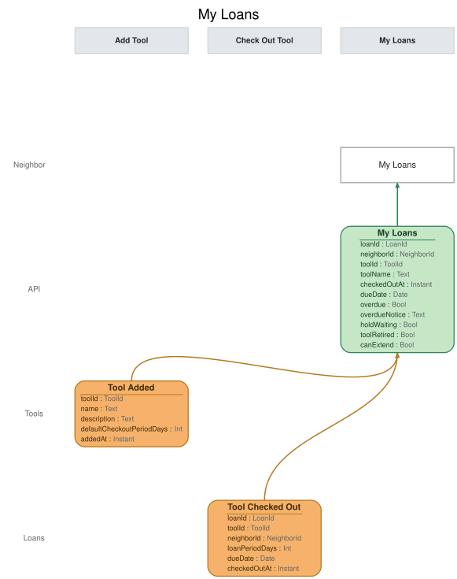

# Slice: My Loans

## Intent
Shows a neighbor the tools they have out right now, when each is due back, and anything that
stands in the way of keeping a tool longer: the loan is overdue, someone else is waiting for the
tool, or the tool has been retired. It also shows whether an overdue notice was sent or couldn't
be delivered. It is the screen the neighbor extends and returns loans from.

## Trigger & Actor
- **Actor:** a neighbor, opening their own My Loans screen.
- **Whose loans it shows:** the loans of the neighbor asking. Sign-in, handled outside the model, supplies the neighbor's ID, resolving a person to their newest account, or to their closed one only when they have no newer.
- **Actions offered:** nothing on this screen records anything by itself. Its actions issue
  commands owned by other slices:
  - **Return** (Return Tool slice) — offered on every listed loan (INV-MYL-12).
  - **Extend** (Extend Loan slice) — offered while canExtend is yes (INV-MYL-9, INV-MYL-10).

## Read Model / View
- **View:** `My Loans` built from events: "Tool Added", "Tool Checked Out", "Loan Extended",
  "Hold Placed", "Hold Cancelled", "Overdue Notice Sent", "Overdue Notice Failed", "Tool
  Returned", "Hold Expired", "Tool Retired", "Tool Lost", "Neighbor Account Closed"
- **Consumed by:** the My Loans screen (Neighbor)
- **Freshness / consistency expectation:** eventual for everything that comes from events: a
  change shows shortly after its event is recorded (seconds, not minutes). `overdue` is worked out
  when the view is read, from dueDate and today's date in the shed's local time zone, so it is
  always current. No action on this screen depends on the view being instant, because Extend Loan
  and Return Tool each check their own rules when they run.

One row per open loan. ToolId, LoanId, HoldId and NeighborId are UUIDs. A Date is a calendar date
in the shed's local time zone; an Instant is a UTC instant set when the event was recorded. A
field marked optional can be absent.

| Field | Type | Source / Notes |
|-------|------|-----------------|
| loanId | LoanId | Tool Checked Out.loanId. |
| neighborId | NeighborId | Tool Checked Out.neighborId: the borrower. |
| toolId | ToolId | Tool Checked Out.toolId. |
| toolName | Text | `Derived:` Tool Added.name for toolId, copied under this name. |
| checkedOutAt | Instant | Tool Checked Out.checkedOutAt. Shown as the checkout date: its calendar date in the shed's local time zone. |
| dueDate | Date | Tool Checked Out.dueDate, replaced by each Loan Extended.dueDate for this loan. |
| overdue | Bool | `Derived:` yes when today's date in the shed's local time zone is after dueDate (INV-MYL-4). Worked out when the view is read. |
| overdueNotice | Text | One of `none`, `sent`, `undelivered`. `Derived:` `sent` once Overdue Notice Sent is recorded for this loan, `undelivered` once Overdue Notice Failed is recorded for it, `none` before either (INV-MYL-5). |
| holdWaiting | Bool | `Derived:` yes while at least one hold on toolId is waiting (INV-MYL-9). See the hold rules below. |
| toolRetired | Bool | `Derived:` yes once Tool Retired is recorded for toolId (INV-MYL-10). |
| canExtend | Bool | `Derived:` yes unless overdue, holdWaiting or toolRetired is yes (INV-MYL-9, INV-MYL-10). Worked out when the view is read, because overdue is. |

**Hold rules.** A hold on the loan's tool is waiting from Hold Placed until it is fulfilled or
ends. This view doesn't hear Hold Fulfilled, and doesn't need to: a tool out on loan has no
fulfilled hold, except in the brief gap described under Alternate & Error Flows. So here a hold
counts as waiting from Hold Placed until it ends. A hold ends when:
- Hold Cancelled is recorded for it;
- Hold Expired is recorded for it;
- its holder checks the tool out (Tool Checked Out for this tool by the hold's neighbor);
- Tool Retired or Tool Lost is recorded for the tool;
- Neighbor Account Closed is recorded for the holder.

Holds placed before the loan began count the same as holds placed during it. To apply these
rules, the view keeps, for each tool, the hold ID and holder of each hold that hasn't ended. This
is bookkeeping, not part of the row, and is never returned.

**Queries**
- **List my loans.** Takes the asking neighbor's neighborId. Returns every open loan whose
  borrower is that neighbor, each with every field above, and nothing about anyone else's loans
  (INV-MYL-1). There is no paging. A neighbor with no open loans gets an empty list. Loans are listed by tool name, ignoring case, then by when the loan was checked out (checkedOutAt); loans checked out at the same instant keep the order their Tool Checked Out was recorded (INV-MYL-13).

## Invariants / Business Rules
- **INV-MYL-1:** A neighbor's My Loans shows only that neighbor's own loans.
  - The query returns only loans whose borrower is the neighbor ID it is given. It never shows who else has a tool or who is waiting for one. No neighbor-facing screen ever shows who has a tool or who holds one; only the shed manager sees borrowers, on Tool Inventory.
- **INV-MYL-2:** Every checkout appears on the borrower's My Loans as one loan, with the tool
  and its due date.
  - The due date is the one Tool Checked Out carries. How it is set is Check Out Tool's rule.
  - A holder collecting a tool set aside for them is an ordinary checkout and appears the same
    way.
- **INV-MYL-3:** When a loan is extended, its due date on My Loans becomes the extended due date.
  - The new due date is the one Loan Extended carries. How far an extension moves it is Extend
    Loan's rule (INV-EXT-3).
- **INV-MYL-4:** A loan shows as overdue from the start of the day after its due date, in the
  shed's local time, and not before.
  - Overdue is worked out by comparing the due date with today. No event marks a loan overdue,
    so the screen shows it overdue on the day after the due date with nothing recorded.
  - An overdue loan can't be extended (INV-EXT-5, Extend Loan), so once a loan is overdue it
    stays overdue until it ends.
- **INV-MYL-5:** Once an overdue notice is sent for a loan, My Loans shows that the borrower was
  notified.
  - If the notice later fails to deliver, My Loans shows instead that the overdue notice couldn't
    be delivered.
- **INV-MYL-6:** A returned loan drops off My Loans, and so does a loan ended by the shed manager
  recording the tool lost.
  - My Loans shows only what the neighbor has out now. It keeps no borrowing history.
- **INV-MYL-7:** Each loan shows the tool, the checkout date, the due date, whether it is
  overdue, and whether an overdue notice has been sent or couldn't be delivered.
  - There is no "due soon" state. Overdue is the only state a loan shows besides on loan.
- **INV-MYL-8:** A loan's entry changes only through its own checkout, extension, overdue notice,
  return or loss, and through holds starting or ending on its tool.
  - That is: Tool Checked Out, Loan Extended, Overdue Notice Sent, Overdue Notice Failed, Tool
    Returned, Tool Lost, Hold Placed, Hold Cancelled, Hold Expired, Tool Retired, and Neighbor
    Account Closed of a holder.
  - The tool's name comes from Tool Added.
- **INV-MYL-9:** While any hold is waiting on a loan's tool, My Loans shows that the loan can't
  be extended because someone is waiting.
  - A hold is waiting from Hold Placed until it is fulfilled or ends. A hold ends when it is
    cancelled or expires, when the holder checks the tool out, when the tool is retired or
    recorded lost, or when the holder closes their account. A tool on loan has no fulfilled hold,
    so for a loan's tool a hold waits until it ends.
  - This includes holds that were already waiting when the loan began. When no hold is waiting
    any more, the loan can be extended again.
- **INV-MYL-10:** An overdue loan, and a loan whose tool has been retired, are marked as not
  extendable.
  - A tool can be retired while it is on loan. The loan stays on My Loans until it is returned or
    the tool is recorded lost, like any other loan.
  - Suspension is not shown on My Loans. A suspended neighbor sees it on My Account, and Extend
    Loan refuses an extension they try with its own reason (INV-EXT-7, Extend Loan).
- **INV-MYL-11:** Applying the same event twice leaves My Loans as if it had been applied once.
- **INV-MYL-12:** My Loans offers Return on every loan it lists.
  - That includes overdue loans, loans whose tool has been retired, and loans of a suspended
    neighbor.
- **INV-MYL-13:** Loans are listed by tool name, ignoring case, then by when they were checked out.
- **INV-MYL-14:** A request with no sign-in is refused before anything else is checked.
- **INV-MYL-15:** My Loans is answered only for the signed-in neighbor: a request for any other neighbor ID is refused.

## Scenarios (Given / When / Then)
- **Tool checked out (INV-MYL-2, INV-MYL-7, INV-MYL-12)**
  - **Given:** Ana (N1) has no loans, and the cordless drill (T1) has no holds
  - **When:** Tool Checked Out is recorded at 10:00 on 5 October, shed time, for loan L1: Ana
    borrowing the drill, due 12 October
  - **Then:** Ana's My Loans lists L1: "Cordless drill", checked out 5 October, due 12 October,
    not overdue, overdue notice `none`, no hold waiting, extendable, with Return offered.
- **Loan extended (INV-MYL-3)**
  - **Given:** Ana's My Loans lists L1, due 12 October
  - **When:** Loan Extended is recorded for L1, with the due date 19 October
  - **Then:** Ana's My Loans lists L1 due 19 October.
- **Not overdue on the due date (INV-MYL-4)**
  - **Given:** Ana's My Loans lists L1, due 12 October
  - **When:** the list is read at 23:59 on 12 October, shed time
  - **Then:** L1 is not overdue, and is extendable.
- **Loan becomes overdue (INV-MYL-4, INV-MYL-10)**
  - **Given:** Ana's My Loans lists L1, due 12 October, and the drill hasn't been returned
  - **When:** the list is read at 00:00 on 13 October, shed time
  - **Then:** L1 shows as overdue and not extendable. Nothing is recorded.
- **Overdue notice sent (INV-MYL-5)**
  - **Given:** Ana's My Loans shows L1 as overdue, overdue notice `none`
  - **When:** Overdue Notice Sent is recorded for L1
  - **Then:** L1 shows overdue notice `sent`.
- **Overdue notice couldn't be delivered (INV-MYL-5)**
  - **Given:** Ana's My Loans shows L1 with overdue notice `sent`
  - **When:** Overdue Notice Failed is recorded for L1
  - **Then:** L1 shows overdue notice `undelivered`.
- **Tool returned (INV-MYL-6)**
  - **Given:** Ana's My Loans lists L1 (the drill) and L2 (a ladder)
  - **When:** Tool Returned is recorded for L1
  - **Then:** L1 drops off Ana's My Loans, and L2 is unchanged.
- **Tool recorded lost (INV-MYL-6)**
  - **Given:** Ana's My Loans lists L2, overdue
  - **When:** Tool Lost is recorded for L2
  - **Then:** L2 drops off Ana's My Loans.
- **Someone places a hold on the borrowed tool (INV-MYL-9)**
  - **Given:** Ana's My Loans lists L1, due 12 October, with no hold waiting
  - **When:** Hold Placed is recorded for Ben's hold H1 on the drill
  - **Then:** L1 shows a hold waiting and is not extendable. It doesn't say who is waiting.
- **One of two holds is cancelled (INV-MYL-9)**
  - **Given:** L1 shows a hold waiting, from Ben's hold H1 and Cara's hold H2
  - **When:** Hold Cancelled is recorded for H1
  - **Then:** L1 still shows a hold waiting, because H2 is.
- **The last waiting hold is cancelled (INV-MYL-9)**
  - **Given:** L1 shows a hold waiting, from H2 only
  - **When:** Hold Cancelled is recorded for H2
  - **Then:** L1 shows no hold waiting and is extendable again.
- **The waiting holder closes their account (INV-MYL-9)**
  - **Given:** L1 shows a hold waiting, from Ben's hold H1 only
  - **When:** Neighbor Account Closed is recorded for Ben
  - **Then:** L1 shows no hold waiting.
- **Tool retired while on loan (INV-MYL-9, INV-MYL-10, INV-MYL-12)**
  - **Given:** L1 shows a hold waiting, from Ben's hold H1, due 12 October
  - **When:** Tool Retired is recorded for the drill
  - **Then:** L1 is still listed, due 12 October, with the tool retired, no hold waiting (retiring
    ended H1), not extendable, and Return still offered.
- **Loan starts with a hold already waiting (INV-MYL-9)**
  - **Given:** the drill was returned with Ben's hold H1 at position 1 and Cara's hold H2 at
    position 2, and it was set aside for Ben
  - **When:** Tool Checked Out is recorded for loan L3: Ben collecting the drill
  - **Then:** H1 ends with Ben's checkout. Ben's My Loans lists L3 with a hold waiting, from H2,
    and not extendable.
- **Next loan after an expired hold (INV-MYL-9)**
  - **Given:** Ben's hold H1 on the drill was set aside for him and then Hold Expired was
    recorded for it. No other hold is waiting.
  - **When:** Tool Checked Out is recorded for loan L4: Dan borrowing the drill
  - **Then:** Dan's My Loans lists L4 with no hold waiting, and extendable.
- **Other neighbors' loans (INV-MYL-1)**
  - **Given:** Ana's My Loans lists L1
  - **When:** Tool Checked Out is recorded for loan L5: Ben borrowing a ladder
  - **Then:** Ben's My Loans lists L5, and Ana's My Loans is unchanged. Listing Ana's loans never
    returns L5.
- **Unrelated events don't change it (INV-MYL-8)**
  - **Given:** Ana's My Loans lists L1 (the drill, T1), due 12 October, with no hold waiting
  - **When:** Neighbor Suspended is recorded for Ana, and Hold Placed is recorded for Ben's hold
    on the ladder (T2)
  - **Then:** L1 is unchanged: still due 12 October, no hold waiting, extendable.
- **Same event applied twice (INV-MYL-11)**
  - **Given:** Ana's My Loans lists L1 once
  - **When:** the same Tool Checked Out for L1 is applied again
  - **Then:** Ana's My Loans still lists L1 once, unchanged.
- **List order (INV-MYL-13)**
  - **Given:** Ana checked out a ladder on 3 October, then a cordless drill on 5 October
  - **When:** her loans are listed
  - **Then:** the cordless drill comes first, then the ladder.
- **No loans (INV-MYL-1)**
  - **Given:** Ana has no open loans
  - **When:** her loans are listed
  - **Then:** the list is empty.
- **Not signed in (INV-MYL-14)**
  - **Given:** nobody is signed in
  - **When:** My Loans is asked for
  - **Then:** refused with `not-signed-in`: "Please sign in." Nothing is returned.
- **Asked by the wrong person (INV-MYL-15)**
  - **Given:** Ben (N2) is signed in
  - **When:** the loans of N1, Ana, are asked for
  - **Then:** refused with `requester-mismatch`: "You can only see your own loans." Nothing is returned.

## Alternate & Error Flows
Reading this view is guarded like a command. A refused read returns nothing and one reason: the
stable name, and the sentence shown on the screen. The checks run in this order:
1. `not-signed-in` (INV-MYL-14).
2. `requester-mismatch` (INV-MYL-15).

| Reason | Sentence | Rule |
|--------|----------|------|
| `not-signed-in` | Please sign in. | INV-MYL-14 |
| `requester-mismatch` | You can only see your own loans. | INV-MYL-15 |

- **Repeated events:** every event is applied idempotently (INV-MYL-11). An event applied a
  second time leaves the view as it was after the first.
- **Events for a loan that has ended:** once a loan is returned or its tool recorded lost, it is
  gone from this view. A later event for it (a replay, or an Overdue Notice Failed that arrives
  after the loan ended) changes nothing.
- **A lapsed set-aside that hasn't expired yet:** after a set-aside's collect-by date has passed,
  someone else may check the tool out before Hold Expired is recorded for the lapsed hold. This
  view doesn't hear Hold Fulfilled, so until Hold Expired lands it counts that hold as waiting,
  and the new loan briefly shows a hold waiting. It clears when Hold Expired is recorded.
- **Stale actions:** an action offered on the screen can be out of date by the time it is used
  (for example, Extend just as a hold is placed, or Return just as the shed manager records the
  tool lost). The command it issues checks its own rules and refuses with its own reason; this
  view raises no errors of its own.

## Non-Functional Requirements
- **Security / authz:** a neighbor may list only their own loans (INV-MYL-1). The query is always asked for the signed-in neighbor's own ID, which sign-in, handled outside the model, supplies; a request for any other neighbor ID is refused `requester-mismatch` (INV-MYL-15), and one with no sign-in `not-signed-in` (INV-MYL-14).
- **PII & compliance:** shows a neighbor their own loans only. It never shows who holds or is
  waiting for a tool. The holders it keeps for matching hold events are never returned.
- **Performance / SLA:** none beyond the freshness above.

## Dependencies & Read Models Affected
- **Upstream events this slice relies on**, and the fields it reads from each:
  - Tool Added (Add Tool): toolId, name.
  - Tool Checked Out (Check Out Tool): loanId, toolId, neighborId, dueDate, checkedOutAt.
  - Loan Extended (Extend Loan): loanId, dueDate.
  - Overdue Notice Sent (Send Overdue Notice): loanId.
  - Overdue Notice Failed (Record Overdue Notice Failure): loanId.
  - Tool Returned (Return Tool): loanId.
  - Tool Lost (Record Tool Lost): loanId.
  - Hold Placed (Place Hold): holdId, toolId, neighborId.
  - Hold Cancelled (Cancel Hold): holdId.
  - Hold Expired (Expire Hold): holdId.
  - Tool Retired (Retire Tool): toolId.
  - Neighbor Account Closed (Close Account): neighborId.
  - Tool Added's keys match slices/add-tool.md, and the loan and hold events' keys match
    slices/tool-inventory.md and slices/tool-catalog.md. checkedOutAt matches Check Out Tool
    (slices/check-out-tool.md). The other events are specified in slices not yet written in
    depth; these keys are this view's assumptions, and each is checked when that slice is.
- **Downstream read models / slices affected:** none. The screen it feeds issues Extend Loan and
  Return Tool.

## Open Questions
None.
- [x] INV-MYL-12 (Return offered on every loan) has no enforcement site in this slice; rephrase it to cite Return Tool's INV-RET-5/7/9, which it relies on, or drop it (conformance 2026-11-01, uncertainty) — v1: v1 keeps the sentence; no code change; deferred to v2 (2026-11-01, Mike Key)
