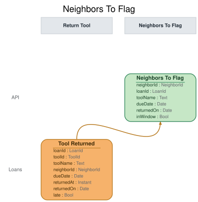

# Slice: Neighbors To Flag

## Intent
The late-return flagger's to-do list: every neighbor whose late returns have reached the
threshold (3 within 90 days) and who hasn't yet been flagged for them, with the loans those late
returns belong to. The flagger works through it, so the shed manager sees each of these neighbors
on Flagged Neighbors and decides whether to suspend them.

## Trigger & Actor
- **Actor:** the Late Return Flagger, a system processor in the Flag Neighbor slice
  (slices/flag-neighbor.md). No person or screen reads this list.
- **What the flagger does with it:** for each neighbor returned, it issues Flag Neighbor naming
  the loans returned, which the flag uses up.

## Read Model / View
- **View:** `Neighbors To Flag` built from events: "Tool Checked Out", "Tool Returned", "Neighbor
  Flagged", "Neighbor Suspended", "Neighbor Reinstated", "Neighbor Account Closed"
- **Consumed by:** the Late Return Flagger (Flag Neighbor). Internal: no ui.
- **Freshness / consistency expectation:** eventual for everything that comes from events
  (seconds, not minutes). Which late returns are still within the 90 days is worked out when the
  list is read, from returnedOn and today's date in the shed's local time zone.

The view keeps one row for every late return that can still count toward a flag; the query
groups them by neighbor. LoanId and NeighborId are UUIDs. A Date is a calendar date in the shed's
local time zone.

| Field | Type | Source / Notes |
|-------|------|-----------------|
| neighborId | NeighborId | Tool Checked Out.neighborId for the loan: the borrower. |
| loanId | LoanId | Tool Returned.loanId. |
| returnedOn | Date | Tool Returned.returnedOn. |
| inWindow | Bool | `Derived:` yes while returnedOn is today or one of the 89 days before it, in the shed's local time zone (INV-NTF-2). Worked out when the list is read. |

To decide whether a return creates a row, the view also keeps, beyond its rows, every loan's
borrower (from Tool Checked Out) and every neighbor's current status: active, suspended (from
Neighbor Suspended until Neighbor Reinstated) or closed (from Neighbor Account Closed). These are
bookkeeping, not rows, and are never returned.

**When a row is created.** Tool Returned with late = yes creates a row for the loan's borrower,
unless the borrower is suspended or their account is closed (INV-NTF-6, INV-NTF-7). An on-time
return creates nothing. Lateness is read from Tool Returned.late, recorded once by Return Tool;
this view never works it out.

**When rows are removed.**
- Neighbor Flagged removes the rows for the loans it names as used up (INV-NTF-3).
- Neighbor Suspended and Neighbor Reinstated remove all of the neighbor's rows (INV-NTF-5,
  INV-NTF-7).
- Neighbor Account Closed removes all of the neighbor's rows (INV-NTF-6).

Nothing puts a row back.

**Queries**
- **List neighbors to flag.** Takes nothing. Returns each neighbor who has at least 3 rows with
  inWindow yes, with their neighborId and the loanIds of those rows (all of them, if more than
  3). There is no paging. The order doesn't matter to the flagger.

## Invariants / Business Rules
- **INV-NTF-1:** Only late returns count toward the threshold.
  - Whether a return was late is recorded on Tool Returned (late), worked out by Return Tool
    against the loan's due date in force, after any extensions. A return on the due date is on
    time.
  - A loan that is still out doesn't count, even if it is overdue, until it is returned late.
  - A tool recorded lost never counts as a late return, even if the loan was overdue: it is
    never returned, so it never produces a Tool Returned.
- **INV-NTF-2:** A neighbor is on the list when they have 3 or more late returns within the last
  90 days that haven't counted toward a flag.
  - The 90 days are a rolling window, counted back from today by the date of each return. A late
    return older than that no longer counts. A late return counts on the day it was returned and the
    next 89 days, 90 calendar days in all, in the shed's local time. A return on 1 June counts
    through 29 August.
- **INV-NTF-3:** Once Neighbor Flagged is recorded for a neighbor, the late returns it names are
  used up and never count again.
  - Neighbor Flagged names, by loan, every late return that counted when the flag was recorded.
    This list and Flagged Neighbors both read that set.
  - The neighbor leaves the list, and is flagged again only after 3 new late returns within 90
    days.
  - A flag the shed manager doesn't act on stays on Flagged Neighbors. It doesn't put the
    neighbor back on this list.
- **INV-NTF-5:** Reinstatement starts a neighbor's late-return count again from zero.
  - Late returns from before Neighbor Reinstated never count toward a later flag.
- **INV-NTF-6:** A neighbor whose account is closed is never flagged.
  - Once Neighbor Account Closed is recorded, the neighbor leaves the list if they are on it. An
    account can't be closed while tools are on loan, so no late return follows a closure.
- **INV-NTF-7:** A suspended neighbor is never flagged.
  - Once Neighbor Suspended is recorded, the neighbor leaves the list if they are on it, and late
    returns while they are suspended aren't counted. Reinstatement then starts their count again
    from zero.
- **INV-NTF-8:** Applying the same event twice leaves the list as if it had been applied once.

The list has no screen; only the Late Return Flagger reads it. The shed manager sees flagged
neighbors on Flagged Neighbors.

## Scenarios (Given / When / Then)
Unless a scenario says otherwise: Ana is an active neighbor with no late returns counting, and
today is 5 October.

- **On-time return doesn't count (INV-NTF-1)**
  - **Given:** Ana's drill loan L1 is due 12 October
  - **When:** Tool Returned is recorded for L1 on 12 October, with late = no
  - **Then:** no row is created, and Ana is not on the list.
- **Late return below the threshold (INV-NTF-2)**
  - **Given:** Ana has one late return counting, on 1 September
  - **When:** Tool Returned is recorded for her loan L2 on 20 September, with late = yes
  - **Then:** Ana has two late returns counting, and she is not on the list.
- **Third late return within 90 days (INV-NTF-2)**
  - **Given:** Ana has late returns counting on 1 September (L1) and 20 September (L2)
  - **When:** Tool Returned is recorded for her loan L3 on 5 October, with late = yes
  - **Then:** the list returns Ana with L1, L2 and L3.
- **Old late return has dropped out of the window (INV-NTF-2)**
  - **Given:** Ana has late returns on 1 June and 20 September, neither used up
  - **When:** Tool Returned is recorded for her loan on 5 October, with late = yes
  - **Then:** only two of Ana's late returns are within 90 days, and the list doesn't return her.
- **Four late returns in the window (INV-NTF-2)**
  - **Given:** Ana has late returns counting on 1, 10 and 20 September, and the flagger hasn't
    acted yet
  - **When:** Tool Returned is recorded for her loan on 5 October, with late = yes
  - **Then:** the list returns Ana with all four loans.
- **Neighbor flagged (INV-NTF-3)**
  - **Given:** the list returns Ana with L1, L2 and L3
  - **When:** Neighbor Flagged is recorded for Ana, naming L1, L2 and L3
  - **Then:** those rows are removed, and Ana is not on the list.
- **Flagged again only on new late returns (INV-NTF-3)**
  - **Given:** Ana was flagged on 5 October, using up L1, L2 and L3
  - **When:** Tool Returned is recorded for her loan L4 on 12 October, with late = yes
  - **Then:** Ana has one late return counting, L4, and she is not on the list.
- **Reinstatement resets the count (INV-NTF-5)**
  - **Given:** Ana was suspended and has since been reinstated, and had two late returns counting
    before her suspension
  - **When:** Tool Returned is recorded for her loan on 10 October, with late = yes
  - **Then:** Ana has one late return counting, and she is not on the list.
- **Account closed while on the list (INV-NTF-6)**
  - **Given:** the list returns Ana, waiting to be flagged
  - **When:** Neighbor Account Closed is recorded for Ana
  - **Then:** Ana's rows are removed, and the list doesn't return her.
- **Suspended while on the list (INV-NTF-7)**
  - **Given:** the list returns Ana, waiting to be flagged
  - **When:** Neighbor Suspended is recorded for Ana
  - **Then:** Ana's rows are removed, and the list doesn't return her.
- **Late return while suspended (INV-NTF-7)**
  - **Given:** Ana is suspended
  - **When:** Tool Returned is recorded for her loan, with late = yes
  - **Then:** no row is created.
- **Last day in the window (INV-NTF-2)**
  - **Given:** Ana has late returns counting on 8 July, 20 September and 1 October; today is 5
    October, which is 89 days after 8 July
  - **When:** the list is read on 5 October
  - **Then:** all three are in the window, and the list returns Ana.
- **First day out of the window (INV-NTF-2)**
  - **Given:** as above, but today is 6 October, 90 days after 8 July
  - **When:** the list is read on 6 October
  - **Then:** the 8 July return no longer counts, and the list doesn't return Ana.
- **Same event applied twice (INV-NTF-8)**
  - **Given:** Ana has late returns counting on 1 and 20 September
  - **When:** the same Tool Returned for her 20 September return is applied again
  - **Then:** Ana still has two late returns counting.

## Alternate & Error Flows
- **Repeated events:** every event is applied idempotently (INV-NTF-8).
- **The flagger reads a neighbor twice before Neighbor Flagged lands:** the list may return the
  same neighbor on two reads in a row. Flagging once for the same late returns is Flag Neighbor's
  rule, enforced when it records Neighbor Flagged; this list raises no errors of its own.
- **Daylight-saving changes:** the day boundary is midnight in the shed's local time zone,
  whatever its offset from UTC that day.

## Non-Functional Requirements
- **Security / authz:** read only by the Late Return Flagger. No person or screen reads it.
- **PII & compliance:** holds neighbor and loan IDs and return dates only. No names or emails.
- **Performance / SLA:** none beyond the freshness above.

## Dependencies & Read Models Affected
- **Upstream events this slice relies on**, and the fields it reads from each:
  - Tool Checked Out (Check Out Tool): loanId, neighborId (whose loan it was).
  - Tool Returned (Return Tool): loanId, returnedOn, late.
  - Neighbor Flagged (Flag Neighbor): neighborId, loanIds (LoanId[]): the loans it uses up.
  - Neighbor Suspended (Suspend Neighbor), Neighbor Reinstated (Reinstate Neighbor), Neighbor
    Account Closed (Close Account): neighborId.
  - These keys match check-out-tool.md and return-tool.md. Loan Extended is no longer read here:
    lateness comes from Tool Returned.late.
- **Downstream read models / slices affected:** none. The Late Return Flagger reads it and issues
  Flag Neighbor.

## Open Questions
None.
