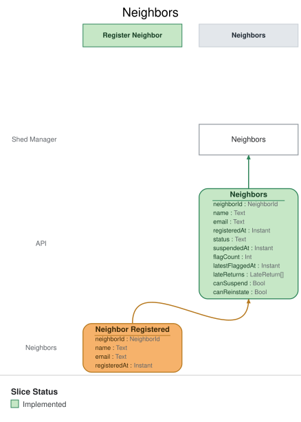

# Slice: Neighbors

## Intent
Shows the shed manager every neighbor account that has signed up, with each account's current
status (active, suspended or closed), on the Neighbors screen. Account closures surface here, and
the shed manager can suspend any active neighbor from this screen.

## Trigger & Actor
- **Actor:** the shed manager, opening the Neighbors screen.
- **What it shows:** one entry per account ever registered, built from the events listed under
  Read Model / View. Nothing on this screen records anything by itself; its one action issues a
  command owned by another slice:
  - **Suspend** (Suspend Neighbor slice) — offered on every active account (INV-NBRS-6).

## Read Model / View
- **View:** `Neighbors` built from events: "Neighbor Registered", "Neighbor Email Changed",
  "Neighbor Suspended", "Neighbor Reinstated", "Neighbor Account Closed"
- **Consumed by:** the Neighbors screen (Shed Manager)
- **Freshness / consistency expectation:** eventual. An entry reflects an event shortly after it
  is recorded (seconds, not minutes). Suspend checks its own rules when it runs, so a stale
  entry can't suspend someone who is no longer active.

One row per account. A NeighborId is a UUID. An Instant is a UTC instant set when the event was
recorded.

| Field | Type | Source / Notes |
|-------|------|-----------------|
| neighborId | NeighborId | Neighbor Registered.neighborId. |
| name | Text | Neighbor Registered.name. Never changes. Need not be unique. |
| email | Text | Neighbor Registered.email, replaced by each Neighbor Email Changed.email for this account. Always the account's current email. |
| registeredAt | Instant | Neighbor Registered.registeredAt. Shown as the sign-up date: its calendar date in the shed's local time zone (INV-NBRS-5). |
| status | Text | One of `active`, `suspended`, `closed`. `Derived:` see the status rules below. |
| canSuspend | Bool | `Derived:` yes while status is `active` (INV-NBRS-6). |

**Status rules.** An account's status is a test of its current facts, taken in this order. The
first that holds wins:
1. **closed** — Neighbor Account Closed has been recorded for the account.
2. **suspended** — otherwise, Neighbor Suspended has been recorded and no Neighbor Reinstated
   since.
3. **active** — otherwise.

**Queries**
- **List the neighbors.** Takes nothing. Returns every account, each with neighborId, name,
  email, registeredAt, status and canSuspend. There is no paging: the query always returns every
  account, ordered by name, then by registeredAt (INV-NBRS-8).

## Invariants / Business Rules
- **INV-NBRS-1:** Every account appears on the Neighbors screen exactly once.
  - One entry per Neighbor Registered; nothing else creates an entry. A neighbor who signs up
    again after closing their account has a new account, so they appear twice: the closed
    entry and the new one.
- **INV-NBRS-2:** Each account's status is active, suspended or closed, worked out by the status
  rules above.
  - Neighbor Registered → active. Neighbor Suspended → suspended. Neighbor Reinstated →
    active. Neighbor Account Closed → closed.
- **INV-NBRS-3:** An account that is closed stays listed, shown as closed.
  - This screen is where the shed manager sees account closures.
  - This differs from Flagged Neighbors and Suspended Neighbors, where a closed account drops
    off (INV-FLN-6, INV-SPN-5): those lists offer an action a closed account can't take, while
    this one is the record of every account.
- **INV-NBRS-4:** Closed is final.
  - A suspended neighbor who closes their account shows as closed, not suspended. No later event
    changes a closed account's status.
- **INV-NBRS-5:** Each entry shows the account's name, its current email, its sign-up date, and
  its status.
  - The email is set by Neighbor Registered and replaced by each Neighbor Email Changed. The name
    never changes.
- **INV-NBRS-6:** The screen offers Suspend on every active account, whether or not the neighbor
  has been flagged, and on no other.
  - Suspend Neighbor checks its own rules when it runs.
- **INV-NBRS-8:** Accounts are listed by name, ignoring case, then by when they signed up.
  - So a neighbor who signed up again after closing appears twice, the older account first.
- **INV-NBRS-7:** Applying the same event twice leaves the Neighbors screen as if it had been
  applied once.
- **INV-NBRS-9:** Only the shed manager can read the Neighbors screen.
  - A signed-in caller without the shed-manager role is refused with `not-shed-manager`, and a
    caller with no sign-in with `not-signed-in`. Nothing is returned to either.

## Scenarios (Given / When / Then)
- **Neighbor registered (INV-NBRS-1, INV-NBRS-2, INV-NBRS-5, INV-NBRS-6)**
  - **Given:** no neighbors have signed up
  - **When:** Neighbor Registered is recorded for Ana Ruiz, ana@example.org
  - **Then:** the Neighbors screen lists Ana Ruiz, ana@example.org, signed up on today's date, as
    active, with Suspend offered.
- **Two neighbors with the same name (INV-NBRS-1)**
  - **Given:** the Neighbors screen lists Ana Ruiz, ana@example.org
  - **When:** Neighbor Registered is recorded for a different account, also named Ana Ruiz,
    with ana.r@example.net
  - **Then:** the Neighbors screen lists both, as separate entries.
- **Same event applied twice (INV-NBRS-7)**
  - **Given:** the Neighbors screen lists Ana once, as active
  - **When:** the same Neighbor Registered for Ana is applied again
  - **Then:** the Neighbors screen still lists Ana once.
- **Email changed (INV-NBRS-5)**
  - **Given:** the Neighbors screen lists Ana Ruiz with ana@example.org, as active
  - **When:** Neighbor Email Changed is recorded for Ana, to ana.ruiz@example.net
  - **Then:** the Neighbors screen lists Ana Ruiz with ana.ruiz@example.net, still active.
- **Neighbor suspended (INV-NBRS-2, INV-NBRS-6)**
  - **Given:** the Neighbors screen lists Ana as active, and Ben as active
  - **When:** Neighbor Suspended is recorded for Ana
  - **Then:** the Neighbors screen shows Ana as suspended, with no Suspend offered. Ben is
    unchanged.
- **Neighbor reinstated (INV-NBRS-2, INV-NBRS-6)**
  - **Given:** the Neighbors screen shows Ana as suspended
  - **When:** Neighbor Reinstated is recorded for Ana
  - **Then:** the Neighbors screen shows Ana as active again, with Suspend offered.
- **Account closed (INV-NBRS-3, INV-NBRS-6)**
  - **Given:** the Neighbors screen lists Ana as active
  - **When:** Neighbor Account Closed is recorded for Ana
  - **Then:** the Neighbors screen still lists Ana, now shown as closed, with no Suspend offered.
- **Suspended neighbor closes their account (INV-NBRS-4)**
  - **Given:** the Neighbors screen shows Ana as suspended
  - **When:** Neighbor Account Closed is recorded for Ana
  - **Then:** the Neighbors screen shows Ana as closed.
- **Closed stays closed (INV-NBRS-4)**
  - **Given:** the Neighbors screen shows Ana's account as closed
  - **When:** an earlier Neighbor Suspended or Neighbor Reinstated for that account is applied
    again
  - **Then:** the account is still shown as closed.
- **Signing up again after closing (INV-NBRS-1, INV-NBRS-3)**
  - **Given:** the Neighbors screen shows Ana Ruiz's account, ana@example.org, as closed
  - **When:** Neighbor Registered is recorded for a new account for Ana Ruiz, with
    ana@example.org
  - **Then:** the Neighbors screen lists two entries for Ana Ruiz with ana@example.org: the old
    account, still closed, and the new one, active, with Suspend offered.
- **Listing order (INV-NBRS-8)**
  - **Given:** Ben Ito signed up on 2 October; Ana Ruiz signed up on 1 October, closed her
    account, and signed up again on 5 October
  - **When:** the shed manager lists the neighbors
  - **Then:** the accounts come back as: Ana Ruiz (signed up 1 October, closed), Ana Ruiz
    (signed up 5 October, active), then Ben Ito.
- **Listing the neighbors**
  - **Given:** the Neighbors screen lists Ana (active), Ben (suspended) and Cara (closed)
  - **When:** the shed manager's screen lists the neighbors
  - **Then:** all three are returned with all their fields, with no paging. Only Ana's entry
    offers Suspend.
- **A neighbor tries to read the list (INV-NBRS-9)**
  - **Given:** the Neighbors screen has entries
  - **When:** a neighbor, signed in without the shed-manager role, asks for the neighbors
  - **Then:** refused with `not-shed-manager`: "Only the shed manager can see this screen."
    Nothing is returned.
- **No sign-in (INV-NBRS-9)**
  - **Given:** the Neighbors screen has entries
  - **When:** a caller with no sign-in asks for the neighbors
  - **Then:** refused with `not-signed-in`: "Please sign in." Nothing is returned.

## Alternate & Error Flows
- **Read refusals:** the list query refuses a caller without the shed-manager role with
  `not-shed-manager` ("Only the shed manager can see this screen."), and a caller with no
  sign-in with `not-signed-in` ("Please sign in."). Nothing is returned on a refusal. These
  mean the same conditions as in the shed manager's commands.
- **Repeated events:** every event is applied idempotently (INV-NBRS-7). An event applied a
  second time leaves the entry as it was after the first.
- **Event for an account the view hasn't seen:** events are applied in the order they were
  recorded, and every account starts with Neighbor Registered, so this can't happen.
- **Stale actions:** Suspend offered on the screen can be out of date by the time it is used
  (for example, on a neighbor who has just closed their account). Suspend Neighbor checks its
  own rules and refuses with its own reason; this view raises no errors of its own.

## Non-Functional Requirements
- **Security / authz:** the Neighbors screen is the shed manager's alone; neighbors see only
  their own account, on My Account. Sign-in, handled outside the shed's events, supplies the
  shed-manager role; only a caller with it may read this view.
- **PII & compliance:** shows every account's name, current email and sign-up date to the shed
  manager, including closed accounts, which stay listed. A replaced email is not kept in the
  view. Names and emails are kept with the shed's loan and hold history and are never erased.
- **Performance / SLA:** none beyond the freshness above.

## Dependencies & Read Models Affected
- **Upstream events this slice relies on**, and the fields it reads from each:
  - Neighbor Registered (Register Neighbor): neighborId, name, email, registeredAt.
  - Neighbor Email Changed (Change Email): neighborId, email.
  - Neighbor Suspended (Suspend Neighbor): neighborId.
  - Neighbor Reinstated (Reinstate Neighbor): neighborId.
  - Neighbor Account Closed (Close Account): neighborId.
  - These keys match slices/register-neighbor.md. The other four events are specified in slices
    not yet written in depth; each is checked against these keys when it is.
- **Downstream read models / slices affected:** none. The screen it feeds issues Suspend
  Neighbor.

## Open Questions
None.
