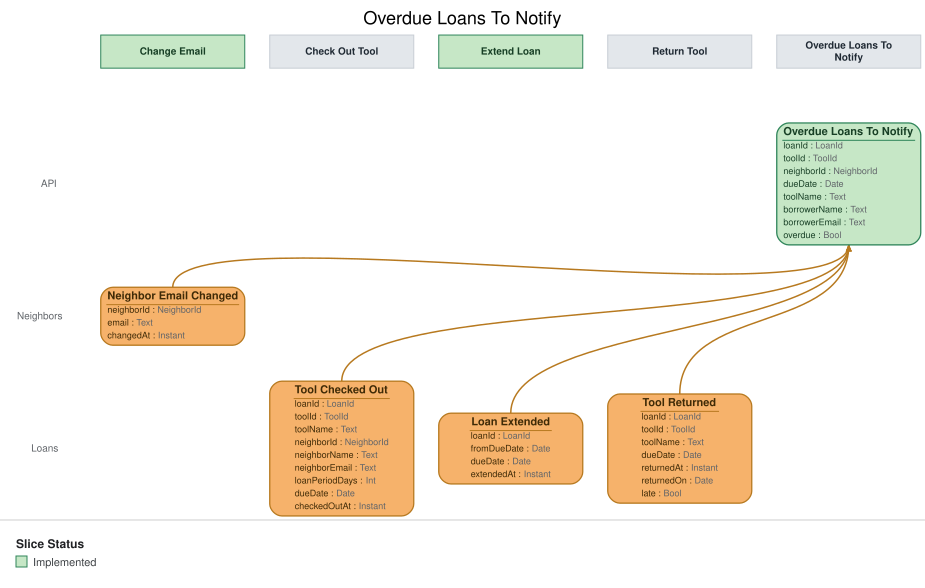

# Slice: Overdue Loans To Notify

## Intent
The list of overdue loans whose borrowers have not yet been sent an overdue notice. The overdue
notice gateway works through it, so each borrower with an overdue loan is emailed once, as soon
as the loan is overdue. Each item carries everything the email needs, so the gateway looks
nothing up elsewhere.

## Trigger & Actor
- **Actor:** the Overdue Notice Gateway, a system reaction in the Send Overdue Notice slice. No
  person reads this list, and it has no screen.
- **What the gateway does with it:** for each loan on the list, it hands one notice to the email
  provider and records Overdue Notice Sent (Send Overdue Notice slice). How often it checks the
  list is that slice's concern.

## Read Model / View
- **View:** `Overdue Loans To Notify` built from events: "Tool Added", "Neighbor Registered",
  "Tool Checked Out", "Loan Extended", "Overdue Notice Sent", "Neighbor Email Changed", "Tool
  Returned", "Tool Lost"
- **Consumed by:** the Overdue Notice Gateway (Send Overdue Notice). Internal: no ui.
- **Freshness / consistency expectation:** eventual for everything that comes from events: a
  change shows shortly after its event is recorded (seconds, not minutes). Whether a loan is
  overdue is worked out when the list is read, from dueDate and today's date in the shed's local
  time zone, so a loan is on the list from the first read after midnight following its due date.

The view keeps one row for every open loan that hasn't been sent a notice; the query returns only
the overdue ones. LoanId, ToolId and NeighborId are UUIDs. A Date is a calendar date in the
shed's local time zone.

| Field | Type | Source / Notes |
|-------|------|-----------------|
| loanId | LoanId | Tool Checked Out.loanId. |
| toolId | ToolId | Tool Checked Out.toolId. |
| neighborId | NeighborId | Tool Checked Out.neighborId: the borrower. |
| dueDate | Date | Tool Checked Out.dueDate, replaced by each Loan Extended.dueDate for this loan. |
| toolName | Text | `Derived:` Tool Added.name for toolId, copied under this name. |
| borrowerName | Text | `Derived:` Neighbor Registered.name for neighborId, copied under this name. |
| borrowerEmail | Text | `Derived:` Neighbor Registered.email for neighborId, replaced by each Neighbor Email Changed.email for that neighbor, copied under this name. Always the current one. |
| overdue | Bool | `Derived:` yes when today's date in the shed's local time zone is after dueDate (INV-OLN-1). Worked out when the list is read. |

**Bookkeeping.** To fill toolName, borrowerName and borrowerEmail the moment a loan starts, the
view keeps the name and current email of every registered neighbor, and the name of every tool,
not only those on a row. This is never returned except on the rows the query returns.

**When a row leaves the view.** A loan's row is removed when Overdue Notice Sent, Tool Returned or
Tool Lost is recorded for it (INV-OLN-8). Nothing puts it back.

**Queries**
- **List loans to notify.** Takes nothing. Returns every row whose overdue is yes, with loanId,
  toolId, neighborId, dueDate, toolName, borrowerName and borrowerEmail. There is no paging. The
  order doesn't matter to the gateway, which sends one notice per loan.

## Invariants / Business Rules
A loan is ready for its notice as soon as it joins the list. When the email goes out, with no
quiet hours, is Send Overdue Notice's rule (INV-OVN-6, Send Overdue Notice).

- **INV-OLN-1:** A loan is on the list from the start of the day after its due date, in the
  shed's local time, while the tool is still out and no overdue notice has been sent for it.
  - Overdue is worked out by comparing the due date with today. No event marks a loan overdue;
    the loan joins the list because the date has passed.
- **INV-OLN-2:** A loan's due date is the one set at checkout, moved by each extension.
  - A loan extended before it became overdue joins the list only once its new due date has
    passed.
- **INV-OLN-3:** Once an overdue notice is sent for a loan, the loan leaves the list and never
  comes back.
  - One notice per loan. An overdue loan can't be extended (INV-EXT-5, Extend Loan), so it stays
    overdue until it ends, and no second notice goes out.
- **INV-OLN-4:** When the tool is returned, or the shed manager records it lost, its loan leaves
  the list.
  - A loan that ends this way before its notice went out never gets a notice.
  - A closed account never has a loan on the list, because an account can't be closed while
    tools are on loan (INV-CLS-7, Close Account).
  - A loan whose tool is retired while it is out stays on the list and still gets its notice:
    the loan carries on until the tool is returned or recorded lost.
- **INV-OLN-6:** Each loan on the list carries everything the notice needs: the borrower's name
  and email, the tool's name, and the due date.
  - The borrower's name comes from Neighbor Registered, and the email is the borrower's current
    one: Neighbor Registered sets it, Neighbor Email Changed replaces it. The tool's name comes
    from Tool Added, and the due date from Tool Checked Out, moved by any Loan Extended. The
    gateway looks nothing up elsewhere.
- **INV-OLN-8:** A loan leaves the list only when an overdue notice is sent for it, when the
  tool is returned, or when the tool is recorded lost.
  - A notice that later fails to deliver doesn't put the loan back on the list. The failure is
    shown to the shed manager on Undelivered Notices, and no further attempt is made.
- **INV-OLN-9:** Applying the same event twice leaves the list as if it had been applied once.

## Scenarios (Given / When / Then)
- **Loan not yet overdue (INV-OLN-1)**
  - **Given:** Tool Checked Out was recorded for loan L1: Ana (N1) borrowing the cordless drill
    (T1), due 12 October
  - **When:** the list is read at 23:59 on 12 October, shed time
  - **Then:** L1 is not returned.
- **Loan becomes overdue (INV-OLN-1, INV-OLN-6)**
  - **Given:** Neighbor Registered was recorded for N1, "Ana Ruiz", ana@example.org; Tool Added
    for T1, "Cordless drill"; and L1 is due 12 October, still out
  - **When:** the list is read at 00:00 on 13 October, shed time
  - **Then:** L1 is returned, with toolName "Cordless drill", borrowerName "Ana Ruiz",
    borrowerEmail ana@example.org, and dueDate 12 October.
- **Extended before it became overdue (INV-OLN-2)**
  - **Given:** L1 is due 12 October
  - **When:** Loan Extended is recorded for L1 on 10 October, with the due date 19 October
  - **Then:** L1 is not returned when the list is read on 13 October, and is returned from 00:00
    on 20 October if still out.
- **Overdue notice sent (INV-OLN-3, INV-OLN-8)**
  - **Given:** L1 is on the list
  - **When:** Overdue Notice Sent is recorded for L1
  - **Then:** L1 leaves the list, and is never returned again while the drill is out.
- **Returned before the notice (INV-OLN-4)**
  - **Given:** L1 is on the list
  - **When:** Tool Returned is recorded for L1 before any notice is sent
  - **Then:** L1 leaves the list, and no notice is sent for it.
- **Tool recorded lost (INV-OLN-4)**
  - **Given:** L1 is on the list
  - **When:** Tool Lost is recorded for L1
  - **Then:** L1 leaves the list, and no notice is sent for it.
- **Tool retired while out (INV-OLN-4)**
  - **Given:** L1 is due 12 October and still out, and Tool Retired was recorded for T1 on 11
    October
  - **When:** the list is read at 00:00 on 13 October
  - **Then:** L1 is returned, ready for its notice.
- **Borrower changes their email (INV-OLN-6)**
  - **Given:** L1 is on the list, carrying ana@oldmail.example
  - **When:** Neighbor Email Changed is recorded for N1, to ana@example.org
  - **Then:** L1 stays on the list, now carrying ana@example.org, so the notice goes to the new
    address.
- **Email changed before the loan is overdue (INV-OLN-6)**
  - **Given:** L1 is due 12 October, and N1's email was changed to ana@example.org on 10 October
  - **When:** the list is read at 00:00 on 13 October
  - **Then:** L1 is returned carrying ana@example.org.
- **Several borrowers (INV-OLN-1)**
  - **Given:** L1 (Ana, due 12 October) and L2 (Ben, due 14 October) are both out
  - **When:** the list is read on 13 October
  - **Then:** only L1 is returned.
- **Same event applied twice (INV-OLN-9)**
  - **Given:** L1 is on the list once
  - **When:** the same Tool Checked Out for L1 is applied again
  - **Then:** L1 is still on the list once.
- **Replayed sent notice (INV-OLN-3, INV-OLN-9)**
  - **Given:** Overdue Notice Sent was recorded for L1, so L1 is off the list
  - **When:** the same Overdue Notice Sent is applied again
  - **Then:** L1 is still off the list.

## Alternate & Error Flows
- **Repeated events:** every event is applied idempotently (INV-OLN-9). An event applied a second
  time leaves the list as it was after the first.
- **Events for a loan that has left the list:** once a loan's row is removed, a later Loan
  Extended, Tool Returned or Tool Lost for it (a replay) changes nothing. An Overdue Notice Failed
  doesn't reach this list at all.
- **The gateway reads a loan twice before Overdue Notice Sent lands:** the list may return the
  same loan on two reads in a row. Sending one notice per loan is the Send Overdue Notice slice's
  rule, enforced when it records Overdue Notice Sent; this list raises no errors of its own.
- **Daylight-saving changes:** the day boundary is midnight in the shed's local time zone,
  whatever its offset from UTC that day.

## Non-Functional Requirements
- **Security / authz:** read only by the Overdue Notice Gateway. No person or screen reads it.
- **PII & compliance:** holds the name and current email of every registered neighbor, and
  hands them to the gateway only for borrowers with an overdue loan. It shows them on no screen.
- **Performance / SLA:** none beyond the freshness above. A loan is ready as soon as it joins the
  list; how soon the email goes out after that is Send Overdue Notice's concern.

## Dependencies & Read Models Affected
- **Upstream events this slice relies on**, and the fields it reads from each:
  - Tool Added (Add Tool): toolId, name.
  - Neighbor Registered (Register Neighbor): neighborId, name, email.
  - Neighbor Email Changed (Change Email): neighborId, email.
  - Tool Checked Out (Check Out Tool): loanId, toolId, neighborId, dueDate.
  - Loan Extended (Extend Loan): loanId, dueDate.
  - Overdue Notice Sent (Send Overdue Notice): loanId.
  - Tool Returned (Return Tool): loanId.
  - Tool Lost (Record Tool Lost): loanId.
  - These match slices/add-tool.md, slices/register-neighbor.md, slices/check-out-tool.md,
    slices/extend-loan.md and slices/my-loans.md. Change Email, Send Overdue Notice, Return Tool
    and Record Tool Lost are specified in slices not yet written in depth; these keys are this
    view's assumptions, and each is checked when that slice is.
- **Downstream read models / slices affected:** Send Overdue Notice, whose gateway works from
  this list and records Overdue Notice Sent.

## Open Questions
None.
