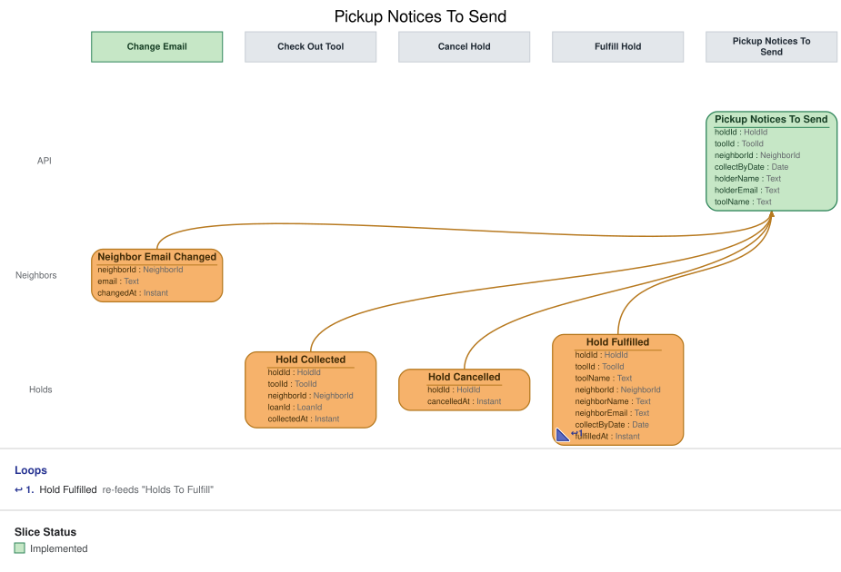

# Slice: Pickup Notices To Send

## Intent
The pickup notice gateway's to-do list: every tool set aside for a holder whose pickup email has
not gone out yet, with everything the email needs.

## Invariants / Business Rules
- **INV-PNS-1:** A hold is on the list from the moment Hold Fulfilled is recorded for it until its
  pickup email is sent.
- **INV-PNS-2:** Each item carries what the email needs: the holder's name and email, the tool's
  name, and the date the tool was set aside.
  - The name comes from Neighbor Registered, and the email is the holder's current one:
    Neighbor Registered sets it, Neighbor Email Changed replaces it. The tool's name comes from
    Tool Added. The
    collect-by date is the set-aside date plus 3 days.
- **INV-PNS-3:** Once Pickup Notice Sent is recorded for a hold, it leaves the list and never
  comes back.
- **INV-PNS-4:** A hold leaves the list, unsent, when its set-aside ends first: the holder
  collects the tool, the hold is cancelled or expires, the tool is retired, or the holder closes
  their account.
- **INV-PNS-6:** A failed pickup email doesn't change the list.
  - Every Pickup Notice Failed follows a Pickup Notice Sent, which already took the hold off the
    list.
- **INV-PNS-5:** The list has no screen. Only the pickup notice gateway reads it.

## Scenarios (Given / When / Then)
- **Set-aside joins the list**
  - **Given:** Ben Ito registered with ben@example.org, the cordless drill was added, and Ben's
    hold on the drill is at the front of its queue
  - **When:** Hold Fulfilled is recorded for Ben's hold on 14 October
  - **Then:** Ben's hold is on the list with Ben Ito, ben@example.org, "Cordless drill", and a
    set-aside date of 14 October.
- **Pickup email sent**
  - **Given:** Ben's hold is on the list
  - **When:** Pickup Notice Sent is recorded for it
  - **Then:** Ben's hold leaves the list.
- **Hold cancelled before the email**
  - **Given:** Ben's hold is on the list
  - **When:** Hold Cancelled is recorded for it
  - **Then:** Ben's hold leaves the list.
- **Tool retired before the email**
  - **Given:** Ben's hold on the drill is on the list
  - **When:** Tool Retired is recorded for the drill
  - **Then:** Ben's hold leaves the list.
- **Holder closes their account before the email**
  - **Given:** Ben's hold is on the list
  - **When:** Neighbor Account Closed is recorded for Ben
  - **Then:** Ben's hold leaves the list.
- **Holder collects before the email**
  - **Given:** Ben's hold on the drill is on the list
  - **When:** Tool Checked Out is recorded for the drill and Ben
  - **Then:** Ben's hold leaves the list.
- **Hold expired before the email**
  - **Given:** Ben's hold is on the list
  - **When:** Hold Expired is recorded for it
  - **Then:** Ben's hold leaves the list.
- **No set-aside, nothing to send**
  - **Given:** the list is empty
  - **When:** Neighbor Registered is recorded for Cara, and Tool Added for a ladder
  - **Then:** the list is still empty.
- **Holder changes their email before the email goes out**
  - **Given:** Ben's hold is on the list with ben@example.org
  - **When:** Neighbor Email Changed is recorded for Ben, to ben.ito@example.net
  - **Then:** Ben's hold stays on the list, now with ben.ito@example.net, and the pickup email
    goes to that address.

## Open Questions
None.
