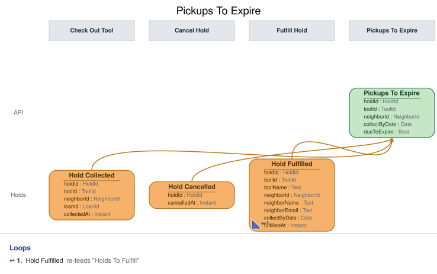

# Slice: Pickups To Expire

## Intent
The pickup expirer's to-do list: every tool currently set aside for a holder, with the date it
must be collected by. The expirer works through the ones whose collect-by date has passed, so a
set-aside the holder doesn't collect in time ends and the tool moves on to the next neighbor.

## Trigger & Actor
- **Actor:** the Pickup Expirer, a system processor in the Expire Hold slice
  (slices/expire-hold.md). No person or screen reads this list.
- **What the expirer does with it:** it reads the set-asides that are due to expire, and issues
  Expire Hold for each.

## Read Model / View
- **View:** `Pickups To Expire` built from events: "Hold Fulfilled", "Tool Checked Out", "Hold
  Cancelled", "Hold Expired", "Tool Retired", "Neighbor Account Closed"
- **Consumed by:** the Pickup Expirer (Expire Hold). Internal: no ui.
- **Freshness / consistency expectation:** eventual for everything that comes from events: a
  set-aside joins or leaves shortly after its event is recorded (seconds, not minutes). Whether a
  set-aside is due to expire is worked out when the list is read, from collectByDate and today's
  date in the shed's local time zone, so it becomes due from the first read after the midnight
  that ends its collect-by date.

The view keeps one row for every live set-aside; the query returns only those due to expire.
HoldId, ToolId and NeighborId are UUIDs. A Date is a calendar date in the shed's local time zone.

| Field | Type | Source / Notes |
|-------|------|-----------------|
| holdId | HoldId | Hold Fulfilled.holdId. |
| toolId | ToolId | Hold Fulfilled.toolId. |
| neighborId | NeighborId | Hold Fulfilled.neighborId: the holder. |
| collectByDate | Date | Hold Fulfilled.collectByDate, as recorded there. Never worked out here. |
| dueToExpire | Bool | `Derived:` yes when today's date in the shed's local time zone is after collectByDate (INV-PTE-2). Worked out when the list is read. |

**When a row leaves the view.** A set-aside's row is removed when:
- Tool Checked Out is recorded for its tool by its holder (matching toolId and neighborId);
- Hold Cancelled or Hold Expired is recorded for its hold;
- Tool Retired is recorded for its tool; or
- Neighbor Account Closed is recorded for its holder.

Nothing puts a row back. A tool recorded lost is always on loan, so it is never set aside, and
Tool Lost needs no rule here.

**Queries**
- **List set-asides to expire.** Takes nothing. Returns every row whose dueToExpire is yes, with
  holdId, toolId, neighborId and collectByDate. There is no paging. The order doesn't matter to
  the expirer, which expires each one.

## Invariants / Business Rules
- **INV-PTE-1:** A set-aside is on the list from Hold Fulfilled, with the collect-by date
  recorded on it.
  - One row per Hold Fulfilled; nothing else creates a row.
- **INV-PTE-2:** A set-aside is due to expire once its collect-by date has passed.
  - This is worked out by comparing the collect-by date with today. No event marks the
    set-aside as lapsed.
  - The set-aside lapses at the start of the day after its collect-by date, in the shed's local
    time. On the collect-by date itself it is not due.
- **INV-PTE-3:** When the holder checks the tool out, the set-aside leaves the list.
- **INV-PTE-4:** When the holder cancels the hold, the set-aside leaves the list.
- **INV-PTE-5:** When Hold Expired is recorded, the set-aside leaves the list.
- **INV-PTE-6:** When the tool is retired or the holder closes their account, the set-aside
  leaves the list.
  - Both end the hold.
- **INV-PTE-9:** A checkout by anyone other than the holder doesn't take the set-aside off the
  list.
  - After the cut-off, the next holder, or anyone if no hold is waiting, may check the tool out
    before Hold Expired is recorded (Check Out Tool, INV-CHK-3b). The lapsed hold still gets its
    Hold Expired.
- **INV-PTE-10:** Applying the same event twice leaves the list as if it had been applied once.

The pickup window runs regardless of whether the holder can collect: it doesn't pause while the
holder is suspended or has an overdue loan (Fulfill Hold, INV-FUL-8; Expire Hold). This list
treats every set-aside alike.

The list has no screen; only the Pickup Expirer reads it.

## Scenarios (Given / When / Then)
Unless a scenario says otherwise: Hold Fulfilled was recorded for Ben's hold H1 on the cordless
drill on 10 October, with a collect-by date of 13 October.

- **Tool set aside (INV-PTE-1)**
  - **Given:** the list is empty
  - **When:** Hold Fulfilled is recorded for H1: the drill, Ben, collect by 13 October
  - **Then:** H1 is on the list, collect by 13 October, not due to expire.
- **On the collect-by date (INV-PTE-2)**
  - **Given:** H1 is on the list, and Ben hasn't collected the drill
  - **When:** the list is read during 13 October, shed time
  - **Then:** H1 is not returned: it isn't due yet.
- **Collect-by date passes (INV-PTE-2)**
  - **Given:** H1 is on the list, and Ben hasn't collected the drill
  - **When:** the list is read after the start of 14 October, shed time
  - **Then:** H1 is returned as due to expire. Nothing is recorded until the expirer acts.
- **Holder collects in time (INV-PTE-3)**
  - **Given:** H1 is on the list
  - **When:** Tool Checked Out is recorded for the drill and Ben on 12 October
  - **Then:** H1 leaves the list.
- **Someone else takes a lapsed set-aside (INV-PTE-9)**
  - **Given:** H1 is on the list and due to expire, and Cara's hold was waiting behind it
  - **When:** Tool Checked Out is recorded for the drill and Cara on 14 October
  - **Then:** H1 stays on the list, still due to expire. It leaves only when Hold Expired is
    recorded for it.
- **Holder cancels (INV-PTE-4)**
  - **Given:** H1 is on the list
  - **When:** Hold Cancelled is recorded for H1
  - **Then:** H1 leaves the list.
- **Set-aside expires (INV-PTE-5)**
  - **Given:** H1 is on the list and due to expire
  - **When:** Hold Expired is recorded for H1
  - **Then:** H1 leaves the list. If Hold Fulfilled is then recorded for Cara's hold H2, H2 joins
    the list with its own collect-by date.
- **Tool retired (INV-PTE-6)**
  - **Given:** H1 is on the list
  - **When:** Tool Retired is recorded for the drill
  - **Then:** H1 leaves the list.
- **Holder closes their account (INV-PTE-6)**
  - **Given:** H1 is on the list
  - **When:** Neighbor Account Closed is recorded for Ben
  - **Then:** H1 leaves the list.
- **Same event applied twice (INV-PTE-10)**
  - **Given:** H1 is on the list once
  - **When:** the same Hold Fulfilled for H1 is applied again
  - **Then:** H1 is still on the list once, with the same collect-by date.

## Alternate & Error Flows
- **Repeated events:** every event is applied idempotently (INV-PTE-10). An event applied a
  second time leaves the list as it was after the first.
- **Events for a set-aside no longer listed:** once a row has left, a later Tool Checked Out,
  Hold Cancelled, Hold Expired, Tool Retired or Neighbor Account Closed for it changes nothing.
- **The expirer reads a set-aside twice before Hold Expired lands:** the list may return the same
  hold on two reads in a row. Expiring a hold once is Expire Hold's rule, enforced when it
  records Hold Expired; this list raises no errors of its own.
- **Daylight-saving changes:** the day boundary is midnight in the shed's local time zone,
  whatever its offset from UTC that day.

## Non-Functional Requirements
- **Security / authz:** read only by the Pickup Expirer. No person or screen reads it.
- **PII & compliance:** holds IDs and dates only. No names or emails.
- **Performance / SLA:** none beyond the freshness above. How soon a due set-aside is expired is
  Expire Hold's concern.

## Dependencies & Read Models Affected
- **Upstream events this slice relies on**, and the fields it reads from each:
  - Hold Fulfilled (Fulfill Hold): holdId, toolId, neighborId, collectByDate.
  - Tool Checked Out (Check Out Tool): toolId, neighborId.
  - Hold Cancelled (Cancel Hold), Hold Expired (Expire Hold): holdId.
  - Tool Retired (Retire Tool): toolId.
  - Neighbor Account Closed (Close Account): neighborId.
  - These keys match the deep-passed docs and the Hold Fulfilled convention.
- **Downstream read models / slices affected:** none. The Pickup Expirer reads it and issues
  Expire Hold.

## Open Questions
None.
