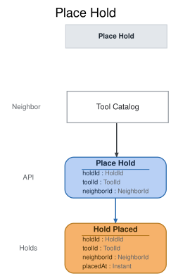

# Slice: Place Hold

## Intent
Let a neighbor get in line for a tool that isn't available to borrow right now, by placing a hold
from the Tool Catalog. Holds on a tool are fulfilled in the order they were placed: when the tool
is back in the shed, it is set aside for the neighbor at the front of the queue.

## Trigger & Actor
A neighbor, from the Tool Catalog, on a tool that is checked out, set aside for a holder, or
reserved (back in the shed with holds waiting, not yet set aside). The catalog is the same for
every neighbor, so it offers Place Hold on every such tool to everyone; a neighbor who may not
hold it is refused with a reason they can see. The shed manager doesn't place holds.

## Command / Input
**Command:** `Place Hold`

A HoldId, ToolId or NeighborId is a UUID.

| Field | Type | Required | Rules / Validation |
|-------|------|----------|--------------------|
| holdId | HoldId | yes | A UUID chosen by the caller for the new hold, so a retried request is recognised. Must not belong to a different hold already placed (INV-HOLD-13). |
| toolId | ToolId | yes | The tool to hold. Must be a tool that has been added (INV-HOLD-14), not retired (INV-HOLD-3), and not available (INV-HOLD-2). |
| neighborId | NeighborId | yes | The neighbor placing the hold, who must be the one making the request (INV-HOLD-1). Must be a registered account (INV-HOLD-14), not closed (INV-HOLD-4) and not suspended (INV-HOLD-9). |

## Trigger
**Triggered by:** screen `Tool Catalog` @Neighbor

## Event(s) Emitted
**Event:** `Hold Placed` → context `Holds`
**Read by:** My Holds (its own slice, which shows the neighbor their place in the queue), Tool
Catalog (holds waiting, and a tool's status), My Loans (a hold waiting on a borrowed tool), and
Holds To Fulfill (the queue the hold fulfiller works from).

| Field | Type | Immutable Fact? | Source / Notes |
|-------|------|-----------------|----------------|
| holdId | HoldId | yes | From the command. Identifies the hold everywhere from here on. |
| toolId | ToolId | yes | From the command. |
| neighborId | NeighborId | yes | From the command: the holder. |
| placedAt | Instant | yes | The UTC moment the event is recorded, set by the system. For display only: the queue is the order Hold Placed is recorded, since two holds can share a timestamp. |

Every field is fixed for good. A hold's later life (fulfilled, cancelled, expired, ended) is
recorded by other events; nothing changes Hold Placed.

## Read Model / View
This slice produces no view of its own. Hold Placed feeds four views, each specified in its own
doc:
- My Holds (slices/my-holds.md) shows the neighbor the new hold and its place in the queue.
- Tool Catalog (slices/tool-catalog.md) counts it among the holds waiting on the tool.
- My Loans (slices/my-loans.md) shows the borrower of the tool that someone is waiting.
- Holds To Fulfill (slices/holds-to-fulfill.md) adds it to the tool's queue.

All are eventually consistent: the hold shows once each view has caught up with Hold Placed.

## Invariants / Business Rules
A tool's state, for these rules, is tested against its events as already recorded, in this
order; the first that holds wins:
1. **checked-out** — a loan of the tool is open: Tool Checked Out recorded, and neither Tool
   Returned nor Tool Lost for that loan.
2. **set-aside** — otherwise, a hold on the tool has been fulfilled and hasn't ended.
3. **reserved** — otherwise, at least one hold on the tool is waiting.
4. **available** — otherwise.

This is the same test the Tool Catalog uses for a tool's status.

A hold is waiting from Hold Placed until it is fulfilled or ends. A hold ends when it is cancelled
or expires, when the holder checks the tool out, when the tool is retired or recorded lost, or
when the holder closes their account. Once fulfilled, the tool is set aside for the holder until
the end of the collect-by date, the set-aside date plus 3 days; a set-aside whose collect-by date
has passed still counts as set aside until Hold Expired is recorded for it. Other slices record
these endings; this slice reads them.

The Tool Catalog is the same for every neighbor, so it offers Place Hold on every tool that isn't
available and can't hide the action from a neighbor who may not use it. Each rule below that
refuses a neighbor (INV-HOLD-4, INV-HOLD-7, INV-HOLD-8, INV-HOLD-9) does so with a reason the
neighbor can see.

- **INV-HOLD-1:** A neighbor places a hold themselves, from the Tool Catalog, and only for
  themselves.
  - The neighbor ID must be the neighbor making the request. How the requester is recognised is
    the open identity question below.
- **INV-HOLD-2:** A hold can be placed on any tool that isn't available.
  - That is a tool that is checked out, set aside for a holder, or back in the shed with holds
    waiting but not yet set aside.
  - A hold on an available tool is refused. The neighbor checks it out instead.
- **INV-HOLD-3:** A hold can't be placed on a retired tool.
  - A tool recorded lost is retired by that. Retiring a tool ends every hold on it.
- **INV-HOLD-4:** A neighbor whose account is closed can't place a hold.
  - Closing an account ends all of that neighbor's holds.
- **INV-HOLD-5:** A new hold joins the back of the tool's queue.
  - The order is the order Hold Placed events are recorded for the tool. placedAt is for display
    only, since two holds can share a timestamp. Holds on one tool are decided one at a time, so
    no two share a place.
  - Holds are fulfilled in queue order; that is Fulfill Hold's rule (INV-FUL-2).
- **INV-HOLD-7:** A neighbor can have only one hold on a given tool.
  - A second hold by the same neighbor on the same tool is refused, whether their first hold is
    waiting or set aside.
  - A hold that has ended doesn't count. After cancelling, or once their hold has expired, the
    neighbor may hold the tool again, at the back of the queue.
- **INV-HOLD-8:** A neighbor can't place a hold on a tool they have on loan themselves.
- **INV-HOLD-9:** A suspended neighbor can't place a new hold.
  - Holds they placed before the suspension keep their place in the queue.
- **INV-HOLD-10:** A neighbor with an overdue loan may place a hold.
  - The overdue loan stops them collecting the tool if it is set aside for them (Check Out Tool,
    INV-CHK-5), not placing the hold.
- **INV-HOLD-11:** There is no limit on how many holds one neighbor can have at once.
- **INV-HOLD-13:** Placing a hold with a hold ID that is already used places no new hold.
  - A repeat with the same tool and neighbor succeeds and records nothing new, whatever has
    happened to the hold since. A repeat with a different tool or neighbor is refused
    (`hold-id-in-use`).
- **INV-HOLD-14:** The tool must have been added, and the neighbor must be a registered account.

## Scenarios (Given / When / Then)
- **Happy path: first hold on a checked-out tool (INV-HOLD-2, INV-HOLD-5)**
  - **Given:** Ana (N1) has the cordless drill (T1) on loan, due 12 October, and no holds are
    waiting on it. Ben (N2) is active.
  - **When:** Ben places hold H1 on T1 from the Tool Catalog
  - **Then:** Hold Placed is recorded for H1: T1, N2, and the time it was placed.
- **Second hold queues behind the first (INV-HOLD-5)**
  - **Given:** T1 is checked out, and Ben's hold H1 on it is waiting
  - **When:** Cleo (N3) places hold H2 on T1
  - **Then:** Hold Placed is recorded for H2, after H1. H2 is behind H1 in T1's queue.
- **Hold on a set-aside tool (INV-HOLD-2)**
  - **Given:** T1 was returned and is set aside for Ben's hold H1, and no other hold is waiting
  - **When:** Cleo places hold H2 on T1
  - **Then:** Hold Placed is recorded for H2, behind Ben's set-aside.
- **Hold on a reserved tool (INV-HOLD-2)**
  - **Given:** T1 has just been returned, Ben's hold H1 is waiting, and Hold Fulfilled has not yet
    been recorded
  - **When:** Cleo places hold H2 on T1
  - **Then:** Hold Placed is recorded for H2, behind H1.
- **Available tool (INV-HOLD-2)**
  - **Given:** the ladder (T2) is in the shed with no holds
  - **When:** Ben tries to place a hold on T2
  - **Then:** refused with `tool-available`: "This tool is available. Check it out instead." No
    event is recorded.
- **Retired tool (INV-HOLD-3)**
  - **Given:** T1 was retired while Ana had it on loan
  - **When:** Ben tries to place a hold on T1
  - **Then:** refused with `tool-retired`: "This tool has been retired." No event is recorded.
- **Already holding this tool (INV-HOLD-7)**
  - **Given:** T1 is checked out, and Ben's hold H1 on it is waiting
  - **When:** Ben tries to place hold H3 on T1
  - **Then:** refused with `already-holding`: "You already have a hold on this tool." No event is
    recorded.
- **Already holding this tool, set aside for them (INV-HOLD-7)**
  - **Given:** T1 is set aside for Ben's hold H1
  - **When:** Ben tries to place hold H3 on T1
  - **Then:** refused with `already-holding`: "You already have a hold on this tool." No event is
    recorded.
- **Holding again after cancelling (INV-HOLD-7)**
  - **Given:** T1 is checked out, Ben's hold H1 on it was cancelled, and Cleo's hold H2 is waiting
  - **When:** Ben places hold H4 on T1
  - **Then:** Hold Placed is recorded for H4, behind H2.
- **Holding again after expiry (INV-HOLD-7)**
  - **Given:** T1 was set aside for Ben's hold H1, Hold Expired was recorded for H1, and Cleo now
    has T1 on loan
  - **When:** Ben places hold H5 on T1
  - **Then:** Hold Placed is recorded for H5.
- **Tool on loan to the neighbor (INV-HOLD-8)**
  - **Given:** Ana has T1 on loan
  - **When:** Ana tries to place a hold on T1
  - **Then:** refused with `tool-on-loan-to-you`: "You have this tool on loan." No event is
    recorded.
- **Suspended neighbor (INV-HOLD-9)**
  - **Given:** T1 is checked out by Ana, and Ben is suspended
  - **When:** Ben tries to place a hold on T1
  - **Then:** refused with `neighbor-suspended`: "You can't place holds while your account is
    suspended." No event is recorded.
- **Closed account (INV-HOLD-4)**
  - **Given:** T1 is checked out by Ana, and Ben's account is closed
  - **When:** a hold on T1 is requested for Ben
  - **Then:** refused with `account-closed`: "This account is closed." No event is recorded.
- **Neighbor with an overdue loan (INV-HOLD-10)**
  - **Given:** Ben has the ladder on loan, overdue, and Ana has T1 on loan
  - **When:** Ben places hold H6 on T1
  - **Then:** Hold Placed is recorded for H6.
- **Holds on several tools (INV-HOLD-11)**
  - **Given:** Ben's hold H1 on T1 is waiting, and the hedge trimmer (T3) is checked out by Ana
  - **When:** Ben places hold H7 on T3
  - **Then:** Hold Placed is recorded for H7. Ben now has holds on T1 and T3.
- **A hold for someone else (INV-HOLD-1)**
  - **Given:** T1 is checked out by Ana
  - **When:** a request from Ben asks to place a hold on T1 for Cleo
  - **Then:** refused with `requester-mismatch`: "You can only place holds for yourself." No
    event is recorded.
- **Unknown tool (INV-HOLD-14)**
  - **Given:** no tool has ID T9
  - **When:** Ben asks to place a hold on T9
  - **Then:** refused with `tool-not-found`: "There is no such tool." No event is recorded.
- **Unknown neighbor (INV-HOLD-14)**
  - **Given:** T1 is checked out by Ana, and no account has neighbor ID N9
  - **When:** a hold on T1 is requested for N9
  - **Then:** refused with `neighbor-not-found`: "There is no such neighbor." No event is
    recorded.
- **Hold on a lapsed set-aside (INV-HOLD-2)**
  - **Given:** T1 was set aside for Ben's hold H1, collect by 17 October, and Hold Expired hasn't
    been recorded for H1
  - **When:** on 18 October, Cleo places hold H8 on T1
  - **Then:** Hold Placed is recorded for H8. T1 still counts as set aside, not available.
- **Lapsed holder holds again before expiry (INV-HOLD-7)**
  - **Given:** T1 was set aside for Ben's hold H1, collect by 17 October, and Hold Expired hasn't
    been recorded for H1
  - **When:** on 18 October, Ben tries to place hold H9 on T1
  - **Then:** refused with `already-holding`: "You already have a hold on this tool." No event is
    recorded. Once Hold Expired is recorded for H1, he may hold T1 again.
- **The same request arrives twice (INV-HOLD-13)**
  - **Given:** Hold Placed was recorded for H1: T1, Ben
  - **When:** the same Place Hold request for H1, T1, Ben arrives again
  - **Then:** the request succeeds and nothing new is recorded. Ben still has one hold on T1.
- **The same request after the hold ended (INV-HOLD-13)**
  - **Given:** Hold Placed was recorded for H1: T1, Ben, and H1 has since been cancelled
  - **When:** the same Place Hold request for H1 arrives again
  - **Then:** the request succeeds and nothing new is recorded. H1 stays cancelled.
- **A hold ID reused for a different hold (INV-HOLD-13)**
  - **Given:** Hold Placed was recorded for H1: T1, Ben
  - **When:** a Place Hold request arrives for H1 with T3, Ben
  - **Then:** refused with `hold-id-in-use`: "That hold ID is already used by another hold." No
    event is recorded.

## Alternate & Error Flows
Every refusal records nothing and returns one reason: the stable name, and the sentence shown to
the neighbor on the Tool Catalog screen. The name is the contract; the sentence is the required
wording of the message.

The checks run in this order, and the first that fails is the reason returned:
1. `requester-mismatch` (INV-HOLD-1): who is asking is settled before anything else.
2. The hold ID is already used (INV-HOLD-13): a repeat with the same details succeeds with
   nothing recorded; otherwise `hold-id-in-use`.
3. `tool-not-found`, then `neighbor-not-found` (INV-HOLD-14).
4. `tool-retired` (INV-HOLD-3).
5. `account-closed`, then `neighbor-suspended` (INV-HOLD-4, INV-HOLD-9).
6. `tool-on-loan-to-you` (INV-HOLD-8).
7. `already-holding` (INV-HOLD-7).
8. `tool-available` (INV-HOLD-2).

| Reason | Sentence | Rule |
|--------|----------|------|
| `hold-id-in-use` | That hold ID is already used by another hold. | INV-HOLD-13 |
| `requester-mismatch` | You can only place holds for yourself. | INV-HOLD-1 |
| `tool-not-found` | There is no such tool. | INV-HOLD-14 |
| `neighbor-not-found` | There is no such neighbor. | INV-HOLD-14 |
| `tool-retired` | This tool has been retired. | INV-HOLD-3 |
| `account-closed` | This account is closed. | INV-HOLD-4 |
| `neighbor-suspended` | You can't place holds while your account is suspended. | INV-HOLD-9 |
| `tool-on-loan-to-you` | You have this tool on loan. | INV-HOLD-8 |
| `already-holding` | You already have a hold on this tool. | INV-HOLD-7 |
| `tool-available` | This tool is available. Check it out instead. | INV-HOLD-2 |

`hold-id-in-use`, `tool-not-found` and `neighbor-not-found` can only come from a faulty caller,
not from the screen. A missing or malformed ID (not a UUID) is bad input, rejected before any
rule is checked. It is not a refusal and has no reason name. The names and sentences shared with
Check Out Tool (`tool-not-found`, `neighbor-not-found`, `tool-retired`, `account-closed`) are
worded the same there.

Idempotency: a repeated request with the same hold ID, tool and neighbor succeeds and records
nothing new, even if the hold has since been fulfilled, cancelled, expired or ended. So a retry
after a lost response never places a second hold.

Requests at the same moment: each Place Hold is decided against the tool's holds and loans as
already recorded, one at a time per tool. Two neighbors holding the same tool together are both
recorded, in the order they are decided. The same neighbor sending two holds on one tool together
gets one recorded; the other is refused with `already-holding`.

A set-aside past its collect-by date still counts as set aside until Hold Expired is recorded for
it. Until then the tool is not available, so a hold on it is accepted (INV-HOLD-2), and the lapsed
holder's own hold still counts as theirs (INV-HOLD-7).

There are no external calls, retries or compensations in this slice. Placing a hold sends no
email.

## Non-Functional Requirements
- **Security / authz:** a neighbor may place a hold only for themselves (INV-HOLD-1); the shed
  manager doesn't place holds. How the requester is recognised is the open identity question
  below.
- **PII & compliance:** Hold Placed links a neighbor to a tool. It holds no name or email; those
  stay on Neighbor Registered and Neighbor Email Changed.
- **Performance / SLA:** none beyond the one-at-a-time rule above.

## Dependencies & Read Models Affected
- **Upstream events this slice relies on**, to apply its rules, and the fields it reads from each:
  - Tool Added (Add Tool): toolId.
  - Tool Retired (Retire Tool): toolId.
  - Tool Lost (Record Tool Lost): loanId.
  - Tool Checked Out (Check Out Tool): loanId, toolId, neighborId.
  - Tool Returned (Return Tool): loanId.
  - Hold Placed (this slice): holdId, toolId, neighborId.
  - Hold Fulfilled (Fulfill Hold): holdId.
  - Hold Cancelled (Cancel Hold): holdId.
  - Hold Expired (Expire Hold): holdId.
  - Neighbor Registered (Register Neighbor): neighborId.
  - Neighbor Suspended (Suspend Neighbor): neighborId.
  - Neighbor Reinstated (Reinstate Neighbor): neighborId.
  - Neighbor Account Closed (Close Account): neighborId.
  - These keys match slices/add-tool.md, slices/register-neighbor.md, slices/check-out-tool.md,
    slices/tool-inventory.md and slices/tool-catalog.md. The others are specified in slices not
    yet written in depth; each is checked against these keys when it is.
- **Downstream read models / slices affected:** My Holds, Tool Catalog, My Loans and Holds To
  Fulfill (the new hold). Fulfill Hold sets the tool aside for the front of the queue; Cancel
  Hold, Expire Hold, Check Out Tool, Retire Tool, Record Tool Lost and Close Account end holds;
  Extend Loan refuses while a hold is waiting.

## Open Questions
- [ ] How does the system know which neighbor is placing the hold? (brief 10 A1)
  - The same identity question is open in Add Tool, Register Neighbor, My Account and My Loans.
  - Options: (a) callers say who they are, and nothing checks it; (b) a sign-in outside the model
    supplies the neighbor's ID; (c) sign-in is modeled as events and slices.
  - Recommendation: (b), which adds nothing to the model.
