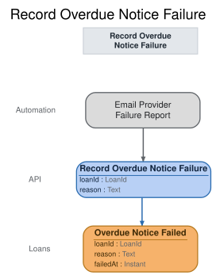

# Slice: Record Overdue Notice Failure

## Intent
Record that an overdue notice could not be delivered to the borrower, so the shed manager knows
the neighbor wasn't told and can follow up in person.

## Invariants / Business Rules
- **INV-ONF-1:** A failure is recorded from the email provider's report that it refused an
  overdue notice or that the notice bounced. No person records it.
  - The email provider is outside the shed. Its failure report triggers Record Overdue Notice
    Failure, which records Overdue Notice Failed.
- **INV-ONF-2:** The shed records only the provider's one final failure report.
  - The provider makes 3 delivery attempts over about an hour and reports a final failure only
    if all of them fail. The shed does no retrying of its own, and a failure a later attempt
    recovers from is never reported.
- **INV-ONF-3:** Overdue Notice Failed is recorded for the loan the notice was about, with the
  date of the failure and whether the email was refused or bounced.
  - Refused and bounced are the two reasons the provider's final report can give.
- **INV-ONF-4:** Every Overdue Notice Failed follows an Overdue Notice Sent for the same loan.
  - Overdue Notice Sent is recorded at hand-off, so the loan has already left Overdue Loans To
    Notify. Recording the failure doesn't change that list.
- **INV-ONF-5:** Every recorded failure is shown to the shed manager on the Undelivered Notices
  screen.
- **INV-ONF-6:** A loan has at most one Overdue Notice Failed. No further notice is attempted
  for it after a failure.
  - The shed manager follows up in person.
- **INV-ONF-7:** A failure report that matches no overdue notice the shed sent is ignored, and
  nothing is recorded.
- **INV-ONF-8:** A failure report that arrives after the loan has ended, because the tool was
  returned or recorded lost, is ignored, and nothing is recorded.
  - For example, the borrower returned the tool during the hour the provider spent retrying.

## Scenarios (Given / When / Then)
- **Refused**
  - **Given:** Overdue Notice Sent was recorded for Ana's cordless drill loan, and the email
    provider refused the notice on all 3 of its attempts
  - **When:** the provider reports that the notice to ana@example.org was refused
  - **Then:** Overdue Notice Failed is recorded for Ana's drill loan, as refused, on today's
    date, and the shed manager's Undelivered Notices screen shows it. No further notice is sent
    for the loan.
- **Bounced**
  - **Given:** Overdue Notice Sent was recorded for Ana's drill loan, and the email bounced on
    all 3 of the provider's attempts
  - **When:** the provider reports that the notice to ana@example.org bounced
  - **Then:** Overdue Notice Failed is recorded for Ana's drill loan, as bounced, on today's
    date, and the shed manager's Undelivered Notices screen shows it.
- **Report matching no notice**
  - **Given:** the shed has sent no overdue notice to cara@example.org
  - **When:** the provider reports that a notice to cara@example.org bounced
  - **Then:** nothing is recorded.
- **Report arrives after the tool was returned**
  - **Given:** Overdue Notice Sent was recorded for Ana's drill loan, and Ana returned the drill
    while the provider was still retrying the notice
  - **When:** the provider reports that the notice to ana@example.org bounced
  - **Then:** nothing is recorded.

## Open Questions
None.
