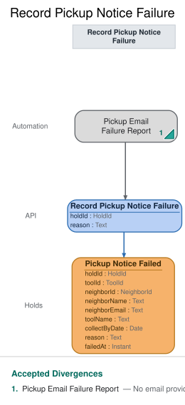

# Slice: Record Pickup Notice Failure

## Intent
Record that a pickup email could not be delivered to the holder, so the shed manager can see the
neighbor wasn't told their tool is ready and can let them know another way, and the holder's My
Holds shows that the email didn't reach them.

## Trigger & Actor
Externally triggered. The email provider, outside the shed, sends a final failure report for a
pickup email the shed handed it. The Pickup Email Failure Report translation turns that report
into the Record Pickup Notice Failure command. No person records a failure, and there is no
screen.

What the report carries: the reference the shed gave the email when it handed it over, which is
the hold's ID, since each set-aside gets at most one pickup email; and the reason, refused or
bounced. Anything else in the report, such as the email address, is not recorded.

## Command / Input
**Command:** `Record Pickup Notice Failure`

A HoldId is a UUID.

| Field | Type | Required | Rules / Validation |
|-------|------|----------|--------------------|
| holdId | HoldId | yes | The reference from the provider's report: the hold the email was about. Must match a Pickup Notice Sent (INV-PNF-8), for a set-aside that hasn't ended (INV-PNF-9). |
| reason | Text | yes | `refused` or `bounced`, from the report (INV-PNF-3). Any other value is bad input. |

## Trigger
**Triggered by:** translation `Pickup Email Failure Report`, also in this slice (externally
triggered by the email provider's final failure report).

## Event(s) Emitted
**Event:** `Pickup Notice Failed` → context `Holds`
**Read by:** My Holds (the hold shows the pickup email couldn't be delivered) and Undelivered
Notices (the shed manager's follow-up list).

| Field | Type | Immutable Fact? | Source / Notes |
|-------|------|-----------------|----------------|
| holdId | HoldId | yes | From the command. |
| reason | Text | yes | From the command: `refused` or `bounced`. |
| failedAt | Instant | yes | The UTC moment the event is recorded, set by the system. Shown as the failure date: its calendar date in the shed's local time zone. |

The event never changes. No later event retries the email or clears the failure.

## Read Model / View
This slice produces no view of its own. Pickup Notice Failed feeds two views, each specified in
its own doc:
- My Holds (slices/my-holds.md) shows the holder that the pickup email couldn't be delivered.
- Undelivered Notices (slices/undelivered-notices.md) lists the failure for the shed manager,
  with the holder's name and email, the tool and the collect-by date, until the set-aside ends.

Both are eventually consistent. Pickup Notices To Send doesn't hear this event: the hold left that
list when Pickup Notice Sent was recorded.

## Invariants / Business Rules
A failure is recorded only from the email provider's report; no person records it, and the only
way in is the translation in Trigger & Actor. The shed records only the provider's one final
failure report: the provider makes 3 delivery attempts over about an hour and reports a final
failure only if all of them fail. The shed does no retrying of its own. The provider signs each final report, under the shed's house email-port contract; the translation checks the signature and drops an unsigned or wrongly signed report without issuing any command. The provider's signature, not a sign-in, is what guards this command.

A failed pickup email changes nothing about the hold: the tool stays set aside for the holder
until the end of the collect-by date, and the window isn't extended (Expire Hold owns when it
ends). Every recorded failure is shown on Undelivered Notices until the set-aside ends, and on the
holder's My Holds; those views own how it is shown.

- **INV-PNF-3:** Pickup Notice Failed is recorded for the hold the email was about, with the
  moment of the failure and whether the email was refused or bounced.
  - Refused and bounced are the two reasons the provider's final report can give.
- **INV-PNF-4:** A set-aside has at most one Pickup Notice Failed. No further pickup email is
  attempted for it.
- **INV-PNF-5:** Every Pickup Notice Failed follows a Pickup Notice Sent for the same hold.
  - Pickup Notice Sent is recorded at hand-off, so the hold has already left Pickup Notices To
    Send. Recording the failure doesn't change that list.
- **INV-PNF-8:** A failure report that matches no pickup email the shed sent is ignored, and
  nothing is recorded.
- **INV-PNF-9:** A failure report that arrives after the set-aside has ended is ignored, and
  nothing is recorded.
  - A set-aside ends when the holder collects the tool, the hold is cancelled or expires, the
    tool is retired, or the holder closes their account.
  - For example, the holder collected the tool during the hour the provider spent retrying.
- **INV-PNF-10:** A failure report repeated for a hold whose failure is already recorded, with the
  same reason, succeeds and records nothing new. With a different reason it is ignored, and
  nothing is recorded.

## Scenarios (Given / When / Then)
- **Refused (INV-PNF-3)**
  - **Given:** Pickup Notice Sent was recorded for Ben's hold H1 on the drill, and the set-aside
    hasn't ended
  - **When:** the provider's final report says the email for H1 was refused
  - **Then:** Pickup Notice Failed is recorded for H1, reason `refused`, with the time it was
    recorded. No further pickup email is sent for H1.
- **Bounced (INV-PNF-3)**
  - **Given:** Pickup Notice Sent was recorded for H1, and the set-aside hasn't ended
  - **When:** the provider's final report says the email for H1 bounced
  - **Then:** Pickup Notice Failed is recorded for H1, reason `bounced`.
- **Report matching no email (INV-PNF-5, INV-PNF-8)**
  - **Given:** no Pickup Notice Sent has been recorded for hold H2
  - **When:** a failure report names H2
  - **Then:** ignored with `no-matching-notice`. Nothing is recorded.
- **Report after the holder collected the tool (INV-PNF-9)**
  - **Given:** Pickup Notice Sent was recorded for H1, and Ben then checked the drill out
  - **When:** the provider's final report says the email for H1 bounced
  - **Then:** ignored with `hold-ended`. Nothing is recorded.
- **Report after the hold expired (INV-PNF-9)**
  - **Given:** Pickup Notice Sent was recorded for H1, and Hold Expired was then recorded for H1
  - **When:** the provider's final report says the email for H1 was refused
  - **Then:** ignored with `hold-ended`. Nothing is recorded.
- **Report after the hold was cancelled (INV-PNF-9)**
  - **Given:** Pickup Notice Sent was recorded for H1, and Hold Cancelled was then recorded for H1
  - **When:** the provider's final report says the email for H1 bounced
  - **Then:** ignored with `hold-ended`. Nothing is recorded.
- **Report after the tool was retired (INV-PNF-9)**
  - **Given:** Pickup Notice Sent was recorded for H1, and Tool Retired was then recorded for the
    drill
  - **When:** the provider's final report says the email for H1 bounced
  - **Then:** ignored with `hold-ended`. Nothing is recorded.
- **Report after the holder closed their account (INV-PNF-9)**
  - **Given:** Pickup Notice Sent was recorded for H1, and Neighbor Account Closed was then
    recorded for Ben
  - **When:** the provider's final report says the email for H1 bounced
  - **Then:** ignored with `hold-ended`. Nothing is recorded.
- **The same report arrives twice (INV-PNF-4, INV-PNF-10)**
  - **Given:** Pickup Notice Failed was recorded for H1, reason `bounced`
  - **When:** the same report, H1 bounced, arrives again
  - **Then:** it succeeds and nothing new is recorded. H1 still has one Pickup Notice Failed.
- **A second report with a different reason (INV-PNF-4, INV-PNF-10)**
  - **Given:** Pickup Notice Failed was recorded for H1, reason `bounced`
  - **When:** a report arrives saying the email for H1 was refused
  - **Then:** ignored with `failure-already-recorded`. Nothing is recorded; H1 keeps its one
    failure, reason `bounced`.

## Alternate & Error Flows
Every refusal records nothing and returns one reason: a stable name and a sentence. No person
sees these; they go back to the translation, which takes no further action, and are kept for
diagnosing the provider link.

The checks run in this order, and the first that fails is the reason returned:
1. `no-matching-notice` (INV-PNF-8).
2. A failure already recorded for the hold (INV-PNF-10): a repeat with the same reason succeeds
   with nothing recorded; otherwise `failure-already-recorded`.
3. `hold-ended` (INV-PNF-9).

| Reason | Sentence | Rule |
|--------|----------|------|
| `no-matching-notice` | No pickup email was sent for that hold. | INV-PNF-8 |
| `failure-already-recorded` | A failure is already recorded for that email. | INV-PNF-10 |
| `hold-ended` | This hold has already ended. | INV-PNF-9 |

`no-matching-notice` and `failure-already-recorded` mean the same conditions as in Record Overdue
Notice Failure, keyed here by hold instead of loan. A missing or malformed hold ID, or a reason
other than `refused` or `bounced`, is bad input, rejected before any rule is checked. It is not a
refusal and has no reason name.

Idempotency: the provider may deliver the same final report more than once. A repeat with the
same hold and reason succeeds and records nothing new, even if the set-aside has since ended. So
one failure never shows twice on Undelivered Notices.

Retries and compensations: none in the shed. The provider's own 3 attempts happen before its final
report. After a failure no further pickup email is attempted; the shed manager can let the holder
know another way.

## Non-Functional Requirements
- **Security / authz:** only the email provider's failure report can trigger this command,
  through the translation. The provider signs each final report, under the shed's house email-port contract; the translation checks the signature and drops an unsigned or wrongly signed report without issuing any command. The provider's signature, not a sign-in, is what guards this command.
- **PII & compliance:** Pickup Notice Failed holds no name or email: only the hold, the reason and
  the time. The address the email went to is already on Pickup Notice Sent, so the address in the
  provider's report is not recorded again.
- **Performance / SLA:** none. A failure shows on Undelivered Notices shortly after the report
  arrives, about an hour after the email was handed over.

## Dependencies & Read Models Affected
- **Upstream events this slice relies on**, to apply its rules, and the fields it reads from each:
  - Pickup Notice Sent (Send Pickup Notice): holdId.
  - Hold Fulfilled (Fulfill Hold): holdId, toolId, neighborId.
  - Tool Checked Out (Check Out Tool): toolId, neighborId.
  - Hold Cancelled (Cancel Hold): holdId.
  - Hold Expired (Expire Hold): holdId.
  - Tool Retired (Retire Tool): toolId.
  - Neighbor Account Closed (Close Account): neighborId.
  - Pickup Notice Failed (this slice): holdId, reason.
  - Pickup Notice Sent keyed by hold ID is agreed with Send Pickup Notice. Hold Fulfilled and Tool
    Checked Out match the conventions and slices/check-out-tool.md. The others are specified in
    slices not yet written in depth; each is checked against these keys when it is.
- **Downstream read models / slices affected:** My Holds and Undelivered Notices (the failure).

## Open Questions
None.
