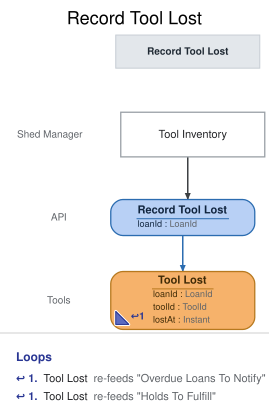

# Slice: Record Tool Lost

## Intent
Let the shed manager record that a tool out on loan is lost or broken and won't come back. Doing
so ends the loan, so the borrower isn't left blocked by a tool they can't return, and takes the
tool out of the shed for good, ending any holds on it.

## Trigger & Actor
The shed manager, from the Tool Inventory screen, on a tool shown as out on loan ("mark lost",
INV-TINV-6). That includes a tool retired while out. The borrower doesn't record a loss, and the
shed manager doesn't record a return on the borrower's behalf instead.

## Command / Input
**Command:** `Record Tool Lost`

A LoanId is a UUID.

| Field | Type | Required | Rules / Validation |
|-------|------|----------|--------------------|
| loanId | LoanId | yes | The loan the tool is out on, as Tool Inventory shows it. Must be a loan that has been checked out (INV-LOST-11) and is still out (INV-LOST-2). |

There is no field for cost, replacement, or what happened: nothing about it is recorded. A
replacement, or the same tool if it turns up later, is added again as a new tool (Add Tool); the
lost tool itself stays retired. The command carries no "from" value: a late copy of an older
request counts as a new request.

## Trigger
**Triggered by:** screen `Tool Inventory` @Shed Manager

## Event(s) Emitted
**Event:** `Tool Lost` → context `Tools`
**Read by:** Tool Inventory and Tool Catalog (the tool drops off), My Loans (the loan drops off),
Overdue Loans To Notify (the loan leaves the list), Undelivered Notices (an overdue-notice entry
for the loan drops off), My Holds and Holds To Fulfill (the tool's holds end).

| Field | Type | Immutable Fact? | Source / Notes |
|-------|------|-----------------|----------------|
| loanId | LoanId | yes | From the command. |
| toolId | ToolId | yes | The loan's tool, from its Tool Checked Out. Carried so views about tools and holds match on the tool directly. |
| lostAt | Instant | yes | The UTC moment the event is recorded, set by the system. |

The event never changes. Tool Lost is one fact with three consequences: the loan ends, the tool is
retired, and every hold on the tool ends. No separate Tool Retired or hold event is recorded.

## Read Model / View
This slice produces no view of its own. Tool Lost updates Tool Inventory, Tool Catalog, My Loans,
Overdue Loans To Notify, Undelivered Notices, My Holds and Holds To Fulfill, each specified in its
own doc and eventually consistent.

## Invariants / Business Rules
A lost tool never counts as a late return, even if its loan was overdue: Tool Lost isn't a Tool
Returned, and only late returns count toward a flag (Neighbors To Flag; Flag Neighbor).

Tool Lost has three consequences, each owned by the slices that read it. The loan ends: after Tool
Lost it can't be returned (INV-RET-2, Return Tool) or extended (Extend Loan), and it is no longer
out. The tool is retired: it can't be borrowed (Check Out Tool), held (INV-HOLD-3, Place Hold) or
retired again (Retire Tool), and every reader treats it as Tool Retired. Every hold on the tool
ends (My Holds, Holds To Fulfill). An overdue
loan ended this way no longer blocks the borrower's checkouts and pickups (Check Out Tool, INV-CHK-5,
counts only open loans), and no overdue notice goes out for it afterwards (INV-OLN-4, Overdue Loans
To Notify). The borrower isn't emailed; the loan simply drops off their My Loans. Holders aren't
told their hold ended, as for any retired tool.

- **INV-LOST-1:** Only the shed manager records a tool lost.
  - Sign-in, handled outside the model, supplies the shed-manager role; a caller without it is refused `not-shed-manager`.
- **INV-LOST-2:** A tool can be recorded lost only while it is out on loan, and the loss is
  recorded against that loan.
  - It can be recorded at any time while the tool is out, before or after the loan is overdue.
  - A tool retired while out on loan can still be recorded lost.
  - A loan that has been returned can't be recorded lost.
- **INV-LOST-3:** Recording a tool lost records only Tool Lost.
  - No Tool Returned, Tool Retired, Hold Cancelled or other hold event is recorded. The one fact
    carries all three consequences below.
- **INV-LOST-10:** Recording a loan lost that is already recorded lost succeeds and records
  nothing.
  - So a double submit, or a retry after a lost response, never records a second loss.
- **INV-LOST-11:** The loan must have been checked out.
- **INV-LOST-12:** A request with no sign-in is refused before anything else is checked.

## Scenarios (Given / When / Then)
- **Happy path (INV-LOST-1, INV-LOST-2, INV-LOST-3)**
  - **Given:** Ana has the ladder (T2) on loan L2, due 12 October, and it is overdue. Ben's hold H1
    on T2 is waiting.
  - **When:** on 20 October the shed manager records L2 lost from Tool Inventory
  - **Then:** Tool Lost is recorded for L2, with toolId T2 and the time it was recorded. No Tool
    Returned, Tool Retired or hold event is recorded: this one fact ends L2, retires T2 and ends
    H1.
- **Lost before the due date (INV-LOST-2)**
  - **Given:** Ana has the hedge trimmer (T3) on loan L3, due 25 October, and it is 15 October
  - **When:** the shed manager records L3 lost
  - **Then:** Tool Lost is recorded for L3, with toolId T3.
- **Lost after being retired while out (INV-LOST-2)**
  - **Given:** Tool Retired was recorded for the drill (T1) while Ben had it on loan L4
  - **When:** the shed manager records L4 lost from Tool Inventory
  - **Then:** Tool Lost is recorded for L4, with toolId T1.
- **Recorded lost twice (INV-LOST-10)**
  - **Given:** Tool Lost was recorded for L2
  - **When:** the same Record Tool Lost request for L2 arrives again
  - **Then:** the request succeeds and nothing new is recorded.
- **Already returned (INV-LOST-2)**
  - **Given:** Tool Returned was recorded for L5
  - **When:** the shed manager tries to record L5 lost
  - **Then:** refused with `loan-ended`: "This loan has ended." No event is recorded.
- **Someone other than the shed manager (INV-LOST-1)**
  - **Given:** Ana has L2 out
  - **When:** a caller signed in without the shed-manager role asks to record L2 lost
  - **Then:** refused with `not-shed-manager`: "Only the shed manager can record tools lost." No
    event is recorded.
- **Unknown loan (INV-LOST-11)**
  - **Given:** no loan has ID L9
  - **When:** the shed manager asks to record L9 lost
  - **Then:** refused with `loan-not-found`: "There is no such loan." No event is recorded.
- **Not signed in (INV-LOST-12)**
  - **Given:** nobody is signed in
  - **When:** a request for recording a tool lost arrives
  - **Then:** refused with `not-signed-in`: "Please sign in." No event is recorded.

## Alternate & Error Flows
Every refusal records nothing and returns one reason: the stable name, and the sentence shown to
the shed manager on the Tool Inventory screen. The name is the contract; the sentence is the
required wording of the message.

The checks run in this order, and the first that fails is the reason returned:
1. `not-signed-in` (INV-LOST-12): a request with no sign-in is refused first.
2. `not-shed-manager` (INV-LOST-1): who is asking is settled next, before any other rule.
3. `loan-not-found` (INV-LOST-11).
4. If Tool Lost is already recorded for the loan, the request succeeds and records nothing
   (INV-LOST-10).
5. `loan-ended`, if Tool Returned is recorded for the loan (INV-LOST-2).

| Reason | Sentence | Rule |
|--------|----------|------|
| `not-signed-in` | Please sign in. | INV-LOST-12 |
| `not-shed-manager` | Only the shed manager can record tools lost. | INV-LOST-1 |
| `loan-not-found` | There is no such loan. | INV-LOST-11 |
| `loan-ended` | This loan has ended. | INV-LOST-2 |

The names mean the same conditions as in Add Tool, Suspend Neighbor, Return Tool and Extend Loan.
`loan-not-found` can only come from a faulty caller, not from the screen, which offers "mark lost"
only on a tool shown as out. A missing or malformed loan ID (not a UUID) is bad input, rejected
before any rule is checked.

Idempotency: a loss is identified by its loan. A repeat after the loan was recorded lost succeeds
and records nothing. A loan that was returned is refused, because recording it lost would be a
different outcome from the one recorded.

Requests at the same moment: Record Tool Lost is decided against the loan's events as already
recorded, one at a time per loan. Of a loss and a return for the same loan at once, whichever is
decided first is recorded; the other finds the loan ended (the return then gets `loan-ended`; the
loss gets `loan-ended`, or succeeds as a repeat if the first was itself a loss).

There are no external calls, retries or compensations in this slice. Nothing is emailed.

## Non-Functional Requirements
- **Security / authz:** only the shed manager may record a tool lost (INV-LOST-1). Sign-in, handled outside the model, supplies the shed-manager role; a caller without it is refused `not-shed-manager`.
- **PII & compliance:** Tool Lost names a loan and a tool. It holds no name or email, and nothing
  about cost or blame.
- **Performance / SLA:** none.

## Dependencies & Read Models Affected
- **Upstream events this slice relies on**, to apply its rules, and the fields it reads from each:
  - Tool Checked Out (Check Out Tool): loanId, toolId.
  - Tool Returned (Return Tool): loanId.
  - Tool Lost (this slice): loanId.
  - These match slices/check-out-tool.md and slices/return-tool.md.
- **Downstream read models / slices affected:** Tool Inventory, Tool Catalog, My Loans, Overdue
  Loans To Notify, Undelivered Notices, My Holds and Holds To Fulfill. Return Tool and Extend Loan
  refuse the ended loan; Check Out Tool, Place Hold and Retire Tool treat the tool as retired.

## Open Questions
None.
