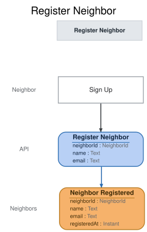

# Slice: Register Neighbor

## Intent
Let a neighbor join the tool shed by signing themselves up, so they can borrow tools.

## Invariants / Business Rules
- **INV-REG-1:** A neighbor registers themselves from the Sign Up screen.
  - The shed manager does not enroll neighbors.
- **INV-REG-2:** A newly registered neighbor is active.
  - Active is one of the three neighbor statuses (active, suspended, closed) on the shed
    manager's Neighbors screen. Suspension and closure come later and from other actions.
- **INV-REG-3:** Sign-up requires a name and an email address.
  - The shed emails neighbors, and only by email: overdue notices to borrowers and pickup
    notices to holders both go to this address.
- **INV-REG-4:** A sign-up is refused if its email belongs to an account that is not closed, or
  to a closed account that was suspended when it was closed.
  - The same rule applies when a neighbor changes their email from My Account. An account's email
    is always its current one.
  - A suspended neighbor can't change their email, so the email an account had when it was
    closed while suspended is the one it was suspended under.
  - One account per email. A closed account's email can be used again, so a neighbor who left
    can come back with the same address.
  - An account closed while suspended keeps its email for good. A suspended neighbor can't
    get around the suspension by closing their account and signing up again with the same
    email.
  - A sign-up with a different email is accepted, even from someone whose earlier account was
    closed while suspended. Email is the only thing that identifies a neighbor. The shed
    manager sees both accounts on the Neighbors screen and can suspend the new one.
- **INV-REG-5:** A newly registered neighbor can borrow straight away.
  - No approval by the shed manager and no email or contact verification come first.
- **INV-REG-6:** A neighbor whose account is closed may sign up again, and doing so creates a
  new account.
  - The closed account stays closed. It is never reopened.

## Scenarios (Given / When / Then)
- **Happy path**
  - **Given:** no account uses the email address ana@example.com
  - **When:** Ana registers from the Sign Up screen with her name and ana@example.com
  - **Then:** Neighbor Registered is recorded with her name and email. Ana appears as active on
    the shed manager's Neighbors screen, her My Account shows her account, and she can borrow
    tools.
- **Signing up again after closing**
  - **Given:** Ana's account, using ana@example.com, was closed while active
  - **When:** Ana registers from the Sign Up screen with her name and ana@example.com
  - **Then:** Neighbor Registered is recorded for a new account. Her old account stays closed,
    the Neighbors screen lists both, and her My Account shows only the new account.

## Open Questions
None.
