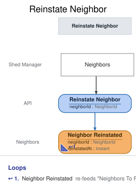

# Slice: Reinstate Neighbor

## Intent
Let the shed manager lift a neighbor's suspension, so the neighbor can borrow again with a clean
late-return record.

## Trigger & Actor
The shed manager, from the Suspended Neighbors screen, for a neighbor listed there. A suspension
never lifts by itself after a set time.

## Command / Input
**Command:** `Reinstate Neighbor`

A NeighborId is a UUID.

| Field | Type | Required | Rules / Validation |
|-------|------|----------|--------------------|
| neighborId | NeighborId | yes | The neighbor to reinstate. Must be a registered account (INV-REI-8) that isn't closed (INV-REI-2). |

There is no reason or note field: nothing is recorded about why. The command carries no "from"
status: a late copy of an older request counts as a new request.

## Trigger
**Triggered by:** screen `Suspended Neighbors` @Shed Manager

## Event(s) Emitted
**Event:** `Neighbor Reinstated` → context `Neighbors`
**Read by:** Suspended Neighbors (the neighbor drops off), Neighbors and My Account (status
active), and Neighbors To Flag (the late-return count starts again). Check Out Tool, Extend Loan,
Place Hold, Change Email and Flag Neighbor read it to know the suspension has lifted.

| Field | Type | Immutable Fact? | Source / Notes |
|-------|------|-----------------|----------------|
| neighborId | NeighborId | yes | From the command. |
| reinstatedAt | Instant | yes | The UTC moment the event is recorded, set by the system. |

The event never changes. A later Neighbor Suspended suspends the neighbor again.

## Read Model / View
This slice produces no view of its own. Neighbor Reinstated feeds Suspended Neighbors, Neighbors,
My Account and Neighbors To Flag, each specified in its own doc and eventually consistent.

## Invariants / Business Rules
A reinstated neighbor is active again: they can check out tools, extend loans, place holds,
collect set-aside tools and change their email, each under that slice's usual rules. A neighbor
can be reinstated while they still have an overdue loan; the overdue loan goes on blocking
checkouts and pickups until the tool is returned (INV-CHK-5, Check Out Tool). Holds they kept
while suspended carry on from their place in the queue. Reinstatement starts the neighbor's
late-return count again from zero: late returns from before it never count toward a later flag
(INV-NTF-5, Neighbors To Flag; INV-FLG-5, Flag Neighbor). The neighbor isn't emailed; My Account
shows them as active again. Suspended Neighbors, Neighbors and My Account own how a reinstatement
is shown.

- **INV-REI-1:** Only the shed manager reinstates a neighbor.
  - Sign-in, handled outside the model, supplies the shed-manager role; a caller without it is refused `not-shed-manager`.
- **INV-REI-2:** Only a suspended neighbor can be reinstated.
  - A neighbor whose account is closed can't be reinstated, because closed is final, even if they
    were suspended when they closed it.
  - Reinstating a neighbor who is already active changes nothing (INV-REI-7).
- **INV-REI-7:** Reinstating a neighbor who is already active succeeds and records nothing.
  - So a double submit, or a retry after a lost response, never records a second reinstatement.
- **INV-REI-8:** The neighbor must be a registered account.
- **INV-REI-9:** A request with no sign-in is refused before anything else is checked.

## Scenarios (Given / When / Then)
- **Happy path (INV-REI-1, INV-REI-2)**
  - **Given:** Ana (N1) is suspended and listed on Suspended Neighbors. She has two late returns
    within the last 90 days, a hold waiting at position 2 on the cordless drill, and an overdue
    ladder loan.
  - **When:** the shed manager reinstates N1 from Suspended Neighbors
  - **Then:** Neighbor Reinstated is recorded for N1, with the time it was recorded. Nothing else
    is recorded: her hold and her loan are untouched.
- **Already active (INV-REI-7)**
  - **Given:** N1 was reinstated and is active
  - **When:** the shed manager reinstates N1 again
  - **Then:** the request succeeds and nothing new is recorded.
- **Never suspended (INV-REI-7)**
  - **Given:** Ben (N2) has never been suspended
  - **When:** the shed manager asks to reinstate N2
  - **Then:** the request succeeds and nothing is recorded.
- **A late copy after a new suspension (INV-REI-2)**
  - **Given:** the shed manager reinstated N1, and later suspended her again
  - **When:** a delayed copy of the earlier Reinstate Neighbor request for N1 arrives
  - **Then:** it counts as a new request: Neighbor Reinstated is recorded for N1 again.
- **Closed while suspended (INV-REI-2)**
  - **Given:** N3 was suspended and then closed their account
  - **When:** the shed manager tries to reinstate N3
  - **Then:** refused with `account-closed`: "This account is closed." No event is recorded.
- **Someone other than the shed manager (INV-REI-1)**
  - **Given:** N1 is suspended
  - **When:** a caller signed in without the shed-manager role asks to reinstate N1
  - **Then:** refused with `not-shed-manager`: "Only the shed manager can reinstate neighbors." No
    event is recorded.
- **Unknown neighbor (INV-REI-8)**
  - **Given:** no account has neighbor ID N9
  - **When:** the shed manager asks to reinstate N9
  - **Then:** refused with `neighbor-not-found`: "There is no such neighbor." No event is
    recorded.
- **Not signed in (INV-REI-9)**
  - **Given:** nobody is signed in
  - **When:** a request for reinstating a neighbor arrives
  - **Then:** refused with `not-signed-in`: "Please sign in." No event is recorded.

## Alternate & Error Flows
Every refusal records nothing and returns one reason: the stable name, and the sentence shown to
the shed manager on the Suspended Neighbors screen. The name is the contract; the sentence is the
required wording of the message.

The checks run in this order, and the first that fails is the reason returned:
1. `not-signed-in` (INV-REI-9): a request with no sign-in is refused first.
2. `not-shed-manager` (INV-REI-1): who is asking is settled next, before any other rule.
3. `neighbor-not-found` (INV-REI-8).
4. If the neighbor's status is already active, the request succeeds and records nothing
   (INV-REI-7). Status is tested with closed first: an account closed while suspended has status
   closed, so it gets `account-closed`.
5. `account-closed` (INV-REI-2).

| Reason | Sentence | Rule |
|--------|----------|------|
| `not-signed-in` | Please sign in. | INV-REI-9 |
| `not-shed-manager` | Only the shed manager can reinstate neighbors. | INV-REI-1 |
| `neighbor-not-found` | There is no such neighbor. | INV-REI-8 |
| `account-closed` | This account is closed. | INV-REI-2 |

The names mean the same conditions as in Suspend Neighbor. `neighbor-not-found` can only come from
a faulty caller, not from the screen, which offers Reinstate only on listed neighbors. A missing
or malformed neighbor ID (not a UUID) is bad input, rejected before any rule is checked.

Idempotency: reinstatement sets a state, and the command carries no "from" status. A request whose
effect has already happened (the neighbor is active) succeeds and records nothing. A late copy of
an older request that arrives after a new suspension reinstates again.

Requests at the same moment: Reinstate Neighbor is decided against the neighbor's events as already
recorded, one at a time per neighbor. A suspension or closure landing at the same moment is decided
in the same order: whichever is recorded first stands.

There are no external calls, retries or compensations in this slice. Nothing is emailed.

## Non-Functional Requirements
- **Security / authz:** only the shed manager may reinstate a neighbor (INV-REI-1). Sign-in, handled outside the model, supplies the shed-manager role; a caller without it is refused `not-shed-manager`.
- **PII & compliance:** Neighbor Reinstated links a neighbor to a reinstatement. It holds no name,
  email or reason.
- **Performance / SLA:** none.

## Dependencies & Read Models Affected
- **Upstream events this slice relies on**, to apply its rules, and the fields it reads from each:
  - Neighbor Registered (Register Neighbor): neighborId.
  - Neighbor Suspended (Suspend Neighbor): neighborId.
  - Neighbor Reinstated (this slice): neighborId.
  - Neighbor Account Closed (Close Account): neighborId.
  - These match slices/register-neighbor.md and slices/suspend-neighbor.md. Close Account is
    specified in a slice not yet written in depth; it is checked against this key when it is.
- **Downstream read models / slices affected:** Suspended Neighbors, Neighbors, My Account and
  Neighbors To Flag. Check Out Tool, Extend Loan, Place Hold, Change Email and Flag Neighbor treat
  the neighbor as active again.

## Open Questions
None.
