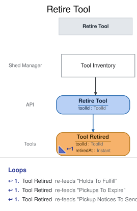

# Slice: Retire Tool

## Intent
Take a tool out of the shed for good: a damaged tool, one the shed no longer keeps, or one added
with a mistake. The shed manager retires it from Tool Inventory, and neighbors can no longer
borrow or hold it.

## Invariants / Business Rules
- **INV-RTR-1:** Only the shed manager can retire a tool, from the Tool Inventory screen.
- **INV-RTR-2:** A tool that is already retired can't be retired again.
- **INV-RTR-3:** Retiring is final. A retired tool is never lent or held again.
  - It drops off Tool Inventory and Tool Catalog. A tool retired to correct a mistake in its
    details is added again as a new tool.
- **INV-RTR-4:** Retiring a tool ends every hold on it, waiting or set aside, whether or not the
  tool is on loan.
  - The ended holds drop off their holders' My Holds. No hold is passed on, and nothing is left
    for the hold fulfiller or the pickup notice gateway to act on.
- **INV-RTR-5:** Nothing is recorded about the tool's condition or the reason it was retired.
  - A damaged tool is the shed manager's call to retire.
- **INV-RTR-6:** A tool can be retired while it is on loan.
  - The loan carries on and can't be extended. The borrower returns the tool as usual, and it
    never comes back into the catalog. The holds on it end straight away.
- **INV-RTR-7:** Holders are not told when a tool they hold is retired.
  - Their hold drops off My Holds.
- **INV-RTR-8:** A tool lost or broken by a borrower, and never returned, is not retired here.
  - The shed manager marks it lost against the loan, which ends the loan and retires the tool in
    one step.

## Scenarios (Given / When / Then)
- **Happy path**
  - **Given:** the ladder is in the shed, available, with no holds on it
  - **When:** the shed manager retires the ladder from Tool Inventory
  - **Then:** Tool Retired is recorded for the ladder. It drops off Tool Inventory and Tool
    Catalog.
- **Set-aside tool with another hold waiting**
  - **Given:** the cordless drill is set aside for Ben, and Cara's hold on it is waiting
  - **When:** the shed manager retires the drill
  - **Then:** Tool Retired is recorded for the drill. Both Ben's and Cara's holds end and drop off
    their My Holds. The drill is not passed to Cara, and drops off Tool Inventory and Tool
    Catalog.
- **Tool on loan, with a hold waiting**
  - **Given:** Ana has the hedge trimmer on loan, due 20 October, and Ben's hold on it is waiting
  - **When:** the shed manager retires the hedge trimmer
  - **Then:** Tool Retired is recorded for the hedge trimmer. Ben's hold ends and drops off his My
    Holds, and he is not told. The hedge trimmer drops off Tool Catalog. Ana's loan carries on,
    due 20 October, and My Loans marks it as unable to be extended.

## Open Questions
- [ ] A tool retired while on loan drops off Tool Inventory. If it then never comes back, how
  does the shed manager mark it lost?
  - Marking a tool lost is an action on Tool Inventory, offered on tools that are out. A tool
    retired while on loan has already left Tool Inventory, so the action can't be reached, and
    the borrower's loan stays out, and eventually overdue, for good.
  - (a) A tool retired while on loan stays on Tool Inventory, shown as retired and out, until it
    is returned or marked lost. (b) Marking lost is also allowed on a retired tool, from wherever
    it remains visible. (c) Retiring while on loan is enough: the shed manager is expected to
    mark the tool lost instead if it won't come back.
  - Recommendation: (a). Tool Inventory already shows which tools are out, and the shed manager
    keeps sight of the tool until its loan ends.
