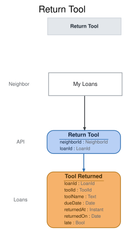

# Slice: Return Tool

## Intent
Let a borrower bring a tool back and end their loan themselves, from My Loans. The tool is then
back in the shed, for the next holder or for anyone to borrow.

## Invariants / Business Rules
- **INV-RET-1:** The borrower returns their own loan themselves, from My Loans.
  - The shed manager does not record returns.
- **INV-RET-2:** Only a loan that is still out can be returned, and only once.
  - A loan ended by the shed manager recording the tool lost can't be returned.
  - A closed account never has a loan out, because an account can't be closed while tools are
    on loan.
- **INV-RET-3:** Returning a tool records only Tool Returned.
  - Setting the tool aside for the first waiting hold is a separate system reaction to the
    return, recorded as Hold Fulfilled.
- **INV-RET-4:** A return is late when it happens after the loan's due date: from the start of
  the day after the due date, in the shed's local time.
  - A return on the due date itself is on time. The due date is the one in force at the time,
    after any extensions.
  - Late returns count toward a neighbor being flagged.
- **INV-RET-5:** An overdue loan can be returned.
  - Once it is returned, no overdue notice goes out for it.
- **INV-RET-6:** A returned tool with no holds waiting is available to borrow straight away.
  - A returned tool with holds waiting is never shown as available. Until Hold Fulfilled is
    recorded, only the neighbor whose hold is at the front of the queue may check it out.
- **INV-RET-7:** A suspended neighbor can return a tool.
- **INV-RET-8:** Nothing about the tool's condition is recorded on return.
  - A damaged tool is the shed manager's to retire.
- **INV-RET-9:** A tool retired while on loan can still be returned. Once returned, it stays out
  of the shed's tools.
  - The return ends the loan as usual. The tool doesn't come back into the Tool Catalog or Tool
    Inventory, and no hold is waiting on it, because retiring it ended its holds.

## Scenarios (Given / When / Then)
- **Happy path: on-time return, no holds**
  - **Given:** Ana has the cordless drill on loan, due 12 October, and no holds are waiting on it
  - **When:** on 11 October, Ana returns the drill from My Loans
  - **Then:** Tool Returned is recorded for the loan, on time. The drill drops off Ana's My
    Loans, and the Tool Catalog shows it available.
- **Return on the due date**
  - **Given:** Ana's drill loan is due 12 October
  - **When:** Ana returns the drill on 12 October
  - **Then:** Tool Returned is recorded, on time.
- **Return with a hold waiting**
  - **Given:** Ana has the drill on loan, and Ben's hold on it is at the front of the queue
  - **When:** Ana returns the drill
  - **Then:** Tool Returned is recorded. The drill drops off Ana's My Loans, and the Tool Catalog
    does not show it as available. The hold reaction then sets the drill aside for Ben.
- **Late return**
  - **Given:** Ana's drill loan was due 12 October, and Overdue Notice Sent has been recorded for
    it
  - **When:** Ana returns the drill on 15 October
  - **Then:** Tool Returned is recorded, late. The drill drops off Ana's My Loans, and the late
    return counts toward Ana being flagged.
- **Late return before the notice went out**
  - **Given:** Ana's drill loan was due 12 October, and no overdue notice has been sent
  - **When:** Ana returns the drill on 13 October
  - **Then:** Tool Returned is recorded, late, and no overdue notice is sent for the loan.
- **Suspended neighbor returns a tool**
  - **Given:** Ana is suspended and has the drill on loan
  - **When:** Ana returns the drill from My Loans
  - **Then:** Tool Returned is recorded, and the drill drops off Ana's My Loans.
- **Returning a tool that was retired while on loan**
  - **Given:** Ana has the ladder on loan, and the shed manager retired it while it was out
  - **When:** Ana returns the ladder from My Loans
  - **Then:** Tool Returned is recorded, and the ladder drops off Ana's My Loans. The ladder
    doesn't appear in the Tool Catalog.

## Open Questions
None.
