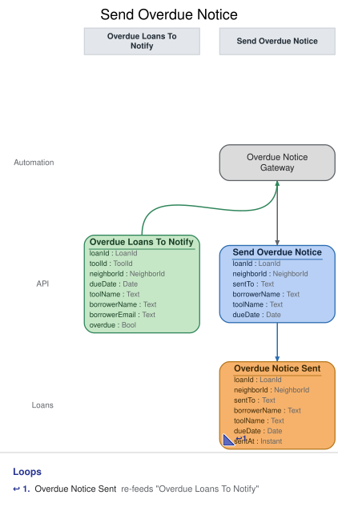

# Slice: Send Overdue Notice

## Intent
Tell a borrower by email that their loan is overdue, once per loan, so they return the tool. The
shed records that the notice was handed to the email provider. That record shows the borrower
was told, and stops a second notice.

## Trigger & Actor
- **Trigger form:** internally triggered. The Overdue Notice Gateway, a translation to the email
  provider outside the shed, watches the Overdue Loans To Notify list (slices/overdue-loans-to-
  notify.md). No person sends notices; only the gateway issues Send Overdue Notice.
- **When it reads:** the list fills when midnight passes in the shed's local time, not when an
  event arrives, so the gateway reads it every 5 minutes, at any hour. A loan is therefore
  noticed within 5 minutes of becoming overdue (INV-OVN-6).
- **What the gateway does, for each loan on the list:**
  1. It issues `Send Overdue Notice` for the loan, with the content from the loan's item:
     borrowerEmail, borrowerName, toolName and dueDate. If the command is refused, or is a
     repeat, nothing is sent for that loan.
  2. Each recorded Overdue Notice Sent is handed to the provider from the event itself, using
     the loan ID as the hand-off's key. The hand-off is driven by the recorded event, not by the
     list: if the hand-off call errors, or the process stops before the provider accepts, it is
     repeated with the same key (after a restart too) until the provider accepts it. This is an
     outbox, not a domain event.
- **The email:** to the address recorded on the event, giving the borrower's name, the tool's
  name and the due date recorded on it, asking them to return the tool, and saying that an
  overdue loan blocks new checkouts and pickups (INV-OVN-3, INV-OVN-7).
- **The email port's contract**, from the shed's house rules: the provider accepts a hand-off
  with a key, sends at most one email per key, makes its own delivery attempts (3 over about an
  hour), and sends one final failure report quoting the key, signed so the shed can trust it.
  The final failure is recorded by Record Overdue Notice Failure (slices/record-overdue-notice-
  failure.md).

## Command / Input
**Command:** `Send Overdue Notice`

A LoanId is a UUID. "Today" is the calendar date in the shed's local time zone at the moment the
command is handled.

| Field | Type | Required | Rules / Validation |
|-------|------|----------|--------------------|
| loanId | LoanId | yes | The overdue loan. Must be a loan that has been checked out (INV-OVN-10), still open (INV-OVN-5) and overdue today (INV-OVN-6). |
| sentTo | Text | yes | The address to send to: the borrower's current email, from the list item's borrowerEmail. |
| borrowerName | Text | yes | From the list item. Shown in the email. |
| toolName | Text | yes | From the list item. Shown in the email. |
| dueDate | Date | yes | From the list item. Must be the loan's current due date (INV-OVN-11). Shown in the email. |

## Trigger
**Triggered by:** translation `Overdue Notice Gateway`, also in this slice, reading `Overdue
Loans To Notify`.

## Event(s) Emitted
**Event:** `Overdue Notice Sent` → context `Loans`
**Read by:** Overdue Loans To Notify (the loan leaves the list for good) and My Loans (shows the
borrower that a notice was sent).

| Field | Type | Immutable Fact? | Source / Notes |
|-------|------|-----------------|----------------|
| loanId | LoanId | yes | From the command. Also the key of the hand-off, which the provider's failure report quotes back. |
| sentTo | Text | yes | From the command: the address the notice went to. |
| borrowerName | Text | yes | From the command: the name the notice was addressed to. |
| toolName | Text | yes | From the command: the tool named in the notice. |
| dueDate | Date | yes | From the command: the due date the notice gave. |
| sentAt | Instant | yes | Set by the system: the UTC moment the event is recorded. |

The address, name, tool name and due date are facts of the notice: what was actually sent. They
are recorded on the event so the hand-off can be repeated, even after a restart, without the
list, and so they don't change if the neighbor's details change later. This is the one kind of
event that carries copies of names.

## Read Model / View
This slice produces no view of its own. The gateway reads Overdue Loans To Notify, specified in
slices/overdue-loans-to-notify.md. Overdue Notice Sent removes the loan from that list and marks
the loan on My Loans. Both are eventually consistent: the list may still show a loan for a moment
after its notice is recorded, which is why the command itself refuses a second notice.

## Invariants / Business Rules
- **INV-OVN-2:** At most one overdue notice is sent per loan.
  - Once Overdue Notice Sent is recorded for a loan, the loan is never sent another notice.
    Notices do not repeat on a schedule.
  - A repeated Send Overdue Notice for a loan whose notice is already recorded succeeds and
    records nothing, and the gateway hands nothing over for it.
- **INV-OVN-3:** Overdue notices go by email only, to the borrower's current email address.
  - Neighbor Registered sets it, Neighbor Email Changed replaces it. The address used is the one
    recorded on Overdue Notice Sent. An email change after that doesn't resend the notice or
    change where a pending hand-off goes.
- **INV-OVN-4:** Overdue Notice Sent is recorded before the notice is handed to the email
  provider, and every notice handed over has one.
  - The hand-off is driven from the recorded event and repeated with the same key, after a
    restart too, until the provider accepts it. That is a technical retry, not a failure of the
    notice.
  - Overdue Notice Sent doesn't mean the borrower received or read the email. Any failure the
    provider reports later follows this Overdue Notice Sent.
- **INV-OVN-5:** No notice is sent for a loan that has ended, because its tool was returned or
  recorded lost.
- **INV-OVN-6:** The notice goes out as soon as the loan is overdue, with no quiet hours.
  - A loan is overdue from the start of the day after its due date, in the shed's local time.
    The due date is the latest one set by Tool Checked Out or Loan Extended.
  - A loan that isn't overdue today is refused, for example one extended just before the
    gateway acted.
- **INV-OVN-7:** The notice gives the borrower's name, the tool's name, the due date, a request
  to return the tool, and that an overdue loan blocks new checkouts and pickups.
- **INV-OVN-9:** After Overdue Notice Failed, no further notice is attempted for that loan.
  - The loan already has its Overdue Notice Sent, so INV-OVN-2 already stops a second one. The
    shed manager follows up in person.
- **INV-OVN-10:** The loan must exist.
- **INV-OVN-11:** The due date given must be the loan's current due date.
  - The gateway reads it from the list, which may be a moment behind. A notice never states a
    due date the loan no longer has.

## Scenarios (Given / When / Then)
Unless a scenario says otherwise: Ana Ruiz (ana@example.org) borrowed the cordless drill as loan
L1, due 12 October, and hasn't returned it. Today is 13 October in the shed's local time.

- **Happy path (INV-OVN-6, INV-OVN-7)**
  - **Given:** at the start of 13 October, shed time, L1 joined Overdue Loans To Notify
  - **When:** the gateway issues Send Overdue Notice for L1, to ana@example.org, for Ana Ruiz,
    the cordless drill, due 12 October
  - **Then:** Overdue Notice Sent is recorded for L1 with that address, name, tool name and due
    date. The gateway then hands the provider an email to ana@example.org, keyed L1, telling Ana
    Ruiz the cordless drill was due 12 October, asking her to return it, and saying that an
    overdue loan blocks new checkouts and pickups.
- **Not overdue on the due date itself (INV-OVN-6)**
  - **Given:** today is 12 October
  - **When:** a Send Overdue Notice for L1 arrives
  - **Then:** refused with `loan-not-overdue`: "This loan isn't overdue." No event is recorded,
    and nothing is handed over.
- **Extended just before the gateway acted (INV-OVN-11)**
  - **Given:** L1 was on the list, and Loan Extended has just moved its due date to 19 October.
    The list hasn't caught up yet.
  - **When:** the gateway issues Send Overdue Notice for L1, giving the due date 12 October
  - **Then:** refused with `due-date-changed`: "This loan's due date has changed." No event is
    recorded, and nothing is handed over.
- **Returned just before the gateway acted (INV-OVN-5)**
  - **Given:** Ana returned the drill, ending L1, and the list hasn't caught up yet
  - **When:** the gateway issues Send Overdue Notice for L1
  - **Then:** refused with `loan-ended`: "This loan has ended." No event is recorded, and nothing
    is handed over.
- **Recorded lost before the notice (INV-OVN-5)**
  - **Given:** Tool Lost has been recorded for L1
  - **When:** a Send Overdue Notice for L1 arrives
  - **Then:** refused with `loan-ended`. No event is recorded.
- **The gateway reads the same loan twice (INV-OVN-2)**
  - **Given:** Overdue Notice Sent has been recorded for L1, and the list returned L1 once more
    before it caught up
  - **When:** the gateway issues Send Overdue Notice for L1 again
  - **Then:** the command succeeds and records nothing new. The gateway hands nothing over, so
    Ana gets one email.
- **No second notice later (INV-OVN-2)**
  - **Given:** Overdue Notice Sent was recorded for L1, and the drill is still out a week later
  - **When:** the gateway reads Overdue Loans To Notify
  - **Then:** L1 isn't on the list, and no further notice is sent.
- **The hand-off call errors (INV-OVN-4)**
  - **Given:** Overdue Notice Sent has been recorded for L1, and the gateway's first hand-off
    call to the provider fails with a connection error
  - **When:** the gateway repeats the hand-off, keyed L1, and the provider accepts it
  - **Then:** one email goes to ana@example.org. Nothing more is recorded.
- **The process stops before the provider accepts (INV-OVN-4)**
  - **Given:** Overdue Notice Sent has been recorded for L1, and the process stopped before the
    hand-off was accepted. L1 has already left Overdue Loans To Notify.
  - **When:** the gateway starts again
  - **Then:** it hands the notice over from the recorded Overdue Notice Sent, keyed L1, to
    ana@example.org with the recorded content. One email goes out.
- **A repeat with different content (INV-OVN-2)**
  - **Given:** Overdue Notice Sent has been recorded for L1 to ana@example.org
  - **When:** a Send Overdue Notice for L1 arrives giving ana.ruiz@example.net
  - **Then:** refused with `notice-already-sent`: "An overdue notice has already been sent for
    this loan." No event is recorded, and nothing is handed over.
- **Current email used (INV-OVN-3)**
  - **Given:** Ana changed her email to ana.ruiz@example.net before L1 became overdue
  - **When:** the gateway issues Send Overdue Notice for L1 with the list's current address
  - **Then:** Overdue Notice Sent is recorded with sentTo ana.ruiz@example.net, and the email
    goes there.
- **Email changed after the notice was recorded (INV-OVN-3)**
  - **Given:** Overdue Notice Sent was recorded for L1 to ana@example.org, and its hand-off
    hasn't been accepted yet
  - **When:** Ana changes her email to ana.ruiz@example.net
  - **Then:** the notice still goes to ana@example.org, the address recorded on it. No second
    notice is sent.
- **Notice that later fails (INV-OVN-9)**
  - **Given:** Overdue Notice Sent was recorded for L1, and Overdue Notice Failed was later
    recorded for it
  - **When:** the gateway reads Overdue Loans To Notify, and a Send Overdue Notice for L1 arrives
    anyway
  - **Then:** L1 isn't on the list. The command succeeds and records nothing new, and nothing is
    handed over.
- **Unknown loan (INV-OVN-10)**
  - **Given:** no loan L9 has been checked out
  - **When:** a Send Overdue Notice for L9 arrives
  - **Then:** refused with `loan-not-found`: "There is no such loan." No event is recorded.

## Alternate & Error Flows
A refusal records nothing, and the gateway hands nothing over for that loan. No person sees these
reasons; they are logged with the loan ID. The name is the contract; the sentence is the log
text.

The checks run in this order, and the first that fails is the reason returned:
1. `loan-not-found` (INV-OVN-10).
2. If Overdue Notice Sent is already recorded for the loan: with the same address, name, tool
   name and due date, the command succeeds and records nothing; otherwise `notice-already-sent`
   (INV-OVN-2).
3. `loan-ended` (INV-OVN-5).
4. `due-date-changed` (INV-OVN-11).
5. `loan-not-overdue` (INV-OVN-6).

| Reason | Sentence | Rule |
|--------|----------|------|
| `loan-not-found` | There is no such loan. | INV-OVN-10 |
| `loan-ended` | This loan has ended. | INV-OVN-5 |
| `notice-already-sent` | An overdue notice has already been sent for this loan. | INV-OVN-2 |
| `due-date-changed` | This loan's due date has changed. | INV-OVN-11 |
| `loan-not-overdue` | This loan isn't overdue. | INV-OVN-6 |

`loan-not-found`, `loan-ended` and `due-date-changed` mean the same conditions as in Extend
Loan. A missing or
malformed loan ID (not a UUID) is bad input, rejected before any rule is checked.

Idempotency: a repeated Send Overdue Notice for a loan that already has its Overdue Notice Sent,
with the same content, succeeds and records nothing, and nothing new is handed over. Notices are
handed over only from recorded Overdue Notice Sent events.

Hand-off retries: the hand-off is driven from each recorded Overdue Notice Sent until the
provider accepts it. A call that errors (the provider unreachable, a timeout), or a stop before
acceptance, is repeated with the same key, the loan ID, after a restart too. The provider sends
at most one email per key. Delivery attempts after acceptance are the provider's; a final
failure is recorded by Record Overdue Notice Failure.

Requests at the same moment: Send Overdue Notice is decided against the loan's events as already
recorded, one at a time per loan, so at most one Overdue Notice Sent is recorded for a loan.

## Non-Functional Requirements
- **Security / authz:** Send Overdue Notice is internal. Only the Overdue Notice Gateway issues
  it; it is not exposed to neighbors or the shed manager.
- **PII & compliance:** the email carries the borrower's name, email address and the tool they
  have. Overdue Notice Sent records the same, as facts of the notice that was sent. Names and
  emails are kept with the shed's loan and hold history and never erased.
- **Performance / SLA:** the notice is recorded within 5 minutes of the start of the day after
  the due date (the gateway's read interval), and handed over as soon as the provider accepts
  it.

## Dependencies & Read Models Affected
- **Upstream events this slice relies on**, to apply its rules, and the fields it reads from
  each:
  - Tool Checked Out (Check Out Tool): loanId, dueDate.
  - Loan Extended (Extend Loan): loanId, dueDate.
  - Tool Returned (Return Tool), Tool Lost (Record Tool Lost): loanId.
  - Overdue Notice Sent (this slice): loanId, sentTo, borrowerName, toolName, dueDate.
  - The gateway reads Overdue Loans To Notify's items: loanId, dueDate, toolName, borrowerName,
    borrowerEmail (slices/overdue-loans-to-notify.md).
  - These keys match slices/check-out-tool.md and extend-loan.md.
- **Downstream read models / slices affected:** Overdue Loans To Notify (the loan leaves it) and
  My Loans (shows the notice was sent). Record Overdue Notice Failure matches the provider's
  failure report to the loan by the hand-off key, the loan ID.

## Open Questions
None.
- [x] Bad input: blank sentTo, borrowerName or toolName is rejected as bad input, not only a malformed loan id (conformance 2026-11-01, finding 6) — v1: v1 code keeps the rejection; doc catches up in v2; deferred to v2 (2026-11-01, Mike Key)
