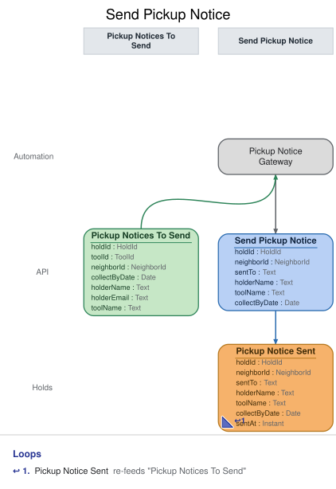

# Slice: Send Pickup Notice

## Intent
Email a neighbor when a tool they hold has been set aside for them, so they collect it before the
end of its collect-by date. The shed records that the email was handed to the email provider, and
My Holds shows the neighbor that it was sent.

## Trigger & Actor
- **Trigger form:** internally triggered. The Pickup Notice Gateway, a translation to the email
  provider outside the shed, watches the Pickup Notices To Send list (slices/pickup-notices-to-
  send.md). No person sends pickup emails; only the gateway issues Send Pickup Notice.
- **When it acts:** the list changes only when an event lands (Hold Fulfilled adds a hold), so
  the gateway acts whenever the list changes, at any hour (INV-PKN-6). Unlike the overdue list,
  nothing joins this list just because time passes.
- **What the gateway does, for each set-aside on the list:**
  1. It issues `Send Pickup Notice` for the hold, with the content from the item: holderEmail,
     holderName, toolName and collectByDate. If the command is refused, or is a repeat, nothing
     is sent for that hold.
  2. Each recorded Pickup Notice Sent is handed to the provider from the event itself, using the
     hold ID as the hand-off's key. The hand-off is driven by the recorded event, not by the
     list: if the hand-off call errors, or the process stops before the provider accepts, it is
     repeated with the same key (after a restart too) until the provider accepts it. This is an
     outbox, not a domain event.
- **The email:** to the address recorded on the event, giving the holder's name, the tool's name
  and the collect-by date recorded on it, and saying that the hold expires and the tool passes to
  the next neighbor if it isn't collected by then (INV-PKN-3, INV-PKN-7).
- **The email port's contract**, from the shed's house rules, is the same as for overdue
  notices: the provider accepts a hand-off with a key, sends at most one email per key, makes
  its own delivery attempts (3 over about an hour), and sends one final failure report quoting
  the key, signed so the shed can trust it. A final failure is recorded by
  Record Pickup Notice Failure (slices/record-pickup-notice-failure.md). The hold still shows as
  ready for pickup, and the pickup window runs as usual.

## Command / Input
**Command:** `Send Pickup Notice`

A HoldId is a UUID. A Date is a calendar date in the shed's local time zone. "Today" is that
date at the moment the command is handled.

| Field | Type | Required | Rules / Validation |
|-------|------|----------|--------------------|
| holdId | HoldId | yes | The set-aside hold. Must be a hold that has been placed (INV-PKN-9) and fulfilled (INV-PKN-10), whose set-aside hasn't ended (INV-PKN-5) and whose collect-by date hasn't passed (INV-PKN-12). |
| sentTo | Text | yes | The address to send to: the holder's current email, from the list item's holderEmail. |
| holderName | Text | yes | From the list item. Shown in the email. |
| toolName | Text | yes | From the list item. Shown in the email. |
| collectByDate | Date | yes | From the list item. Must be the hold's collect-by date as recorded on Hold Fulfilled (INV-PKN-11). Shown in the email. |

## Trigger
**Triggered by:** translation `Pickup Notice Gateway`, also in this slice, reading `Pickup
Notices To Send`.

## Event(s) Emitted
**Event:** `Pickup Notice Sent` → context `Holds`
**Read by:** Pickup Notices To Send (the hold leaves the list for good) and My Holds (shows the
holder that they were emailed).

| Field | Type | Immutable Fact? | Source / Notes |
|-------|------|-----------------|----------------|
| holdId | HoldId | yes | From the command. Also the key of the hand-off, which the provider's failure report quotes back. |
| sentTo | Text | yes | From the command: the address the email went to. |
| holderName | Text | yes | From the command: the name the email was addressed to. |
| toolName | Text | yes | From the command: the tool named in the email. |
| collectByDate | Date | yes | From the command: the collect-by date the email gave. |
| sentAt | Instant | yes | Set by the system: the UTC moment the event is recorded. |

The address, name, tool name and collect-by date are facts of the email: what was actually sent.
They are recorded on the event so the hand-off can be repeated, even after a restart, without the
list, and so they don't change if the neighbor's details change later. Outgoing-email events are
the one kind of event that carries copies of names.

## Read Model / View
This slice produces no view of its own. The gateway reads Pickup Notices To Send, specified in
slices/pickup-notices-to-send.md. Pickup Notice Sent removes the hold from that list and marks
it on My Holds. Both are eventually consistent: the list may still show a hold for a moment after
its email is recorded, which is why the command itself refuses a second email.

## Invariants / Business Rules
- **INV-PKN-2:** At most one pickup email is sent per set-aside.
  - Once Pickup Notice Sent is recorded for a hold, it is never emailed again.
  - A repeated Send Pickup Notice with the same content succeeds and records nothing, and
    nothing new is handed over. One with different content is refused.
- **INV-PKN-3:** Pickup emails go by email only, through the same provider as overdue notices, to
  the holder's current email address.
  - Neighbor Registered sets it, Neighbor Email Changed replaces it. The address used is the one
    recorded on Pickup Notice Sent. An email change after that doesn't resend the email or
    change where a pending hand-off goes.
- **INV-PKN-4:** Pickup Notice Sent is recorded before the email is handed to the email provider,
  and every email handed over has one.
  - The hand-off is driven from the recorded event and repeated with the same key, after a
    restart too, until the provider accepts it. That is a technical retry, not a failure of the
    email.
  - Pickup Notice Sent doesn't mean the holder received or read the email. Any failure the
    provider reports later follows this Pickup Notice Sent.
- **INV-PKN-5:** No pickup email is sent for a set-aside that has already ended.
  - A set-aside ends when its hold ends: the holder checks the tool out, the hold is cancelled
    or expires, the tool is retired, or the holder closes their account.
- **INV-PKN-6:** The email goes out as soon as the tool is set aside, with no quiet hours.
  - The pickup window starts at the set-aside, not when the email is sent; the collect-by date
    doesn't move.
- **INV-PKN-7:** The email gives the holder's name, the tool's name, the collect-by date, and
  that the hold expires and the tool passes to the next neighbor if it isn't collected by then.
- **INV-PKN-9:** The hold must exist.
- **INV-PKN-10:** The hold must have been fulfilled: a waiting hold gets no pickup email.
- **INV-PKN-11:** The collect-by date given must be the one recorded on the hold's Hold
  Fulfilled.
- **INV-PKN-12:** No pickup email is sent once the collect-by date has passed, even if Hold
  Expired hasn't been recorded yet.
  - The set-aside lapses at the start of the day after the collect-by date, shed local time. An
    email sent after that would tell the holder to collect by a date that is already over.

## Scenarios (Given / When / Then)
Unless a scenario says otherwise: Ben Ito (ben@example.org) holds the cordless drill under hold
H1, and Hold Fulfilled was recorded for H1 on 14 October with a collect-by date of 17 October.
Today is 14 October in the shed's local time.

- **Happy path (INV-PKN-6, INV-PKN-7)**
  - **Given:** H1 joined Pickup Notices To Send when Hold Fulfilled was recorded
  - **When:** the gateway issues Send Pickup Notice for H1, to ben@example.org, for Ben Ito, the
    cordless drill, collect by 17 October
  - **Then:** Pickup Notice Sent is recorded for H1 with that address, name, tool name and
    collect-by date. The gateway then hands the provider an email to ben@example.org, keyed H1,
    telling Ben Ito the cordless drill is ready for him, to collect by 17 October, and that
    otherwise his hold expires and the drill passes to the next neighbor.
- **The gateway reads the same hold twice (INV-PKN-2)**
  - **Given:** Pickup Notice Sent has been recorded for H1, and the list returned H1 once more
    before it caught up
  - **When:** the gateway issues the same Send Pickup Notice for H1 again
  - **Then:** the command succeeds and records nothing new. Nothing new is handed over, so Ben
    gets one email.
- **A repeat with different content (INV-PKN-2)**
  - **Given:** Pickup Notice Sent has been recorded for H1 to ben@example.org
  - **When:** a Send Pickup Notice for H1 arrives giving ben.ito@example.net
  - **Then:** refused with `notice-already-sent`: "A pickup email has already been sent for this
    hold." No event is recorded, and nothing is handed over.
- **The process stops before the provider accepts (INV-PKN-4)**
  - **Given:** Pickup Notice Sent has been recorded for H1, and the process stopped before the
    hand-off was accepted. H1 has already left Pickup Notices To Send.
  - **When:** the gateway starts again
  - **Then:** it hands the email over from the recorded Pickup Notice Sent, keyed H1, to
    ben@example.org with the recorded content. One email goes out.
- **The hand-off call errors (INV-PKN-4)**
  - **Given:** Pickup Notice Sent has been recorded for H1, and the first hand-off call fails
    with a connection error
  - **When:** the gateway repeats the hand-off, keyed H1, and the provider accepts it
  - **Then:** one email goes to ben@example.org. Nothing more is recorded.
- **Holder collected before the email went out (INV-PKN-5)**
  - **Given:** Ben checked out the drill before the gateway acted, which ended H1, and the list
    hasn't caught up yet
  - **When:** the gateway issues Send Pickup Notice for H1
  - **Then:** refused with `hold-ended`: "This hold has already ended." No event is recorded, and
    nothing is handed over.
- **Hold cancelled before the email went out (INV-PKN-5)**
  - **Given:** Ben cancelled H1 before the gateway acted
  - **When:** the gateway issues Send Pickup Notice for H1
  - **Then:** refused with `hold-ended`. No event is recorded.
- **Hold expired before the email went out (INV-PKN-5)**
  - **Given:** Hold Expired has been recorded for H1, and no pickup email was sent
  - **When:** a Send Pickup Notice for H1 arrives
  - **Then:** refused with `hold-ended`. No event is recorded.
- **Tool retired, or holder's account closed, before the email went out (INV-PKN-5)**
  - **Given:** the drill was retired while set aside for Ben
  - **When:** the gateway issues Send Pickup Notice for H1
  - **Then:** refused with `hold-ended`. No event is recorded. The same applies if Ben closed his
    account instead.
- **Current email used (INV-PKN-3)**
  - **Given:** Ben changed his email to ben.ito@example.net before H1 was fulfilled
  - **When:** the gateway issues Send Pickup Notice for H1 with the list's current address
  - **Then:** Pickup Notice Sent is recorded with sentTo ben.ito@example.net, and the email goes
    there.
- **Email changed after the email was recorded (INV-PKN-3)**
  - **Given:** Pickup Notice Sent was recorded for H1 to ben@example.org, and its hand-off hasn't
    been accepted yet
  - **When:** Ben changes his email to ben.ito@example.net
  - **Then:** the email still goes to ben@example.org, the address recorded on it.
- **A waiting hold (INV-PKN-10)**
  - **Given:** Cara's hold H2 on the drill is waiting, not fulfilled
  - **When:** a Send Pickup Notice for H2 arrives
  - **Then:** refused with `hold-not-set-aside`: "This hold hasn't been set aside." No event is
    recorded.
- **Wrong collect-by date (INV-PKN-11)**
  - **Given:** H1's collect-by date is 17 October
  - **When:** a Send Pickup Notice for H1 arrives giving 18 October
  - **Then:** refused with `collect-by-date-mismatch`: "This isn't the hold's collect-by date."
    No event is recorded.
- **Collect-by date already passed (INV-PKN-12)**
  - **Given:** H1's collect-by date is 17 October, no pickup email has been sent, and Hold
    Expired hasn't been recorded. Today is 18 October.
  - **When:** a Send Pickup Notice for H1 arrives
  - **Then:** refused with `pickup-window-ended`: "This set-aside's pickup window has ended." No
    event is recorded, and nothing is handed over.
- **Unknown hold (INV-PKN-9)**
  - **Given:** no hold H9 has been placed
  - **When:** a Send Pickup Notice for H9 arrives
  - **Then:** refused with `hold-not-found`: "There is no such hold." No event is recorded.

## Alternate & Error Flows
A refusal records nothing, and the gateway hands nothing over for that hold. No person sees these
reasons; they are logged with the hold ID. The name is the contract; the sentence is the log
text.

The checks run in this order, and the first that fails is the reason returned:
1. `hold-not-found` (INV-PKN-9).
2. If Pickup Notice Sent is already recorded for the hold: with the same address, name, tool
   name and collect-by date, the command succeeds and records nothing; otherwise
   `notice-already-sent` (INV-PKN-2).
3. `hold-ended` (INV-PKN-5).
4. `hold-not-set-aside` (INV-PKN-10).
5. `collect-by-date-mismatch` (INV-PKN-11).
6. `pickup-window-ended` (INV-PKN-12).

| Reason | Sentence | Rule |
|--------|----------|------|
| `hold-not-found` | There is no such hold. | INV-PKN-9 |
| `notice-already-sent` | A pickup email has already been sent for this hold. | INV-PKN-2 |
| `hold-ended` | This hold has already ended. | INV-PKN-5 |
| `hold-not-set-aside` | This hold hasn't been set aside. | INV-PKN-10 |
| `collect-by-date-mismatch` | This isn't the hold's collect-by date. | INV-PKN-11 |
| `pickup-window-ended` | This set-aside's pickup window has ended. | INV-PKN-12 |

`hold-not-found` and `hold-ended` mean the same conditions as in Cancel Hold and Fulfill Hold;
`notice-already-sent` the same as in Send Overdue Notice; `pickup-window-ended` the same as in
Check Out Tool (the set-aside's collect-by date has passed). `hold-not-set-aside` and
`collect-by-date-mismatch` can only come from a stale list or a faulty caller. A missing or
malformed hold ID (not a UUID) is bad input, rejected before any rule is checked.

Idempotency: a repeated Send Pickup Notice for a hold that already has its Pickup Notice Sent,
with the same content, succeeds and records nothing, and nothing new is handed over. Emails are
handed over only from recorded Pickup Notice Sent events.

Hand-off retries: the hand-off is driven from each recorded Pickup Notice Sent until the provider
accepts it. A call that errors, or a stop before acceptance, is repeated with the same key, the
hold ID, after a restart too. The provider sends at most one email per key. Delivery attempts
after acceptance are the provider's; a final failure is recorded by Record Pickup Notice Failure.

Requests at the same moment: Send Pickup Notice is decided against the hold's events as already
recorded, one at a time per hold, so at most one Pickup Notice Sent is recorded for a hold.

## Non-Functional Requirements
- **Security / authz:** Send Pickup Notice is internal. Only the Pickup Notice Gateway issues it;
  it is not exposed to neighbors or the shed manager.
- **PII & compliance:** the email carries the holder's name, email address and the tool set aside
  for them. Pickup Notice Sent records the same, as facts of the email that was sent. Names and emails are
  kept with the shed's loan and hold history and never erased.
- **Performance / SLA:** the email is recorded within moments of Hold Fulfilled, and handed over
  as soon as the provider accepts it.

## Dependencies & Read Models Affected
- **Upstream events this slice relies on**, to apply its rules, and the fields it reads from
  each:
  - Hold Placed (Place Hold): holdId, toolId, neighborId.
  - Hold Fulfilled (Fulfill Hold): holdId, toolId, neighborId, collectByDate.
  - Hold Cancelled (Cancel Hold), Hold Expired (Expire Hold): holdId.
  - Tool Checked Out (Check Out Tool): toolId, neighborId (the holder's own checkout ends the
    hold).
  - Tool Retired (Retire Tool): toolId.
  - Neighbor Account Closed (Close Account): neighborId.
  - Pickup Notice Sent (this slice): holdId, sentTo, holderName, toolName, collectByDate.
  - The gateway reads Pickup Notices To Send's items: holdId, holderEmail, holderName, toolName,
    collectByDate (slices/pickup-notices-to-send.md).
  - These keys match the deep-passed docs and the Hold Fulfilled convention.
- **Downstream read models / slices affected:** Pickup Notices To Send (the hold leaves it) and My
  Holds (shows the email was sent). Record Pickup Notice Failure matches the provider's failure
  report to the hold by the hand-off key, the hold ID.

## Open Questions
None.
- [x] Bad input: blank sentTo, holderName or toolName is rejected as bad input; the email subject is 'Your <tool> is ready for pickup' (conformance 2026-11-01, finding 7) — v1: v1 code keeps both; doc catches up in v2; deferred to v2 (2026-11-01, Mike Key)
