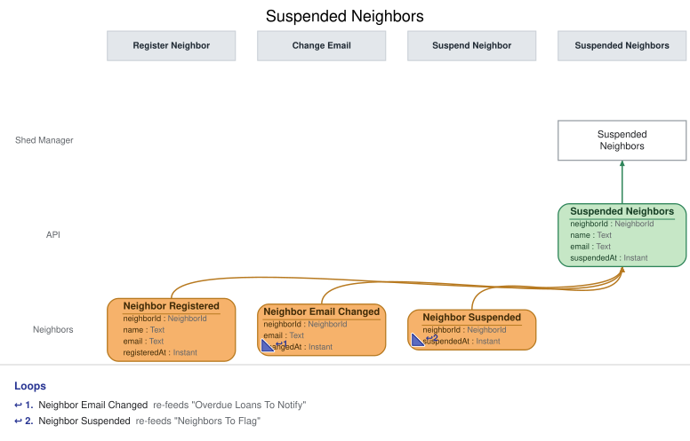

# Slice: Suspended Neighbors

## Intent
Shows the shed manager every neighbor who is currently suspended, with when they were suspended,
on the Suspended Neighbors screen they reinstate neighbors from.

## Trigger & Actor
- **Actor:** the shed manager, opening the Suspended Neighbors screen.
- **What it shows:** one entry per neighbor currently suspended, built from the events listed
  under Read Model / View. Nothing on this screen records anything by itself; its one action
  issues a command owned by another slice:
  - **Reinstate** (Reinstate Neighbor slice), offered on every entry (INV-SPN-4).
- A neighbor is suspended by the shed manager from Flagged Neighbors or from the Neighbors screen
  (Suspend Neighbor). No email goes to the neighbor on suspension or reinstatement, and no reason
  or note is recorded with a suspension.

## Read Model / View
- **View:** `Suspended Neighbors` built from events: "Neighbor Suspended", "Neighbor
  Registered", "Neighbor Email Changed", "Neighbor Reinstated", "Neighbor Account Closed"
- **Consumed by:** the Suspended Neighbors screen (Shed Manager)
- **Freshness / consistency expectation:** eventual. An entry appears or drops off shortly after
  its event is recorded (seconds, not minutes). Reinstate checks its own rules when it runs.

One row per suspended neighbor. A NeighborId is a UUID. An Instant is a UTC instant set when the
event was recorded.

| Field | Type | Source / Notes |
|-------|------|-----------------|
| neighborId | NeighborId | Neighbor Suspended.neighborId. |
| name | Text | Neighbor Registered.name for neighborId. Never changes. |
| email | Text | Neighbor Registered.email for neighborId, replaced by each Neighbor Email Changed.email. Always the current one. |
| suspendedAt | Instant | Neighbor Suspended.suspendedAt. Shown as the suspended date: its calendar date in the shed's local time zone. |

To fill an entry when the suspension lands, the view also keeps every neighbor's name and current
email. These are bookkeeping, not rows, and are never returned.

**When an entry appears and drops off.**
- Neighbor Suspended creates the neighbor's entry.
- Neighbor Reinstated removes it.
- Neighbor Account Closed removes it.

**Queries**
- **List suspended neighbors.** Takes nothing. Returns every entry with neighborId, name, email
  and suspendedAt. There is no paging. Entries are listed by name, then by suspendedAt, when the
  entry was created (INV-SPN-10).

## Invariants / Business Rules
- **INV-SPN-1:** A neighbor appears on Suspended Neighbors when Neighbor Suspended is recorded
  for them, whether they were suspended from Flagged Neighbors or from the Neighbors screen.
- **INV-SPN-2:** Each entry shows the neighbor's name and current email and the date they were
  suspended.
  - The name comes from Neighbor Registered. The email is the current one: Neighbor Registered
    sets it, Neighbor Email Changed replaces it.
  - A suspended neighbor can't change their email. The email shown is the one they had when they
    were suspended, which may itself have been changed before; it changes again only after they
    are reinstated, by which time they have left the list.
  - No reason or note is recorded with a suspension, so none is shown.
- **INV-SPN-3:** A suspended neighbor stays on the list until they are reinstated or close their
  account.
  - A suspension never lifts by itself after a set time, and it is never permanent.
- **INV-SPN-4:** Every entry offers Reinstate, and a reinstated neighbor leaves the list.
  - Reinstating is the only action this screen offers.
- **INV-SPN-5:** When a suspended neighbor closes their account, they leave the list.
  - Closed is final, so the shed manager is never offered Reinstate on a closed account.
- **INV-SPN-6:** A neighbor appears on the list at most once.
  - A neighbor who is reinstated and later suspended again appears again, with the new date.
- **INV-SPN-10:** Entries are listed by name, ignoring case, then by when the neighbor was
  suspended.
  - The same order as every list in the shed.
- **INV-SPN-9:** Applying the same event twice leaves the list as if it had been applied once.
- **INV-SPN-11:** Only the shed manager can read Suspended Neighbors.
  - A signed-in caller without the shed-manager role is refused with `not-shed-manager`, and a
    caller with no sign-in with `not-signed-in`. Nothing is returned to either.

Only Neighbor Suspended, Neighbor Reinstated and Neighbor Account Closed add or remove entries;
Neighbor Registered and Neighbor Email Changed supply names and emails.

## Scenarios (Given / When / Then)
Unless a scenario says otherwise: Ana Ruiz registered with ana@example.org, and Ben Ito with
ben@example.org.

- **Neighbor suspended (INV-SPN-1, INV-SPN-2, INV-SPN-4)**
  - **Given:** Suspended Neighbors is empty
  - **When:** Neighbor Suspended is recorded for Ana on 7 October
  - **Then:** Suspended Neighbors lists Ana Ruiz, ana@example.org, suspended 7 October, with
    Reinstate offered.
- **Email changed before suspension (INV-SPN-2)**
  - **Given:** Ana changed her email to ana.ruiz@example.net before she was suspended
  - **When:** Neighbor Suspended is recorded for Ana
  - **Then:** Suspended Neighbors lists Ana Ruiz, ana.ruiz@example.net.
- **Neighbor reinstated (INV-SPN-4)**
  - **Given:** Suspended Neighbors lists Ana and Ben
  - **When:** Neighbor Reinstated is recorded for Ana
  - **Then:** Ana leaves Suspended Neighbors. Ben is still listed.
- **Suspended neighbor closes their account (INV-SPN-5)**
  - **Given:** Suspended Neighbors lists Ana
  - **When:** Neighbor Account Closed is recorded for Ana
  - **Then:** Ana leaves Suspended Neighbors.
- **Suspended again after reinstatement (INV-SPN-6)**
  - **Given:** Ana was suspended on 7 October and reinstated on 1 November
  - **When:** Neighbor Suspended is recorded for Ana again on 3 February
  - **Then:** Suspended Neighbors lists Ana once, suspended 3 February.
- **Same event applied twice (INV-SPN-9)**
  - **Given:** Suspended Neighbors lists Ana once
  - **When:** the same Neighbor Suspended for Ana is applied again
  - **Then:** Ana is still listed once, suspended 7 October.
- **Listing order (INV-SPN-10)**
  - **Given:** Suspended Neighbors lists Ben Ito (suspended 1 October) and Ana Ruiz (suspended 7
    October)
  - **When:** the shed manager lists suspended neighbors
  - **Then:** Ana Ruiz comes first, then Ben Ito.
- **Listing suspended neighbors**
  - **Given:** Suspended Neighbors lists Ana and Ben
  - **When:** the shed manager's screen lists suspended neighbors
  - **Then:** both entries are returned with all their fields, with no paging.
- **A neighbor tries to read the list (INV-SPN-11)**
  - **Given:** Suspended Neighbors has entries
  - **When:** a neighbor, signed in without the shed-manager role, asks for the suspended neighbors
  - **Then:** refused with `not-shed-manager`: "Only the shed manager can see this screen."
    Nothing is returned.
- **No sign-in (INV-SPN-11)**
  - **Given:** Suspended Neighbors has entries
  - **When:** a caller with no sign-in asks for the suspended neighbors
  - **Then:** refused with `not-signed-in`: "Please sign in." Nothing is returned.

## Alternate & Error Flows
- **Read refusals:** the list query refuses a caller without the shed-manager role with
  `not-shed-manager` ("Only the shed manager can see this screen."), and a caller with no
  sign-in with `not-signed-in` ("Please sign in."). Nothing is returned on a refusal. These
  mean the same conditions as in the shed manager's commands.
- **Repeated events:** every event is applied idempotently (INV-SPN-9).
- **Events after an entry is gone:** once an entry has been removed, a later Neighbor Reinstated
  or Neighbor Account Closed for that neighbor changes nothing. A later Neighbor Suspended starts
  a new entry.
- **Stale actions:** Reinstate offered on the screen can be out of date by the time it is used
  (for example, on a neighbor who has just closed their account). Reinstate Neighbor checks its
  own rules and refuses with its own reason; this view raises no errors of its own.

## Non-Functional Requirements
- **Security / authz:** the Suspended Neighbors screen is the shed manager's alone. Sign-in, handled outside the shed's events, supplies the
  shed-manager role; only a caller with it may read this view.
- **PII & compliance:** shows suspended neighbors' names and current emails to the shed manager
  only. An entry is removed on reinstatement or account closure. Names and emails are kept with
  the shed's loan and hold history and never erased.
- **Performance / SLA:** none beyond the freshness above.

## Dependencies & Read Models Affected
- **Upstream events this slice relies on**, and the fields it reads from each:
  - Neighbor Suspended (Suspend Neighbor): neighborId, suspendedAt.
  - Neighbor Reinstated (Reinstate Neighbor), Neighbor Account Closed (Close Account):
    neighborId.
  - Neighbor Registered (Register Neighbor): neighborId, name, email.
  - Neighbor Email Changed (Change Email): neighborId, email.
  - These keys match the deep-passed docs and Suspend Neighbor's Neighbor Suspended
    {neighborId, suspendedAt}.
- **Downstream read models / slices affected:** none. The screen it feeds issues Reinstate
  Neighbor.

## Open Questions
None.
