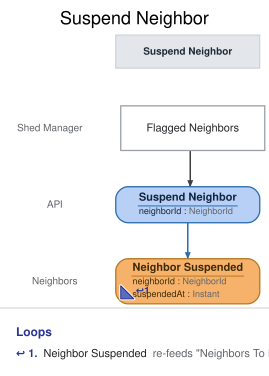

# Slice: Suspend Neighbor

## Intent
Let the shed manager suspend any active neighbor, so someone who keeps returning tools late stops
borrowing until the shed manager reinstates them. Usually the neighbor has been flagged for late
returns. The system flags; the shed manager decides.

## Trigger & Actor
The shed manager issues Suspend Neighbor from either of two screens:
- **Flagged Neighbors**, for a neighbor the system has flagged for late returns.
- **Neighbors**, for any active neighbor, flagged or not.

## Invariants / Business Rules
- **INV-SUS-1:** Only the shed manager suspends a neighbor, from Flagged Neighbors or from the
  Neighbors screen.
  - On the Neighbors screen, Suspend is offered for any active neighbor, flagged or not. This
    covers a neighbor who closed their account while suspended and signed up again with a
    different email.
  - The system never suspends anyone. Reaching the late-return threshold never suspends a
    neighbor by itself.
- **INV-SUS-2:** Only an active neighbor can be suspended.
  - A neighbor who is already suspended can't be suspended again. A neighbor whose account is
    closed can't be suspended, because closed is final.
- **INV-SUS-3:** A suspension lasts until the shed manager reinstates the neighbor.
  - It never lifts by itself after a set time, and it is never permanent.
- **INV-SUS-4:** A suspended neighbor can't check out a tool, extend a loan, place a new hold, or
  change their email.
  - That includes collecting a tool set aside for them. A set-aside they can't collect expires
    after its 3 days, as any other.
  - Each of these is refused with suspension as the reason. They can change their email again
    once reinstated.
- **INV-SUS-5:** A suspended neighbor keeps what they already have.
  - Their loans stay out, and they can return them. Their holds keep their places in the queue,
    and they can cancel them.
- **INV-SUS-6:** Once suspended, the neighbor leaves Flagged Neighbors and appears on Suspended
  Neighbors. The Neighbors screen and the neighbor's own My Account show them as suspended.
  - While suspended, the neighbor is never flagged.
- **INV-SUS-7:** The neighbor isn't emailed about the suspension.
  - They see it on My Account, and as the reason when a checkout, extension, new hold or email
    change is refused.
- **INV-SUS-8:** No reason or note is recorded with the suspension.

## Scenarios (Given / When / Then)
- **Happy path**
  - **Given:** Ana is active and on Flagged Neighbors after three late returns within 90 days.
    She has the ladder on loan and a hold waiting on the cordless drill.
  - **When:** the shed manager suspends Ana from Flagged Neighbors
  - **Then:** Neighbor Suspended is recorded for Ana. She leaves Flagged Neighbors and appears on
    Suspended Neighbors, and the Neighbors screen and her My Account show her as suspended. She
    still has the ladder on loan, and her hold on the drill keeps its place.
- **Suspending a neighbor who isn't flagged**
  - **Given:** Ben is active and not flagged
  - **When:** the shed manager suspends Ben from the Neighbors screen
  - **Then:** Neighbor Suspended is recorded for Ben. The Neighbors screen and his My Account
    show him as suspended, and he appears on Suspended Neighbors.

## Open Questions
None.
