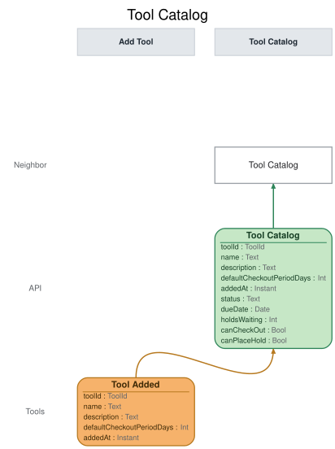

# Slice: Tool Catalog

## Intent
Shows neighbors the tools in the shed and whether each one can be borrowed right now, on the Tool
Catalog screen they check tools out and place holds from.

## Invariants / Business Rules
- **INV-TCAT-1:** Every added tool appears in the catalog exactly once, available to borrow.
  - One entry per Tool Added. Nothing else creates an entry.
  - Each entry shows the tool's name, its description if it has one, and its default checkout
    period. Tools may share a name; each is its own entry.
- **INV-TCAT-2:** A checked-out tool shows as checked out, with its due date, until it is
  returned.
  - When the loan is extended, the catalog shows the new due date.
- **INV-TCAT-3:** A tool that is back in the shed with holds waiting, but not yet set aside,
  shows as reserved, never as available.
  - This covers the moment after a return before Hold Fulfilled lands, and the moment after a
    set-aside ends before the next hold is fulfilled.
  - The catalog doesn't show who it is reserved for. It shows the holds waiting, and offers Check
    Out and Place Hold (INV-TCAT-11, INV-TCAT-7).
- **INV-TCAT-4:** A tool set aside for a holder shows as set aside, not available, until that
  holder checks it out or the set-aside ends.
  - A set-aside runs through the end of its collect-by date, the set-aside date plus 3 days, and
    lapses at the start of the next day, shed local time. It also ends early if the holder
    cancels the hold or closes their account.
  - The catalog shows the set-aside until Hold Expired is recorded. The holder's claim ends at
    the cut-off even if that is a little earlier; Check Out Tool enforces it.
  - However it ends, other than by the holder's checkout, the tool passes to the next hold, or
    becomes available if no holds are waiting.
- **INV-TCAT-5:** The catalog is the same for every neighbor.
  - It never shows a neighbor that a tool is set aside for them. That is shown on My Holds.
- **INV-TCAT-6:** Each tool shows how many holds are waiting on it.
  - A hold is waiting from Hold Placed until it is fulfilled or ends. A hold ends when it is
    cancelled or expires, the holder checks the tool out, the tool is retired or recorded lost,
    or the holder closes their account.
- **INV-TCAT-7:** The catalog offers Place Hold on any tool that isn't available: checked out,
  reserved, or set aside.
  - A neighbor who wants an available tool checks it out instead.
  - The action is offered by the tool's state alone, the same to every neighbor. A neighbor who
    can't place the hold (they already hold the tool, have it on loan, or are suspended) still
    sees it, and Place Hold refuses them with the reason.
- **INV-TCAT-11:** The catalog offers Check Out on an available tool, and on a reserved or
  set-aside tool. It doesn't offer Check Out on a tool that is checked out.
  - The action is offered by the tool's state alone, the same to every neighbor. On a reserved
    or set-aside tool, only the holder whose turn it is can check it out; Check Out Tool refuses
    anyone else with the reason.
- **INV-TCAT-8:** A retired tool drops off the catalog, including one retired while on loan.
  - Retiring a tool also ends its holds.
- **INV-TCAT-10:** A tool marked lost drops off the catalog.
  - Marking a tool lost ends its loan, retires it and ends its holds, all at once.
- **INV-TCAT-9:** Only Tool Added, Tool Checked Out, Loan Extended, Hold Placed, Hold Cancelled,
  Tool Returned, Hold Fulfilled, Hold Expired, Tool Retired, Tool Lost and Neighbor Account
  Closed change the catalog.
  - Overdue notices are shown on My Loans, not here.

## Scenarios (Given / When / Then)
- **Tool added**
  - **Given:** the catalog lists no tools
  - **When:** Tool Added is recorded for a cordless drill, described as "18V, two batteries",
    with a 7-day default checkout period
  - **Then:** the catalog lists the drill, its description and its 7-day period, as available,
    with no holds waiting.
- **Tool checked out**
  - **Given:** the catalog lists the drill as available
  - **When:** Tool Checked Out is recorded for the drill, due back on 12 October
  - **Then:** the catalog shows the drill as checked out, due back 12 October, and offers Place
    Hold on it.
- **Loan extended**
  - **Given:** the catalog shows the drill as checked out, due back 12 October
  - **When:** Loan Extended is recorded for the drill's loan, with a new due date of 19 October
  - **Then:** the catalog shows the drill as checked out, due back 19 October.
- **Hold placed**
  - **Given:** the catalog shows the drill as checked out, with no holds waiting
  - **When:** Hold Placed is recorded for the drill
  - **Then:** the catalog shows the drill as checked out, with 1 hold waiting.
- **Hold cancelled**
  - **Given:** the catalog shows the drill as checked out, with 2 holds waiting
  - **When:** Hold Cancelled is recorded for one of those holds
  - **Then:** the catalog shows the drill as checked out, with 1 hold waiting.
- **Tool returned, no holds waiting**
  - **Given:** the catalog shows the drill as checked out, with no holds waiting
  - **When:** Tool Returned is recorded for the drill
  - **Then:** the catalog lists the drill as available, with no due date.
- **Tool returned, holds waiting**
  - **Given:** the catalog shows the drill as checked out, with 2 holds waiting
  - **When:** Tool Returned is recorded for the drill
  - **Then:** the catalog shows the drill as reserved, with 2 holds waiting, and offers Check Out
    and Place Hold on it.
- **Hold fulfilled**
  - **Given:** the drill has been returned, with 2 holds waiting
  - **When:** Hold Fulfilled is recorded for the drill
  - **Then:** the catalog shows the drill as set aside, with 1 hold waiting, and offers Check Out
    and Place Hold on it. Every neighbor sees the same entry, including the holder it is set
    aside for.
- **Hold expired, another hold waiting**
  - **Given:** the catalog shows the drill as set aside, with 1 hold waiting
  - **When:** Hold Expired is recorded for the set-aside hold
  - **Then:** the catalog shows the drill as reserved, with 1 hold waiting. Once Hold Fulfilled
    is recorded for that hold, it shows the drill as set aside, with no holds waiting.
- **Hold expired, no holds waiting**
  - **Given:** the catalog shows the drill as set aside, with no holds waiting
  - **When:** Hold Expired is recorded for the set-aside hold
  - **Then:** the catalog lists the drill as available.
- **Holder collects the set-aside tool**
  - **Given:** the catalog shows the drill as set aside
  - **When:** Tool Checked Out is recorded for the drill by the holder
  - **Then:** the catalog shows the drill as checked out, with the new loan's due date.
- **Set-aside hold cancelled, another hold waiting**
  - **Given:** the catalog shows the drill as set aside, with 1 hold waiting
  - **When:** Hold Cancelled is recorded for the set-aside hold
  - **Then:** the catalog shows the drill as reserved, with 1 hold waiting. Once Hold Fulfilled
    is recorded for the waiting hold, it shows the drill as set aside, with no holds waiting.
- **Set-aside holder closes their account, no holds waiting**
  - **Given:** the catalog shows the drill as set aside, with no holds waiting
  - **When:** Neighbor Account Closed is recorded for the holder
  - **Then:** the catalog lists the drill as available.
- **Front holder collects before the set-aside is recorded**
  - **Given:** the drill has just been returned, with 2 holds waiting
  - **When:** Tool Checked Out is recorded for the drill by the holder at the front of the queue
  - **Then:** the catalog shows the drill as checked out, with the new loan's due date, and 1
    hold waiting.
- **Holder closes their account**
  - **Given:** the catalog shows the drill as checked out, with 2 holds waiting, one of them
    Cara's
  - **When:** Neighbor Account Closed is recorded for Cara
  - **Then:** the catalog shows the drill as checked out, with 1 hold waiting.
- **Tool retired**
  - **Given:** the catalog lists the drill as available
  - **When:** Tool Retired is recorded for the drill
  - **Then:** the drill drops off the catalog. Other tools are unchanged.
- **Tool retired while on loan**
  - **Given:** the catalog shows the hedge trimmer as checked out, due 20 October, with 1 hold
    waiting
  - **When:** Tool Retired is recorded for the hedge trimmer
  - **Then:** the hedge trimmer drops off the catalog, though its loan carries on.
- **Tool marked lost**
  - **Given:** the catalog shows the drill as checked out, due 12 October, with 1 hold waiting
  - **When:** Tool Lost is recorded for the drill
  - **Then:** the drill drops off the catalog. Other tools are unchanged.

## Open Questions
None.
