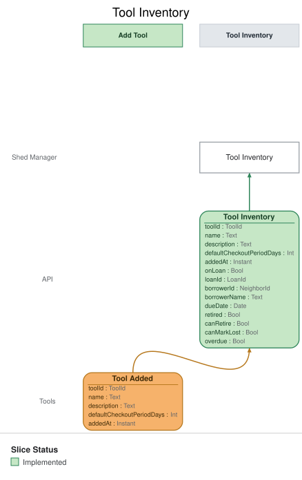

# Slice: Tool Inventory

## Intent
Shows the shed manager every tool in the shed on the Tool Inventory screen, and which of them are
out on loan, to whom, and until when. It is the shed manager's working screen for tools: they add
and retire tools from it, and record a tool lost when it is out and never coming back.

## Trigger & Actor
- **Actor:** the shed manager, opening the Tool Inventory screen.
- **What it shows:** one entry per tool currently in the shed or out on loan, built from the
  events listed under Read Model / View. Nothing on this screen records anything by itself; its
  actions issue commands owned by other slices:
  - **Add Tool** (Add Tool slice) — always offered.
  - **Retire** (Retire Tool slice) — offered on every listed tool that is not already retired
    (INV-TINV-7).
  - **Mark lost** (Record Tool Lost slice) — offered only on a tool that is out on loan
    (INV-TINV-6).

## Read Model / View
- **View:** `Tool Inventory` built from events: "Tool Added", "Neighbor Registered", "Tool Checked
  Out", "Loan Extended", "Tool Returned", "Tool Retired", "Tool Lost"
- **Consumed by:** the Tool Inventory screen (Shed Manager)
- **Freshness / consistency expectation:** eventual — an entry reflects an event shortly after it
  is recorded (seconds, not minutes). No action on this screen depends on it being instant,
  because each command checks its own rules when it runs.

One row per listed tool. ToolId, NeighborId and LoanId are UUIDs. A Date is a calendar date in
the shed's local time zone; an Instant is a UTC instant set when the event was recorded. A field
marked optional can be absent.

| Field | Type | Source / Notes |
|-------|------|-----------------|
| toolId | ToolId | Tool Added.toolId. |
| name | Text | Tool Added.name. Never changes. Need not be unique. |
| description | Text | Optional: absent when the tool was added without one. Tool Added.description. |
| defaultCheckoutPeriodDays | Int | Tool Added.defaultCheckoutPeriodDays (1–30). |
| addedAt | Instant | Tool Added.addedAt. |
| onLoan | Bool | `Derived:` yes from Tool Checked Out for this tool until Tool Returned or Tool Lost for that loan; no otherwise. |
| loanId | LoanId | `Derived:` Tool Checked Out.loanId while the tool is on loan; none once Tool Returned or Tool Lost for that loan lands. Optional: present only while on loan. |
| borrowerId | NeighborId | `Derived:` Tool Checked Out.neighborId while the tool is on loan; none otherwise. Optional: present only while on loan. |
| borrowerName | Text | `Derived:` Neighbor Registered.name for borrowerId while the tool is on loan; none otherwise. Optional: present only while on loan. |
| dueDate | Date | `Derived:` Tool Checked Out.dueDate, replaced by each Loan Extended.dueDate for that loan, while the tool is on loan; none otherwise. Optional: present only while on loan. |
| retired | Bool | `Derived:` yes once Tool Retired is recorded for this tool. A retired row exists only while the tool is still out on loan. |
| canRetire | Bool | `Derived:` yes while retired is no. Returned so the screen can offer Retire (INV-TINV-7). |
| canMarkLost | Bool | `Derived:` same as onLoan. Returned so the screen can offer Mark lost (INV-TINV-6). |

**Queries**
- **List the tool inventory.** Takes nothing. Returns every listed tool, each with all the fields
  above. There is no paging: the query always returns every listed tool. The order is an open
  question below.

## Invariants / Business Rules
- **INV-TINV-1:** Every added tool appears in the inventory exactly once.
  - One entry per Tool Added; nothing else creates an entry.
  - Each physical item is its own tool, so two identical drills are two entries.
- **INV-TINV-2:** A retired tool drops off the inventory once it is back in the shed or recorded
  lost.
  - A tool retired while it is in the shed drops off at once.
  - A tool retired while it is out on loan stays listed, marked retired and out, until it is
    returned or recorded lost. Then it drops off. This lets the shed manager record it lost if
    it never comes back.
  - A tool recorded lost is retired by that, so it drops off too.
  - This differs from the Tool Catalog, where a tool retired while on loan drops off at once:
    neighbors can do nothing with it, while the shed manager may still need to record it lost.
- **INV-TINV-3:** The inventory changes only when a tool is added, checked out, extended, returned,
  retired or recorded lost, or when a neighbor registers.
  - Neighbor Registered supplies the borrower names shown on tools that are out.
  - Holds and overdue notices leave it unchanged. Hold state is shown to neighbors
    on the Tool Catalog, not here.
  - A tool's details never change after it is added (see the note under Add Tool's event table). A mistake is
    corrected by retiring the tool and adding it again.
- **INV-TINV-4:** Each entry shows the tool's name, its description when it has one, and its
  default checkout period.
- **INV-TINV-5:** Each entry shows whether the tool is out on loan. A tool that is out also shows
  the borrower's name and the due date.
  - A tool is out from Tool Checked Out until Tool Returned or Tool Lost.
  - The due date moves with each extension.
  - When the tool comes back or is recorded lost, the borrower's name and due date are no longer
    shown on it.
- **INV-TINV-6:** The inventory offers "mark lost" only on a tool that is out on loan.
  - Recording a tool lost ends its loan, retires the tool and ends its holds. It never counts
    as a late return for the borrower (Record Tool Lost, INV-LOST-3 to INV-LOST-6).
- **INV-TINV-7:** The inventory offers "retire" on every listed tool that is not already retired.
  - A tool retired while out on loan stays listed but is not offered "retire" again.
- **INV-TINV-8:** Applying the same event twice leaves the inventory as if it had been applied
  once.

## Scenarios (Given / When / Then)
- **Tool added (INV-TINV-1, INV-TINV-4, INV-TINV-7)**
  - **Given:** the shed has no tools
  - **When:** Tool Added is recorded for a cordless drill, described as "18V, two batteries",
    with a default checkout period of 7 days
  - **Then:** the Tool Inventory lists the cordless drill with its description and its 7-day
    default checkout period, in the shed, with "retire" offered and no "mark lost".
- **Tool added without a description (INV-TINV-4)**
  - **Given:** the shed has no tools
  - **When:** Tool Added is recorded for a ladder with no description and a default checkout
    period of 3 days
  - **Then:** the Tool Inventory lists the ladder with its 3-day default checkout period and no
    description.
- **Two of the same tool (INV-TINV-1)**
  - **Given:** the Tool Inventory lists one cordless drill
  - **When:** Tool Added is recorded for a second cordless drill, with its own tool ID
  - **Then:** the Tool Inventory lists both drills as separate entries.
- **Same event applied twice (INV-TINV-8)**
  - **Given:** the Tool Inventory lists the cordless drill once
  - **When:** the same Tool Added for that drill is applied again
  - **Then:** the Tool Inventory still lists the drill once.
- **Neighbor registers (INV-TINV-3)**
  - **Given:** the Tool Inventory lists the drill, in the shed
  - **When:** Neighbor Registered is recorded for Ana Ruiz
  - **Then:** no entry on the Tool Inventory changes.
- **Tool checked out (INV-TINV-5, INV-TINV-6)**
  - **Given:** Neighbor Registered was recorded for Ana Ruiz, and the Tool Inventory lists the
    cordless drill, in the shed
  - **When:** Tool Checked Out is recorded for Ana borrowing the drill, due 12 October
  - **Then:** the Tool Inventory shows the drill as out on loan to Ana Ruiz, the name she
    registered with, due 12 October, and offers "mark lost" on it.
- **Loan extended (INV-TINV-5)**
  - **Given:** the Tool Inventory shows the drill out on loan to Ana, due 12 October
  - **When:** Loan Extended is recorded for Ana's drill loan, with the due date 19 October
  - **Then:** the Tool Inventory shows the drill out on loan to Ana, due 19 October.
- **Tool returned (INV-TINV-5, INV-TINV-6)**
  - **Given:** the Tool Inventory shows the drill out on loan to Ana, due 19 October
  - **When:** Tool Returned is recorded for Ana's drill loan
  - **Then:** the Tool Inventory shows the drill as in the shed, with no borrower, due date or
    "mark lost".
- **Tool retired (INV-TINV-2)**
  - **Given:** the Tool Inventory lists a cordless drill and a ladder, both in the shed
  - **When:** Tool Retired is recorded for the cordless drill
  - **Then:** the cordless drill drops off the Tool Inventory, and the ladder is still listed.
- **Tool retired while out on loan (INV-TINV-2, INV-TINV-6, INV-TINV-7)**
  - **Given:** the Tool Inventory shows the ladder out on loan to Ben, due 20 October
  - **When:** Tool Retired is recorded for the ladder
  - **Then:** the Tool Inventory still lists the ladder, marked retired and out on loan to Ben,
    due 20 October, with "mark lost" still offered and "retire" no longer offered.
- **Retired tool comes back (INV-TINV-2)**
  - **Given:** the Tool Inventory shows the ladder marked retired and out on loan to Ben
  - **When:** Tool Returned is recorded for Ben's ladder loan
  - **Then:** the ladder drops off the Tool Inventory.
- **Retired tool recorded lost (INV-TINV-2)**
  - **Given:** the Tool Inventory shows the ladder marked retired and out on loan to Ben
  - **When:** Tool Lost is recorded for Ben's ladder loan
  - **Then:** the ladder drops off the Tool Inventory.
- **Tool recorded lost (INV-TINV-2)**
  - **Given:** the Tool Inventory shows the hedge trimmer out on loan to Ana
  - **When:** Tool Lost is recorded for Ana's hedge trimmer loan
  - **Then:** the hedge trimmer drops off the Tool Inventory.
- **Holds and notices don't change it (INV-TINV-3)**
  - **Given:** the Tool Inventory shows the drill out on loan to Ana, due 12 October
  - **When:** Hold Placed is recorded for Ben on the drill, and later Overdue Notice Sent is
    recorded for Ana's drill loan
  - **Then:** the drill's entry is unchanged.
- **Listing the inventory**
  - **Given:** the Tool Inventory lists the cordless drill (in the shed) and the ladder (out on
    loan to Ben, due 20 October)
  - **When:** the shed manager's screen lists the tool inventory
  - **Then:** both tools are returned with all their fields, with no paging.

## Alternate & Error Flows
- **Repeated events:** every event is applied idempotently (INV-TINV-8). A Tool Added, Tool
  Checked Out, Loan Extended, Tool Returned, Tool Retired or Tool Lost applied a second time leaves
  the entry as it was after the first.
- **Event for a tool that is no longer listed:** under the rules above, a Loan Extended, Tool
  Returned or Tool Lost can reach this view for a tool that is no longer listed only as a replay
  of an event already applied. It changes nothing.
- **Stale actions:** an action offered on the screen can be out of date by the time it is used
  (for example, "mark lost" on a tool that has just been returned). The command it issues checks
  its own rules and refuses with its own reason; this view raises no errors of its own.

## Non-Functional Requirements
- **Security / authz:** the Tool Inventory is the shed manager's screen; neighbors see tools on
  the Tool Catalog instead. How the system recognises the shed manager is the open identity
  question in Add Tool (slices/add-tool.md); this view follows its answer.
- **PII & compliance:** shows a borrower's name while they have a tool out. It never shows their
  email. The name stops being shown on that tool once the loan ends.
- **Performance / SLA:** none beyond the freshness above.

## Dependencies & Read Models Affected
- **Upstream events this slice relies on**, and the fields it reads from each:
  - Tool Added (Add Tool): toolId, name, description, defaultCheckoutPeriodDays, addedAt.
  - Neighbor Registered (Register Neighbor): neighborId, name.
  - Tool Checked Out (Check Out Tool): loanId, toolId, neighborId, dueDate.
  - Loan Extended (Extend Loan): loanId, dueDate.
  - Tool Returned (Return Tool): loanId, toolId.
  - Tool Retired (Retire Tool): toolId.
  - Tool Lost (Record Tool Lost): loanId, toolId.
  - All but Tool Added are specified in slices not yet written in depth. These names are this
    view's assumptions; each of those slices is checked against them when it is.
- **Downstream read models / slices affected:** none. The screen it feeds issues Add Tool, Retire
  Tool and Record Tool Lost.

## Open Questions
- [ ] Should a tool that is out show when its loan is overdue?
  - The inventory already has the due date. Overdue would be worked out when the inventory is
    read, from dueDate and today's date in the shed's local time zone, so it needs no model
    change. It would be a bare `derived` field.
  - Recommendation: yes. It is what tells the shed manager a tool may be lost.
- [ ] In what order are tools listed?
  - This is the shed-wide question of one order for every list view: by name, then by when the
    item was created. For this view that means by name, then by addedAt.
  - Recommendation: yes, that order.
