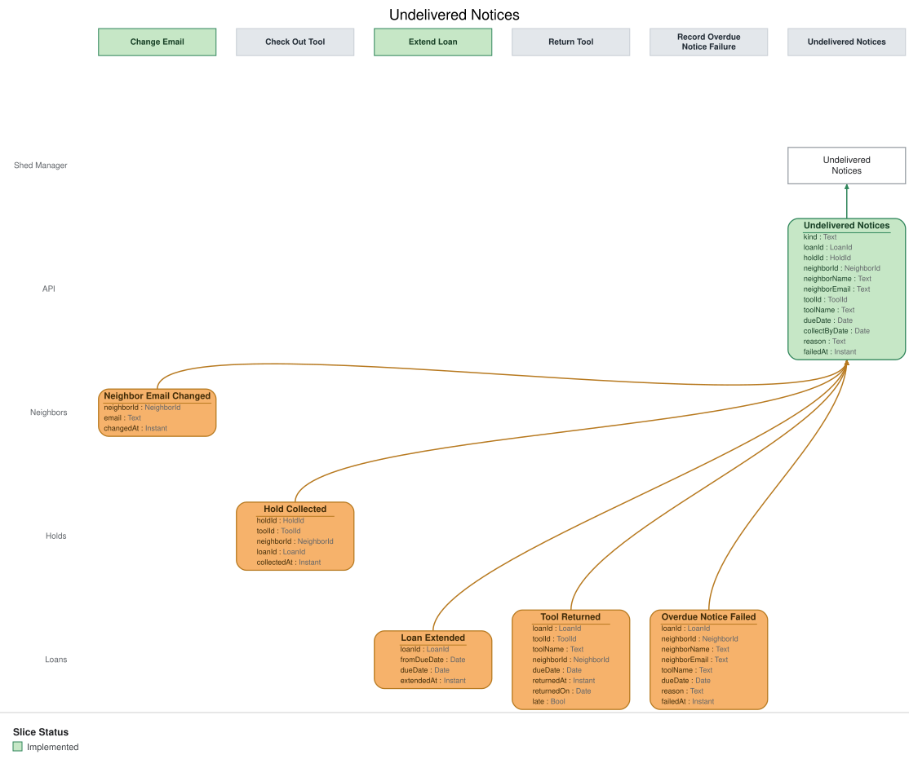

# Slice: Undelivered Notices

## Intent
Shows the shed manager every email the shed couldn't deliver — overdue notices and pickup
notices — so they can reach the neighbor another way. A neighbor who wasn't told their loan is
overdue, or that a tool is waiting for them, doesn't stay unnoticed.

## Invariants / Business Rules
- **INV-UDN-1:** Every failed overdue notice and every failed pickup notice appears on Undelivered
  Notices exactly once.
  - One entry per Overdue Notice Failed or Pickup Notice Failed; nothing else creates an entry.
  - A failure is recorded only after the email provider has made its 3 delivery attempts over
    about an hour and reported a final failure. The shed manager never sees a notice that is
    still being tried.
  - A failure report that matches no notice the shed sent is ignored, and shows nothing here.
  - A pickup-notice failure report that arrives after the set-aside has ended is ignored too.
- **INV-UDN-2:** Each entry shows the failure date, and whether the provider refused the email or
  it bounced.
  - A bounce usually means a wrong email address, which the shed manager can raise with the
    neighbor.
- **INV-UDN-3:** An overdue-notice entry shows the borrower's name and email, the tool's name,
  and the due date.
- **INV-UDN-3a:** A pickup-notice entry shows the holder's name and email, the tool's name, and
  the collect-by date.
- **INV-UDN-4:** An overdue-notice entry drops off when the tool is returned, or when the shed
  manager records it lost.
  - Either way the loan has ended, and there is nothing left to follow up.
- **INV-UDN-5:** A pickup-notice entry drops off when the set-aside ends.
  - A set-aside ends when the holder collects the tool, or the hold is cancelled or expires, or
    it ends because the tool was retired or lost or the holder closed their account.
- **INV-UDN-6:** Only the shed manager sees Undelivered Notices. Neighbors never do.
- **INV-UDN-7:** No email is tried again after its failure is recorded.
  - Following up is the shed manager's job, in person.

## Scenarios (Given / When / Then)
- **Overdue notice fails**
  - **Given:** Undelivered Notices is empty
  - **When:** Overdue Notice Failed is recorded on 13 October for Ana Ruiz's cordless drill loan,
    due 12 October, because the email bounced
  - **Then:** Undelivered Notices lists Ana Ruiz with ana@example.org, the cordless drill, the due
    date 12 October, the failure date 13 October, and that the email bounced.
- **Pickup notice fails**
  - **Given:** the hedge trimmer is set aside for Ben, collect by 16 October
  - **When:** Pickup Notice Failed is recorded on 13 October for Ben's pickup notice, because the
    provider refused it
  - **Then:** Undelivered Notices lists the failed pickup notice for Ben, with his email, the
    hedge trimmer, the collect-by date 16 October, the failure date 13 October, and that the
    provider refused it. Ana's entry is unchanged.
- **Tool returned**
  - **Given:** Undelivered Notices lists the failed overdue notice for Ana's drill loan
  - **When:** Tool Returned is recorded for the drill
  - **Then:** Ana's entry drops off Undelivered Notices.
- **Tool recorded lost**
  - **Given:** Undelivered Notices lists the failed overdue notice for Ana's drill loan
  - **When:** Tool Lost is recorded for the drill
  - **Then:** Ana's entry drops off Undelivered Notices.
- **Holder collects the tool**
  - **Given:** Undelivered Notices lists the failed pickup notice for Ben's hedge trimmer
  - **When:** Tool Checked Out is recorded for the hedge trimmer and Ben
  - **Then:** Ben's entry drops off Undelivered Notices.
- **Pickup failure reported after the set-aside ended**
  - **Given:** the hedge trimmer was set aside for Ben, and Ben has since collected it
  - **When:** a failure report for Ben's pickup notice arrives
  - **Then:** nothing is added to Undelivered Notices.

## Open Questions
None.
