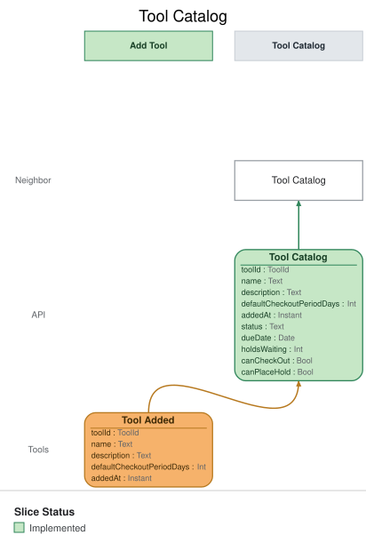

# Slice: Tool Catalog

<!-- GENERATED:em-slice-story:start — generated from the model by `em slice sync`; do not hand-edit -->
Step 3 of 3 in **Stock the shed** · after [Tool Inventory](./tool-inventory.md) · the story ends here · State View
<!-- GENERATED:em-slice-story:end -->

## Intent
Shows neighbors every tool they can borrow or hold, on the Tool Catalog screen, and what state
each one is in: available, checked out (and until when), reserved for the hold queue, or set
aside for a holder. It is the neighbors' working screen for tools: they check tools out and place
holds from it.

## Trigger & Actor
- **Actor:** a neighbor, opening the Tool Catalog screen.
- **What it shows:** one entry per tool that is in the shed or out on loan and not retired, built
  from the events listed under Read Model / View. A tool in maintenance is not
  listed (INV-TCAT-15). Every neighbor sees exactly the same catalog
  (INV-TCAT-5). Nothing on this screen records anything by itself; its actions issue commands
  owned by other slices:
  - **Check Out** (Check Out Tool slice) — offered by the tool's state alone (INV-TCAT-11).
  - **Place Hold** (Place Hold slice) — offered by the tool's state alone (INV-TCAT-7).

## Read Model / View
- **View:** `Tool Catalog` built from events: "Tool Added", "Tool Checked Out", "Loan Extended",
  "Hold Placed", "Hold Cancelled", "Tool Returned", "Hold Fulfilled", "Hold Expired", "Tool
  Retired", "Tool Lost", "Tool Maintenance Scheduled", "Tool Maintenance Completed"
- **Consumed by:** the Tool Catalog screen (Neighbor)
- **Freshness / consistency expectation:** eventual. An entry reflects an event shortly after it
  is recorded (seconds, not minutes). No action on this screen depends on it being instant,
  because Check Out Tool and Place Hold each check their own rules when they run.

One row per listed tool. ToolId, LoanId, HoldId and NeighborId are UUIDs. A Date is a calendar
date in the shed's local time zone; an Instant is a UTC instant set when the event was recorded.
A field marked optional can be empty.

| Field | Type | Source / Notes |
|-------|------|-----------------|
| toolId | ToolId | Tool Added.toolId. |
| name | Text | Tool Added.name. Never changes. Need not be unique. |
| description | Text | Optional. Tool Added.description. |
| defaultCheckoutPeriodDays | Int | Tool Added.defaultCheckoutPeriodDays: whole days, 1–30. |
| addedAt | Instant | Tool Added.addedAt. |
| status | Text | One of `available`, `checked-out`, `reserved`, `set-aside`. `Derived:` see the status rules below. |
| dueDate | Date | Optional. `Derived:` Tool Checked Out.dueDate, replaced by each Loan Extended.dueDate for that loan, while status is checked out; none otherwise. |
| holdsWaiting | Int | `Derived:` the number of this tool's holds that have been placed and have neither been fulfilled nor ended. |
| canCheckOut | Bool | `Derived:` yes unless status is checked out (INV-TCAT-11). |
| canPlaceHold | Bool | `Derived:` yes unless status is available (INV-TCAT-7). |

**Status rules.** A tool's status is a test of its current facts, taken in this order. The
first that holds wins:
1. **checked-out** — a loan of the tool is open: Tool Checked Out has been recorded, and neither
   Tool Returned nor Tool Lost for that loan.
2. **set-aside** — otherwise, a hold on the tool has been fulfilled and has not yet ended.
3. **reserved** — otherwise, at least one hold on the tool is waiting.
4. **available** — otherwise.

A hold is waiting from Hold Placed until it is fulfilled or ends. A hold ends when Hold
Cancelled, Hold Expired or Hold Collected is recorded for it; retiring the tool, recording it lost
and closing the holder's account each record Hold Cancelled for the holds they end. Because the test reads current facts, the order events arrive
in doesn't matter. For example, a lapsed set-aside whose tool has already gone out to someone
else is checked-out, even before its Hold Expired lands.

**Maintenance.** Tool Maintenance Scheduled takes the tool out of the list; Tool Maintenance
Completed puts it back (INV-TCAT-15, INV-TCAT-16). While a tool is in maintenance the view keeps
its entry, so that completing the maintenance can restore it, but the entry is not listed and no
query returns it. A tool that has been retired or recorded lost is never restored.

To match later events to a tool, the view also keeps, for each tool, the loan ID of the current
loan and the hold ID and holder of each live hold. These are bookkeeping, not part of the row,
and are never returned.

**Queries**
- **List the catalog.** Takes nothing; it is the same for every neighbor (INV-TCAT-5). Returns
  every listed tool, each with toolId, name, description, defaultCheckoutPeriodDays, addedAt,
  status, dueDate, holdsWaiting, canCheckOut and canPlaceHold. There is no paging: the query
  always returns every listed tool, ordered by name, then by addedAt (INV-TCAT-13).

## Invariants / Business Rules
- **INV-TCAT-1:** Every added tool appears in the catalog exactly once, available to borrow.
  - One entry per Tool Added. Nothing else creates an entry.
  - Each entry shows the tool's name, its description if it has one, and its default checkout
    period. Tools may share a name; each is its own entry.
  - A tool can be borrowed as soon as it is added.
- **INV-TCAT-2:** A checked-out tool shows as checked out, with its due date, until it is
  returned.
  - When the loan is extended, the catalog shows the new due date.
  - The due date is cleared when the tool comes back.
- **INV-TCAT-3:** A tool that is back in the shed with holds waiting, but not yet set aside,
  shows as reserved, never as available.
  - This covers the moment after a return before Hold Fulfilled lands, and the moment after a
    set-aside ends before the next hold is fulfilled.
  - The catalog doesn't show who it is reserved for. Only the holder whose turn it is can check
    it out; Check Out Tool enforces that (INV-CHK-3a).
- **INV-TCAT-4:** A tool set aside for a holder shows as set aside until that holder checks it
  out or the set-aside ends.
  - A set-aside runs through the end of its collect-by date, the set-aside date plus 3 days, and
    lapses at the start of the next day, shed local time. It also ends early if the holder
    cancels the hold or closes their account.
  - The catalog shows the set-aside until Hold Expired is recorded. The holder's claim ends at
    the cut-off even if that is a little earlier; Check Out Tool enforces it (INV-CHK-3b).
  - However it ends, other than by the holder's checkout, the tool's status follows the status
    rules: checked-out if someone else already has it out, else reserved if another hold is
    waiting, else available.
- **INV-TCAT-5:** The catalog is the same for every neighbor.
  - It never shows a neighbor that a tool is set aside for them; they see their own set-aside on
    My Holds.
  - It never shows who a tool is checked out to, who holds it, or who it is reserved or set
    aside for. Only the shed manager sees borrowers, on the Tool Inventory.
- **INV-TCAT-6:** Each tool shows how many holds are waiting on it.
  - A hold is waiting from Hold Placed until it is fulfilled or ends.
- **INV-TCAT-7:** The catalog offers Place Hold on any tool that isn't available: checked out,
  reserved, or set aside.
  - A neighbor who wants an available tool checks it out instead.
  - The action is offered by the tool's state alone. A neighbor who can't place the hold (they
    already hold the tool, have it on loan, or are suspended) still sees it, and Place Hold
    refuses them with the reason.
- **INV-TCAT-8:** A retired tool drops off the catalog at once, including one retired while on
  loan.
  - Retiring a tool also ends its holds.
  - This differs from the Tool Inventory, which keeps a tool retired while on loan until it comes
    back or is recorded lost (INV-TINV-2). Neighbors can do nothing with a retired tool; the shed
    manager may still need to record it lost.
- **INV-TCAT-9:** Only Tool Added, Tool Checked Out, Loan Extended, Hold Placed, Hold Cancelled,
  Tool Returned, Hold Fulfilled, Hold Collected, Hold Expired, Tool Retired, Tool Lost, Tool Maintenance Scheduled
  and Tool Maintenance Completed change the catalog.
  - Overdue notices, pickup emails and email changes are shown elsewhere, not here.
- **INV-TCAT-10:** A tool recorded lost drops off the catalog.
  - Recording a tool lost ends its loan, retires it and ends its holds, all at once.
- **INV-TCAT-11:** The catalog offers Check Out on an available, reserved or set-aside tool. It
  doesn't offer Check Out on a tool that is checked out.
  - The action is offered by the tool's state alone, the same to every neighbor. On a reserved
    or set-aside tool, only the holder whose turn it is can check it out; Check Out Tool refuses
    anyone else with the reason.
- **INV-TCAT-13:** Tools are listed by name, ignoring case, then by when they were added.
  - The same order as every list in the shed.
- **INV-TCAT-12:** Applying the same event twice leaves the catalog as if it had been applied
  once.
- **INV-TCAT-15:** A tool in maintenance drops off the catalog at once.
  - Tool Maintenance Scheduled removes the tool from the list, so neighbors can't see it, check
    it out or place a hold on it. The shed manager sees it on the Tool Maintenance screen.
  - Schedule Tool Maintenance only accepts a tool that is in the shed with no loan, set-aside or
    holds waiting, so the entry that drops off is an available one.
  - Tool Maintenance Scheduled for a tool that is not listed (retired, lost, or already in
    maintenance) changes nothing.
- **INV-TCAT-16:** A tool whose maintenance is completed comes back to the catalog as available.
  - Tool Maintenance Completed lists the tool again, with its original name, description,
    default checkout period and added date, no due date and no holds waiting, Check Out offered
    and Place Hold not offered.
  - Tool Maintenance Completed for a tool that is not in maintenance, or that has been retired
    or recorded lost, changes nothing. A retired tool stays off the catalog (INV-TCAT-8,
    INV-TCAT-10).
- **INV-TCAT-14:** Any signed-in neighbor can read the Tool Catalog; a caller with no sign-in
  can't.
  - A caller with no sign-in is refused with `not-signed-in`. Nothing is returned.

## Scenarios (Given / When / Then)
- **Tool added (INV-TCAT-1, INV-TCAT-11)**
  - **Given:** the catalog lists no tools
  - **When:** Tool Added is recorded for a cordless drill, described as "18V, two batteries",
    with a 7-day default checkout period
  - **Then:** the catalog lists the drill, its description and its 7-day period, as available,
    with no holds waiting, Check Out offered and Place Hold not offered.
- **Two identical tools (INV-TCAT-1)**
  - **Given:** the catalog lists one tool named "Cordless drill"
  - **When:** Tool Added is recorded for a second tool named "Cordless drill", with its own tool
    ID
  - **Then:** the catalog lists both drills as separate entries.
- **Same event applied twice (INV-TCAT-12)**
  - **Given:** the catalog lists the drill once, with 1 hold waiting
  - **When:** the same Tool Added, and the same Hold Placed, for the drill are applied again
  - **Then:** the catalog still lists the drill once, with 1 hold waiting.
- **Tool checked out (INV-TCAT-2, INV-TCAT-7, INV-TCAT-11)**
  - **Given:** the catalog lists the drill as available
  - **When:** Tool Checked Out is recorded for the drill, due 12 October
  - **Then:** the catalog shows the drill as checked out, due 12 October, with Place Hold
    offered and Check Out not offered. It doesn't show who borrowed it.
- **Loan extended (INV-TCAT-2)**
  - **Given:** the catalog shows the drill as checked out, due 12 October
  - **When:** Loan Extended is recorded for the drill's loan, with the due date 19 October
  - **Then:** the catalog shows the drill as checked out, due 19 October.
- **Hold placed (INV-TCAT-6)**
  - **Given:** the catalog shows the drill as checked out, with no holds waiting
  - **When:** Hold Placed is recorded for the drill
  - **Then:** the catalog shows the drill as checked out, with 1 hold waiting.
- **Hold cancelled while the tool is out (INV-TCAT-6)**
  - **Given:** the catalog shows the drill as checked out, with 2 holds waiting
  - **When:** Hold Cancelled is recorded for one of those holds
  - **Then:** the catalog shows the drill as checked out, with 1 hold waiting.
- **Tool returned, no holds waiting (INV-TCAT-2)**
  - **Given:** the catalog shows the drill as checked out, due 19 October, with no holds waiting
  - **When:** Tool Returned is recorded for the drill's loan
  - **Then:** the catalog lists the drill as available, with no due date.
- **Tool returned, holds waiting (INV-TCAT-3, INV-TCAT-7, INV-TCAT-11)**
  - **Given:** the catalog shows the drill as checked out, with 2 holds waiting
  - **When:** Tool Returned is recorded for the drill's loan
  - **Then:** the catalog shows the drill as reserved, with no due date and 2 holds waiting,
    and offers both Check Out and Place Hold on it.
- **Only waiting hold cancelled while reserved (INV-TCAT-3, INV-TCAT-6)**
  - **Given:** the catalog shows the drill as reserved, with 1 hold waiting
  - **When:** Hold Cancelled is recorded for that hold
  - **Then:** the catalog lists the drill as available, with no holds waiting.
- **Hold fulfilled (INV-TCAT-4, INV-TCAT-5, INV-TCAT-6)**
  - **Given:** the catalog shows the drill as reserved, with 2 holds waiting
  - **When:** Hold Fulfilled is recorded for the drill's front hold
  - **Then:** the catalog shows the drill as set aside, with 1 hold waiting, and offers Check Out
    and Place Hold on it. Every neighbor sees the same entry, including the holder it is set
    aside for.
- **Holder collects the set-aside tool (INV-TCAT-2, INV-TCAT-4)**
  - **Given:** the catalog shows the drill as set aside, with 1 hold waiting
  - **When:** Tool Checked Out is recorded for the drill by the holder, due 24 October
  - **Then:** the catalog shows the drill as checked out, due 24 October, with 1 hold waiting.
- **Front holder collects before the set-aside is recorded (INV-TCAT-2, INV-TCAT-6)**
  - **Given:** the catalog shows the drill as reserved, with 2 holds waiting
  - **When:** Tool Checked Out is recorded for the drill by the holder at the front of the queue,
    due 24 October
  - **Then:** that holder's hold ends. The catalog shows the drill as checked out, due 24
    October, with 1 hold waiting.
- **Set-aside expires, another hold waiting (INV-TCAT-3, INV-TCAT-4)**
  - **Given:** the catalog shows the drill as set aside, with 1 hold waiting
  - **When:** Hold Expired is recorded for the set-aside hold
  - **Then:** the catalog shows the drill as reserved, with 1 hold waiting. Once Hold Fulfilled
    is recorded for that hold, it shows the drill as set aside, with no holds waiting.
- **Lapsed set-aside taken by someone else before the expiry lands (INV-TCAT-2, INV-TCAT-4)**
  - **Given:** the drill is set aside for Ben, with Cara's hold waiting. Ben's collect-by date
    has passed, but Hold Expired has not been recorded.
  - **When:** Tool Checked Out is recorded for the drill by Cara, due 25 October, and then Hold
    Expired is recorded for Ben's hold
  - **Then:** after the checkout, the catalog shows the drill as checked out, due 25 October,
    with no holds waiting. After the expiry, it still shows the drill as checked out, due 25
    October. It never shows the drill as available or reserved.
- **Set-aside expires, no hold waiting (INV-TCAT-4)**
  - **Given:** the catalog shows the drill as set aside, with no holds waiting
  - **When:** Hold Expired is recorded for the set-aside hold
  - **Then:** the catalog lists the drill as available.
- **Set-aside hold cancelled, another hold waiting (INV-TCAT-3, INV-TCAT-4)**
  - **Given:** the catalog shows the drill as set aside, with 1 hold waiting
  - **When:** Hold Cancelled is recorded for the set-aside hold
  - **Then:** the catalog shows the drill as reserved, with 1 hold waiting.
- **Set-aside holder closes their account, no hold waiting (INV-TCAT-4)**
  - **Given:** the catalog shows the drill as set aside for Cara, with no holds waiting
  - **When:** Close Account records Hold Cancelled for Cara's hold
  - **Then:** the catalog lists the drill as available.
- **Waiting holder closes their account (INV-TCAT-6)**
  - **Given:** the catalog shows the drill as checked out, with 2 holds waiting, one of them
    Cara's, and the hedge trimmer as checked out with 1 hold waiting, Cara's
  - **When:** Close Account records Hold Cancelled for each of Cara's two holds
  - **Then:** the catalog shows the drill with 1 hold waiting and the hedge trimmer with none.
    Both are still checked out.
- **Tool retired in the shed (INV-TCAT-8)**
  - **Given:** the catalog lists the drill as available, and the ladder as available
  - **When:** Tool Retired is recorded for the drill
  - **Then:** the drill drops off the catalog. The ladder is unchanged.
- **Tool retired while on loan (INV-TCAT-8)**
  - **Given:** the catalog shows the hedge trimmer as checked out, due 20 October, with 1 hold
    waiting
  - **When:** Tool Retired is recorded for the hedge trimmer
  - **Then:** the hedge trimmer drops off the catalog at once, though its loan carries on.
- **Retired tool's later events change nothing (INV-TCAT-8)**
  - **Given:** the hedge trimmer was retired while on loan and has dropped off the catalog
  - **When:** Tool Returned is recorded for its loan
  - **Then:** the hedge trimmer does not come back into the catalog.
- **Tool recorded lost (INV-TCAT-10)**
  - **Given:** the catalog shows the drill as checked out, due 12 October, with 1 hold waiting
  - **When:** Tool Lost is recorded for the drill's loan
  - **Then:** the drill drops off the catalog. Other tools are unchanged.
- **Tool sent for maintenance (INV-TCAT-15)**
  - **Given:** the catalog lists the drill as available, and the ladder as available
  - **When:** Tool Maintenance Scheduled is recorded for the drill
  - **Then:** the drill drops off the catalog. The ladder is unchanged.
- **Maintenance completed (INV-TCAT-16, INV-TCAT-11)**
  - **Given:** the drill is in maintenance and is not listed
  - **When:** Tool Maintenance Completed is recorded for the drill
  - **Then:** the catalog lists the drill again as available, with its original name,
    description, default checkout period and added date, no due date and no holds waiting, Check
    Out offered and Place Hold not offered.
- **Maintenance completed for a retired tool (INV-TCAT-16, INV-TCAT-8)**
  - **Given:** the drill was in maintenance and was then retired
  - **When:** Tool Maintenance Completed is recorded for the drill
  - **Then:** the drill is not listed.
- **Maintenance events repeated or out of place (INV-TCAT-15, INV-TCAT-16, INV-TCAT-12)**
  - **Given:** the catalog lists the ladder as available, and the drill is in maintenance
  - **When:** Tool Maintenance Completed is recorded for the ladder, and Tool Maintenance
    Scheduled is applied again for the drill
  - **Then:** the ladder is still listed once, as available, and the drill is still not listed.
- **Events the catalog doesn't hear (INV-TCAT-9)**
  - **Given:** the catalog shows the drill as checked out, due 12 October
  - **When:** Overdue Notice Sent is recorded for the drill's loan
  - **Then:** the drill's entry is unchanged.
- **Listing order (INV-TCAT-13)**
  - **Given:** the catalog lists a ladder, then a cordless drill added on 1 October, then a
    second cordless drill added on 3 October
  - **When:** a neighbor lists the catalog
  - **Then:** the tools come back as: the cordless drill added 1 October, the cordless drill
    added 3 October, then the ladder.
- **Listing the catalog (INV-TCAT-5)**
  - **Given:** the catalog lists the drill (checked out, due 12 October, 1 hold waiting) and the
    ladder (available)
  - **When:** Ana lists the catalog, and then Ben does
  - **Then:** both get the same two tools with the same fields, with no paging, and nothing
    about who has borrowed or holds either tool.
- **No sign-in (INV-TCAT-14)**
  - **Given:** the catalog lists the drill
  - **When:** a caller with no sign-in asks for the catalog
  - **Then:** refused with `not-signed-in`: "Please sign in." Nothing is returned.

## Alternate & Error Flows
- **Read refusals:** the list query refuses a caller with no sign-in with `not-signed-in`
  ("Please sign in."). Nothing is returned on a refusal.
- **Repeated events:** every event is applied idempotently (INV-TCAT-12). An event applied a
  second time leaves the entry as it was after the first.
- **Event for a tool that is no longer listed:** once a tool has been retired or recorded lost,
  its later events (a Tool Returned for a loan that carried on after retirement, or a replay)
  change nothing.
- **Maintenance events out of place:** Tool Maintenance Completed for a tool that is not in
  maintenance, or for a retired or lost tool, and Tool Maintenance Scheduled for a tool that is
  not listed, change nothing. A retired or lost tool is never restored (INV-TCAT-16).
- **Hold events for a tool that is no longer listed:** a hold can't be placed on a retired tool,
  and retirement ends its holds, so a hold event for an unlisted tool can only be a replay. It
  changes nothing.
- **Stale actions:** an action offered on the screen can be out of date by the time it is used
  (for example, Check Out on a tool someone else has just borrowed). The command it issues
  checks its own rules and refuses with its own reason; this view raises no errors of its own.

## Non-Functional Requirements
- **Security / authz:** the Tool Catalog is the neighbors' screen, for any signed-in neighbor;
  sign-in is handled outside the shed's events. It shows only tool details and state, the same
  to everyone.
- **PII & compliance:** none. The catalog shows no neighbor's name, email or identity. The
  holders and borrowers it keeps for matching events are never returned, and neither is the shed
  manager's name that Tool Maintenance Scheduled carries as scheduledBy.
- **Performance / SLA:** none beyond the freshness above.

## Dependencies & Read Models Affected
- **Upstream events this slice relies on**, and the fields it reads from each:
  - Tool Added (Add Tool): toolId, name, description, defaultCheckoutPeriodDays, addedAt.
  - Tool Checked Out (Check Out Tool): loanId, toolId, neighborId, dueDate.
  - Loan Extended (Extend Loan): loanId, dueDate.
  - Tool Returned (Return Tool): loanId.
  - Hold Placed (Place Hold): holdId, toolId, neighborId.
  - Hold Cancelled (Cancel Hold): holdId.
  - Hold Fulfilled (Fulfill Hold): holdId.
  - Hold Expired (Expire Hold): holdId.
  - Tool Retired (Retire Tool): toolId.
  - Tool Lost (Record Tool Lost): loanId.
  - Tool Maintenance Scheduled (Schedule Tool Maintenance): toolId. Its other fields (toolName,
    tasks, notes, scheduledBy, scheduledAt) are for the Tool Maintenance screen; the catalog
    reads none of them and returns none of them.
  - Tool Maintenance Completed (Complete Tool Maintenance): toolId.
  - Tool Maintenance Tasks Added (Add Tool Maintenance Tasks) is not heard: tasks added to a tool
    already in maintenance leave the catalog as it is (INV-TCAT-9).
  - Hold Cancelled is also recorded by Retire Tool, Record Tool Lost and Close Account, one per
    hold they end.
  - Tool Added and the loan events' keys match slices/add-tool.md and slices/tool-inventory.md.
    The hold events are specified in slices not yet written in depth;
    these keys are this view's assumptions, and each of those slices is checked against them when
    it is.
- **Downstream read models / slices affected:** none. The screen it feeds issues Check Out Tool
  and Place Hold.

## Open Questions
None.
