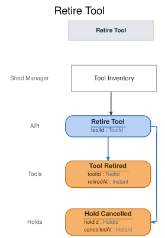

# Slice: Retire Tool

<!-- GENERATED:em-slice-story:start — generated from the model by `em slice sync`; do not hand-edit -->
Step 1 of 15 in **Take a tool or a neighbor out of the shed** · the story starts here · before My Holds — tool retired · State Change
<!-- GENERATED:em-slice-story:end -->

## Intent
Take a tool out of the shed for good: a damaged tool, one the shed no longer keeps, or one added
with a mistake. The shed manager retires it from Tool Inventory, and neighbors can no longer
borrow or hold it. Retiring is final: nothing un-retires a tool. A tool retired to correct a
mistake in its details is added again as a new tool.

What follows a retirement is decided by the views and slices that read Tool Retired:
- The tool drops off the Tool Catalog at once (INV-TCAT-8). It drops off Tool Inventory at once
  if it is in the shed. A tool retired while on loan stays on Tool Inventory, shown as retired
  and out, until it is returned or recorded lost (INV-TINV-2), so the shed manager can still
  record it lost if it never comes back.
- Every hold on the tool ends, waiting or set aside: Retire Tool records Hold Cancelled for each
  in the same decision. No hold is passed on, and the holders are not told; their holds drop off
  My Holds (INV-MYHD-7).
- A loan on the tool carries on, can't be extended (INV-EXT-8), and ends when the tool is
  returned or recorded lost.
- A tool in maintenance can be retired, and retiring it ends the maintenance: Tool Maintenance
  drops its row on Tool Retired. A tool in maintenance has no holds and no loan, so no
  Hold Cancelled is recorded with it.
- Check Out Tool and Place Hold refuse a retired tool.

A tool lost or broken by a borrower, and never returned, is not retired here. The shed manager
records it lost against the loan (Record Tool Lost), which ends the loan and retires the tool in
one step. A lost tool that later turns up is added again as a new tool.

## Trigger & Actor
The shed manager, from the Tool Inventory screen, which offers Retire on every listed tool not
already retired (INV-TINV-7). Sign-in, handled outside the shed's events, supplies the
shed-manager role.

## Command / Input
**Command:** `Retire Tool`

A ToolId is a UUID.

| Field | Type | Required | Rules / Validation |
|-------|------|----------|--------------------|
| toolId | ToolId | yes | The tool to retire. Must be a tool that has been added (INV-RTR-10). It may be in the shed, in maintenance, on loan, reserved or set aside (INV-RTR-6). |

## Trigger
**Triggered by:** screen `Tool Inventory` @Shed Manager

## Event(s) Emitted
**Event:** `Tool Retired` → context `Tools`
**Read by:** Tool Inventory and Tool Catalog (the tool is retired), Tool Maintenance (the tool's
row is dropped) and My Loans (a loan on it is marked).

| Field | Type | Immutable Fact? | Source / Notes |
|-------|------|-----------------|----------------|
| toolId | ToolId | yes | From the command. |
| retiredAt | Instant | yes | Set by the system: the UTC moment the event is recorded. |

Nothing is recorded about the tool's condition or the reason it was retired: the event carries
no reason, note or condition. A damaged tool is the shed manager's call to retire.

**Event:** `Hold Cancelled` → context `Holds`
**Read by:** My Holds, Tool Catalog, My Loans, Holds To Fulfill, Pickups To Expire, Pickup Notices
To Send and Undelivered Notices, as any cancellation (the hold ends).

The same event Cancel Hold records, recorded here once per hold on the tool, waiting or set aside, in the same decision as Tool Retired. The decider reads the holds it ends. With no such hold, none is recorded; the readers can't tell these from a holder's own cancellation and needn't.

| Field | Type | Immutable Fact? | Source / Notes |
|-------|------|-----------------|----------------|
| holdId | HoldId | yes | Set by the system: the hold being ended, from its Hold Placed. |
| cancelledAt | Instant | yes | Set by the system: the same moment as Tool Retired. |

## Read Model / View
This slice produces no view of its own. Tool Retired changes the tool's entry in Tool Inventory
and Tool Catalog, drops its row from Tool Maintenance and marks a loan on it in My Loans; the Hold Cancelled recorded with it end its
holds in My Holds, Tool Catalog, My Loans and the hold to-do lists. Each view is specified in its own doc. All are eventually consistent.

## Invariants / Business Rules
- **INV-RTR-1:** Only the shed manager can retire a tool.
  - Neighbors do not retire tools. Sign-in, handled outside the shed's events, supplies the
    shed-manager role; a caller without it is refused with `not-shed-manager`.
  - A caller with no sign-in is refused with `not-signed-in`, before anything else is checked.
- **INV-RTR-2:** Retiring a tool that is already retired records nothing new.
  - The request succeeds, so a double submit or a retry never fails and never records a second
    Tool Retired. This includes a tool retired by being recorded lost.
- **INV-RTR-6:** A tool can be retired whatever its state: in the shed, in maintenance, on loan,
  reserved or set aside.
  - Retiring is never refused because of a loan, a hold or maintenance.
- **INV-RTR-10:** The tool must exist.

## Scenarios (Given / When / Then)
- **Happy path (INV-RTR-6)**
  - **Given:** the ladder is in the shed, available, with no holds on it
  - **When:** the shed manager retires the ladder from Tool Inventory
  - **Then:** Tool Retired is recorded for the ladder, and nothing else.
- **Tool set aside, another hold waiting (INV-RTR-6)**
  - **Given:** the cordless drill is set aside for Ben, and Cara's hold on it is waiting
  - **When:** the shed manager retires the drill
  - **Then:** Tool Retired is recorded for the drill, and Hold Cancelled for Ben's hold and for
    Cara's.
- **Tool on loan, with a hold waiting (INV-RTR-6)**
  - **Given:** Ana has the hedge trimmer on loan, due 20 October, and Ben's hold on it is waiting
  - **When:** the shed manager retires the hedge trimmer
  - **Then:** Tool Retired is recorded for the hedge trimmer, and Hold Cancelled for Ben's hold.
    Ana's loan is unchanged.
- **Tool reserved (INV-RTR-6)**
  - **Given:** the drill has just been returned with Ben's hold waiting, and Hold Fulfilled
    hasn't been recorded yet
  - **When:** the shed manager retires the drill
  - **Then:** Tool Retired is recorded for the drill, and Hold Cancelled for Ben's hold.
- **Tool in maintenance (INV-RTR-6)**
  - **Given:** the ladder is in maintenance for sharpening, and Tool Maintenance lists it
  - **When:** the shed manager retires the ladder
  - **Then:** Tool Retired is recorded for the ladder, and nothing else. The ladder's row drops off
    Tool Maintenance.
- **Retiring twice (INV-RTR-2)**
  - **Given:** Tool Retired has been recorded for the ladder
  - **When:** the shed manager retires the ladder again
  - **Then:** the request succeeds and nothing new is recorded.
- **Retiring a tool recorded lost (INV-RTR-2)**
  - **Given:** Tool Lost has been recorded for Ana's loan of the hedge trimmer, which retired it
  - **When:** the shed manager retires the hedge trimmer
  - **Then:** the request succeeds and nothing new is recorded.
- **Someone other than the shed manager (INV-RTR-1)**
  - **Given:** the ladder is in the shed
  - **When:** a caller signed in without the shed-manager role asks to retire it
  - **Then:** refused with `not-shed-manager`: "Only the shed manager can retire tools." No event
    is recorded.
- **Unknown tool (INV-RTR-10)**
  - **Given:** no tool T9 has been added
  - **When:** the shed manager retires T9
  - **Then:** refused with `tool-not-found`: "There is no such tool." No event is recorded.
- **No sign-in (INV-RTR-1)**
  - **Given:** a caller with no sign-in
  - **When:** they ask to retire the ladder
  - **Then:** refused with `not-signed-in`: "Please sign in." No event is recorded.

## Alternate & Error Flows
Every refusal records nothing and returns one reason: the stable name, and the sentence shown to
the shed manager on the Tool Inventory screen. The name is the contract; the sentence is the
required wording of the message.

The checks run in this order, and the first that fails is the reason returned:
1. `not-signed-in`, then `not-shed-manager` (INV-RTR-1).
2. `tool-not-found` (INV-RTR-10).
3. If the tool is already retired, the request succeeds and records nothing (INV-RTR-2).

| Reason | Sentence | Rule |
|--------|----------|------|
| `not-signed-in` | Please sign in. | INV-RTR-1 |
| `not-shed-manager` | Only the shed manager can retire tools. | INV-RTR-1 |
| `tool-not-found` | There is no such tool. | INV-RTR-10 |

`not-shed-manager` and `tool-not-found` mean the same conditions as in Add Tool and Check Out
Tool. `tool-not-found` can only come from a faulty caller, not from the screen. A missing or
malformed tool ID (not a UUID) is bad input, rejected before any rule is checked.

Idempotency: retiring a tool that is already retired succeeds and records nothing (INV-RTR-2).

Requests at the same moment: Retire Tool is decided against the tool's events as already
recorded, one at a time per tool. If a checkout, a hold or a fulfilment for the tool is decided
just before the retirement, it stands, and the retirement then ends the loan's chance of
extension and the tool's holds. If it is decided just after, it is refused by its own slice
because the tool is retired.

There are no external calls in this slice, and no email is sent.

## Non-Functional Requirements
- **Security / authz:** only the shed manager may retire a tool (INV-RTR-1). Sign-in, handled
  outside the shed's events, supplies the shed-manager role.
- **PII & compliance:** none. Tool Retired holds only the tool and a time.
- **Performance / SLA:** none.

## Dependencies & Read Models Affected
- **Upstream events this slice relies on**, to apply its rules, and the fields it reads from
  each:
  - Tool Added (Add Tool): toolId.
  - Tool Retired (this slice): toolId.
  - Tool Lost (Record Tool Lost): loanId, toolId (a lost tool is retired by that).
  - These keys match the deep-passed docs and the loan-ending convention.
- **Downstream read models / slices affected:** Tool Inventory, Tool Catalog, Tool Maintenance
  and My Loans (Tool Retired); My Holds, Tool Catalog, My Loans, Undelivered Notices, Holds To Fulfill, Pickups To
  Expire and Pickup Notices To Send (the Hold Cancelled recorded here). Check Out
  Tool, Place Hold, Extend Loan and Fulfill Hold read whether a tool is retired.

## Open Questions
None.
